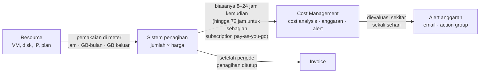
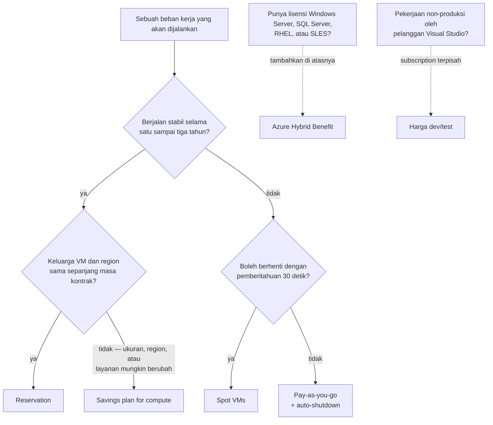
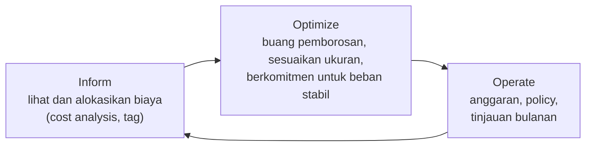

# Makan Siang 19 · Manajemen Biaya (Dasar)

🇬🇧 [Read in English](README.md)

> **Jalur:** Bulan inti · **Level:** Dasar · **Bagian 4:** Keamanan, operasional, dan tata kelola
> **Waktu:** 60 menit · **Makan siang prasyarat:** 04 dan 18 disarankan (06 membantu)
> **Area keterampilan AZ-900:** Menjelaskan manajemen dan tata kelola Azure
> **Lab:** [Lab 19 · Temukan pemborosan buatan Anda sendiri](../../labs/19-cost-management/README.id.md) — sekitar 40 menit · biaya 💲
> **Penulis:** Stefanus Pinarta · [Tentang penulis](../../README.id.md#tentang-penulis)

| ⏱ Menit | Segmen |
|---:|---|
| 5 | Skenario dan tujuan |
| 25 | Bacaan |
| 15 | Demo: animasi interaktif (+ video panduan opsional) |
| 5 | Uji pemahaman |
| 5 | Poin penting dan pratinjau lab |
| 5 | Waktu cadangan — habiskan makan siang Anda 🍜 |

## 🍱 Menu hari ini

Setelah makan siang ini, Anda akan mampu:

- **Menjelaskan** apa saja yang membentuk tagihan Azure, dan mengapa data biaya baru tiba beberapa jam setelah
  pemakaian, bukan secara real-time.
- **Memperkirakan** biaya sebuah desain dengan pricing calculator (*kalkulator harga*) dan **memilih** di antara
  pay-as-you-go (*model berbasis penggunaan*), reservation, savings plan, Spot, Azure Hybrid Benefit, dan harga
  dev/test.
- **Menggunakan** Cost Management (*manajemen biaya*) — cost analysis, anggaran, alert, export — dan Azure Advisor untuk
  melihat serta mengendalikan pengeluaran.
- **Menemukan** pemborosan yang umum dengan Azure Resource Graph dan memakai tag agar setiap biaya punya pemilik.

## 🏪 Sementara itu di Nusantara Retail

Invoice Azure pertama yang lengkap mendarat di meja tim keuangan pada suatu Senin pagi. Jumlahnya tidak fantastis,
tetapi lebih besar daripada spreadsheet yang sudah disetujui Ibu Sari, dan rincian barisnya terbaca seperti bahasa
asing: managed disk, alamat IP, bandwidth, App Service. Pak Budi bersikeras bahwa toko online hanya butuh dua web
server. Dewi samar-samar ingat pernah membuat sebuah plan uji coba waktu bereksperimen dengan serverless. Rizky mengaku
sudah menghapus sebuah VM, "tapi mungkin tidak semuanya". Tidak ada yang bisa memastikan biaya mana milik toko online,
mana milik toko-toko cabang, dan mana milik eksperimen yang seharusnya sudah selesai berminggu-minggu lalu.

Ibu Sari meneruskan invoice itu kepada Anda dengan tiga pertanyaan. Sebenarnya kita membayar untuk apa? Untuk siapa? Dan
bagaimana caranya supaya bulan depan tidak ada kejutan lagi?

Pertanyaan hari ini: **bagaimana Anda memahami, memprediksi, dan mengendalikan biaya Azure Nusantara Retail?**

---

## 📖 Bacaan (≈25 menit)

### 1. Ke mana uangnya pergi

Hampir semua harga di Azure berbentuk tarif: sekian per jam, per gigabyte per bulan, per sejuta operasi, atau per
gigabyte data yang ditransfer. Di balik layar, setiap resource (*sumber daya*) melaporkan pemakaiannya pada satu atau
beberapa **meter**. Sebuah virtual machine (*komputer virtual*) melaporkan jam compute pada meter yang sesuai dengan
ukuran dan region (*wilayah*) tempat ia berjalan. Managed disk miliknya melaporkan kapasitas yang di-provision pada
meter disk. Alamat IP publik Standard melaporkan setiap jam selama ia ada. Lalu lintas yang keluar dari Azure diukur
dalam gigabyte. Sistem penagihan mengalikan setiap jumlah itu dengan harga di perjanjian Anda, lalu menjumlahkan
semuanya. Tagihan Anda tidak lebih misterius daripada hasil penjumlahan itu.

Ibaratnya meteran listrik PLN di rumah: kulkas, lampu, dan AC sama-sama menambah angka kWh, lalu di akhir bulan angka
itu dikalikan tarif. Bedanya, di Azure setiap resource punya meterannya sendiri, sehingga Anda bisa melihat persis
"peralatan" mana yang menyedot biaya.

Model sederhana itu menyimpan dua jebakan. Pertama, banyak meter menagih apa yang Anda **provision** — kapasitas yang
Anda pesan dan sediakan — bukan apa yang Anda pakai. Managed disk 128 GiB berbiaya sama, entah berisi database pesanan
atau kosong sama sekali, dan App Service plan tetap ditagih untuk instance-nya (server virtual yang disiapkan untuk plan
itu) walaupun tidak ada satu aplikasi pun yang berjalan di atasnya. Jebakan kedua adalah waktu: sebagian meter terus
berjalan selama resource itu ada, sehingga apa pun yang Anda lupakan diam-diam terus memakan biaya, jam demi jam, sampai
ada yang menghapusnya — persis seperti tarif parkir mal yang terus berjalan selama mobil masih di dalam gedung, entah
Anda sedang belanja atau lupa memarkirnya di lantai berapa.

Inilah **pendorong biaya** (cost driver) yang benar-benar bisa Anda pengaruhi:

| Pendorong biaya | Apa yang mengubah harga | Contoh di Nusantara Retail | Tuas yang bisa Anda tarik |
|---|---|---|---|
| Jenis, tier, dan ukuran resource | Layanannya, SKU-nya (varian produknya), atau ukuran VM-nya (seri B vs seri D, Standard HDD vs Premium SSD) | VM toko online yang ukurannya disiapkan untuk promo 12.12 sepanjang tahun | Sesuaikan ukuran (right-size); pilih tier (tingkatan layanan) termurah yang memenuhi kebutuhan |
| Lama berjalan | Meter per jam berjalan selama resource ada atau dialokasikan | VM pengembangan yang tetap menyala pada malam hari dan akhir pekan | Deallocate, auto-shutdown (mati otomatis sesuai jadwal), jadwal, scale in (kurangi jumlah instance) |
| Kapasitas yang di-provision | Disk, plan, dan throughput yang dipesan ditagih berdasarkan ukuran, bukan pemakaian | Data disk 256 GiB yang hanya berisi 3 GiB | Disk yang lebih kecil; hapus yang tidak dipakai siapa pun |
| Region | SKU yang sama bisa berbeda harga di region lain | Indonesia Central dibandingkan dengan Southeast Asia | Bandingkan di kalkulator, setelah urusan residensi data beres |
| Transfer data | Data yang masuk ke Azure gratis; data yang keluar ke internet dan antar-region dikenai biaya | Pembeli yang mengunduh foto produk | Kompres, gunakan cache, tempatkan layanan yang sering saling berkomunikasi dalam satu region |
| Lisensi | Windows Server, SQL Server, dan sebagian distribusi Linux menambah biaya perangkat lunak | Server laporan berbasis Windows di kantor pusat | Azure Hybrid Benefit, harga dev/test, Linux bila cocok |
| Tambahan | Paket dukungan (support plan), perangkat lunak dari Marketplace (toko aplikasi pihak ketiga di Azure), fitur premium | Image firewall pihak ketiga dari Marketplace | Baca harganya sebelum memilih **Create** |

Ada satu hal lagi yang perlu dipahami sebelum Anda membuka laporan biaya apa pun: **data biaya tidak real-time**.
Pemakaian dikumpulkan, diberi harga, lalu dimuat ke Cost Management secara berkelompok (batch). Untuk subscription
(*langganan*) Enterprise Agreement dan Microsoft Customer Agreement, data biasanya muncul dalam 8 sampai 24 jam; untuk
sebagian subscription pay-as-you-go bisa sampai 72 jam. Perkiraan biaya untuk bulan yang sedang berjalan diperbarui
beberapa kali sehari dan baru menjadi final setelah invoice terbit. Subscription yang benar-benar baru bisa butuh hingga
48 jam sebelum semua fitur Cost Management berfungsi.

Bayangkan buku kas sebuah warung yang baru direkap setiap malam: penjualan pagi tadi jelas sudah terjadi, tetapi
angkanya belum tercatat di buku. Cost Management bekerja dengan cara serupa, hanya saja jeda rekapnya bisa berjam-jam,
bahkan berhari-hari.



Jadi, ketika Dewi menyalakan VM besar pukul 09.00 dan cost analysis masih kosong pukul 11.00, itu bukan bug. Saat Anda
perlu tahu apa yang ada *saat ini juga*, tanyakan pada inventaris — Azure Resource Graph atau activity log (catatan
setiap operasi pada resource Anda) — bukan pada tagihan.

### 2. Perkirakan sebelum membangun

Kejutan biaya yang paling murah adalah kejutan yang Anda temukan sebelum men-deploy. **Azure pricing calculator**
(azure.microsoft.com/pricing/calculator) bekerja seperti keranjang belanja online: Anda memasukkan produk ke sebuah
**estimate** (perkiraan), lalu memilih region, tier, ukuran, sistem operasi, dan perkiraan pemakaian untuk
masing-masing. Virtual machine secara default dihitung 730 jam, yaitu satu bulan penuh; ubah menjadi 200 jam dan
perkiraannya langsung diperbarui. Untuk produk yang menawarkan diskon komitmen, kalkulator memungkinkan Anda berpindah
antara pay-as-you-go, reservation, dan savings plan, serta menampilkan biaya **di muka** (upfront) terpisah dari biaya
**bulanan**. Anda bisa menyimpan beberapa estimate, mengekspor salah satunya ke Excel, membagikan tautannya kepada tim
keuangan, dan mengganti mata uang tampilan. Jika Anda login ke kalkulator itu sendiri, ia bisa menampilkan harga sesuai
perjanjian Anda, bukan harga ritel.

Setiap harga di kalkulator berasal dari **Azure Retail Prices API**, sebuah API publik — antarmuka yang bisa dipanggil
langsung oleh program — yang tidak memerlukan login. Karena itu API ini praktis untuk skrip dan spreadsheet; di lab
nanti Anda akan memakainya dari Cloud Shell untuk membandingkan pay-as-you-go dengan reservation satu tahun. Microsoft
menetapkan harga setiap layanan Azure dalam dolar AS; mata uang lain disediakan sebagai acuan dan bisa berubah dari
bulan ke bulan.

Perkiraan yang baik untuk Nusantara Retail memiliki tiga kebiasaan:

- **Pisahkan beban dasar dan beban puncak.** Dua web server hampir sepanjang tahun, enam selama dua minggu promo 12.12.
  Kalau dirata-ratakan, kedua angka itu sama-sama tersembunyi.
- **Baris-baris yang sunyi.** Disk, IP publik, data keluar, penyimpanan cadangan (backup), ingesti log, dan paket
  dukungan sering kali, kalau dijumlahkan, sama besarnya dengan layanan "utama".
- **Satu estimate per opsi.** Desain berbasis VM dan desain PaaS (*platform sebagai layanan*) yang disandingkan membuat
  untung-ruginya terlihat jelas oleh Ibu Sari.

> [!TIP]
> Materi pelatihan lama akan mengarahkan Anda ke **Total Cost of Ownership (TCO) Calculator**, kalkulator total biaya
> kepemilikan. Microsoft sudah menghentikannya (deprecated) pada akhir Agustus 2025. Untuk membandingkan pusat data —
> atau ruang server di sebelah pantry kantor — dengan Azure, gunakan fitur **business case** di Azure Migrate (masih
> preview saat tulisan ini dibuat), yang bekerja dari data server hasil penemuan otomatis (discovery) atau hasil impor.

### 3. Bayar lebih murah untuk hal yang sama

Setelah Anda tahu *apa* yang dibutuhkan, Anda bisa mengubah *cara* membayarnya. **Pay-as-you-go** adalah cara default:
Anda membayar tarif normal sesuai daftar harga, persis sesuai pemakaian, dan tidak berkomitmen apa pun. Cara ini ideal
untuk apa pun yang baru, naik-turun tajam, atau berumur pendek — sekaligus cara paling mahal untuk menjalankan server
yang tidak pernah berhenti. Azure menawarkan lima cara untuk membayar lebih murah:

| Opsi | Cara kerjanya | Gunakan ketika | Waspadai |
|---|---|---|---|
| **Reservation** | Berkomitmen satu atau tiga tahun untuk satu jenis resource di satu region (untuk VM, ada fleksibilitas di dalam satu keluarga ukuran); bayar di muka atau bulanan | Pemakaian stabil dan tidak akan berganti ukuran, region, atau layanan | Jam yang tidak terpakai hangus; refund dibatasi (USD 50.000 per 12 bulan bergulir); reservation yang dibeli mulai Februari 2027 untuk layanan yang dicakup savings plan tidak bisa ditukar (exchange) |
| **Savings plan for compute** | Berkomitmen pada jumlah tetap per jam selama satu atau tiga tahun; berlaku otomatis untuk compute yang memenuhi syarat (VM, App Service, Functions Premium, Container Apps, Container Instances, Dedicated Host) di region mana pun | Total belanja compute stabil, tetapi ukuran, region, atau layanannya mungkin berubah | Tidak bisa dibatalkan; komitmen yang tidak terpakai dalam satu jam hangus |
| **Spot VMs** | Berjalan di kapasitas sisa dengan diskon besar; Azure bisa mengusir (evict) VM dengan pemberitahuan 30 detik | Batch job (pekerjaan massal terjadwal), test run, rendering — pekerjaan yang bisa diulang | Tanpa SLA (perjanjian tingkat layanan); ukuran seri B tidak didukung; kapasitas bisa hilang |
| **Azure Hybrid Benefit** | Bawa lisensi Windows Server atau SQL Server dengan Software Assurance (program pemeliharaan lisensi Microsoft) atau dengan subscription yang memenuhi syarat, atau bawa subscription RHEL/SLES (Red Hat Enterprise Linux/SUSE Linux Enterprise Server), lalu bayar infrastrukturnya saja | Anda sudah memiliki lisensinya | Kepatuhan lisensi tetap menjadi tanggung jawab Anda |
| **Harga dev/test** | Pelanggan Visual Studio yang aktif mendapat tarif diskon di subscription dev/test — misalnya, VM Windows ditagih dengan tarif Linux | Lingkungan non-produksi | Tanpa SLA; jangan pernah menjalankan produksi di sana |

**Reservation** cocok untuk dua VM toko online Nusantara Retail setelah ukurannya stabil selama beberapa bulan.
**Savings plan** lebih pas jika Dewi berencana memindahkan sebagian toko online ke Container Apps tahun depan, karena
komitmennya mengikuti belanja, bukan VM tertentu. **Savings plan for databases** yang lebih baru bekerja dengan cara
yang sama untuk layanan seperti Azure SQL dan Cosmos DB. Bila beberapa diskon bisa berlaku sekaligus, Azure memakai yang
paling spesifik lebih dulu: reservation, lalu savings plan, lalu pay-as-you-go untuk sisanya.

Ibaratnya begini. Pay-as-you-go seperti menginap di hotel per malam: bebas datang dan pergi, tetapi mahal kalau
dilakukan setiap hari. Reservation seperti mengontrak satu kamar kos tertentu selama setahun: per bulannya jauh lebih
murah, tetapi uang sewanya tetap jalan walaupun kamar itu Anda tinggalkan. Savings plan lebih mirip voucher makan
bernilai tetap per jam yang berlaku di semua gerai food court yang ikut program: Anda bebas pindah gerai, tetapi jatah
jam itu yang tidak terpakai langsung hangus.



Azure Hybrid Benefit bisa ditumpuk dengan reservation: reservation memberi diskon pada compute, dan Hybrid Benefit
menghapus biaya lisensinya. Spot dan harga dev/test berbicara soal *di mana* sebuah beban kerja (workload) berjalan;
reservation dan savings plan berbicara soal *berapa lama* Anda berjanji membayar.

> [!WARNING]
> Reservation atau savings plan adalah janji pembayaran, bukan server. Jika VM yang menjadi tujuannya Anda hapus, Anda
> tetap membayar komitmen itu sampai masa kontraknya berakhir. Beli komitmen **paling akhir**: setelah Anda membuang
> pemborosan dan menyesuaikan ukuran, dan hanya untuk pemakaian yang sudah Anda amati selama beberapa bulan.

### 4. Melihat dan mengendalikan pengeluaran

**Microsoft Cost Management** adalah seperangkat alat bawaan yang gratis untuk memahami dan mengatur pengeluaran. Ia
bekerja di berbagai **scope** (cakupan) — billing account, management group (*grup manajemen*), subscription, atau
resource group (*grup sumber daya*) — sehingga tim toko online bisa melihat resource group miliknya sendiri, sementara
tim keuangan melihat semuanya. Sebagian besar jenis subscription didukung, termasuk akun gratis (free account) dan
pay-as-you-go, tetapi ada beberapa penawaran yang tidak; saat tulisan ini dibuat, Azure for Students salah satunya.

Alat yang paling sering akan Anda pakai:

- **Cost analysis** menampilkan biaya aktual dan biaya perkiraan (forecast). Smart view memecah total berdasarkan
  resource, layanan, resource group, atau subscription; custom view memungkinkan Anda mengelompokkan dan memfilter
  berdasarkan hampir apa saja, termasuk **tag**, lalu menyimpan, membagikan, atau mengunduh hasilnya. Mengelompokkan
  biaya Nusantara Retail berdasarkan layanan itulah "tagihan yang diurai" yang diminta tim keuangan.
- **Anggaran (budget)** menetapkan jumlah untuk satu bulan, kuartal, atau tahun pada suatu scope, lalu memicu **alert**
  (*pemberitahuan*) ketika pengeluaran aktual atau perkiraan melewati persentase tertentu dari jumlah itu. Satu anggaran
  bisa memiliki hingga lima ambang (threshold) dan lima penerima email. Pada scope subscription dan resource group,
  anggaran juga bisa memanggil **action group**, yang dapat menjalankan otomatisasi — misalnya runbook (skrip
  otomatisasi yang dijalankan Azure) yang mematikan VM pengembangan. Ibaratnya sensor parkir di mobil: bunyinya makin
  rapat saat bemper mendekati tembok, tetapi sensor itu tidak pernah menginjak rem untuk Anda.
- **Anomaly alert** memakai riwayat 60 hari terakhir Anda untuk menandai hari yang terlihat tidak biasa. Fitur ini
  bekerja di scope subscription dan berjalan sekitar satu setengah hari setelah hari yang diperiksanya.
- **Export** mengirim data biaya ke storage account (*akun penyimpanan*) sesuai jadwal, siap dipakai di Power BI atau di
  laporan Anda sendiri.

**Azure Advisor**, yang sudah Anda kenal di Makan Siang 16, menambahkan tab **Cost** berisi rekomendasi: menyesuaikan
ukuran atau mematikan VM yang kurang dimanfaatkan, menghapus App Service plan yang kosong, meninjau disk yang tidak
terpasang ke apa pun, dan membeli reservation atau savings plan berdasarkan pemakaian Anda belakangan ini. Sebagian
besar aturan ini melihat riwayat berhari-hari atau berminggu-minggu, jadi Advisor tidak akan menandai sesuatu yang baru
Anda buat sejam yang lalu.

> [!IMPORTANT]
> Anggaran adalah **alarm, bukan rem**. Saat sebuah ambang terlewati, Azure mengirim email (biasanya dalam satu jam
> setelah evaluasi harian) dan tidak ada yang berhenti. Ditambah jeda data 8 sampai 72 jam, sebuah kesalahan bisa
> berjalan sehari atau lebih sebelum ada yang mengetahuinya. Subscription berbasis kredit seperti akun gratis punya
> batas pengeluaran (spending limit); subscription pay-as-you-go tidak punya, sehingga anggaran ditambah kebiasaan
> bersih-bersih adalah jaring pengaman Anda.

Untuk menjawab "untuk siapa?", Anda membutuhkan **tag**. Data biaya membawa tag setiap resource, sehingga tag
`costCenter` memungkinkan cost analysis membagi tagihan per tim — itulah **showback**, yaitu menunjukkan porsi biaya
setiap tim. Ketika tim keuangan benar-benar menagihkan porsi itu ke setiap departemen, namanya menjadi **chargeback**.
Ada tiga fakta tentang tag yang sering menjebak. Tag tidak diwariskan dari resource group secara default. Tag hanya
muncul di data biaya sejak saat ia dipasang, jadi biaya bulan lalu tidak akan menampilkan tag yang baru dipasang minggu
ini. Dan tag baru bisa butuh waktu hingga sehari untuk muncul. Wajibkan tag sejak resource dibuat dengan Azure Policy
(Makan Siang 18). Jika akun Anda berupa Enterprise Agreement atau Microsoft Customer Agreement, Cost Management juga
bisa **mewarisi** (inherit) tag subscription dan resource group ke dalam catatan pemakaian — resource-nya sendiri tetap
tidak berubah.

### 5. Menemukan dan menghentikan pemborosan

Sebagian besar pemborosan di Azure tidak dramatis. Ia kecil, terus-menerus, dan tak terlihat di antara daftar resource
yang semuanya menampilkan status hijau **Succeeded**. Inilah para tersangka yang biasa:

| Pemborosan | Mengapa masih memakan biaya | Cara menemukannya | Perbaikan |
|---|---|---|---|
| Managed disk yang tidak terpasang | Disk ditagih berdasarkan ukuran yang di-provision; menghapus VM tidak ikut menghapus disk-nya kecuali Anda memintanya | Resource Graph (`diskState` bernilai `Unattached`), Advisor | Buat snapshot (salinan disk pada satu titik waktu) jika ragu, lalu hapus |
| IP publik yang tidak terhubung | IP publik Standard ditagih setiap jam, terpasang atau tidak | Resource Graph (tanpa IP configuration dan tanpa NAT gateway) | Hapus, atau pakai ulang |
| App Service plan kosong | Instance plan tetap ditagih walaupun tidak ada aplikasi sama sekali (kecuali tier Free dan Shared) | Resource Graph (jumlah site = 0), Advisor | Hapus plan-nya atau pindahkan aplikasi ke dalamnya |
| VM yang berhenti tetapi tidak di-deallocate | Mematikan dari dalam sistem operasi hanya mematikan OS-nya; kapasitas compute tetap dialokasikan (dipesankan) untuk Anda dan tetap ditagih. Hanya deallocate yang melepasnya dan menghentikan meter compute | Status daya VM "Stopped", bukan "Stopped (deallocated)" | Stop dari Azure, atau deallocate |
| VM kebesaran atau menganggur | Anda membayar kapasitas yang tidak pernah dipakai beban kerjanya | Rekomendasi right-size dari Advisor, metrik CPU | Ubah ukurannya (resize), atau jadwalkan shutdown |
| Lingkungan uji yang terlupakan | Semua isinya terus ditagih | Cost analysis per resource group, tag seperti `environment=test` | Hapus resource group-nya; bangun ulang dari kode saat dibutuhkan |

**Azure Resource Graph** — layanan kueri dari Makan Siang 04 — adalah cara tercepat untuk memburu resource yatim
(orphan) di semua subscription yang bisa Anda baca. Resource yatim adalah resource yang "induknya" sudah tiada, misalnya
disk yang VM-nya sudah dihapus. Resource Graph memakai sebagian dari Kusto Query Language (KQL), bahasa kueri yang juga
dipakai Log Analytics, dan tidak seperti data biaya, ia mencerminkan perubahan hanya dalam hitungan saat. Kueri ini
menampilkan setiap disk tak terpasang yang bisa Anda lihat:

```kusto
Resources
| where type =~ 'microsoft.compute/disks'
| where tostring(properties.diskState) =~ 'Unattached'
| project name, resourceGroup, sku = tostring(sku.name), sizeGB = toint(properties.diskSizeGB)
```

Filter satu baris yang serupa bisa menemukan IP publik tanpa `ipConfiguration` dan tanpa `natGateway`, serta App Service
plan yang nilai `numberOfSites`-nya nol. Sebelum menghapus apa pun, tanyakan dulu kepada pemiliknya (tag sangat membantu
di sini), periksa activity log untuk melihat pemakaian terakhir, dan buat snapshot untuk disk yang Anda ragukan.
Sebagian disk hanya *tampak* terlantar — replika Azure Site Recovery (layanan replikasi untuk pemulihan bencana),
misalnya.

Bersih-bersih sekali itu memuaskan; tetap bersih adalah soal kebiasaan. Kebiasaan itu punya nama: **FinOps** (dari
*financial operations*), sebuah praktik di mana tim engineering, keuangan, dan bisnis berbagi tanggung jawab atas
pengeluaran cloud. FinOps Foundation menggambarkannya sebagai siklus tiga fase yang terus diulang, bukan proyek yang
punya titik selesai.



### 6. Bagaimana semuanya menyatu untuk Nusantara Retail

Inilah rencana yang Anda bawa kembali kepada Ibu Sari. Pertama, **inform** (beri informasi): setiap resource diberi tag
`costCenter` (storefront untuk toko online, stores untuk toko-toko cabang, atau it-shared untuk layanan TI bersama),
`environment`, dan `owner`, yang diwajibkan lewat assignment Azure Policy dari Makan Siang 18. Cost analysis yang
dikelompokkan berdasarkan `costCenter` dan disimpan sebagai view bersama menjadi halaman pertama rapat keuangan bulanan,
sekaligus jawaban atas pertanyaan "untuk siapa?".

Berikutnya, **optimize** (optimalkan). Perburuan resource yatim berjalan setiap Jumat: disk yang tidak terpasang, IP
yang tidak terhubung, dan plan kosong dimasukkan ke laporan singkat, pemiliknya diberi waktu seminggu untuk
mengklaimnya, dan sisanya dihapus. Tab Cost di Advisor ditinjau setiap bulan. VM pengembangan diberi auto-shutdown pukul
19.00 WIB. Setelah ukuran toko online stabil selama satu kuartal, kedua web server beralih ke reservation — atau ke
savings plan jika migrasi ke Container Apps jadi dilakukan. Job malam yang menghitung ulang harga untuk empat puluh toko
adalah kandidat yang bagus untuk Spot, asalkan memakai ukuran yang mendukung Spot. Jika tim Dewi punya subscription
Visual Studio, pekerjaan pengembangan dipindahkan ke subscription dev/test.

Terakhir, **operate** (jalankan secara rutin). Setiap resource group mendapat anggaran bulanan dengan alert pada 50, 80,
dan 100 persen yang dikirim ke Ibu Sari dan pemilik grup tersebut. Alert 100 persen pada anggaran pengembangan juga
memanggil action group yang mematikan VM dev. Sebuah anomaly alert di tingkat subscription menangkap lonjakan tak
terduga yang tidak dianggarkan siapa pun.

Perhatikan apa yang membuat semua ini lebih mudah: kemampuan menghapus sesuatu tanpa rasa takut. Jika sebuah lingkungan
bisa dibangun ulang dari sebuah file dalam hitungan menit, tidak ada yang mau menyimpan salinan menganggur "buat
jaga-jaga". Itulah topik makan siang berikutnya, infrastructure as code (*infrastruktur sebagai kode*) dengan Bicep. Di
Makan Siang 21 Anda akan bertemu lagi dengan biaya sebagai salah satu dari lima pilar Azure Well-Architected Framework,
dan Makan Siang 31 menerapkan anggaran di scope management group untuk seluruh perusahaan.

> [!NOTE]
> **Renungkan sejenak:** saat ini toko online berjalan di dua VM sepanjang waktu, tetapi Dewi ingin memindahkannya ke
> Container Apps dalam enam bulan. Apakah Anda akan membeli reservation tiga tahun untuk VM-nya sekarang, savings plan
> for compute, atau belum membeli apa-apa? Apa yang ingin Anda lihat di cost analysis sebelum memutuskan?

---

## 🎬 Demo (≈15 menit)

1. **Animasi interaktif (≈6–8 menit):**
   [Buka demo](https://stefpin.github.io/azure-fundamentals-lunches/demos/19-cost-management.html?lang=id) — tekan ▶
   Putar atau telusuri langkah demi langkah sesuai kecepatan Anda. Sedang offline? Unduh
   [`docs/demos/19-cost-management.html`](../../docs/demos/19-cost-management.html) lalu buka di browser apa saja.
2. **Video panduan (≤ 6 menit):** _segera hadir_ — [baca naskah video](demo-video-script.id.md).

Yang perlu diperhatikan:

- Bagaimana satu angka total terpecah menjadi compute, penyimpanan, dan jaringan begitu tagihan dikelompokkan
  berdasarkan kategori meter.
- Lencana yang mengingatkan bahwa data biaya tertinggal beberapa jam, dan mengapa hal itu membuat Resource Graph menjadi
  alat yang tepat untuk berburu resource yatim.
- Tiga resource yatim yang meternya terus menyuapi tagihan, dan apa yang terjadi pada totalnya setelah ketiganya
  dihapus.
- Indikator anggaran pada 50, 80, dan 100 persen: email terkirim, tetapi tidak ada satu resource pun yang berhenti.

## ✅ Uji pemahaman (≈5 menit)

1. Rizky menghapus sebuah VM uji minggu lalu, tetapi invoice masih menampilkan biaya managed disk untuk VM itu. Apa yang
   terjadi, dan bagaimana Anda menemukan semua resource serupa di seluruh subscription?
   <details><summary>Lihat jawaban</summary>

   Menghapus VM meninggalkan disk-nya dalam status **Unattached**, dan managed disk ditagih sesuai ukuran yang
   di-provision. Jalankan kueri Azure Resource Graph untuk disk yang `diskState`-nya `Unattached` (Advisor juga akan
   menandainya setelah beberapa waktu) — *alasannya:* Resource Graph melihat semua subscription dalam hitungan detik,
   sedangkan tagihan baru memberi tahu Anda sehari kemudian.

   </details>
2. Ibu Sari ingin menerima email saat resource group toko online mencapai 80 persen dari jumlah bulanannya, dan ingin VM
   pengembangan dimatikan otomatis pada 100 persen. Apa yang Anda konfigurasikan?
   <details><summary>Lihat jawaban</summary>

   Sebuah **anggaran (budget)** bulanan di setiap resource group dengan alert biaya aktual pada 80 persen yang dikirim
   ke email Ibu Sari, dan pada anggaran pengembangan sebuah alert 100 persen yang memanggil **action group** untuk
   menjalankan otomatisasi yang men-deallocate VM tersebut — *alasannya:* anggaran saja hanya memberi tahu; ia tidak
   pernah menghentikan resource.

   </details>
3. Dua VM toko online dengan ukuran yang sama akan berjalan 24/7 di Indonesia Central setidaknya selama tiga tahun.
   Sebuah job malam untuk menghitung ulang harga bisa dijalankan ulang jika terputus. Opsi pembelian mana yang cocok
   untuk masing-masing?
   <details><summary>Lihat jawaban</summary>

   **Reservation** (atau savings plan, jika ukuran atau layanannya mungkin berubah) untuk web server yang stabil, dan
   **Spot VMs** untuk job malam yang bisa diulang, dengan ukuran VM yang mendukung Spot — *alasannya:* komitmen memberi
   imbalan bagi pemakaian yang bisa diprediksi, sedangkan Spot menukar jaminan kapasitas dengan diskon besar.

   </details>
4. Dewi membuat sebuah VM besar pukul 09.00. Pukul 11.00, cost analysis untuk resource group-nya masih kosong. Haruskah
   ia melaporkan bug?
   <details><summary>Lihat jawaban</summary>

   Tidak. Data biaya datang secara berkelompok, biasanya 8 sampai 24 jam kemudian dan hingga 72 jam untuk sebagian
   subscription pay-as-you-go — *alasannya:* alur penagihan mengumpulkan dan memberi harga pada pemakaian sebelum Cost
   Management menampilkannya, jadi gunakan Resource Graph atau activity log untuk inventaris real-time.

   </details>
5. Kemarin tim keuangan memasang tag `costCenter=storefront` pada setiap resource toko online. Mengapa cost analysis
   bulan lalu masih menampilkan sebagian besar biaya toko online sebagai "untagged"?
   <details><summary>Lihat jawaban</summary>

   Tag hanya muncul di data biaya sejak saat dipasang; tag tidak ditambahkan ke pemakaian historis — *alasannya:* setiap
   catatan pemakaian membawa tag yang dimiliki resource saat catatan itu direkam, jadi wajibkan tag sejak resource
   dibuat dengan Azure Policy.

   </details>

## 🧠 Poin penting

- Setiap biaya Azure adalah sebuah meter: jumlah dikali harga. Banyak meter menagih apa yang Anda **provision** atau
  berapa lama sebuah resource **ada**, sehingga resource yang terlupakan memakan biaya setiap jam.
- Data biaya **tertinggal beberapa jam** (biasanya 8–24 jam, hingga 72 jam untuk sebagian subscription pay-as-you-go);
  gunakan Resource Graph untuk inventaris real-time dan anggaran untuk peringatan dini.
- Perkirakan sebelum membangun dengan **pricing calculator**; TCO calculator yang lama sudah tidak ada, jadi gunakan
  business case di Azure Migrate untuk perbandingan dengan pusat data.
- Buang pemborosan dan sesuaikan ukuran **lebih dulu**, baru berkomitmen: reservation untuk pemakaian yang stabil,
  savings plan untuk compute yang fleksibel, Spot untuk pekerjaan yang boleh terinterupsi, Hybrid Benefit dan harga
  dev/test untuk lisensi dan lingkungan non-produksi.
- **Anggaran adalah alarm, bukan rem.** Padukan tag, cost analysis, anggaran dengan alert 50/80/100 persen, Advisor, dan
  perburuan resource yatim secara rutin — itulah siklus FinOps: inform, optimize, dan operate.

## 🗒️ Catatan lapangan dari Stefanus

> **Setiap resource butuh pemilik dan tanggal kedaluwarsa.** Saat meninjau sebuah subscription, saya tidak memulai dari
> baris tagihan yang paling besar, melainkan dari baris yang tidak bisa dijelaskan siapa pun. Biaya besar biasanya punya
> pembela yang siap angkat tangan. Biaya kecil — sebuah disk, sebuah alamat IP, sebuah plan sisa uji coba kuartal lalu —
> tidak ada yang merasa memilikinya, dan justru karena itulah ia awet. Maka aturan saya sederhana: apa pun yang sifatnya
> sementara wajib lahir dengan tag `owner` dan tag `expiresOn`, dan yang menjaganya adalah Azure Policy, bukan niat
> baik. Sebulan sekali saya mengurutkan semuanya menurut tanggal itu, lalu mengirim daftar pendek ke setiap pemilik.
> Jarang ada orang yang mau membela resource yang mencantumkan namanya sendiri; biasanya langsung dihapus. Dan kalau ada
> yang bilang "simpan dulu, buat jaga-jaga", saya cukup bertanya: bisakah kita membangunnya lagi dari kode dalam sepuluh
> menit?

## 🔬 Lab Anda: Temukan pemborosan buatan Anda sendiri

`setup.sh` membuat tiga pemborosan murah yang disengaja, semuanya diberi tag `costCenter=retail-lab`: disk Standard HDD
yang tidak terpasang, IP publik Standard yang tidak terhubung ke apa pun, dan App Service plan tanpa aplikasi. Anda
memburunya dengan Azure Resource Graph, memeriksa apa kata Advisor (dan mempelajari mengapa ia masih diam), membuat
anggaran resource group dengan alert 50, 80, dan 100 persen, membandingkan pay-as-you-go dengan reservation satu tahun
untuk VM kecil, lalu akhirnya menghapus pemborosan itu dan membuktikan bahwa semuanya sudah hilang.

- ⏱ Sekitar 40 menit · 💲 · bisa dikerjakan terpisah (tidak perlu lab sebelumnya)
- 👉 [Mulai Lab 19](../../labs/19-cost-management/README.id.md)

## 📚 Pelajari lebih lanjut

- [Microsoft Learn: Memperkirakan biaya dengan Azure pricing calculator](https://learn.microsoft.com/azure/cost-management-billing/costs/pricing-calculator) — semua fitur kalkulator, termasuk harga sesuai perjanjian Anda dan cara perkiraan dihitung.
- [Microsoft Learn: Tutorial — Membuat dan mengelola anggaran](https://learn.microsoft.com/azure/cost-management-billing/costs/tutorial-acm-create-budgets) — scope anggaran, alert biaya aktual dan perkiraan, serta action group.
- [Microsoft Learn: Apa itu savings plan?](https://learn.microsoft.com/azure/cost-management-billing/savings-plan/savings-plan-overview) — bagaimana komitmen per jam diterapkan dan bagaimana perbandingannya dengan reservation.
- [Microsoft Learn: Rekomendasi biaya di Azure Advisor](https://learn.microsoft.com/azure/advisor/advisor-reference-cost-recommendations) — daftar lengkap pemeriksaan biaya yang dijalankan Advisor, layanan demi layanan.

---

⬅️ [Makan Siang 18 · Tata Kelola dan Kepatuhan (Dasar): Azure Policy, Lock, Tag, dan Microsoft Purview](../18-governance-compliance-basic/README.id.md) · 🏠 [Beranda kursus](../../README.id.md) · [Makan Siang 20 · Infrastructure as Code dengan Bicep (Dasar)](../20-infrastructure-as-code-bicep/README.id.md) ➡️

<sub>Terakhir divalidasi: Oktober 2026 · Menemukan informasi yang sudah usang? [Buka issue](../../CONTRIBUTING.md).</sub>
