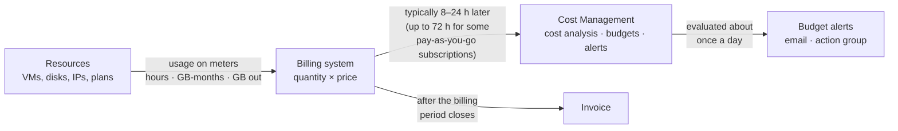
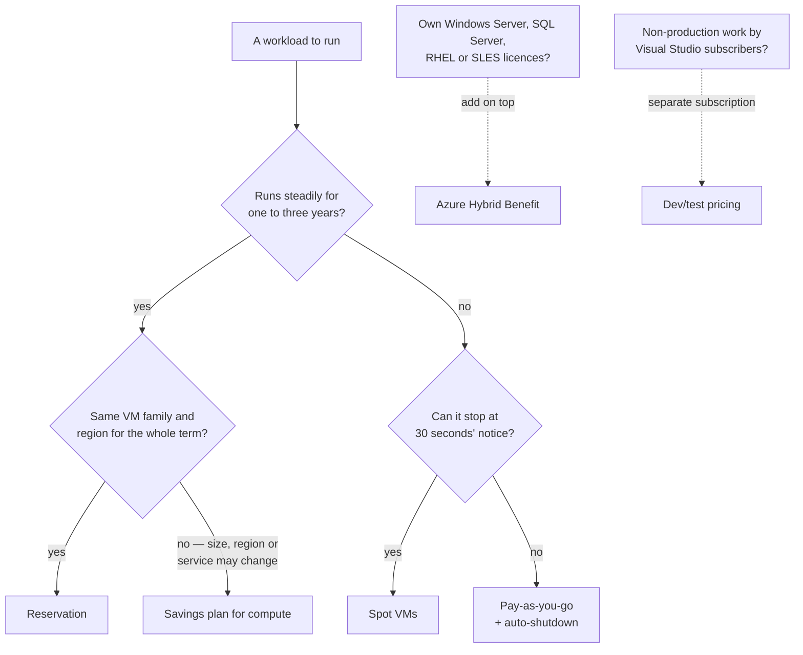
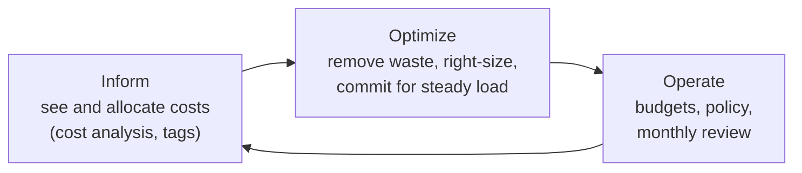

# Lunch 19 · Cost Management (Basic)

> **Track:** Core month · **Level:** Basic · **Part 4:** Secure, operate and govern
> **Time:** 60 minutes · **Prerequisite lunches:** 04 and 18 recommended (06 helps)
> **AZ-900 skill area:** Describe Azure management and governance
> **Lab:** [Lab 19 · Find the waste you made yourself](../../labs/19-cost-management/README.md) — about 40 minutes · cost 💲

| ⏱ Minutes | Segment |
|---:|---|
| 5 | Scenario and objectives |
| 25 | Reading |
| 15 | Demo: interactive animation (+ optional walkthrough video) |
| 5 | Knowledge check |
| 5 | Key takeaways and lab preview |
| 5 | Buffer — finish your lunch 🍜 |

## 🍱 Today's menu

By the end of this lunch you will be able to:

- **Explain** what drives an Azure bill, and why cost data arrives hours after the usage instead of in real time.
- **Estimate** a design with the pricing calculator and **choose** between pay-as-you-go, reservations, savings plans,
  Spot, Azure Hybrid Benefit and dev/test pricing.
- **Use** Cost Management (cost analysis, budgets, alerts, exports) and Azure Advisor to see and control spending.
- **Find** common waste with Azure Resource Graph and use tags so that every cost has an owner.

## 🏪 Meanwhile at Nusantara Retail

The first full Azure invoice lands on the finance team's desk on a Monday morning. It isn't huge, but it is bigger than
the spreadsheet Ibu Sari approved, and the line items read like a foreign language: managed disks, IP addresses,
bandwidth, App Service. Pak Budi insists the storefront only needs two web servers. Dewi vaguely remembers a test plan
from the serverless experiments. Rizky admits he deleted a VM "but maybe not all of it". Nobody can say which costs
belong to the storefront, which to the stores, and which to experiments that should have ended weeks ago.

Ibu Sari forwards the invoice to you with three questions. What are we paying for? Who is it for? And how do we make sure
next month holds no surprises?

Today's question: **how do you understand, predict and control what Azure costs Nusantara Retail?**

---

## 📖 Reading (≈25 minutes)

### 1. Where the money goes

Almost every Azure price is a rate: so much per hour, per gigabyte per month, per million operations or per gigabyte
transferred. Behind the scenes, every resource reports its consumption on one or more **meters**. A virtual machine
reports compute hours on the meter for its size and region. Its managed disk reports provisioned capacity on a disk
meter. A Standard public IP address reports every hour it exists. Traffic that leaves Azure is metered in gigabytes. The
billing system multiplies each quantity by the price in your agreement and adds everything up. Your bill is nothing more
mysterious than that sum.

That simple model hides two traps. The first is that many meters charge for what you **provision**, not what you use. A
128 GiB managed disk costs the same whether it holds the orders database or nothing at all, and an App Service plan
bills for its instances even when no app runs on it. The second trap is time: some meters run for as long as a resource
exists, so anything you forget keeps costing money quietly, every hour, until somebody deletes it.

These are the **cost drivers** you can actually influence:

| Driver | What changes the price | Nusantara Retail example | Lever you can pull |
|---|---|---|---|
| Resource type, tier and size | The service, its SKU or VM size (B-series vs D-series, Standard HDD vs Premium SSD) | Storefront VMs sized for the 12.12 sale all year round | Right-size; choose the cheapest tier that meets the requirement |
| Running time | Hourly meters run while a resource exists or is allocated | Dev VMs running nights and weekends | Deallocate, auto-shutdown, schedules, scale in |
| Provisioned capacity | Disks, plans and reserved throughput bill for size, not use | A 256 GiB data disk that holds 3 GiB | Smaller disks; delete what nobody uses |
| Region | The same SKU can cost a different amount in another region | Indonesia Central compared with Southeast Asia | Compare in the calculator, after data residency is settled |
| Data transfer | Data into Azure is free; data out to the internet and between regions is charged | Shoppers downloading product photos | Compress, cache, keep chatty services in one region |
| Licences | Windows Server, SQL Server and some Linux distributions add a software charge | The Windows reporting server at head office | Azure Hybrid Benefit, dev/test pricing, Linux where it fits |
| Extras | Support plans, Marketplace software, premium features | A third-party firewall image from the Marketplace | Read the price before you select **Create** |

There is one more thing to understand before you open any cost report: **cost data is not real-time**. Usage is
collected, priced and loaded into Cost Management in batches. For Enterprise Agreement and Microsoft Customer Agreement
subscriptions the data typically appears within 8 to 24 hours; for some pay-as-you-go subscriptions it can take up to
72 hours. Estimated charges for the open month refresh several times a day and only become final after the invoice is
issued. A brand-new subscription can need up to 48 hours before every Cost Management feature works.



So when Dewi starts a large VM at 09:00 and cost analysis shows nothing at 11:00, that is not a bug. When you need to
know what exists *right now*, ask the inventory — Azure Resource Graph or the activity log — not the bill.

### 2. Estimate before you build

The cheapest cost surprise is the one you find before you deploy. The **Azure pricing calculator**
(azure.microsoft.com/pricing/calculator) works like a shopping cart: you add products to an **estimate**, then choose the
region, tier, size, operating system and expected usage for each one. A virtual machine defaults to 730 hours, which is a
full month; change it to 200 hours and the estimate updates instantly. Where a product offers commitment discounts, the
calculator lets you switch between pay-as-you-go, reservations and savings plans and shows any **upfront** cost
separately from the **monthly** cost. You can save several estimates, export one to Excel, share a link with the finance
team and change the display currency. If you log in to the calculator itself, it can show the prices from your own
agreement instead of retail prices.

Every price in the calculator comes from the **Azure Retail Prices API**, a public API that needs no sign-in. That makes
it handy for scripts and spreadsheets — in the lab you'll use it to compare pay-as-you-go with a one-year reservation from
Cloud Shell. Microsoft prices every Azure service in US dollars; other currencies are provided for reference and can move
from month to month.

A good estimate for Nusantara Retail has three habits:

- **Baseline and peak separately.** Two web servers most of the year, six during the 12.12 sale for two weeks. Averaging
  them hides both numbers.
- **The quiet lines.** Disks, public IPs, data out, backup storage, log ingestion and the support plan often add up to as
  much as the "main" service.
- **One estimate per option.** A VM design and a PaaS design side by side make the trade-off visible to Ibu Sari.

> [!TIP]
> Older training material sends you to the **Total Cost of Ownership (TCO) Calculator**. Microsoft deprecated it at the
> end of August 2025. To compare a datacenter — or the server room next to the pantry — with Azure, use the **business
> case** feature in Azure Migrate (in preview at the time of writing), which works from discovered or imported server data.

### 3. Pay less for the same thing

Once you know *what* you need, you can change *how* you pay for it. **Pay-as-you-go** is the default: you pay the list
rate for exactly what you use and commit to nothing. It is ideal for anything new, spiky or short-lived — and the most
expensive way to run a server that never stops. Azure offers five ways to pay less:

| Option | How it works | Use it when | Watch out for |
|---|---|---|---|
| **Reservation** | Commit for one or three years to a resource type in a region (for VMs, with flexibility within a size family); pay up front or monthly | Usage is steady and won't change size, region or service | Unused hours are lost; refunds are capped (USD 50,000 per rolling 12 months); reservations bought from February 2027 for services covered by savings plans can't be exchanged |
| **Savings plan for compute** | Commit to a fixed amount per hour for one or three years; applies automatically across eligible compute (VMs, App Service, Functions Premium, Container Apps, Container Instances, Dedicated Host) in any region | Total compute spend is steady, but sizes, regions or services may change | Can't be cancelled; unused commitment in an hour is lost |
| **Spot VMs** | Run on spare capacity at a deep discount; Azure can evict the VM with 30 seconds' notice | Batch jobs, test runs, rendering — work that can restart | No SLA; B-series sizes aren't supported; capacity can disappear |
| **Azure Hybrid Benefit** | Bring Windows Server or SQL Server licences with Software Assurance (or eligible subscriptions), or RHEL/SLES subscriptions, and pay only for the infrastructure | You already own the licences | Licence compliance stays your responsibility |
| **Dev/test pricing** | Active Visual Studio subscribers get discounted rates in dev/test subscriptions — for example, Windows VMs billed at Linux rates | Non-production environments | No SLA; never run production there |

A **reservation** suits Nusantara Retail's two storefront VMs once their size has been stable for a few months. A
**savings plan** is the better fit if Dewi plans to move part of the storefront to Container Apps next year, because the
commitment follows the spend rather than a specific VM. A newer **savings plan for databases** works the same way for
services such as Azure SQL and Cosmos DB. When several discounts could apply, Azure uses the most specific first:
reservations, then savings plans, then pay-as-you-go for whatever is left.



Azure Hybrid Benefit stacks with reservations: the reservation discounts the compute, and the benefit removes the
licence charge. Spot and dev/test pricing are about *where* a workload runs; reservations and savings plans are about
*how long* you promise to pay.

> [!WARNING]
> A reservation or savings plan is a billing promise, not a server. If you delete the VM it was meant for, you keep paying
> the commitment until the term ends. Buy commitments **last**: after you have removed waste and right-sized, and only for
> usage you have watched for a few months.

### 4. See and control spending

**Microsoft Cost Management** is the free, built-in toolset for understanding and governing spend. It works at
different **scopes** — a billing account, a management group, a subscription or a resource group — so the storefront
team can see its own resource group while finance sees everything. Most subscription types are supported, including the
free account and pay-as-you-go, but a few offers aren't; at the time of writing, Azure for Students is one of them.

The tools you'll use most:

- **Cost analysis** shows actual and forecast costs. Smart views break the total down by resource, service, resource
  group or subscription; custom views let you group and filter by almost anything, including **tags**, then save, share
  or download the result. Grouping Nusantara Retail's costs by service is exactly the "decomposed bill" the finance team
  asked for.
- **Budgets** set an amount for a month, quarter or year at a scope and raise **alerts** when actual or forecast spend
  crosses a percentage of it. A budget can have up to five thresholds and five email recipients. At subscription and
  resource-group scope, a budget can also call an **action group**, which can run automation — for example, a runbook that
  stops development VMs.
- **Anomaly alerts** use your last 60 days of history to flag a day that looks unusual. They work at subscription scope
  and run about a day and a half after the day they check.
- **Exports** deliver cost data to a storage account on a schedule, ready for Power BI or your own reports.

**Azure Advisor**, which you met in Lunch 16, adds a **Cost** tab with recommendations: right-size or shut down
underutilized VMs, delete empty App Service plans, review disks that aren't attached to anything, and buy reservations or
savings plans based on your recent usage. Most of these rules look at days or weeks of history, so Advisor won't flag
something you created an hour ago.

> [!IMPORTANT]
> Budgets are **alarms, not brakes**. When a threshold is crossed, Azure sends an email (normally within an hour of the
> daily evaluation) and nothing stops. Combined with the 8-to-72-hour data delay, a mistake can run for a day or more
> before anyone hears about it. Credit-based subscriptions such as the free account have a spending limit; pay-as-you-go
> subscriptions don't, so budgets plus a cleanup habit are your safety net.

To answer "who is it for?", you need **tags**. Cost data carries each resource's tags, so a `costCenter` tag lets cost
analysis split the bill per team — that is **showback**. When finance actually charges each department for its share,
it becomes **chargeback**. Three facts about tags catch people out. Tags are not inherited from the resource group by
default. A tag only appears in cost data from the moment it is applied, so last month's costs won't show this week's
tags. And it can take up to a day for a new tag to show up. Enforce tags at creation time with Azure Policy (Lunch 18).
If your account is an Enterprise Agreement or Microsoft Customer Agreement, Cost Management can also **inherit**
subscription and resource-group tags into the usage records — the resources themselves stay unchanged.

### 5. Find and stop waste

Most Azure waste isn't dramatic. It is small, steady and invisible in a list of resources that all show a green
**Succeeded** status. These are the usual suspects:

| Waste | Why it still costs money | How to find it | Fix |
|---|---|---|---|
| Unattached managed disk | Disks bill for provisioned size; deleting a VM doesn't delete its disks unless you ask | Resource Graph (`diskState` is `Unattached`), Advisor | Snapshot if unsure, then delete |
| Unassociated public IP | Standard public IPs bill every hour, attached or not | Resource Graph (no IP configuration and no NAT gateway) | Delete, or re-use it |
| Empty App Service plan | The plan's instances bill even with zero apps (except Free and Shared tiers) | Resource Graph (number of sites is 0), Advisor | Delete the plan or move apps into it |
| Stopped but not deallocated VM | Shutting down inside the OS keeps the compute allocated and billed | VM power state "Stopped" instead of "Stopped (deallocated)" | Stop from Azure, or deallocate |
| Oversized or idle VM | You pay for capacity the workload never uses | Advisor right-size recommendations, CPU metrics | Resize, or schedule shutdown |
| Forgotten test environments | Everything inside keeps billing | Cost analysis by resource group, tags such as `environment=test` | Delete the resource group; rebuild from code when needed |

**Azure Resource Graph** — the query service from Lunch 04 — is the fastest way to hunt orphans across every
subscription you can read. It uses a subset of the Kusto Query Language (KQL), and unlike cost data it reflects changes
within moments. This query lists every unattached disk you can see:

```kusto
Resources
| where type =~ 'microsoft.compute/disks'
| where tostring(properties.diskState) =~ 'Unattached'
| project name, resourceGroup, sku = tostring(sku.name), sizeGB = toint(properties.diskSizeGB)
```

Similar one-line filters find public IPs with no `ipConfiguration` and no `natGateway`, and App Service plans whose
`numberOfSites` is zero. Before you delete anything, check with the owner (tags help), look at the activity log for recent
use, and take a snapshot of any disk you aren't sure about. Some disks only *look* abandoned — Site Recovery replicas,
for example.

Cleaning up once is satisfying; staying clean is a habit. That habit has a name: **FinOps**, a practice in which
engineering, finance and the business share responsibility for cloud spend. The FinOps Foundation describes it as a
loop of three phases that you repeat, not a project that ends.



### 6. How it fits together for Nusantara Retail

Here is the plan you take back to Ibu Sari. First, **inform**: every resource gets `costCenter` (storefront, stores or
it-shared), `environment` and `owner` tags, enforced by the Azure Policy assignments from Lunch 18. Cost analysis,
grouped by `costCenter` and saved as a shared view, becomes the first page of the monthly finance meeting, and the
answer to "who is it for?".

Next, **optimize**. The orphan hunt runs every Friday: unattached disks, unassociated IPs and empty plans go into a short
report, owners have a week to claim them, and the rest is deleted. Advisor's cost tab is reviewed monthly. Development
VMs get auto-shutdown at 19:00 Jakarta time. Once the storefront's size has been stable for a quarter, the two web servers
move to a reservation — or to a savings plan if the Container Apps migration goes ahead. The nightly job that recalculates
prices for forty stores is a good Spot candidate, on a size that supports Spot. If Dewi's team has Visual Studio
subscriptions, development moves to a dev/test subscription.

Finally, **operate**. Each resource group gets a monthly budget with alerts at 50, 80 and 100 percent to Ibu Sari and the
group's owner. The development budget's 100 percent alert also calls an action group that stops dev VMs. A subscription
anomaly alert catches the unexpected spike nobody budgeted for.

Look at what makes all of this easier: being able to delete things without fear. If an environment can be rebuilt from
a file in minutes, nobody keeps an idle copy "just in case". That is the subject of the next lunch, infrastructure as code
with Bicep. In Lunch 21 you'll meet cost again as one of the five pillars of the Azure Well-Architected Framework, and
Lunch 31 applies budgets at management-group scope for the whole company.

> [!NOTE]
> **Pause and think:** the storefront runs on two VMs around the clock today, but Dewi wants to move it to Container Apps
> within six months. Would you buy a three-year reservation for the VMs now, a savings plan for compute, or nothing yet?
> What would you want to see in cost analysis before you decide?

---

## 🎬 Demo (≈15 minutes)

1. **Interactive animation (≈6–8 min):** [Open the demo](https://stefpin.github.io/azure-fundamentals-lunches/demos/19-cost-management.html) —
   press ▶ Play or step through it at your own pace. Offline? Download
   [`docs/demos/19-cost-management.html`](../../docs/demos/19-cost-management.html) and open it in any browser.
2. **Walkthrough video (≤ 6 min):** _coming soon_ — [read the walkthrough script](demo-video-script.md).

What to watch for:

- How one total splits into compute, storage and network once you group the bill by meter category.
- The badge that reminds you cost data is hours behind, and why that makes Resource Graph the right orphan-hunting tool.
- The three orphans whose meters keep feeding the bill, and what happens to the total when they are gone.
- The budget gauge at 50, 80 and 100 percent: emails go out, but no resource stops.

## ✅ Knowledge check (≈5 minutes)

1. Rizky deleted a test VM last week, yet the invoice still shows managed-disk charges for it. What happened, and how do
   you find every resource like it across the subscription?
   <details><summary>Show answer</summary>

   Deleting the VM left its disk behind in the **Unattached** state, and managed disks bill for their provisioned size.
   Query Azure Resource Graph for disks whose `diskState` is `Unattached` (Advisor also flags them after a while) —
   *why:* Resource Graph sees every subscription in seconds, while the bill only tells you about it a day later.

   </details>
2. Ibu Sari wants an email when the storefront resource group reaches 80 percent of its monthly amount, and the
   development VMs stopped automatically at 100 percent. What do you configure?
   <details><summary>Show answer</summary>

   A monthly **budget** on each resource group with an actual-cost alert at 80 percent sent to her email, and on the
   development budget a 100 percent alert that calls an **action group** running automation that deallocates the VMs —
   *why:* a budget on its own only notifies; it never stops a resource.

   </details>
3. Two storefront VMs of the same size will run 24/7 in Indonesia Central for at least three years. A nightly price
   recalculation job can be restarted if it is interrupted. Which purchase options fit each?
   <details><summary>Show answer</summary>

   A **reservation** (or a savings plan, if sizes or services may change) for the steady web servers, and **Spot VMs** for
   the restartable nightly job, on a VM size that supports Spot — *why:* commitments reward predictable usage, while Spot
   trades guaranteed capacity for a deep discount.

   </details>
4. Dewi created a large VM at 09:00. At 11:00 the cost analysis for her resource group still shows nothing. Should she
   report a bug?
   <details><summary>Show answer</summary>

   No. Cost data arrives in batches, typically 8 to 24 hours later and up to 72 hours for some pay-as-you-go
   subscriptions — *why:* the billing pipeline collects and prices usage before Cost Management shows it, so use Resource
   Graph or the activity log for real-time inventory.

   </details>
5. Finance tagged every storefront resource with `costCenter=storefront` yesterday. Why does last month's cost analysis
   still show most storefront costs as "untagged"?
   <details><summary>Show answer</summary>

   Tags only appear in cost data from the moment they are applied; they aren't added to historical usage — *why:* each
   usage record carries the tags the resource had when it was recorded, so enforce tags at creation time with Azure Policy.

   </details>

## 🧠 Key takeaways

- Every Azure charge is a meter: quantity times price. Many meters bill for what you **provision** or for how long a
  resource **exists**, so forgotten resources cost money every hour.
- Cost data is **hours behind** (typically 8–24 hours, up to 72 for some pay-as-you-go subscriptions); use Resource Graph
  for real-time inventory and budgets for early warning.
- Estimate before you build with the **pricing calculator**; the old TCO calculator is gone, so use the Azure Migrate
  business case for datacenter comparisons.
- Remove waste and right-size **first**, then commit: reservations for stable usage, savings plans for flexible compute,
  Spot for interruptible work, Hybrid Benefit and dev/test pricing for licences and non-production.
- **Budgets are alarms, not brakes.** Combine tags, cost analysis, budgets with 50/80/100 percent alerts, Advisor and a
  regular orphan hunt — the FinOps loop of inform, optimize and operate.

## 🔬 Your lab: Find the waste you made yourself

`setup.sh` creates three cheap pieces of deliberate waste, all tagged `costCenter=retail-lab`: an unattached Standard HDD
disk, a Standard public IP that isn't associated with anything, and an App Service plan with no apps. You hunt them down
with Azure Resource Graph, check what Advisor says (and learn why it is still quiet), create a resource-group budget with
50, 80 and 100 percent alerts, compare pay-as-you-go with a one-year reservation for a small VM, and finally delete the
waste and prove it is gone.

- ⏱ About 40 minutes · 💲 · works on its own (no earlier lab needed)
- 👉 [Start Lab 19](../../labs/19-cost-management/README.md)

## 📚 Go further

- [Microsoft Learn: Estimate costs with the Azure pricing calculator](https://learn.microsoft.com/azure/cost-management-billing/costs/pricing-calculator) — every calculator feature, including agreement prices and how estimates are calculated.
- [Microsoft Learn: Tutorial — Create and manage budgets](https://learn.microsoft.com/azure/cost-management-billing/costs/tutorial-acm-create-budgets) — budget scopes, actual and forecast alerts, and action groups.
- [Microsoft Learn: What are savings plans?](https://learn.microsoft.com/azure/cost-management-billing/savings-plan/savings-plan-overview) — how the hourly commitment is applied and how it compares with reservations.
- [Microsoft Learn: Cost recommendations in Azure Advisor](https://learn.microsoft.com/azure/advisor/advisor-reference-cost-recommendations) — the full list of cost checks Advisor runs, service by service.

---

⬅️ [Lunch 18 · Governance and Compliance (Basic): Azure Policy, Locks, Tags and Microsoft Purview](../18-governance-compliance-basic/README.md) · 🏠 [Course home](../../README.md) · [Lunch 20 · Infrastructure as Code with Bicep](../20-infrastructure-as-code-bicep/README.md) ➡️

<sub>Last validated: October 2026 · Spotted something out of date? [Open an issue](../../CONTRIBUTING.md).</sub>
