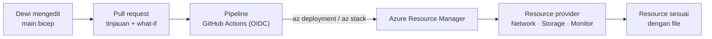
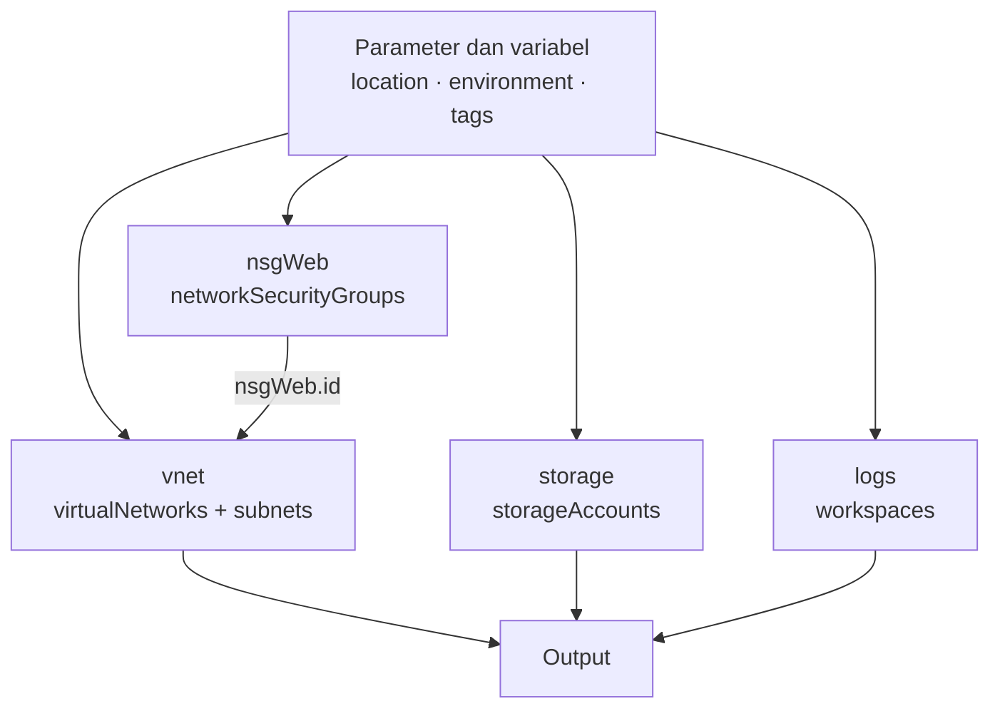

# Makan Siang 20 · Infrastructure as Code dengan Bicep (Dasar)

🇬🇧 [Read in English](README.md)

> **Jalur:** Bulan inti · **Level:** Dasar · **Bagian 4:** Keamanan, operasional, dan tata kelola
> **Waktu:** 60 menit · **Makan siang prasyarat:** 04 disarankan (08 dan 18 membantu)
> **Area keterampilan AZ-900:** Menjelaskan manajemen dan tata kelola Azure
> **Lab:** [Lab 20 · Sembilan belas makan siang penuh klik dalam satu file](../../labs/20-infrastructure-as-code-bicep/README.id.md) — sekitar 50 menit · biaya 💲
> **Penulis:** Stefanus Pinarta · [Tentang penulis](../../README.id.md#tentang-penulis)

| ⏱ Menit | Segmen |
|---:|---|
| 5 | Skenario dan tujuan |
| 25 | Bacaan |
| 15 | Demo: animasi interaktif (+ video panduan opsional) |
| 5 | Uji pemahaman |
| 5 | Poin penting dan pratinjau lab |
| 5 | Waktu cadangan — habiskan makan siang Anda 🍜 |

## 🍱 Menu hari ini

Setelah makan siang ini, Anda akan mampu:

- **Menjelaskan** mengapa infrastructure as code (*infrastruktur sebagai kode*) penting dan apa bedanya deployment
  deklaratif dengan skrip imperatif.
- **Membandingkan** template ARM JSON (*templat ARM*), Bicep, dan Terraform, lalu memilih salah satunya untuk sebuah
  tim.
- **Membaca dan menulis** file Bicep: parameter, variabel, resource (*sumber daya*), symbolic name, dependensi, output,
  module, loop, kondisi, dan decorator.
- **Men-deploy dengan aman** memakai scope, mode, dan what-if, serta **melindungi** apa yang sudah Anda deploy dengan
  template spec dan deployment stack — pengganti Azure Blueprints.

## 🏪 Sementara itu di Nusantara Retail

Sembilan belas makan siang sudah berlalu, dan lingkungan Azure Nusantara Retail kini benar-benar nyata — dibangun satu
klik portal dan satu perintah CLI demi satu. Hari Selasa, Dewi meminta "salinan jaringan toko online untuk testing".
Tidak ada yang bisa membuat salinan yang benar-benar sama. Hari Rabu, Pak Budi menemukan sebuah aturan NSG (network
security group) yang tidak pernah ia setujui; activity log menyebut Rizky mengubahnya pukul 23.00, tetapi tidak menyebut
alasannya. Hari Kamis, Ibu Sari membaca catatan pemulihan bencana (disaster recovery) dari Makan Siang 17 dan
melontarkan pertanyaan yang membuat seisi rapat terdiam: "Kalau Southeast Asia lenyap besok, bisakah kita membangun
ulang semuanya — persis sama — di region lain, dalam satu jam?"

Jawaban jujurnya: tidak. Bukan karena Azure tidak mampu, tetapi karena desainnya tersimpan di ingatan orang, bukan di
dalam sebuah file. Persis seperti resep rendang keluarga yang tidak pernah ditulis: selama sang juru masak ada, semuanya
lancar; begitu ia berhalangan, tidak ada yang bisa menghasilkan rasa yang sama.

Pertanyaan hari ini: **bagaimana Anda menuliskan lingkungan Azure Nusantara Retail dalam kode yang bisa ditinjau,
diulang, dan dilindungi?**

---

## 📖 Bacaan (≈25 menit)

### 1. Mengapa infrastructure as code

**Infrastructure as code (IaC)** berarti menuliskan infrastruktur Anda — jaringan, server, database, policy — dalam file
teks yang tinggal berdampingan dengan kode aplikasi Anda. File itu disimpan di Git (sistem yang mencatat setiap versi
file), perubahannya ditinjau lewat pull request (usulan perubahan yang diperiksa rekan sebelum digabungkan), dan
deployment-nya diserahkan kepada sebuah tool. Kedengarannya seperti hobi para developer. Sebenarnya ini adalah praktik
operasional dan tata kelola, dan IaC memecahkan persis masalah-masalah yang dialami Nusantara Retail:

- **Bisa diulang.** Jaringan test dan jaringan produksi berasal dari file yang sama dengan parameter yang berbeda,
  sehingga "sudah jalan di test" benar-benar berarti sesuatu.
- **Tinjauan dan audit.** Perubahan aturan NSG menjadi pull request yang disetujui Pak Budi *sebelum* sampai ke Azure,
  dan riwayat Git mencatat siapa mengubah apa, kapan, dan mengapa.
- **Pemulihan yang cepat.** Membangun ulang sebuah lingkungan cukup dengan satu perintah, bukan satu akhir pekan
  berbekal screenshot — kepingan yang selama ini hilang dari rencana pemulihan bencana di Makan Siang 17.
- **Deteksi drift.** Drift adalah pergeseran antara kondisi nyata dan isi file. Ketika seseorang mengubah resource
  secara manual, pratinjau berikutnya menunjukkan perbedaannya dengan file.
- **Eksperimen yang lebih murah.** Jika Anda bisa membangun ulang dalam hitungan menit, Anda bisa menghapus tanpa rasa
  takut — kebiasaan hemat biaya dari Makan Siang 19.

Ada dua gaya otomatisasi. Skrip **imperatif** menjelaskan *bagaimana*: buat virtual network (*jaringan virtual*), lalu
subnet, lalu pasang NSG — dan jika subnet-nya ternyata sudah ada, Anda sendiri yang harus menangani error-nya. Skrip
Azure CLI di lab-lab sebelumnya bersifat imperatif. File **deklaratif** menjelaskan *apa*: "ada sebuah virtual network
dengan dua subnet ini dan NSG ini". Mesinnya membandingkan kondisi yang diinginkan (desired state) itu dengan apa yang
sudah ada, lalu menentukan sendiri langkah-langkahnya. Deployment deklaratif bersifat **idempoten**: jalankan file yang
sama dua kali, dan eksekusi kedua tidak mengubah apa pun, karena kenyataan sudah sesuai dengan file.

Ibaratnya memesan ojek online. Cara imperatif seperti memandu pengemudi belokan demi belokan: "lurus, belok kiri di
masjid, kanan di pom bensin" — kalau jalannya ditutup, Anda sendiri yang harus mencari jalan lain. Cara deklaratif
seperti memasukkan alamat tujuan di aplikasi: Anda cukup menyebut *ke mana*, dan aplikasinya yang menentukan rute. Kalau
Anda memesan lagi ke alamat tempat Anda sudah berdiri, tidak ada perjalanan yang terjadi — itulah idempoten.



Semua jalan menuju tempat yang sama. Entah Anda mengeklik di portal, menjalankan CLI, atau men-deploy sebuah file,
permintaannya selalu melewati **Azure Resource Manager** (Makan Siang 04), yang memeriksa izin dan policy Anda lalu
memanggil resource provider — layanan di balik setiap jenis resource, misalnya Microsoft.Network untuk jaringan. IaC
hanya membuat permintaan-permintaan itu bisa diulang.

### 2. Template ARM, Bicep, dan Terraform

Azure Resource Manager secara bawaan memahami **template ARM**: dokumen JSON (format teks untuk data terstruktur) yang
berisi daftar parameter, variabel, resource, dan output. Template ini lengkap dan presisi, tetapi bertele-tele.
Ekspresinya ditulis di dalam string yang diapit kurung siku, seperti `"[parameters('location')]"`, dan lingkungan
berukuran sedang dengan cepat menjadi ratusan baris yang sulit ditinjau.

**Bicep** adalah bahasa khusus (domain-specific language, DSL) buatan Microsoft untuk pekerjaan yang sama. File Bicep
lebih pendek dan lebih mirip kode: Anda memanggil fungsi secara langsung, merujuk resource lain dengan **symbolic name**
(nama simbolis), dan Bicep menentukan sendiri dependensinya. Saat Anda men-deploy, Bicep CLI melakukan **transpile**,
yaitu menerjemahkan file itu menjadi template ARM JSON, sehingga Bicep bisa melakukan semua yang bisa dilakukan template
ARM, termasuk setiap jenis resource dan versi API (antarmuka yang dipakai untuk berbicara dengan layanan Azure) sejak
hari pertama dirilis. Tidak ada file state terpisah: Azure sendiri yang menjadi catatan tentang apa yang ada. Bicep
gratis, open source, dan didukung Microsoft, dan extension Visual Studio Code-nya memberi Anda IntelliSense (saran
otomatis saat mengetik), validasi, dan visualizer.

**Terraform**, buatan HashiCorp, adalah alternatif populer dengan bahasanya sendiri, HCL (HashiCorp Configuration
Language). Kekuatannya adalah jangkauan: satu tool dan satu alur kerja untuk Azure, cloud lain, dan banyak produk SaaS
(*perangkat lunak sebagai layanan*). Harga dari jangkauan itu adalah sebuah **file state** yang mencatat apa saja yang
dikelola Terraform; Anda harus menyimpannya secara terpusat, menguncinya selama perubahan berlangsung, dan
melindunginya, karena file itu bisa berisi secret (data rahasia seperti password atau key).

| | Template ARM (JSON) | Bicep | Terraform |
|---|---|---|---|
| Bahasa | JSON dengan ekspresi dalam kurung siku | DSL ringkas, dikompilasi menjadi ARM JSON | HCL |
| Cloud | Hanya Azure | Hanya Azure | Azure, cloud lain, dan penyedia SaaS |
| State | Azure adalah sumber kebenaran | Azure adalah sumber kebenaran | File state yang harus Anda simpan, kunci, dan lindungi |
| Fitur Azure baru | Versi API apa pun sejak hari pertama | Versi API apa pun sejak hari pertama | Setelah provider-nya mendukung (provider AzAPI bisa memanggil versi API apa pun) |
| Pratinjau perubahan | what-if | what-if | `terraform plan` |
| Menghapus yang sudah keluar dari file | Deployment stack | Deployment stack | `apply` berikutnya menghancurkannya |
| Paling cocok untuk | Template yang dihasilkan otomatis atau yang sudah ada | Tim yang fokus di Azure dan baru mulai | Tim multi-cloud, atau yang sudah punya keahlian Terraform |

Bagi Nusantara Retail — toko yang hanya memakai Azure, dengan tim kecil dan tanpa kode Terraform yang sudah ada — Bicep
adalah pilihan yang wajar. Jika kelak mereka perlu mengelola DNS di penyedia lain atau repositori GitHub dari pipeline
yang sama — rangkaian langkah otomatis yang mem-build dan men-deploy kode — Terraform layak dilirik lagi. Keduanya sah;
yang tidak sah adalah mencampur keduanya untuk resource yang sama, karena dua tool yang sama-sama merasa memiliki sebuah
resource akan saling membatalkan perubahan.

Skrip imperatif tidak lantas hilang. Skrip tetap menjadi alat yang tepat untuk pekerjaan sekali jalan, untuk pekerjaan
data plane (mengolah isi resource, bukan resource-nya) seperti mengunggah foto produk ke sebuah container, dan sebagai
perekat di dalam pipeline: build file Bicep, jalankan what-if, deploy, lalu jalankan skrip singkat untuk smoke test,
yaitu uji cepat bahwa hasilnya benar-benar hidup. Patokannya sederhana: apa pun yang harus *ada* masuk ke file
deklaratif; apa pun yang cukup *terjadi* sekali boleh berupa skrip.

> [!TIP]
> Anda tidak harus mulai dari halaman kosong. Halaman **Export template** pada sebuah resource group (*grup sumber
> daya*) menghasilkan template ARM JSON dari apa yang sudah ada, dan `az bicep decompile --file template.json` mengubah
> JSON menjadi Bicep. Perlakukan hasilnya sebagai draf pertama: template hasil ekspor berisi nilai read-only dan nilai
> default yang sebaiknya Anda hapus, serta nama-nama yang di-hard-code yang sebaiknya Anda ubah menjadi parameter.

### 3. Anatomi Bicep

Berikut sebuah file Bicep yang kecil tetapi lengkap. File ini membuat sebuah network security group dan sebuah virtual
network yang subnet-nya memakai NSG tersebut:

```bicep
targetScope = 'resourceGroup'

@description('Azure region for every resource.')
param location string = resourceGroup().location

@allowed([
  'lab'
  'test'
  'prod'
])
param environment string = 'lab'

var tags = {
  costCenter: 'retail-lab'
  environment: environment
}

resource nsgWeb 'Microsoft.Network/networkSecurityGroups@2024-05-01' = {
  name: 'nsg-web'
  location: location
  tags: tags
}

resource vnet 'Microsoft.Network/virtualNetworks@2024-05-01' = {
  name: 'vnet-nusa-iac'
  location: location
  tags: tags
  properties: {
    addressSpace: {
      addressPrefixes: [
        '10.20.0.0/16'
      ]
    }
    subnets: [
      {
        name: 'snet-web'
        properties: {
          addressPrefix: '10.20.1.0/24'
          networkSecurityGroup: {
            id: nsgWeb.id // a symbolic reference creates an implicit dependency
          }
        }
      }
    ]
  }
}

output vnetId string = vnet.id
```

Setiap bagian punya tugasnya masing-masing:

| Elemen | Sintaks | Kegunaannya |
|---|---|---|
| Target scope | `targetScope = 'resourceGroup'` | Ke mana file di-deploy: resource group (default), subscription (*langganan*), management group (*grup manajemen*), atau tenant |
| Parameter | `param location string = resourceGroup().location` | Input yang berubah antar-deployment; nilai default boleh memakai fungsi |
| Decorator | `@description()`, `@allowed()`, `@minLength()`, `@secure()` | Dokumentasi dan validasi; `@secure()` menjauhkan secret dari log |
| Variabel | `var tags = { … }` | Nilai yang dihitung sekali lalu dipakai ulang, misalnya satu set tag |
| Resource | `resource nsgWeb 'Type@apiVersion' = { … }` | Satu resource Azure; versi API menentukan properti apa saja yang tersedia |
| Symbolic name | `nsgWeb`, `vnet` | Cara file merujuk sebuah resource — bukan nama resource itu di Azure |
| Dependensi implisit | `nsgWeb.id` dipakai di dalam `vnet` | Bicep mengurutkan deployment untuk Anda; `dependsOn` jarang diperlukan |
| Resource yang sudah ada | `resource kv '…' existing = { name: '…' }` | Merujuk resource yang tidak di-deploy oleh file ini |
| Output | `output vnetId string = vnet.id` | Nilai yang dikembalikan kepada Anda atau ke langkah berikutnya |
| Module | `module net 'network.bicep' = { params: { … } }` | Memakai ulang file Bicep lain, dari folder lokal atau dari registry (tempat berbagi module) |
| Loop | `[for name in names: { … }]` | Banyak resource atau properti serupa dari sebuah array |
| Kondisi | `resource logs '…' = if (deployLogs) { … }` | Men-deploy resource hanya jika sebuah ekspresi bernilai true |

**Versi API** pada setiap jenis resource (`@2024-05-01`) mengunci skemanya: properti apa saja yang ada dan apa artinya.
Di VS Code, extension Bicep memvalidasi setiap properti terhadap skema itu saat Anda mengetik. Fungsi seperti
`resourceGroup()` dan `uniqueString()` membantu Anda menghindari nilai yang di-hard-code.
`uniqueString(resourceGroup().id)` selalu mengembalikan hash (rangkaian karakter hasil perhitungan) 13 karakter yang
sama untuk resource group yang sama, sehingga sangat cocok untuk nama yang harus unik secara global seperti storage
account (*akun penyimpanan*): unik di seluruh Azure, tetapi identik di setiap redeploy.

Karena `vnet` merujuk ke `nsgWeb.id`, Bicep tahu bahwa NSG harus ada lebih dulu. Resource yang tidak saling bergantung
dibuat secara paralel:



Untuk nilai parameter, Anda bisa mengetiknya di command line atau menyimpannya dalam **file `.bicepparam`**, yang
diawali `using 'main.bicep'` dan berisi penetapan nilai seperti `param environment = 'test'`. Satu template ditambah
satu file parameter per lingkungan adalah pola klasiknya. Codebase yang lebih besar menambahkan tipe buatan sendiri
(user-defined types), fungsi, dan file bersama, tetapi blok-blok bangunan di tabel atas sudah bisa membawa Anda cukup
jauh.

> [!WARNING]
> Jangan pernah menulis password, key, atau connection string ke dalam file Bicep, file parameter di Git, atau sebuah
> **output**. Output disimpan dalam riwayat deployment, tempat siapa pun yang bisa membaca resource group dapat
> melihatnya. Tandai parameter rahasia dengan `@secure()`, ambil nilai dari Key Vault saat deployment, dan utamakan
> managed identity — identitas aplikasi yang dikelola Azure tanpa password (Makan Siang 15) — sehingga tidak ada secret
> yang perlu dioper sama sekali.

### 4. Men-deploy dengan aman: scope, mode, dan what-if

Sebuah deployment menargetkan sebuah **scope** (cakupan) dengan perintah yang sesuai: `az deployment group create` untuk
resource group, `az deployment sub create` untuk subscription (untuk membuat resource group, policy assignment, atau
anggaran), `az deployment mg create` untuk management group, dan `az deployment tenant create` untuk tenant, wadah
tingkat teratas milik organisasi Anda. Setiap deployment juga tercatat di Azure, sehingga halaman **Deployments** pada
resource group menunjukkan apa yang di-deploy, kapan, dan dengan parameter apa.

Deployment ke resource group punya **mode**. Mode **Incremental**, yang merupakan default sekaligus yang
direkomendasikan, membuat atau memperbarui apa yang dijelaskan file dan membiarkan semua hal lain di resource group.
Mode **Complete** juga menghapus resource yang tidak ada di file. Microsoft tidak lagi merekomendasikan mode complete
dan sedang menghentikannya secara bertahap; untuk menghapus resource lewat kode, gunakan deployment stack (bagian 5).

Ada satu hal halus yang menjebak hampir semua orang: file selalu menggambarkan kondisi yang diinginkan sebuah resource
secara *lengkap*. Jika Anda me-redeploy sebuah NSG yang file-nya hanya mencantumkan satu aturan, aturan apa pun yang
ditambahkan Rizky secara manual akan hilang, karena properti yang tidak ada di file direset. Itu fitur — file selalu
menang — tetapi hanya jika semua orang mengetahuinya.

Sebelum ada yang berubah, mintalah pratinjau. **What-if** membandingkan file dengan apa yang sudah ada dan mencetak diff
(daftar perbedaan):

```bash
az deployment group what-if --resource-group rg-storefront-test --template-file main.bicep
```

Anggap saja seperti halaman ringkasan pesanan di aplikasi belanja online sebelum Anda menekan tombol Bayar: Anda bisa
melihat apa yang akan ditambah, diubah, atau dihapus, dan masih bisa membatalkannya.

Setiap resource mendapat simbol: `+` dibuat, `~` diubah (dengan properti yang berubah tercantum di bawahnya), `-`
dihapus, dan `=` tidak berubah. Dalam mode incremental Anda tidak akan pernah melihat penghapusan; simbol itu baru
muncul pada mode complete atau pada deployment stack yang menghapus resource yang tidak lagi dikelola. What-if terkadang
melaporkan **noise** — properti yang diisi Azure dengan nilai default tampil sebagai perubahan padahal sebenarnya tidak
ada yang berubah — jadi bacalah diff-nya, jangan hanya memercayai baris ringkasannya. Anda juga bisa menambahkan
`--confirm-with-what-if` ke `az deployment group create` untuk melihat pratinjau dan menjawab ya atau tidak sebelum
deployment berjalan.

Masalah paling murah ditangkap sebelum Azure melihatnya, jadi bayangkan tiga pemeriksaan yang makin lama makin ketat.
`az bicep build` mengompilasi file menjadi ARM JSON di mesin Anda dan melaporkan **error** (symbol yang salah ketik,
kurung kurawal yang hilang) serta **warning** dari linter bawaan, yaitu pemeriksa kesalahan umum (parameter yang tidak
dipakai, properti yang tidak dikenal skema). Error menghentikan build; warning tidak — jadi tetaplah membacanya.
Berikutnya, `az deployment group validate` bertanya kepada Resource Manager apakah template itu akan diterima di
resource group tujuan, tanpa men-deploy apa pun. Terakhir, what-if menunjukkan diff yang sebenarnya terhadap apa yang
ada. Secara default, what-if memeriksa izin yang sama dengan deployment sungguhan, karena itu tim biasanya membiarkan
identitas pipeline yang menjalankan pratinjau lalu mengirimkan hasilnya kepada para peninjau.

Deployment juga meninggalkan jejak. Beri setiap deployment nama yang bermakna dengan `--name` (jika tidak, nama file
yang dipakai), dan halaman **Deployments** pada resource group menyimpan template, parameter, output, dan error apa pun
untuk setiap eksekusi. Ketika deployment gagal di tengah jalan, perbaiki file lalu deploy lagi: resource yang sudah ada
cukup dikonfirmasi, dan yang gagal dicoba lagi. Itulah buah dari idempotensi.

Terakhir, **template spec** menyimpan sebuah template sebagai resource berversi di Azure
(`Microsoft.Resources/templateSpecs`). Tim lain bisa men-deploy "network v1.2" dari portal atau CLI tanpa akses ke
repositori Git Anda, dan Anda mengatur siapa yang boleh memakainya dengan Azure RBAC (role-based access control,
*kontrol akses berbasis peran*).

### 5. Siklus hidup dan pagar pengaman: deployment stack, verified module, dan pipeline

Deployment biasa membuat resource lalu melupakannya. **Deployment stack** (`Microsoft.Resources/deploymentStacks`)
mengingatnya. Stack men-deploy sebuah file Bicep atau template, menyimpan daftar **managed resource** (resource yang
dikelolanya), dan menerapkan dua aturan pada resource tersebut:

| Pengaturan stack | Flag CLI | Nilai | Fungsinya |
|---|---|---|---|
| Action on unmanage | `--action-on-unmanage` | `detachAll`, `deleteResources`, `deleteAll` | Apa yang terjadi pada resource yang keluar dari file atau saat stack dihapus: dipertahankan sebagai resource biasa yang tidak dikelola, dihapus, atau sekalian menghapus resource group yang dikelola |
| Deny settings | `--deny-settings-mode` | `none`, `denyDelete`, `denyWriteAndDelete` | Membuat **deny assignment** (aturan larangan yang mengalahkan izin dari role) yang memblokir penghapusan, atau penulisan dan penghapusan, pada managed resource — bahkan untuk Owner |
| Pengecualian | `--deny-settings-excluded-principals`, `--deny-settings-excluded-actions` | Hingga 5 principal, hingga 200 action | Membebaskan, misalnya, identitas pipeline atau satu operasi yang tidak berbahaya |
| Scope turunan | `--deny-settings-apply-to-child-scopes` | Aktif atau nonaktif | Memperluas perlindungan ke child resource seperti database SQL |

Membuat stack terlihat seperti ini:

```bash
az stack group create --name stack-storefront --resource-group rg-storefront-prod \
  --template-file main.bicep --action-on-unmanage deleteResources \
  --deny-settings-mode denyDelete --yes
```

Deny settings mirip dengan resource lock (*kunci sumber daya*) dari Makan Siang 04, dengan dua perbedaan. Lock berlaku
untuk semua orang, termasuk pipeline Anda; deny settings bisa mengecualikan principal (pengguna, grup, atau identitas
aplikasi) tertentu. Selain itu, deny settings ikut bersama stack: muncul saat Anda men-deploy stack dan hilang saat Anda
menghapusnya. Deny settings hanya melindungi **control plane**, yaitu lapisan pengelolaan resource — stack DenyDelete
mencegah seseorang menghapus storage account, bukan menghapus blob di dalamnya — dan hanya resource yang dideklarasikan
di file. Membuat stack dengan deny settings memerlukan izin tambahan, yang tercakup dalam role **Azure Deployment Stack
Owner**. Untuk pemisahan yang lebih kuat, letakkan stack di scope induk (misalnya, stack tingkat subscription yang
men-deploy ke sebuah resource group), sehingga orang yang bekerja di resource group itu tidak bisa mengubah stack-nya
sendiri.

> [!IMPORTANT]
> Deny assignment yang dibuat oleh stack adalah milik stack itu. Anda tidak bisa menghapusnya di halaman **Access
> control (IAM)**, dan menjadi Owner pun tidak membantu. Untuk mengubah apa yang dilindungi, perbarui stack-nya (atau
> hapus stack-nya). Uji deny settings di lab terlebih dahulu, dan selalu kecualikan identitas yang menjalankan pipeline
> Anda.

Deployment stack, bersama template spec dan Azure Policy, adalah pengganti yang direkomendasikan untuk **Azure
Blueprints**, yang sedang dipensiunkan: assignment baru diblokir mulai 31 Oktober 2026, dan layanan ini pensiun
sepenuhnya pada 31 Januari 2027.

Anda tidak harus menulis setiap resource dari nol. **Azure Verified Modules (AVM)** adalah pustaka module Bicep dan
Terraform yang sudah teruji, dimiliki Microsoft, dan mengikuti panduan Well-Architected. Resource module membungkus satu
jenis resource dengan default yang masuk akal dan aman; pattern module menggabungkan beberapa resource. Anda merujuk
sebuah module dari registry publik dan mengunci (pin) versinya:

```bicep
module images 'br/public:avm/res/storage/storage-account:<version>' = {
  params: {
    name: 'stnusa${uniqueString(resourceGroup().id)}'
    skuName: 'Standard_LRS'
  }
}
```

Kepingan terakhir adalah siapa yang menjalankan deployment. Di lingkungan yang matang, orang tidak men-deploy dari
laptop mereka: pipeline yang melakukannya. Dengan **GitHub Actions**, workflow meminta token **OpenID Connect (OIDC)** —
semacam tanda pengenal digital yang hanya berlaku sebentar — dari GitHub, dan sebuah app registration Microsoft Entra
atau user-assigned managed identity dengan **federated credential** memercayai token dari repositori dan branch (cabang
kode di Git) tersebut. Tidak ada password atau client secret yang disimpan di mana pun:

```yaml
permissions:
  id-token: write   # allow the job to request an OIDC token
  contents: read
steps:
  # (check out the repository first)
  - uses: azure/login@v2
    with:
      client-id: ${{ secrets.AZURE_CLIENT_ID }}
      tenant-id: ${{ secrets.AZURE_TENANT_ID }}
      subscription-id: ${{ secrets.AZURE_SUBSCRIPTION_ID }}
  - run: az deployment group what-if --resource-group rg-storefront-test --template-file infra/main.bicep
```

Makan Siang 22 membangun federated credential ini langkah demi langkah.

### 6. Bagaimana semuanya menyatu untuk Nusantara Retail

Cara kerja yang baru ini muat dalam satu halaman. Repositori mendapat folder `infra`: `main.bicep`, beberapa module
(jaringan, penyimpanan, pemantauan), dan satu file `.bicepparam` per lingkungan. Permintaan Dewi akan salinan test
berubah menjadi sebuah file parameter baru dan sebuah pull request. Pipeline menjalankan `az bicep build` dan what-if
pada setiap pull request dan mengirimkan diff-nya untuk ditinjau. Pak Budi menyetujui perubahan jaringan di pull
request, alih-alih menemukannya belakangan di activity log.

Ketika pull request digabungkan (merge), pipeline men-deploy produksi sebagai deployment stack dengan `denyDelete`,
hanya dengan mengecualikan identitas pipeline itu sendiri. Rizky tetap bisa melihat semuanya, tetapi menghapus storage
account produksi secara tidak sengaja tidak mungkin lagi terjadi. Jika Pak Budi ingin menghentikan pengeditan lewat
portal juga, `denyWriteAndDelete` bisa melakukannya, dengan konsekuensi setiap perubahan harus lewat pipeline — dan
justru itulah intinya.

Lingkungan test memakai file yang sama dengan file parameter berbeda dan action `deleteResources`. Jumat sore, tim
menghapus stack test, dan bersamanya setiap resource test — tidak ada yang ditagih selama akhir pekan. Hari Senin,
pipeline membangunnya kembali, identik sampai ke tag-nya, dalam hitungan menit.

Lalu pertanyaan Ibu Sari? Membangun ulang di region lain sekarang cukup dengan mengganti parameter ditambah satu
deployment, sementara datanya kembali dari backup dan replika yang Anda rancang di Makan Siang 17. Di Makan Siang 21
Anda akan men-deploy seluruh platform inti dengan cara ini, dari Bicep yang modular. Makan Siang 22 membahas identitas
pipeline OIDC, dan Makan Siang 31 memakai deployment stack untuk mengelola tata kelola di banyak subscription.

> [!NOTE]
> **Renungkan sejenak:** pukul 23.00 Rizky menambahkan aturan "allow RDP from anywhere" (izinkan akses Remote Desktop
> dari mana saja) ke `nsg-web` lewat portal. Apa yang terjadi pada aturan itu saat pipeline berikutnya men-deploy file
> Bicep dalam mode incremental? Dan apa yang akan terjadi pada pukul 23.00 itu jika stack-nya memakai
> `denyWriteAndDelete` dan Rizky tidak dikecualikan?

---

## 🎬 Demo (≈15 menit)

1. **Animasi interaktif (≈6–8 menit):**
   [Buka demo](https://stefpin.github.io/azure-fundamentals-lunches/demos/20-infrastructure-as-code-bicep.html?lang=id)
   — tekan ▶ Putar atau telusuri langkah demi langkah sesuai kecepatan Anda. Sedang offline? Unduh
   [`docs/demos/20-infrastructure-as-code-bicep.html`](../../docs/demos/20-infrastructure-as-code-bicep.html) lalu buka
   di browser apa saja.
2. **Video panduan (≤ 6 menit):** _segera hadir_ — [baca naskah video](demo-video-script.id.md).

Yang perlu diperhatikan:

- Resource yang direncanakan muncul samar-samar selagi file ditulis, dan baru menjadi nyata ketika Resource Manager
  men-deploy-nya.
- Panel what-if: `+` pada eksekusi pertama, `=` saat Anda me-redeploy, `~` ketika satu parameter berubah, `-` ketika
  stack membuang resource yang sudah keluar dari file.
- Penghapusan manual yang ditolak oleh deny assignment milik stack.
- Betapa cepatnya resource group yang kosong dibangun ulang dari file yang sama.

## ✅ Uji pemahaman (≈5 menit)

1. Dewi men-deploy file Bicep yang sama dua kali berturut-turut. Deployment kedua selesai dengan cepat dan tidak
   mengubah apa pun. Sifat infrastructure as code deklaratif apa yang ditunjukkan oleh hal ini?
   <details><summary>Lihat jawaban</summary>

   **Idempotensi** — *alasannya:* Resource Manager membandingkan kondisi yang diinginkan di file dengan apa yang ada dan
   hanya bertindak pada perbedaannya, sehingga mengulang deployment itu aman.

   </details>
2. Anda menghapus Log Analytics workspace dari `main.bicep` lalu me-redeploy dengan `az deployment group create` dalam
   mode default. Apakah workspace itu terhapus? Jika Anda ingin kode yang menghapusnya, apa yang sebaiknya Anda pakai?
   <details><summary>Lihat jawaban</summary>

   Tidak — mode incremental membiarkan resource yang tidak ada di file tetap utuh. Gunakan **deployment stack** dengan
   `--action-on-unmanage deleteResources` (atau `deleteAll`) — *alasannya:* mode complete tidak lagi direkomendasikan
   dan sedang dihentikan secara bertahap, digantikan oleh stack.

   </details>
3. Sebelum perubahan di produksi, Pak Budi ingin melihat persis apa yang akan terjadi. Perintah apa yang Anda jalankan,
   dan apa arti `~` di depan sebuah resource?
   <details><summary>Lihat jawaban</summary>

   `az deployment group what-if` (atau `az deployment group create --confirm-with-what-if`); `~` berarti resource itu
   sudah ada dan akan **diubah**, dengan properti yang berubah tercantum di bawahnya — *alasannya:* what-if menampilkan
   pratinjau perubahan tanpa benar-benar melakukannya.

   </details>
4. Sebuah perusahaan berjalan di Azure, tetapi juga ingin memakai tool dan alur kerja yang sama untuk mengelola DNS-nya
   di penyedia lain dan repositori GitHub-nya. Bicep atau Terraform?
   <details><summary>Lihat jawaban</summary>

   **Terraform** — *alasannya:* Bicep hanya men-deploy resource Azure, sedangkan Terraform punya provider untuk banyak
   cloud dan produk SaaS (dengan konsekuensi adanya file state yang harus Anda simpan dan lindungi).

   </details>
5. Pak Budi ingin tidak ada seorang pun selain pipeline deployment yang bisa menghapus virtual network produksi yang
   dibuat dari file Bicep. Apa yang Anda gunakan, dan mengapa bukan lock CanNotDelete?
   <details><summary>Lihat jawaban</summary>

   Deploy sebagai **deployment stack** dengan `--deny-settings-mode denyDelete` dan identitas pipeline di
   `--deny-settings-excluded-principals` — *alasannya:* lock berlaku untuk semua orang, termasuk pipeline, sedangkan
   deny settings pada stack bisa mengecualikan principal tertentu dan dikelola bersama kodenya.

   </details>

## 🧠 Poin penting

- Infrastructure as code mengubah lingkungan Anda menjadi file yang bisa ditinjau dan diulang; deployment **deklaratif**
  bersifat idempoten, jadi me-redeploy itu aman.
- **Bicep** adalah bahasa ringkas yang dikompilasi menjadi ARM JSON dengan dukungan sejak hari pertama untuk setiap API
  Azure; **Terraform** menambah jangkauan multi-cloud dengan konsekuensi adanya file state.
- File Bicep terdiri dari parameter, variabel, resource dengan **symbolic name**, output, dan secara opsional module,
  loop, serta kondisi; rujukan seperti `nsgWeb.id` menciptakan **dependensi implisit**.
- Deploy dalam mode **incremental**, selalu lihat pratinjau dengan **what-if**, dan ingat bahwa file menggambarkan
  kondisi yang diinginkan setiap resource secara lengkap.
- **Deployment stack** mengelola sekelompok resource sebagai satu kesatuan, menghapus apa yang keluar dari file, dan
  melindungi resource dengan **deny settings**; bersama template spec dan Azure Policy, stack menggantikan Azure
  Blueprints.

## 🗒️ Catatan lapangan dari Stefanus

> **Kalau belum pernah dibangun ulang dari file, itu baru harapan.** Setiap kali ada yang bilang lingkungannya "sudah
> semuanya di Bicep", saya selalu menanyakan hal yang sama: kapan terakhir kali salinan test dihapus lalu dibangun ulang
> hanya lewat pipeline? Pembangunan ulang itulah ujian yang sesungguhnya, karena di situlah ketahuan apa yang terlupa
> dari file: role assignment yang diberikan secara manual, secret yang diketik langsung di portal, record DNS yang
> ditambahkan seseorang malam-malam. Karena itu saya menjadwalkan latihan ini, mencatat berapa lama waktunya, dan
> mengubah setiap celah yang ditemukan menjadi pull request. Kebiasaan kedua saya lebih sederhana: saat meninjau
> perubahan, saya membaca hasil what-if sebelum membaca Bicep-nya. Kode menunjukkan apa yang dimaksud penulisnya; diff
> menunjukkan apa yang benar-benar akan terjadi. Saya paling teliti pada setiap `-` dan pada `~` di resource yang tidak
> pernah direncanakan untuk disentuh.

## 🔬 Lab Anda: Sembilan belas makan siang penuh klik dalam satu file

Anda melengkapi sebuah `main.bicep` starter yang berisi latihan bertanda jelas — sebuah network security group, sebuah
virtual network dengan dua subnet, sebuah Log Analytics workspace, dan output — di samping storage account yang sudah
ditulis. Anda mem-build-nya, melihat pratinjaunya dengan what-if, men-deploy-nya, mengubah satu parameter dan
menyaksikan what-if melaporkan modifikasi, lalu me-redeploy. Terakhir, Anda men-deploy file yang sama sebagai deployment
stack dengan DenyDelete, menyaksikan upaya menghapus storage account gagal, dan menghapus semuanya dengan menghapus
stack.

- ⏱ Sekitar 50 menit · 💲 · bisa dikerjakan terpisah (tidak perlu lab sebelumnya)
- 👉 [Mulai Lab 20](../../labs/20-infrastructure-as-code-bicep/README.id.md)

## 📚 Pelajari lebih lanjut

- [Microsoft Learn: Apa itu Bicep?](https://learn.microsoft.com/azure/azure-resource-manager/bicep/overview) — bahasanya, manfaatnya, dan jalur dari file pertama Anda hingga module.
- [Microsoft Learn: Bicep what-if — pratinjau perubahan sebelum deployment](https://learn.microsoft.com/azure/azure-resource-manager/bicep/deploy-what-if) — jenis perubahan, format hasil, dan cara membaca noise.
- [Microsoft Learn: Membuat dan men-deploy deployment stack Azure dengan Bicep](https://learn.microsoft.com/azure/azure-resource-manager/bicep/deployment-stacks) — managed resource, action on unmanage, dan deny settings, lengkap dengan contoh CLI dan PowerShell.
- [Azure Verified Modules](https://azure.github.io/Azure-Verified-Modules/) — indeks module, spesifikasi, dan cara memakai module di Bicep dan Terraform.

---

⬅️ [Makan Siang 19 · Manajemen Biaya (Dasar)](../19-cost-management/README.id.md) · 🏠 [Beranda kursus](../../README.id.md) · [Makan Siang 21 · Capstone Inti: Menyatukan Semuanya (Dasar)](../21-core-capstone/README.id.md) ➡️

<sub>Terakhir divalidasi: Oktober 2026 · Menemukan informasi yang sudah usang? [Buka issue](../../CONTRIBUTING.md).</sub>
