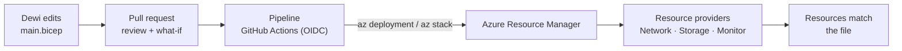
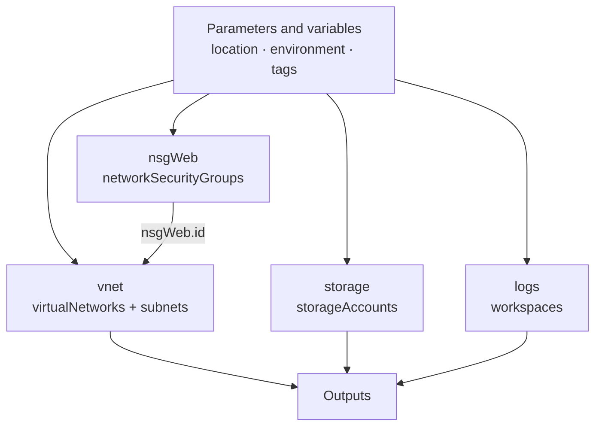

# Lunch 20 · Infrastructure as Code with Bicep (Basic)

> **Track:** Core month · **Level:** Basic · **Part 4:** Secure, operate and govern
> **Time:** 60 minutes · **Prerequisite lunches:** 04 recommended (08 and 18 help)
> **AZ-900 skill area:** Describe Azure management and governance
> **Lab:** [Lab 20 · Nineteen lunches of clicks in one file](../../labs/20-infrastructure-as-code-bicep/README.md) — about 50 minutes · cost 💲

| ⏱ Minutes | Segment |
|---:|---|
| 5 | Scenario and objectives |
| 25 | Reading |
| 15 | Demo: interactive animation (+ optional walkthrough video) |
| 5 | Knowledge check |
| 5 | Key takeaways and lab preview |
| 5 | Buffer — finish your lunch 🍜 |

## 🍱 Today's menu

By the end of this lunch you will be able to:

- **Explain** why infrastructure as code matters and how declarative deployments differ from imperative scripts.
- **Compare** ARM JSON templates, Bicep and Terraform, and choose one for a team.
- **Read and write** a Bicep file: parameters, variables, resources, symbolic names, dependencies, outputs, modules,
  loops, conditions and decorators.
- **Deploy safely** with scopes, modes and what-if, and **protect** what you deployed with template specs and deployment
  stacks — the replacement for Azure Blueprints.

## 🏪 Meanwhile at Nusantara Retail

Nineteen lunches in, Nusantara Retail's Azure estate is real — and it was built one portal click and one CLI command at
a time. On Tuesday Dewi asks for "a copy of the storefront network for testing". Nobody can produce one that matches.
On Wednesday Pak Budi notices an NSG rule he never approved; the activity log says Rizky changed it at 23:00, but not why.
On Thursday Ibu Sari reads the disaster recovery notes from Lunch 17 and asks the question that silences the meeting:
"If Southeast Asia disappeared tomorrow, could we rebuild everything — exactly the same — in another region, in an hour?"

The honest answer is no. Not because Azure can't, but because the design lives in people's memories instead of in a
file.

Today's question: **how do you describe Nusantara Retail's Azure environment in code that you can review, repeat and
protect?**

---

## 📖 Reading (≈25 minutes)

### 1. Why infrastructure as code

**Infrastructure as code (IaC)** means describing your infrastructure — networks, servers, databases, policies — in text
files that live next to your application code. You store them in Git, review changes in pull requests and let a tool
deploy them. It sounds like a developer's hobby. It is actually an operations and governance practice, and it solves the
exact problems Nusantara Retail ran into:

- **Repeatability.** The test network and the production network come from the same file with different parameters, so
  "works in test" means something.
- **Review and audit.** A change to an NSG rule is a pull request that Pak Budi approves *before* it reaches Azure, and
  Git history records who changed what, when and why.
- **Speed of recovery.** Rebuilding an environment is one command, not a weekend with screenshots — the missing piece in
  the disaster recovery plan from Lunch 17.
- **Drift detection.** When someone changes a resource by hand, the next preview shows the difference from the file.
- **Cheaper experiments.** If you can rebuild in minutes, you can delete without fear — the cost habit from Lunch 19.

There are two styles of automation. An **imperative** script describes *how*: create the virtual network, then the
subnet, then attach the NSG — and if the subnet already exists, handle that error yourself. The Azure CLI scripts in the
earlier labs are imperative. A **declarative** file describes *what*: "there is a virtual network with these two subnets
and this NSG". The engine compares that desired state with what exists and works out the steps. Declarative deployments
are **idempotent**: run the same file twice and the second run changes nothing, because reality already matches.



Every road leads to the same place. Whether you click in the portal, run the CLI or deploy a file, the request goes
through **Azure Resource Manager** (Lunch 04), which checks your permissions and policies and calls the resource
providers. IaC simply makes those requests repeatable.

### 2. ARM templates, Bicep and Terraform

Azure Resource Manager natively understands **ARM templates**: JSON documents that list parameters, variables, resources
and outputs. They are complete and precise, but verbose. Expressions live inside strings in square brackets, such as
`"[parameters('location')]"`, and a medium-sized environment quickly becomes hundreds of lines that are hard to review.

**Bicep** is Microsoft's domain-specific language for the same job. A Bicep file is shorter and reads more like code:
you call functions directly, refer to other resources by a **symbolic name**, and Bicep works out the dependencies. When
you deploy, the Bicep CLI **transpiles** the file into an ARM JSON template, so Bicep can do everything ARM templates can,
including every resource type and API version from the day it is released. There is no separate state file: Azure itself
is the record of what exists. Bicep is free, open source and supported by Microsoft, and the Visual Studio Code extension
gives you IntelliSense, validation and a visualizer.

**Terraform**, from HashiCorp, is a popular alternative with its own language (HCL). Its strength is reach: one tool and
one workflow for Azure, other clouds and many SaaS products. The price of that reach is a **state file** that records
what Terraform manages; you must store it centrally, lock it during changes and protect it, because it can contain
secrets.

| | ARM templates (JSON) | Bicep | Terraform |
|---|---|---|---|
| Language | JSON with bracket expressions | Concise DSL, compiled to ARM JSON | HCL |
| Clouds | Azure only | Azure only | Azure, other clouds and SaaS providers |
| State | Azure is the source of truth | Azure is the source of truth | State file you store, lock and protect |
| New Azure features | Any API version from day one | Any API version from day one | When the provider supports them (the AzAPI provider can call any API version) |
| Preview changes | what-if | what-if | `terraform plan` |
| Deleting what left the file | Deployment stacks | Deployment stacks | Next `apply` destroys it |
| Best fit | Generated or existing templates | Azure-focused teams starting fresh | Multi-cloud teams, existing Terraform skills |

For Nusantara Retail — an Azure-only shop with a small team and no existing Terraform code — Bicep is the natural
choice. If they later need to manage DNS at another provider or GitHub repositories from the same pipeline, Terraform
becomes worth a second look. Both are valid; mixing them for the same resources is not, because two tools that each
believe they own a resource will undo each other's changes.

Imperative scripts don't disappear. They remain the right tool for one-off jobs, for data-plane work such as uploading
product photos to a container, and as glue inside pipelines: build the Bicep file, run what-if, deploy, then run a short
script to smoke-test the result. The rule of thumb is simple: anything that should *exist* belongs in the declarative
file; anything that should *happen* once can be a script.

> [!TIP]
> You don't have to start from a blank page. The **Export template** page of a resource group produces an ARM JSON
> template of what already exists, and `az bicep decompile --file template.json` turns JSON into Bicep. Treat the result as
> a first draft: exported templates contain read-only values and defaults you should delete, and hard-coded names you
> should turn into parameters.

### 3. Bicep anatomy

Here is a small but complete Bicep file. It creates a network security group and a virtual network whose subnet uses that
NSG:

```bicep
targetScope = 'resourceGroup'

@description('Azure region for every resource.')
param location string = resourceGroup().location

@allowed([
  'lab'
  'test'
  'prod'
])
param environment string = 'lab'

var tags = {
  costCenter: 'retail-lab'
  environment: environment
}

resource nsgWeb 'Microsoft.Network/networkSecurityGroups@2024-05-01' = {
  name: 'nsg-web'
  location: location
  tags: tags
}

resource vnet 'Microsoft.Network/virtualNetworks@2024-05-01' = {
  name: 'vnet-nusa-iac'
  location: location
  tags: tags
  properties: {
    addressSpace: {
      addressPrefixes: [
        '10.20.0.0/16'
      ]
    }
    subnets: [
      {
        name: 'snet-web'
        properties: {
          addressPrefix: '10.20.1.0/24'
          networkSecurityGroup: {
            id: nsgWeb.id // a symbolic reference creates an implicit dependency
          }
        }
      }
    ]
  }
}

output vnetId string = vnet.id
```

Each part has a job:

| Element | Syntax | What it is for |
|---|---|---|
| Target scope | `targetScope = 'resourceGroup'` | Where the file deploys: resource group (the default), subscription, management group or tenant |
| Parameter | `param location string = resourceGroup().location` | Inputs that change between deployments; defaults can use functions |
| Decorator | `@description()`, `@allowed()`, `@minLength()`, `@secure()` | Documentation and validation; `@secure()` keeps secrets out of logs |
| Variable | `var tags = { … }` | A value computed once and reused, such as a tag set |
| Resource | `resource nsgWeb 'Type@apiVersion' = { … }` | One Azure resource; the API version fixes which properties exist |
| Symbolic name | `nsgWeb`, `vnet` | How the file refers to a resource — not the Azure name |
| Implicit dependency | `nsgWeb.id` used inside `vnet` | Bicep orders the deployment for you; `dependsOn` is rarely needed |
| Existing resource | `resource kv '…' existing = { name: '…' }` | Refers to a resource the file doesn't deploy |
| Output | `output vnetId string = vnet.id` | Values handed back to you or to the next step |
| Module | `module net 'network.bicep' = { params: { … } }` | Reuses another Bicep file, locally or from a registry |
| Loop | `[for name in names: { … }]` | Many similar resources or properties from an array |
| Condition | `resource logs '…' = if (deployLogs) { … }` | Deploys a resource only when an expression is true |

The **API version** in each resource type (`@2024-05-01`) pins the schema: which properties exist and what they mean. In
VS Code, the Bicep extension validates every property against that schema as you type. Functions such as
`resourceGroup()` and `uniqueString()` help you avoid hard-coded values. `uniqueString(resourceGroup().id)` returns the same
13-character hash every time for the same resource group, which makes it perfect for globally unique names like storage
accounts: unique across Azure, yet identical on every redeploy.

Because `vnet` refers to `nsgWeb.id`, Bicep knows the NSG must exist first. Resources that don't depend on each other are
created in parallel:



For parameter values, you can type them on the command line or keep them in a **`.bicepparam` file**, which starts with
`using 'main.bicep'` and assigns values such as `param environment = 'test'`. One template plus one parameter file per
environment is the classic pattern. Larger codebases add user-defined types, functions and shared files, but the
building blocks in the table above take you a long way.

> [!WARNING]
> Never write a password, key or connection string into a Bicep file, a parameter file in Git, or an **output**. Outputs
> are stored in the deployment history, where anyone who can read the resource group can see them. Mark secret parameters
> with `@secure()`, fetch values from Key Vault at deployment time, and prefer managed identities (Lunch 15) so there is no
> secret to pass at all.

### 4. Deploying safely: scopes, modes and what-if

A deployment targets a **scope** with a matching command: `az deployment group create` for a resource group,
`az deployment sub create` for a subscription (to create resource groups, policy assignments or budgets),
`az deployment mg create` for a management group and `az deployment tenant create` for the tenant. Each deployment is
itself recorded in Azure, so the resource group's **Deployments** page shows what was deployed, when and with which
parameters.

Resource-group deployments have a **mode**. **Incremental** mode, the default and the recommended one, creates or updates
what the file describes and leaves everything else in the resource group alone. **Complete** mode also deletes resources
that aren't in the file. Microsoft no longer recommends complete mode and is gradually deprecating it; to delete
resources through code, use deployment stacks (section 5).

One subtlety catches almost everyone: the file always describes a resource's *complete* desired state. If you redeploy
an NSG whose file lists one rule, any rule Rizky added by hand disappears, because properties that aren't in the file
are reset. That is a feature — the file wins — but only if everyone knows it.

Before anything changes, ask for a preview. **What-if** compares the file with what exists and prints a diff:

```bash
az deployment group what-if --resource-group rg-storefront-test --template-file main.bicep
```

Each resource gets a symbol: `+` create, `~` modify (with the changing properties listed underneath), `-` delete and
`=` no change. In incremental mode you will never see a delete; it appears with complete mode or with a deployment stack
that deletes unmanaged resources. What-if sometimes reports **noise** — properties that Azure filled in with defaults
appear as changes even though nothing really changes — so read the diff instead of trusting the summary line. You can
also add `--confirm-with-what-if` to `az deployment group create` to see the preview and answer yes or no before it
deploys.

Problems are cheapest to catch before Azure sees them, so think of three checks that get stricter as they go.
`az bicep build` compiles a file to ARM JSON on your machine and reports **errors** (a misspelled symbol, a missing
brace) and **warnings** from the built-in linter (an unused parameter, a property the schema doesn't know). Errors stop
the build; warnings don't — so read them. Next, `az deployment group validate` asks Resource Manager whether the template
would be accepted in the target resource group, without deploying anything. Finally, what-if shows the actual diff
against what exists. By default, what-if checks the same permissions as a real deployment, which is why teams usually
let the pipeline's identity run the preview and post the result for reviewers.

Deployments also leave a trail. Give each deployment a meaningful name with `--name` (otherwise the file name is used),
and the resource group's **Deployments** page keeps the template, the parameters, the outputs and any error for each run.
When a deployment fails halfway, fix the file and deploy again: resources that already exist are simply confirmed, and
the ones that failed are tried again. That is idempotency paying off.

Finally, a **template spec** stores a template as a versioned resource in Azure (`Microsoft.Resources/templateSpecs`).
Teams can deploy "network v1.2" from the portal or the CLI without access to your Git repository, and you control who
can use it with Azure RBAC.

### 5. Lifecycle and guardrails: deployment stacks, verified modules and pipelines

A normal deployment creates resources and then forgets about them. A **deployment stack** (`Microsoft.Resources/deploymentStacks`)
remembers. It deploys a Bicep file or template, keeps a list of the **managed resources**, and applies two policies to
them:

| Stack setting | CLI flag | Values | What it does |
|---|---|---|---|
| Action on unmanage | `--action-on-unmanage` | `detachAll`, `deleteResources`, `deleteAll` | What happens to a resource that leaves the file or when the stack is deleted: keep it as an ordinary unmanaged resource, delete it, or also delete managed resource groups |
| Deny settings | `--deny-settings-mode` | `none`, `denyDelete`, `denyWriteAndDelete` | Creates a **deny assignment** that blocks deletes, or writes and deletes, on managed resources — even for Owners |
| Exclusions | `--deny-settings-excluded-principals`, `--deny-settings-excluded-actions` | Up to 5 principals, up to 200 actions | Exempts, for example, the pipeline's identity or one harmless operation |
| Child scopes | `--deny-settings-apply-to-child-scopes` | On or off | Extends the protection to child resources such as SQL databases |

Creating one looks like this:

```bash
az stack group create --name stack-storefront --resource-group rg-storefront-prod \
  --template-file main.bicep --action-on-unmanage deleteResources \
  --deny-settings-mode denyDelete --yes
```

Deny settings resemble the resource locks from Lunch 04, with two differences. Locks apply to everyone, including your
pipeline; deny settings can exempt named principals. And deny settings travel with the stack: they appear when you deploy
it and disappear when you delete it. They protect the **control plane** only — a DenyDelete stack stops someone deleting
the storage account, not deleting a blob inside it — and only resources declared in the file. Creating a stack with deny
settings needs extra permissions, which the **Azure Deployment Stack Owner** role includes. For stronger separation, put
the stack at a parent scope (for example, a subscription stack that deploys into a resource group), so people who work in
the resource group can't edit the stack itself.

> [!IMPORTANT]
> A deny assignment created by a stack belongs to the stack. You can't remove it on the **Access control (IAM)** page,
> and being an Owner doesn't help. To change what is protected, update the stack (or delete it). Test deny settings in a
> lab first, and always exclude the identity that runs your pipeline.

Deployment stacks, together with template specs and Azure Policy, are the recommended replacement for **Azure
Blueprints**, which is being retired: new assignments are blocked from October 31, 2026, and it is fully retired on
January 31, 2027.

You don't have to write every resource from scratch. **Azure Verified Modules (AVM)** is a Microsoft-owned library of
tested Bicep and Terraform modules that follow Well-Architected guidance. Resource modules wrap one resource type with
sensible, secure defaults; pattern modules combine several. You reference a module from the public registry and pin a
version:

```bicep
module images 'br/public:avm/res/storage/storage-account:<version>' = {
  params: {
    name: 'stnusa${uniqueString(resourceGroup().id)}'
    skuName: 'Standard_LRS'
  }
}
```

The last piece is who runs the deployment. In a mature setup, people don't deploy from their laptops: a pipeline does.
With **GitHub Actions**, the workflow asks GitHub for a short-lived **OpenID Connect (OIDC)** token, and a Microsoft Entra
app registration or user-assigned managed identity with a **federated credential** trusts tokens from that repository and
branch. No password or client secret is stored anywhere:

```yaml
permissions:
  id-token: write   # allow the job to request an OIDC token
  contents: read
steps:
  # (check out the repository first)
  - uses: azure/login@v2
    with:
      client-id: ${{ secrets.AZURE_CLIENT_ID }}
      tenant-id: ${{ secrets.AZURE_TENANT_ID }}
      subscription-id: ${{ secrets.AZURE_SUBSCRIPTION_ID }}
  - run: az deployment group what-if --resource-group rg-storefront-test --template-file infra/main.bicep
```

Lunch 22 builds this federated credential step by step.

### 6. How it fits together for Nusantara Retail

The new way of working fits on one page. The repository gets an `infra` folder: `main.bicep`, a few modules (network,
storage, monitoring) and one `.bicepparam` file per environment. Dewi's request for a test copy becomes a new parameter
file and a pull request. The pipeline runs `az bicep build` and what-if on every pull request and posts the diff for
review. Pak Budi approves network changes in the pull request instead of discovering them in the activity log.

When the pull request merges, the pipeline deploys production as a deployment stack with `denyDelete`, excluding only the
pipeline's own identity. Rizky can still look at everything, but deleting the production storage account by mistake is no
longer possible. If Pak Budi wants to stop portal edits as well, `denyWriteAndDelete` does that, at the cost of making
every change go through the pipeline — which is rather the point.

The test environment uses the same files with a different parameter file and the `deleteResources` action. On Friday
evening the team deletes the test stack, and with it every test resource — nothing bills over the weekend. On Monday the
pipeline rebuilds it, identical to the tag, in minutes.

And Ibu Sari's question? Rebuilding in another region is now a parameter change plus a deployment, while the data
comes back from the backups and replicas you designed in Lunch 17. In Lunch 21 you'll deploy the whole core platform
this way, from modular Bicep. Lunch 22 covers the OIDC pipeline identity, and Lunch 31 uses deployment stacks to manage
governance across many subscriptions.

> [!NOTE]
> **Pause and think:** at 23:00 Rizky adds an "allow RDP from anywhere" rule to `nsg-web` in the portal. What happens to
> that rule the next time the pipeline deploys the Bicep file in incremental mode? And what would have happened at 23:00 if
> the stack used `denyWriteAndDelete` and Rizky weren't excluded?

---

## 🎬 Demo (≈15 minutes)

1. **Interactive animation (≈6–8 min):** [Open the demo](https://stefpin.github.io/azure-fundamentals-lunches/demos/20-infrastructure-as-code-bicep.html) —
   press ▶ Play or step through it at your own pace. Offline? Download
   [`docs/demos/20-infrastructure-as-code-bicep.html`](../../docs/demos/20-infrastructure-as-code-bicep.html) and open it in any browser.
2. **Walkthrough video (≤ 6 min):** _coming soon_ — [read the walkthrough script](demo-video-script.md).

What to watch for:

- Planned resources appear faintly while the file is written, and only become real when Resource Manager deploys them.
- The what-if panel: `+` on the first run, `=` when you redeploy, `~` when one parameter changes, `-` when a stack drops a
  resource that left the file.
- A manual delete that the stack's deny assignment refuses.
- How quickly an empty resource group is rebuilt from the same file.

## ✅ Knowledge check (≈5 minutes)

1. Dewi deploys the same Bicep file twice in a row. The second deployment finishes quickly and changes nothing. Which
   property of declarative infrastructure as code does this show?
   <details><summary>Show answer</summary>

   **Idempotency** — *why:* Resource Manager compares the desired state in the file with what exists and only acts on
   differences, so repeating a deployment is safe.

   </details>
2. You remove the Log Analytics workspace from `main.bicep` and redeploy with `az deployment group create` in the default
   mode. Is the workspace deleted? If you want code to delete it, what should you use?
   <details><summary>Show answer</summary>

   No — incremental mode leaves resources that aren't in the file untouched. Use a **deployment stack** with
   `--action-on-unmanage deleteResources` (or `deleteAll`) — *why:* complete mode is no longer recommended and is being
   gradually deprecated in favour of stacks.

   </details>
3. Before a production change, Pak Budi wants to see exactly what will happen. Which command do you run, and what does a
   `~` in front of a resource mean?
   <details><summary>Show answer</summary>

   `az deployment group what-if` (or `az deployment group create --confirm-with-what-if`); `~` means the resource exists
   and will be **modified**, with the changing properties listed underneath — *why:* what-if previews the change without
   making it.

   </details>
4. A company runs on Azure but also wants the same tool and workflow to manage its DNS at another provider and its GitHub
   repositories. Bicep or Terraform?
   <details><summary>Show answer</summary>

   **Terraform** — *why:* Bicep only deploys Azure resources, while Terraform has providers for many clouds and SaaS
   products (at the cost of a state file you must store and protect).

   </details>
5. Pak Budi wants nobody except the deployment pipeline to be able to delete the production virtual network created from
   the Bicep file. What do you use, and why not a CanNotDelete lock?
   <details><summary>Show answer</summary>

   Deploy it as a **deployment stack** with `--deny-settings-mode denyDelete` and the pipeline's identity in
   `--deny-settings-excluded-principals` — *why:* a lock applies to everyone, including the pipeline, while stack deny
   settings can exempt named principals and are managed together with the code.

   </details>

## 🧠 Key takeaways

- Infrastructure as code turns your environment into reviewable, repeatable files; **declarative** deployments are
  idempotent, so redeploying is safe.
- **Bicep** is a concise language that compiles to ARM JSON with day-one support for every Azure API; **Terraform** adds
  multi-cloud reach at the cost of a state file.
- A Bicep file is parameters, variables, resources with **symbolic names**, outputs, and optionally modules, loops and
  conditions; references like `nsgWeb.id` create **implicit dependencies**.
- Deploy in **incremental** mode, always preview with **what-if**, and remember the file describes the complete desired
  state of each resource.
- **Deployment stacks** manage a group of resources as a unit, delete what leaves the file and protect resources with
  **deny settings**; together with template specs and Azure Policy they replace Azure Blueprints.

## 🔬 Your lab: Nineteen lunches of clicks in one file

You complete a starter `main.bicep` with clearly marked exercises — a network security group, a virtual network with two
subnets, a Log Analytics workspace and outputs — next to a storage account that is already written. You build it, preview
it with what-if, deploy it, change one parameter and watch what-if report a modification, then redeploy. Finally, you
deploy the same file as a deployment stack with DenyDelete, watch an attempt to delete the storage account fail, and
remove everything by deleting the stack.

- ⏱ About 50 minutes · 💲 · works on its own (no earlier lab needed)
- 👉 [Start Lab 20](../../labs/20-infrastructure-as-code-bicep/README.md)

## 📚 Go further

- [Microsoft Learn: What is Bicep?](https://learn.microsoft.com/azure/azure-resource-manager/bicep/overview) — the language, its benefits and the path from your first file to modules.
- [Microsoft Learn: Bicep what-if — preview changes before deployment](https://learn.microsoft.com/azure/azure-resource-manager/bicep/deploy-what-if) — change types, result formats and how to read the noise.
- [Microsoft Learn: Create and deploy Azure deployment stacks in Bicep](https://learn.microsoft.com/azure/azure-resource-manager/bicep/deployment-stacks) — managed resources, action on unmanage and deny settings with CLI and PowerShell examples.
- [Azure Verified Modules](https://azure.github.io/Azure-Verified-Modules/) — the module index, specifications and how to consume modules in Bicep and Terraform.

---

⬅️ [Lunch 19 · Cost Management](../19-cost-management/README.md) · 🏠 [Course home](../../README.md) · [Lunch 21 · Core Capstone: Putting It All Together](../21-core-capstone/README.md) ➡️

<sub>Last validated: October 2026 · Spotted something out of date? [Open an issue](../../CONTRIBUTING.md).</sub>
