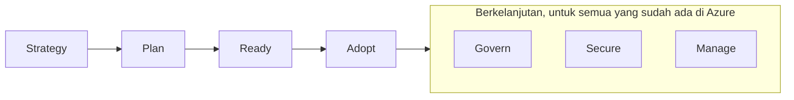
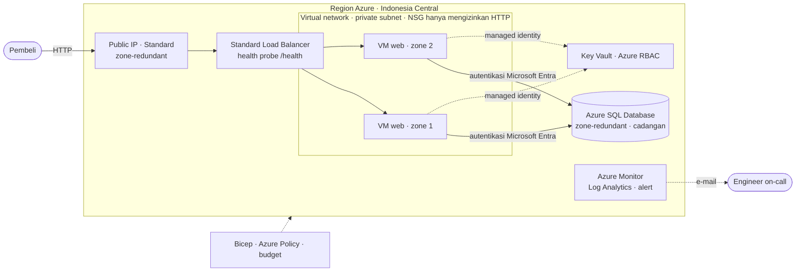
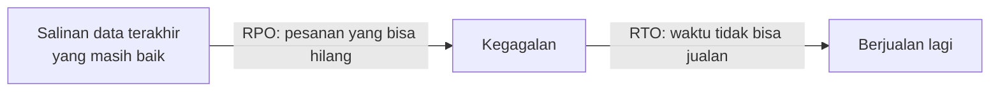

# Makan Siang 21 · Capstone Inti: Menyatukan Semuanya (Dasar)

🇬🇧 [Read in English](README.md)

> **Jalur:** Bulan inti · **Level:** Dasar · **Bagian 4:** Keamanan, operasional, dan tata kelola
> **Waktu:** 60 menit · **Makan siang prasyarat:** 01–20 (seluruh bulan inti; makan siang ini merangkum yang Anda perlukan)
> **Area keterampilan AZ-900:** Ketiganya — Menjelaskan konsep cloud · Menjelaskan arsitektur dan layanan Azure · Menjelaskan manajemen dan tata kelola Azure
> **Lab:** [Lab 21 · Proyek capstone](../../labs/21-core-capstone/README.id.md) — sekitar 2–3 jam, bisa dicicil · biaya 💲💲
> **Penulis:** Stefanus Pinarta · [Tentang penulis](../../README.id.md#tentang-penulis)

| ⏱ Menit | Segmen |
|---:|---|
| 5 | Skenario dan tujuan |
| 25 | Bacaan |
| 15 | Demo: animasi interaktif (+ video panduan opsional) |
| 5 | Uji pemahaman |
| 5 | Poin penting dan pratinjau lab |
| 5 | Waktu cadangan — habiskan makan siang Anda 🍜 |

## 🍱 Menu hari ini

Setelah makan siang ini, Anda akan mampu:

- **Menjelaskan** lima pilar Azure Well-Architected Framework dan menyebutkan trade-off (kompromi) di balik sebuah keputusan desain.
- **Menguraikan** tujuh metodologi Cloud Adoption Framework dan apa yang dimaksud dengan Azure landing zone.
- **Merakit** arsitektur target Nusantara Retail dari layanan-layanan bulan inti dan memberi alasan untuk setiap bagiannya.
- **Menjawab** pertanyaan "berapa lama kita tidak bisa jualan?" dengan RTO dan RPO untuk setiap skenario kegagalan.
- **Merencanakan** persiapan ujian AZ-900 dan memilih apa yang akan Anda pelajari di bulan pendalaman.

## 🏪 Sementara itu di Nusantara Retail

Empat minggu lalu Anda berdiri di ruangan sebelah pantry, mendengarkan dengung sebuah server tua yang sudah kelelahan, dan untuk pertama kalinya mendengar pertanyaan Ibu Sari: *"Kalau server itu mati, berapa lama kita tidak bisa jualan?"* Tidak seorang pun di rapat itu punya jawabannya.

Sejak itu Anda mengumpulkan kepingannya, satu makan siang demi satu makan siang: region (*wilayah*) dan availability zone (*zona ketersediaan*), jaringan dan load balancer, database yang membuat cadangannya sendiri, secret yang tidak pernah menyentuh file konfigurasi, alert (*pemberitahuan*), policy, anggaran (budget), dan sebuah file Bicep yang sanggup membangun ulang semuanya. Yang belum Anda miliki adalah gambaran utuhnya.

Rapat bulanan jatuh pada hari Jumat. Ibu Sari menginginkan jawaban lugas, lengkap dengan angka. Dewi ingin tahu kekhawatiran mana saja yang bisa ia serahkan kepada Azure. Pak Budi ingin tahu bagaimana desain ini berdampingan dengan sistem di kantor pusat, dan bagian keuangan ingin jaminan bahwa tagihan tidak akan mengagetkan siapa pun. Hari ini Anda merakit satu desain utuh, mengujinya dengan pertanyaan-pertanyaan yang diajukan para arsitek Microsoft sendiri, lalu menyiapkan jawaban Anda: berapa lama kita tidak bisa jualan — dan berapa banyak yang bisa hilang?

---

## 📖 Bacaan (≈25 menit)

Capstone tidak membawa layanan yang benar-benar baru. Istilahnya berasal dari batu penutup yang dipasang paling akhir di puncak sebuah bangunan: inilah saatnya semua kepingan terpasang di tempatnya. Anda akan melihat Nusantara Retail melalui dua kerangka kerja (framework) dari Microsoft — satu untuk menilai satu workload, satu lagi untuk mengadopsi cloud sebagai sebuah perusahaan — lalu merakit arsitektur target, mengubahnya menjadi jawaban untuk direktur, dan merencanakan langkah Anda berikutnya.

### 1. Well-Architected Framework: lima pertanyaan untuk setiap desain

**Azure Well-Architected Framework** (WAF) adalah kumpulan prinsip desain, daftar periksa (checklist), dan alat peninjauan dari Microsoft untuk membangun **workload** yang baik. Workload (beban kerja) adalah gabungan resource (*sumber daya*), kode, dan data yang bersama-sama menghasilkan satu hasil bisnis, misalnya toko online Nusantara Retail. Framework ini mengelompokkan panduannya ke dalam lima **pilar**. Cara termudah mengingatnya adalah menganggap kelimanya sebagai lima pertanyaan yang akan diajukan seorang peninjau yang sangat teliti terhadap desain apa pun.

Bayangkan Anda hendak membeli rumah. Sebelum menandatangani apa pun, Anda pasti bertanya: apakah bangunannya tetap kokoh saat hujan deras? Apakah pintu dan pagarnya aman? Berapa tagihan listrik dan airnya setiap bulan? Mudahkah dirawat dan diperbaiki? Masih legakah ketika keluarga besar datang saat Lebaran? Lima pilar WAF menanyakan hal yang persis sama, hanya saja untuk sebuah sistem.

| Pilar | Pertanyaan si peninjau | Dalam desain Nusantara Retail | Makan siang |
|---|---|---|---|
| **Reliability** (*keandalan*) | Apakah toko tetap berjualan saat ada yang rusak, dan bisakah kita pulih dalam target yang disepakati? | Dua VM (*komputer virtual*) web di dua availability zone di belakang Standard load balancer; cadangan database otomatis; failover yang sudah diuji | 03, 09, 17 |
| **Security** (keamanan) | Apakah hanya orang dan kode yang tepat yang bisa menjangkau data? | Tidak ada public IP pada VM; NSG yang hanya mengizinkan HTTP; sign-in database khusus Microsoft Entra; Key Vault dengan Azure RBAC (*kontrol akses berbasis peran*); prinsip hak akses minimum (least privilege) untuk Rizky | 05, 08, 15 |
| **Cost Optimization** (pengoptimalan biaya) | Apakah kita hanya membayar untuk hal yang menghasilkan nilai? | VM burstable berukuran kecil; database serverless yang bisa pause (berhenti sejenak); budget dengan alert; tag untuk laporan biaya | 01, 19 |
| **Operational Excellence** (keunggulan operasional) | Bisakah kita men-deploy, mengubah, memantau, dan memperbaikinya dengan aman dan dengan hasil yang sama setiap kali? | Semuanya dalam Bicep, dipratinjau dengan what-if; alert yang benar-benar sampai ke seseorang; runbook (panduan langkah demi langkah) tertulis | 16, 18, 20 |
| **Performance Efficiency** (efisiensi performa) | Apakah sistem tetap sanggup saat permintaan berubah — misalnya saat promo 12.12? | Scale out dengan menambah server di beberapa zone; ukuran VM yang pas; uji beban (load test) sebelum masa puncak | 06, 09, 23 |

Perhatikan bahwa pilar bukanlah layanan. Azure Monitor tidak "mengerjakan" operational excellence, dan Key Vault tidak "mengerjakan" security. Pilar adalah kualitas dari desain secara keseluruhan, dan hampir setiap layanan yang Anda temui bulan ini melayani lebih dari satu pilar. Load balancer, misalnya, sekaligus memberi Anda reliability (health probe-nya mengalihkan lalu lintas menjauhi server yang gagal) dan performance efficiency (lebih banyak server di balik satu alamat).

Microsoft menerbitkan framework ini sebagai panduan gratis di Microsoft Learn, termasuk **service guide** yang menerapkan kelima pilar pada masing-masing layanan, dan sebuah penilaian mandiri bernama **Azure Well-Architected Review**. Anda tidak perlu membaca semuanya. Cukup ajukan lima pertanyaan itu pada setiap desain yang Anda tinjau, dimulai dari lab Anda hari ini.

> [!TIP]
> Catat setiap pilihan desain yang penting dalam beberapa baris: apa yang Anda pilih, pilar mana yang terbantu, pilar mana yang dikorbankan, dan kapan keputusan itu perlu ditinjau ulang. Tim menyebut catatan ini **architecture decision record** (catatan keputusan arsitektur). Enam bulan lagi tidak ada yang ingat mengapa database berhenti sendiri saat sepi; catatan itulah yang akan ingat.

### 2. Trade-off: Anda tidak bisa memaksimalkan semua pilar

Pilar-pilar ini saling tarik-menarik. Redundansi yang lebih banyak meningkatkan reliability, tetapi menambah biaya. Jaringan privat meningkatkan security, tetapi menambah komponen yang harus dioperasikan. Auto-pause menghemat uang, tetapi membuat pembeli pertama setelah jam sepi harus menunggu. Arsitek yang baik tidak menghindari trade-off; ia memilihnya dengan sengaja dan menjelaskannya kepada orang-orang yang menanggung risikonya.

| Keputusan | Memperkuat | Melemahkan | Keputusan Nusantara Retail |
|---|---|---|---|
| VM web kedua di zone lain | Reliability | Cost (biaya compute jadi dua kali lipat) | Ya. Satu jam tanpa penjualan lebih mahal daripada sebulan biaya satu VM kecil. |
| Database zone-redundant | Reliability | Cost | Ya untuk production; dilewati di lab. |
| Database serverless yang auto-pause | Cost | Performance (request pertama setelah pause harus menunggu) | Hanya untuk lab dan pengujian; production tetap menyisakan kapasitas minimum. |
| Private endpoint (*titik akhir privat*) menggantikan public endpoint (*titik akhir publik*) | Security | Operational excellence (ada DNS dan jaringan yang harus dikelola) | Direncanakan untuk bulan pendalaman. |
| Policy Allowed locations | Security dan kepatuhan (residensi data) | Kelincahan (agility) | Ya — tetapi policy ini juga harus mengizinkan region pemulihan bencana (disaster recovery). |
| Retensi log yang panjang | Operational excellence, investigasi keamanan | Cost | 30 hari sebagai awal; lebih lama untuk log audit jika regulator memintanya. |

Setiap "ya" di tabel itu ada harganya, dan setiap "tidak" ada risikonya. Tugas Anda adalah membuat keduanya terlihat jelas. Ibu Sari yang menanggung kerugian saat toko tidak bisa berjualan, dan bagian keuangan yang memegang anggaran, jadi merekalah — bukan Anda — yang memutuskan di mana garisnya ditarik, setelah Anda menjelaskan pilihan-pilihannya dengan bahasa yang sederhana.

Trade-off juga bersembunyi di dalam **dependensi**, yaitu ketergantungan antarkomponen. Satu pesanan pembeli membutuhkan public IP, load balancer, setidaknya satu VM web, database, dan Key Vault — semuanya pada saat yang sama. Jika masing-masing dari lima mata rantai itu tersedia 99,9% dari waktu — angka ilustrasi, bukan SLA (service level agreement, janji tingkat layanan) Azure — rantai secara keseluruhan hanya tersedia sekitar 99,5% dari waktu, karena celah-celah kecil itu saling menjumlah. Ibaratnya lampu hias tujuhbelasan yang dirangkai seri: cukup satu bohlam putus, seluruh rangkaian ikut padam. Itulah sebabnya desain ini membelanjakan uangnya di titik-titik tempat satu kegagalan saja akan menghentikan segalanya: dua VM alih-alih satu, pintu depan yang zone-redundant, dan database yang tetap hidup walau satu zone hilang. Setiap dependensi baru, seberguna apa pun, menurunkan angka total — kecuali dependensi itu juga dibuat redundan.

### 3. Sekilas tentang Cloud Adoption Framework

Well-Architected Framework menilai satu workload. Pasangannya, **Cloud Adoption Framework** (CAF), memandu seluruh organisasi: keputusan-keputusan yang diambil para pemimpin, tim platform, dan tim keamanan sebelum, selama, dan sesudah workload pindah ke Azure. Saat tulisan ini dibuat, CAF menggambarkan adopsi Azure sebagai tujuh metodologi, masing-masing menjawab satu pertanyaan kunci.

| Metodologi | Pertanyaan kunci | Jawaban Nusantara Retail sejauh ini |
|---|---|---|
| **Strategy** (strategi) | Mengapa kita mengadopsi Azure, dan seperti apa wujud keberhasilannya? | Berhenti kehilangan penjualan gara-gara satu server, bertahan saat puncak 12.12, dan menyimpan data pelanggan di Indonesia. |
| **Plan** (rencana) | Bagaimana kita menyiapkan orang dan workload? | Menginventarisasi toko online, database pesanan, dan sistem di toko-toko; melatih tim (lewat kursus ini). |
| **Ready** (siap) | Bagaimana kita membangun Azure landing zone kita? | Subscription (*langganan*), rentang alamat yang tidak bertabrakan dengan 10.0.0.0/16 milik kantor pusat, policy dasar, dan budget. |
| **Adopt** (adopsi) | Bagaimana kita memigrasikan, memodernisasi, dan membangun workload? | Pindahkan toko online ke VM sekarang; modernisasi ke App Service atau container (*kontainer*) nanti. |
| **Govern** (tata kelola) | Bagaimana kita mengendalikan lingkungannya? | Allowed locations, tag wajib, budget. |
| **Secure** (amankan) | Bagaimana kita melindunginya? | Microsoft Entra ID (*ID Microsoft Entra*) dengan MFA (*autentikasi multifaktor*), Key Vault, Microsoft Defender for Cloud (*Microsoft Defender untuk Cloud*). |
| **Manage** (kelola) | Bagaimana kita mengoperasikan dan mengoptimalkannya dari waktu ke waktu? | Azure Monitor, cadangan (backup), patching, tinjauan biaya bulanan. |

Hasil dari metodologi Ready adalah **Azure landing zone**: lingkungan yang sudah disiapkan dan diatur, tempat workload nantinya pindah. Bayangkan sebuah kompleks perumahan baru: jalan, saluran air, listrik PLN, pos satpam, dan aturan membangun dari pengembang sudah ada sebelum rumah pertama berdiri. CAF membagi landing zone menjadi dua. **Platform landing zone** adalah fondasi bersama — hierarki management group (*grup manajemen*), identitas, konektivitas, pemantauan terpusat, dan policy yang diwarisi semua pihak — yang biasanya dijalankan oleh tim platform yang kecil. Setiap workload mendapat **workload landing zone**: subscription tempat tim seperti tim Dewi membangun dan menjalankan aplikasinya di dalam pagar pengaman (guardrail) milik platform.

Microsoft menyediakan **accelerator** landing zone yang men-deploy desain rekomendasinya sebagai kode. Perusahaan seukuran Nusantara Retail boleh memulai dengan versi yang lebih kecil daripada arsitektur referensi lengkapnya, tetapi tetap harus memutuskan management group, subscription, rentang alamat, dan policy dasarnya sebelum workload kedua datang; Makan Siang 31 membangunnya secara lengkap. Satu pengingat dari Makan Siang 18 juga berlaku di sini: Azure Blueprints sedang dipensiunkan, jadi landing zone masa kini dibangun dengan infrastructure as code (*infrastruktur sebagai kode*), Azure Policy, dan deployment stack.

### 4. Arsitektur target Nusantara Retail

Inilah desain yang sedikit demi sedikit dibangun sepanjang bulan inti. Lingkungan production akan berjalan di **Indonesia Central** demi residensi data, artinya data pelanggan tetap tersimpan di Indonesia; lab Anda membangun bentuk yang sama di Southeast Asia.

Mari kita telusuri dari luar ke dalam:

- **Pintu depan.** Pembeli tiba di **Standard public IP** yang zone-redundant — tetap hidup walau satu zone padam — dan terpasang pada **Standard load balancer** (SKU Basic sudah dipensiunkan pada September 2025). Health probe HTTP pada `/health`, semacam pemeriksaan kesehatan berkala, menentukan server mana yang menerima koneksi baru. Inilah satu-satunya jalan masuk dari internet.
- **Lapisan web.** Dua VM Linux kecil berjalan di availability zone yang berbeda tanpa public IP, di dalam **private subnet** yang NSG-nya (network security group) hanya mengizinkan HTTP dan probe dari load balancer, tidak ada yang lain. Virtual network (*jaringan virtual*) yang baru kini secara default memakai private subnet tanpa akses internet tersembunyi, sehingga VM keluar ke internet melalui outbound rule milik load balancer. Server-server ini tidak menyimpan data, sehingga mana pun di antaranya bisa diganti dari kode dalam hitungan menit.
- **Data.** Azure SQL Database hanya menerima identitas Microsoft Entra, sehingga tidak ada kata sandi database di mana pun. Di production, database ini zone-redundant, dan cadangan otomatisnya memungkinkan point-in-time restore, yaitu pemulihan data ke titik waktu tertentu.
- **Secret.** Aplikasi membaca pengaturannya dari Key Vault melalui **managed identity** (identitas yang dikelola Azure, tanpa kata sandi), dan Azure RBAC menentukan identitas mana yang boleh membaca secret yang mana.
- **Operasional.** Azure Monitor mengumpulkan metrik dan activity log, sebuah Log Analytics workspace menyimpan log seperti jejak audit Key Vault, dan alert rule memberi tahu sebuah action group yang mengirim e-mail kepada engineer yang sedang piket (on-call).
- **Pagar pengaman.** Policy Allowed locations menjaga resource tetap berada di region yang disetujui, tag mengisi laporan biaya, dan budget memperingatkan bagian keuangan pada 50, 80, dan 100 persen.
- **Semuanya sebagai kode.** Satu deployment Bicep, yang dipecah menjadi beberapa modul, membuat semua itu. What-if menampilkan pratinjau setiap perubahan, dan resource group (*grup sumber daya*) yang hilang bisa dibangun ulang dalam hitungan menit, bukan hari.

Sama pentingnya adalah apa yang sengaja ditinggalkan oleh versi ini. Pembeli masih memakai HTTP biasa; TLS (enkripsi koneksi yang memunculkan ikon gembok di browser) dan web application firewall baru hadir bersama Application Gateway atau Front Door di Makan Siang 27. Database masih punya public endpoint yang ditutup oleh firewall-nya; private endpoint menggantikannya di bulan pendalaman. Dua VM tidak bisa bertambah sendiri untuk promo 12.12; scale set (*Kumpulan Skala Komputer Virtual*) dengan autoscale memperbaikinya di Makan Siang 23. Menuliskan celah-celah ini bukanlah pengakuan gagal. Inilah backlog (daftar pekerjaan berikutnya) yang jujur, yang Anda serahkan kepada Ibu Sari bersama desainnya — setiap item lengkap dengan pilar dan harganya.

### 5. Menjawab direktur: RTO dan RPO

Pertanyaan Ibu Sari punya dua bagian. "Berapa lama kita tidak bisa jualan?" adalah **recovery time objective** (RTO), target waktu pemulihan: durasi gangguan terlama yang masih bisa diterima bisnis. Bagian yang belum ia tanyakan — "berapa banyak pesanan yang bisa hilang?" — adalah **recovery point objective** (RPO), target titik pemulihan: seberapa jauh ke belakang salinan data terakhir yang masih baik boleh berada. Keduanya adalah keputusan bisnis. Tugas Anda adalah menunjukkan apa yang diberikan setiap desain dan berapa biayanya.

Bayangkan listrik PLN padam saat Anda sedang mengetik laporan. RTO adalah berapa lama Anda tidak bisa bekerja sampai listrik menyala dan komputer siap lagi. RPO adalah berapa banyak ketikan yang hilang sejak terakhir kali Anda menekan Ctrl+S.

Bahas kegagalannya satu per satu; satu angka untuk "seluruh sistem" menyembunyikan detail yang justru penting.

| Kegagalan | Apa yang dilakukan desain target | RTO | RPO |
|---|---|---|---|
| Hari ini: server di sebelah pantry mati | Perbaiki atau beli perangkat keras, instal ulang, pulihkan cadangan apa pun yang ada | Berhari-hari | Semua data sejak cadangan terakhir — kalau memang ada |
| Satu VM web crash | Health probe menandainya down; VM yang lain menerima semua koneksi baru | Hitungan detik (beberapa pembeli perlu mengklik ulang) | Tidak ada — lapisan web tidak menyimpan data |
| Satu availability zone gagal total | Sama untuk lapisan web; database zone-redundant tetap berjalan di zone lain (dokumentasi Azure menyebut umumnya kurang dari 30 detik) | Beberapa detik hingga kurang dari satu menit | Tidak ada |
| Seseorang menghapus pesanan hari ini | Point-in-time restore membuat salinan database dari saat tepat sebelum kesalahan | Beberapa menit hingga beberapa jam, tergantung ukuran database | Beberapa menit: cadangan transaction log berjalan kira-kira setiap 5–10 menit |
| Seluruh region hilang (jarang terjadi) | Bangun ulang dari Bicep di region kedua; data diambil dari replika yang sudah disiapkan di sana sebelumnya (Makan Siang 28) | Berjam-jam tanpa persiapan; jauh lebih singkat dengan replika siaga | Beberapa detik dengan replika; tanpa replika, semua data sejak salinan terakhir di luar region |

Angka di dalam tabel hanyalah janji; hanya latihan (drill) yang mengubahnya menjadi fakta. Di lab, Anda mematikan zone 1 sendiri dan mengukur lamanya jeda, dan latihan restore di Makan Siang 17 melakukan hal yang sama untuk cadangan.

> [!WARNING]
> **Ketersediaan tinggi (high availability) bukanlah cadangan.** Zone redundancy menyalin setiap perubahan ke zone lain dalam hitungan detik — termasuk `DELETE` yang tidak disengaja, persis seperti pesan salah kirim di grup WhatsApp keluarga yang dalam sekejap sudah diterima semua anggota. Hanya cadangan dan point-in-time restore yang bisa membawa Anda kembali ke saat *sebelum* kesalahan itu. Anda membutuhkan keduanya, dan Anda harus menguji restore-nya.

Satu kejutan lagi. Indonesia Central **tidak punya region pasangan** (region pair, *pasangan wilayah*), dan fitur-fitur yang mengandalkan pasangan tidak tersedia di sana — contohnya penyimpanan cadangan geo-redundant untuk Azure SQL. Karena itu, rencana pemulihan bencana tingkat region harus menyebut region kedua secara eksplisit (Southeast Asia adalah pilihan yang wajar), menyalin data ke sana dengan sengaja, dan mengizinkan region itu di policy Allowed locations *sebelum* hari buruk itu tiba.

Jadi jawaban untuk Ibu Sari menjadi: *"Kalau satu server, atau bahkan satu zone pusat data, gagal, kita tetap berjualan dan tidak kehilangan apa pun. Kalau ada yang menghapus pesanan, kita memulihkan database ke satu menit sebelum kesalahan itu dan memasukkan ulang pesanan dari beberapa menit terakhir. Kalau seluruh region Jakarta padam, desain hari ini butuh berjam-jam untuk dibangun ulang di tempat lain; salinan siaga di Singapura akan memperpendek waktu itu, dan saya bisa menghitungkan biayanya untuk Ibu."*

> [!NOTE]
> **Renungkan sejenak:** Ibu Sari meminta "tanpa downtime, tanpa data hilang, dan opsi termurah". Dari ketiganya, dua mana yang bisa Anda tawarkan sekaligus, dan pilar mana yang "dibelanjakan" oleh setiap kombinasi?

### 6. Selanjutnya: AZ-900 dan bulan pendalaman

Jika Anda berencana mengambil sertifikasi, bulan inti adalah silabus Anda. Ujian AZ-900 (Microsoft Azure Fundamentals) mengukur tiga area keterampilan — sesuai daftar skills measured per 20 Juli 2026 — dan setiap makan siang inti terpetakan ke area-area itu:

| Area keterampilan | Bobot | Makan siang yang mengajarkannya |
|---|---|---|
| Menjelaskan konsep cloud | 25–30% | 02 (ditambah bagian "mengapa cloud" di 01 dan 21) |
| Menjelaskan arsitektur dan layanan Azure | 35–40% | 03, 04, 05, 06, 07, 08, 09, 10, 11, 12, 13, 14, 15 |
| Menjelaskan manajemen dan tata kelola Azure | 30–35% | 01, 16, 18, 19, 20 |
| Di luar ujian, tetapi sering ditanyakan di tempat kerja | — | 17 (cadangan dan pemulihan bencana); 21 menyatukan ketiga area |

Tiga tips belajar. Pertama, konsep cloud menyumbang sekitar seperempat nilai tetapi hanya diajarkan dalam satu makan siang, jadi baca ulang Makan Siang 02 beserta uji pemahamannya sebanyak dua kali. Kedua, buka [panduan belajar AZ-900](https://learn.microsoft.com/credentials/certifications/resources/study-guides/az-900) resmi dan centang setiap butirnya terhadap kursus ini; ujian memakai nama produk terbaru, jadi sebutlah Microsoft Entra ID, jangan pernah Azure AD. Ketiga, kerjakan **practice assessment gratis** (simulasi ujian) di Microsoft Learn, yang tautannya ada di halaman sertifikasi Azure Fundamentals. Simulasi ini menjelaskan setiap jawaban, bisa diulang sesering yang Anda mau, dan hasilnya menunjukkan makan siang mana yang perlu Anda ulangi. Nilai 700 atau lebih berarti lulus ujian yang sesungguhnya.

> [!TIP]
> Ujian ini juga tersedia dalam bahasa Indonesia. Microsoft menyarankan Anda mendaftar dengan akun Microsoft pribadi, supaya catatan sertifikasi Anda tetap ikut bersama Anda saat berganti tempat kerja.

Bulan inti memberi Anda keluasan. **Bulan pendalaman** membawa setiap topik ke kedalaman yang dibutuhkan seorang administrator atau arsitek, dan urutannya pas sekali dengan permintaan Nusantara Retail berikutnya:

| Permintaan Nusantara Retail berikutnya | Makan siang pendalaman |
|---|---|
| "Pipeline Rizky harus bisa men-deploy tanpa kata sandi yang disimpan." | 22 · Identitas dan akses (lanjutan) |
| "Bertahan saat promo 12.12 tanpa membeli server untuk setahun penuh." | 23 · Virtual machine (lanjutan) |
| "Buat faktur kebal ransomware dan tetap privat." | 24 · Penyimpanan (lanjutan) |
| "Pisahkan layanan bersama dari workload." | 25 · Jaringan virtual (lanjutan) |
| "Hubungkan kantor pusat dan empat puluh toko." | 26 · Konektivitas hibrid |
| "Blokir serangan dan arahkan pembeli ke situs yang sehat." | 27 · Load balancing (lanjutan) |
| "Jaga pesanan tetap aman walaupun region gagal." | 28 · Database relasional (lanjutan) |
| "Tim microservices ingin Kubernetes." | 29 · Container (lanjutan): AKS |
| "Kenapa checkout lambat hari Jumat lalu?" | 30 · Pemantauan (lanjutan) |
| "Atur semua subscription, bukan cuma satu." | 31 · Tata kelola dalam skala besar |

Bulan itu ditutup dengan [tantangan capstone lanjutan](../../labs/32-advanced-capstone-challenge/README.id.md): hanya berisi persyaratan, tanpa panduan langkah demi langkah. Anda membangun ulang arsitektur hari ini dengan cara production — hub and spoke, private endpoint, web application firewall, failover group untuk database, dan rencana pemulihan bencana untuk region yang tidak punya pasangan. Desain hari ini adalah desain yang bisa Anda jelaskan kepada Ibu Sari hari Jumat nanti; desain di tantangan itulah yang benar-benar akan Anda jalankan.

---

## 🎬 Demo (≈15 menit)

1. **Animasi interaktif (≈6–8 menit):** [Buka demo](https://stefpin.github.io/azure-fundamentals-lunches/demos/21-core-capstone.html?lang=id) — tekan ▶ Putar atau telusuri langkah demi langkah sesuai kecepatan Anda. Sedang offline? Unduh [`docs/demos/21-core-capstone.html`](../../docs/demos/21-core-capstone.html) dan buka di browser apa pun.
2. **Video panduan (≤ 6 menit):** _segera hadir_ — [baca naskah video](demo-video-script.id.md).

Yang perlu diperhatikan:

- Jalur request: public IP, load balancer, NSG, satu VM web di salah satu dari dua zone, lalu Azure SQL dan Key Vault.
- Apa yang berubah saat zone 1 gagal — dan apa yang *tidak* berubah: tidak ada konfigurasi yang diedit, tidak ada pesanan yang hilang.
- Tiga guardrail yang bekerja: alert yang sampai ke seseorang, policy yang menolak deployment di luar region, dan budget yang memperingatkan bagian keuangan.
- Jawaban akhir untuk Ibu Sari, skenario demi skenario.

## ✅ Uji pemahaman (≈5 menit)

1. Dewi mengusulkan penghematan dengan menjalankan hanya satu VM web pada malam hari, saat lalu lintas sepi. Dua pilar mana yang saling bertentangan, dan apa kompromi yang masuk akal?
   

Lihat jawaban

   Reliability melawan cost optimization. Pertahankan dua VM kecil di dua zone sepanjang waktu (atau scale set dengan minimal dua instance) dan berhematlah di tempat lain — ukuran burstable, reservation untuk bagian beban yang stabil, dan menghapus lingkungan pengujian. *alasannya:* dengan satu VM, satu kegagalan di malam hari berarti toko tutup total, dan tidak ada yang terjaga untuk memperbaikinya.

   

2. Pukul 14.00, sebuah script yang keliru menghapus pesanan hari itu. Database-nya zone-redundant. Bagaimana cara mendapatkan kembali pesanan-pesanan itu, dan berapa banyak data yang hilang?
   

Lihat jawaban

   Zone redundancy tidak membantu — penghapusan itu sudah ikut direplikasi dalam hitungan detik. Gunakan point-in-time restore untuk membuat salinan database per saat tepat sebelum pukul 14.00, lalu salin kembali baris-baris yang hilang atau alihkan aplikasi ke salinan itu. Anda kehilangan paling banyak beberapa menit pesanan, ditambah pesanan apa pun yang masuk setelah kesalahan; lama restore bergantung pada ukuran database. *alasannya:* ketersediaan tinggi melindungi dari kegagalan infrastruktur; cadangan melindungi dari kesalahan data.

   

3. Sebelum toko online pindah, Pak Budi ingin subscription, management group, rentang alamat, dan policy dasar sudah siap. Metodologi Cloud Adoption Framework yang mana ini, dan apa nama hasilnya?
   

Lihat jawaban

   Metodologi Ready; hasilnya adalah Azure landing zone — platform landing zone ditambah workload landing zone. *alasannya:* Ready menyiapkan lingkungan yang sudah diatur, tempat workload akan pindah, sebelum workload itu benar-benar pindah.

   

4. Policy Allowed locations Anda hanya mengizinkan Indonesia Central. Saat latihan pemulihan bencana, tim men-deploy toko online ke Southeast Asia. Apa yang terjadi, dan apa yang seharusnya sudah dilakukan lebih awal?
   

Lihat jawaban

   Deployment ditolak dengan `RequestDisallowedByPolicy`. Region DR (pemulihan bencana) seharusnya sudah ditambahkan ke daftar yang diizinkan (atau dicakup assignment terpisah untuk lingkungan DR) sebagai bagian dari rencana DR, lalu diuji dalam latihan. *alasannya:* guardrail harus dirancang bersama rencana pemulihan, bukan baru ditemukan saat bencana terjadi.

   

5. Seminggu sebelum ujian AZ-900, practice assessment menunjukkan hasil yang lemah pada Azure Policy, resource lock (*kunci sumber daya*), dan Microsoft Purview. Area keterampilan mana itu, berapa bobotnya, dan makan siang mana yang perlu Anda ulangi lebih dulu?
   

Lihat jawaban

   Menjelaskan manajemen dan tata kelola Azure, 30–35% dari ujian. Mulailah dari Makan Siang 18 (Azure Policy, lock, tag, Microsoft Purview), lalu 19, 16, dan 20. *alasannya:* practice assessment menunjuk ke sebuah area keterampilan, dan kursus ini memetakan setiap area keterampilan ke makan siang tertentu.

   

## 🧠 Poin penting

- Lima pilar Well-Architected Framework — reliability, security, cost optimization, operational excellence, dan performance efficiency — adalah pertanyaan yang perlu diajukan pada setiap workload, dan setiap keputusan desain "membeli" satu pilar dengan pilar lainnya.
- Cloud Adoption Framework memandu seluruh organisasi melalui Strategy, Plan, Ready, Adopt, Govern, Secure, dan Manage; Ready menghasilkan Azure landing zone (platform landing zone plus workload landing zone) sebelum workload pindah.
- Arsitektur target Nusantara Retail: pintu depan Standard yang zone-redundant, VM tanpa state (stateless) di dua zone tanpa public IP, Azure SQL khusus Entra, Key Vault dengan RBAC, alert Azure Monitor, serta guardrail berupa policy dan budget — semuanya dari Bicep.
- Jawab pertanyaan soal ketersediaan dengan RTO dan RPO untuk setiap skenario kegagalan. Ketersediaan tinggi, cadangan, dan pemulihan bencana memecahkan masalah yang berbeda, dan karena Indonesia Central tidak punya pasangan, Anda sendiri yang memilih dan menyiapkan region DR.
- AZ-900 memberi bobot 25–30% untuk konsep cloud, 35–40% untuk arsitektur dan layanan, serta 30–35% untuk manajemen dan tata kelola; practice assessment gratis menunjukkan bagian yang perlu diulang, dan bulan pendalaman membawa setiap topik lebih jauh.

## 🗒️ Catatan lapangan dari Stefanus

> **Angka tanpa tanggal latihan hanyalah tebakan.** Setiap kali disodori tabel RTO dan RPO, saya bertanya untuk setiap barisnya: *kapan terakhir kali kita membuktikannya, dan siapa yang memegang stopwatch?* Kalau jawabannya "belum pernah", saya tulis "belum diuji" tepat di samping angkanya — dengan ukuran huruf yang sama, bukan sebagai catatan kaki. Aturan saya: setiap skenario gangguan punya baris sendiri, penanggung jawab sendiri, dan tanggal latihan berikutnya. Latihan kehilangan satu zone cukup satu sore; uji point-in-time restore muat dalam satu jam makan siang. Saya juga selalu memburu ketergantungan yang tidak tercatat: policy yang memblokir region pemulihan, secret yang hanya bisa dibaca satu orang, record DNS yang tak jelas pemiliknya. Rencana pemulihan jarang gagal di langkah-langkah besar; ia gagal di satu izin kecil yang lupa diberikan sebelum hari buruk itu datang.

## 🔬 Lab Anda: Proyek capstone

Anda men-deploy platform inti Nusantara Retail dari Bicep yang modular — jaringan, dua VM web di dua zone di belakang Standard load balancer, Azure SQL dengan autentikasi khusus Entra, Key Vault ber-RBAC, Log Analytics dengan tiga alert rule, dan policy Allowed locations — lalu memperlakukannya seperti production. Anda mematikan zone 1 dan membuktikan toko tetap buka, melihat alert sampai di inbox Anda, menguji policy, menambahkan budget, menjawab Ibu Sari dengan RTO dan RPO hasil pengukuran, dan meninjau seluruh desain terhadap kelima pilar.

- ⏱ Sekitar 2–3 jam (bisa dibagi menjadi tiga sesi) · 💲💲 · bisa dikerjakan terpisah (tidak perlu lab sebelumnya)
- 👉 [Mulai Lab 21](../../labs/21-core-capstone/README.id.md)

## 📚 Pelajari lebih lanjut

- [Azure Well-Architected Framework](https://learn.microsoft.com/azure/well-architected/) — lima pilar, service guide, dan checklist desain, langsung dari Microsoft.
- [Apa itu Azure landing zone?](https://learn.microsoft.com/azure/cloud-adoption-framework/ready/landing-zone/) — platform landing zone dan workload landing zone beserta arsitektur referensinya; titik awal untuk Makan Siang 31.
- [Microsoft Certified: Azure Fundamentals](https://learn.microsoft.com/credentials/certifications/azure-fundamentals/) — detail ujian, panduan belajar, dan practice assessment gratis.
- [Azure Well-Architected Review](https://learn.microsoft.com/assessments/azure-architecture-review/) — penilaian mandiri gratis yang bisa Anda jalankan untuk toko online setelah lab.

---

⬅️ [Makan Siang 20 · Infrastructure as Code dengan Bicep (Dasar)](../20-infrastructure-as-code-bicep/README.id.md) · 🏠 [Beranda kursus](../../README.id.md) · [Makan Siang 22 · Identitas dan Akses (Lanjutan)](../22-identity-access-advanced/README.id.md) ➡️

Terakhir divalidasi: Oktober 2026 · Menemukan informasi yang sudah usang? [Buka issue](../../CONTRIBUTING.md).
