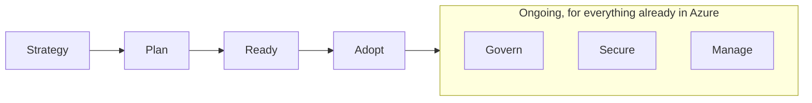
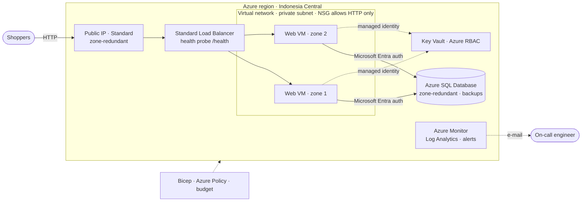
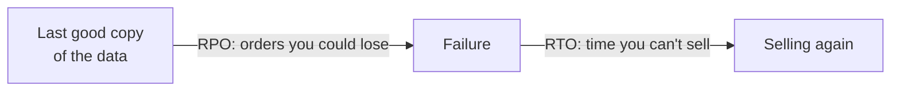

# Lunch 21 · Core Capstone: Putting It All Together (Basic)

🇮🇩 [Baca dalam Bahasa Indonesia](README.id.md)

> **Track:** Core month · **Level:** Basic · **Part 4:** Secure, operate and govern
> **Time:** 60 minutes · **Prerequisite lunches:** 01–20 (the whole core month; this lunch recaps what you need)
> **AZ-900 skill area:** All three — Describe cloud concepts · Describe Azure architecture and services · Describe Azure management and governance
> **Lab:** [Lab 21 · Capstone project](../../labs/21-core-capstone/README.md) — about 2–3 hours, can be split · cost 💲💲
> **Author:** Stefanus Pinarta · [About the author](../../README.md#about-the-author)

| ⏱ Minutes | Segment |
|---:|---|
| 5 | Scenario and objectives |
| 25 | Reading |
| 15 | Demo: interactive animation (+ optional walkthrough video) |
| 5 | Knowledge check |
| 5 | Key takeaways and lab preview |
| 5 | Buffer — finish your lunch 🍜 |

## 🍱 Today's menu

By the end of this lunch you will be able to:

- **Explain** the five pillars of the Azure Well-Architected Framework and name the trade-off behind a design decision.
- **Describe** the seven methodologies of the Cloud Adoption Framework and what an Azure landing zone is.
- **Assemble** Nusantara Retail's target architecture from the services of the core month and justify every part.
- **Answer** "how long can't we sell?" with an RTO and an RPO for each failure scenario.
- **Plan** your AZ-900 preparation and choose what to study in the deep-dive month.

## 🏪 Meanwhile at Nusantara Retail

Four weeks ago you stood in the room next to the pantry, listened to one tired server hum, and heard Ibu Sari's
question for the first time: *"If that server dies, how long can't we sell?"* Nobody in the meeting had an answer.

Since then you have collected the pieces one lunch at a time: regions and availability zones, networks and load
balancers, a database that backs itself up, secrets that never touch a configuration file, alerts, policies, budgets,
and a Bicep file that can rebuild all of it. What you do not have yet is the whole picture.

The monthly meeting is on Friday. Ibu Sari wants a straight answer with numbers. Dewi wants to know which worries she
can hand over to Azure. Pak Budi wants to know how the design sits next to head office, and finance wants a promise
that the bill will not surprise anyone. Today you assemble one design, test it against the questions Microsoft's own
architects ask, and prepare your answer: how long can't we sell — and how much could we lose?

---

## 📖 Reading (≈25 minutes)

A capstone brings no brand-new services. It is the moment the pieces click into place. You will look at Nusantara
Retail through two Microsoft frameworks — one for judging a single workload, one for adopting the cloud as a company —
then assemble the target architecture, turn it into an answer for the director, and plan your next steps.

### 1. The Well-Architected Framework: five questions for every design

The **Azure Well-Architected Framework** (WAF) is Microsoft's collection of design principles, checklists and review
tools for building a good **workload**: the resources, code and data that together deliver one business outcome, such
as Nusantara Retail's storefront. The framework groups its guidance into five **pillars**. The easiest way to remember
them is as five questions a demanding reviewer would ask about any design.

| Pillar | The reviewer's question | In Nusantara Retail's design | Lunches |
|---|---|---|---|
| **Reliability** | Does the shop keep selling when something breaks, and can we recover within agreed targets? | Two web VMs in two availability zones behind a Standard load balancer; automatic database backups; a tested failover | 03, 09, 17 |
| **Security** | Can only the right people and code reach the data? | No public IPs on the VMs; an NSG that admits HTTP only; Microsoft Entra-only database sign-in; Key Vault with Azure RBAC; least privilege for Rizky | 05, 08, 15 |
| **Cost Optimization** | Are we paying only for what creates value? | Small burstable VMs; a serverless database that pauses; a budget with alerts; tags for cost reports | 01, 19 |
| **Operational Excellence** | Can we deploy, change, observe and fix it safely and repeatably? | Everything in Bicep, previewed with what-if; alerts that reach a person; a written runbook | 16, 18, 20 |
| **Performance Efficiency** | Does it keep up when demand changes — during the 12.12 sale, for example? | Scale out by adding servers across zones; right-sized VMs; load tests before peaks | 06, 09, 23 |

Notice that the pillars are not services. Azure Monitor does not "do" operational excellence, and Key Vault does not
"do" security. A pillar is a quality of the whole design, and almost every service you met this month serves more than
one. The load balancer, for example, gives you reliability (its health probe routes around failures) and performance
efficiency (more servers behind one address) at the same time.

Microsoft publishes the framework as free guidance on Microsoft Learn, including **service guides** that apply the five
pillars to individual services and a self-assessment called the **Azure Well-Architected Review**. You do not need to
read all of it. Ask the five questions of every design you review, starting with your lab today.

> [!TIP]
> Write down every significant design choice in a few lines: what you chose, which pillar it helps, which pillar it
> costs, and when to revisit it. Teams call this an **architecture decision record**. Six months from now nobody will
> remember why the database pauses itself; the record will.

### 2. Trade-offs: you cannot max out every pillar

The pillars pull against each other. More redundancy improves reliability and costs money. Private networking improves
security and adds moving parts to operate. Auto-pause saves money and makes the first shopper after a quiet hour wait.
A good architect does not avoid trade-offs; she chooses them on purpose and explains them to the people who carry the risk.

| Decision | Strengthens | Weakens | Nusantara Retail's call |
|---|---|---|---|
| A second web VM in another zone | Reliability | Cost (compute doubles) | Yes. An hour without sales costs more than a month of a small VM. |
| Zone-redundant database | Reliability | Cost | Yes in production; skipped in the lab. |
| Serverless database that auto-pauses | Cost | Performance (the first request after a pause waits) | Lab and test only; production keeps a minimum capacity. |
| Private endpoints instead of public endpoints | Security | Operational excellence (DNS and networking to manage) | Planned for the deep-dive month. |
| Allowed-locations policy | Security and compliance (data residency) | Agility | Yes — but it must also allow the disaster recovery region. |
| Long log retention | Operational excellence, security investigations | Cost | 30 days to start; longer for audit logs if regulators ask. |

Every "yes" in that table has a price, and every "no" has a risk. Your job is to make both visible. Ibu Sari owns the
cost of an outage and finance owns the budget, so they — not you — decide where the line sits, once you have shown them
the options in plain words.

Trade-offs also hide in **dependencies**. A shopper's order needs the public IP, the load balancer, at least one web
VM, the database and Key Vault, all at the same moment. If each of those five links were available 99.9% of the time —
an illustrative number, not an Azure SLA — the chain as a whole would be available only about 99.5% of the time,
because the small gaps add up. That is why the design spends its money where a single failure would stop everything:
two VMs instead of one, a zone-redundant front door, a database that survives a zone. Every new dependency, however
useful, lowers the total unless it is redundant too.

### 3. The Cloud Adoption Framework at a glance

The Well-Architected Framework judges one workload. Its companion, the **Cloud Adoption Framework** (CAF), guides the
whole organization: the decisions that leaders, platform teams and security teams make before, during and after
workloads move to Azure. At the time of writing, CAF describes Azure adoption as seven methodologies, each answering
one key question.

| Methodology | The key question | Nusantara Retail's answer so far |
|---|---|---|
| **Strategy** | Why are we adopting Azure, and what does success look like? | Stop losing sales to one server, survive the 12.12 peak, keep customer data in Indonesia. |
| **Plan** | How will we prepare people and workloads? | Inventory the storefront, the orders database and the store systems; train the team (this course). |
| **Ready** | How will we build our Azure landing zone? | Subscriptions, address ranges that avoid head office's 10.0.0.0/16, baseline policies and budgets. |
| **Adopt** | How will we migrate, modernize and build workloads? | Move the storefront to VMs now; modernize it to App Service or containers later. |
| **Govern** | How will we control the environment? | Allowed locations, required tags, budgets. |
| **Secure** | How will we protect it? | Microsoft Entra ID with MFA, Key Vault, Microsoft Defender for Cloud. |
| **Manage** | How will we operate and optimize it over time? | Azure Monitor, backups, patching, monthly cost reviews. |

The result of the Ready methodology is an **Azure landing zone**: a prepared, governed environment that workloads move
into. Think of a housing estate where the roads, water, electricity and building rules exist before the first house
goes up. CAF splits a landing zone in two. The **platform landing zone** is the shared foundation — the management
group hierarchy, identity, connectivity, central monitoring and the policies everyone inherits — usually run by a small
platform team. Each workload gets a **workload landing zone**: the subscriptions where a team like Dewi's builds and
runs its application inside the platform's guardrails.

Microsoft offers landing zone **accelerators** that deploy its recommended designs as code. A company the size of
Nusantara Retail can start smaller than the full reference, but it should still decide its management groups,
subscriptions, address ranges and baseline policies before the second workload arrives; Lunch 31 builds this out. One
reminder from Lunch 18 applies here too: Azure Blueprints is being retired, so today's landing zones are built with
infrastructure as code, Azure Policy and deployment stacks.

### 4. Nusantara Retail's target architecture

Here is the design the core month has been building toward. Production would run in **Indonesia Central** for data
residency; your lab builds the same shape in Southeast Asia.

Walk through it from the outside in:

- **The front door.** Shoppers reach a zone-redundant **Standard public IP** on a **Standard load balancer** (the Basic
  SKUs were retired in September 2025). An HTTP health probe on `/health` decides which servers receive new
  connections. It is the only way in from the internet.
- **The web tier.** Two small Linux VMs run in different availability zones without public IPs, in a **private
  subnet** whose NSG admits HTTP and the load balancer's probes and nothing else. New virtual networks now default to
  private subnets with no hidden internet access, so the VMs go out through the load balancer's outbound rule. The
  servers keep no data, so any of them can be replaced from code in minutes.
- **The data.** Azure SQL Database accepts only Microsoft Entra identities, so no database password exists anywhere.
  In production it is zone-redundant, and its automatic backups allow point-in-time restore.
- **The secrets.** The application reads its settings from Key Vault through a **managed identity**, and Azure RBAC
  decides which identity may read which secret.
- **The operations.** Azure Monitor collects metrics and the activity log, a Log Analytics workspace keeps logs such as
  Key Vault's audit trail, and alert rules notify an action group that e-mails the on-call engineer.
- **The guardrails.** An Allowed-locations policy keeps resources in approved regions, tags feed cost reports, and a
  budget warns finance at 50, 80 and 100 percent.
- **Everything as code.** One Bicep deployment, split into modules, creates all of it. What-if previews every change,
  and a lost resource group is rebuilt in minutes rather than days.

Just as important is what this version leaves out on purpose. Shoppers still use plain HTTP; TLS and a web application
firewall arrive with Application Gateway or Front Door in Lunch 27. The database still has a public endpoint, closed by
its firewall; private endpoints replace it in the deep-dive month. Two VMs cannot grow by themselves for the 12.12 sale;
scale sets with autoscale fix that in Lunch 23. Writing these gaps down is not an admission of failure. It is the
honest backlog you hand to Ibu Sari together with the design, each item with its pillar and its price.

### 5. Answering the director: RTO and RPO

Ibu Sari's question has two halves. "How long can't we sell?" is the **recovery time objective** (RTO): the longest
outage the business accepts. The half she has not asked yet — "how many orders could we lose?" — is the **recovery
point objective** (RPO): how far back in time the last good copy of the data may be. Both are business decisions. Your
job is to show what each design delivers and what it costs.

Go through the failures one by one; a single number for "the system" hides the detail that matters.

| Failure | What the target design does | RTO | RPO |
|---|---|---|---|
| Today: the pantry server dies | Repair or buy hardware, reinstall, restore whatever backup exists | Days | Everything since the last backup, if there is one |
| One web VM crashes | The health probe marks it down; the other VM takes every new connection | Seconds (a few shoppers click again) | None — the web tier stores no data |
| A whole availability zone fails | Same for the web tier; a zone-redundant database keeps running in the other zones (Azure documents typically under 30 seconds) | Seconds to under a minute | None |
| Someone deletes today's orders | Point-in-time restore creates a copy of the database from just before the mistake | Minutes to hours, depending on database size | Minutes: transaction log backups run roughly every 5–10 minutes |
| The whole region is lost (rare) | Rebuild from Bicep in a second region; the data comes from a replica prepared there in advance (Lunch 28) | Hours without preparation; much less with a standby replica | Seconds with a replica; otherwise everything since the last copy outside the region |

Numbers in a table are promises; only a drill turns them into facts. In the lab you switch off zone 1 yourself and
time the gap, and Lunch 17's restore drill does the same for backups.

> [!WARNING]
> **High availability is not a backup.** Zone redundancy copies every change to the other zones within seconds —
> including the accidental `DELETE`. Only backups and point-in-time restore take you back to *before* the mistake. You
> need both, and you need to test the restore.

One more twist. Indonesia Central has **no paired region**, and features that rely on pairs are not available there —
geo-redundant backup storage for Azure SQL, for example. A regional disaster plan must therefore name a second region
explicitly (Southeast Asia is the natural choice), copy the data there on purpose, and allow that region in the
Allowed-locations policy *before* the bad day.

So the answer for Ibu Sari becomes: *"If a server, or even a whole datacenter zone, fails, we keep selling and lose
nothing. If someone deletes orders, we restore to a minute before the mistake and re-enter a few minutes of orders. If
the whole Jakarta region went down, today's design needs hours to rebuild elsewhere; a standby copy in Singapore would
shrink that, and I can price it for you."*

> [!NOTE]
> **Pause and think:** Ibu Sari asks for "zero downtime, zero data loss, and the cheapest option". Which two of the three
> can you offer at once, and which pillar does each combination spend?

### 6. What comes next: AZ-900 and the deep-dive month

If you plan to certify, the core month is your syllabus. Exam AZ-900 (Microsoft Azure Fundamentals) measures three
skill areas — the skills measured as of July 20, 2026 — and every core lunch maps onto them:

| Skill area | Weight | Lunches that teach it |
|---|---|---|
| Describe cloud concepts | 25–30% | 02 (plus the "why cloud" parts of 01 and 21) |
| Describe Azure architecture and services | 35–40% | 03, 04, 05, 06, 07, 08, 09, 10, 11, 12, 13, 14, 15 |
| Describe Azure management and governance | 30–35% | 01, 16, 18, 19, 20 |
| Beyond the exam, but asked about at work | — | 17 (backup and disaster recovery); 21 pulls all three areas together |

Three study tips. First, cloud concepts carry about a quarter of the marks but only one lunch, so reread Lunch 02 and
its knowledge check twice. Second, open the official
[AZ-900 study guide](https://learn.microsoft.com/credentials/certifications/resources/study-guides/az-900) and tick off
every bullet against this course; the exam uses current product names, so say Microsoft Entra ID, never Azure AD.
Third, take the **free practice assessment** on Microsoft Learn, linked from the Azure Fundamentals certification page.
It explains every answer, you can repeat it as often as you like, and its results show which lunches to revisit. A
score of 700 or more passes the real exam.

> [!TIP]
> The exam is also offered in Indonesian. Microsoft recommends registering with a personal Microsoft account, so your
> certification record stays with you when you change employers.

The core month gave you breadth. The **deep-dive month** takes each topic to the depth an administrator or architect
needs, and it lines up neatly with Nusantara Retail's next requests:

| Nusantara Retail's next request | Deep-dive lunch |
|---|---|
| "Rizky's pipeline must deploy without a stored password." | 22 · Identity and access (advanced) |
| "Survive the 12.12 sale without buying servers for the whole year." | 23 · Virtual machines (advanced) |
| "Make the invoices ransomware-proof and private." | 24 · Storage (advanced) |
| "Separate shared services from the workloads." | 25 · Virtual networking (advanced) |
| "Connect head office and forty stores." | 26 · Hybrid connectivity |
| "Block attacks and send shoppers to a healthy site." | 27 · Load balancing (advanced) |
| "Keep orders safe even if the region fails." | 28 · Relational databases (advanced) |
| "The microservices team wants Kubernetes." | 29 · Containers (advanced): AKS |
| "Why was checkout slow on Friday?" | 30 · Monitoring (advanced) |
| "Govern every subscription, not just one." | 31 · Governance at scale |

The month ends with the [advanced capstone challenge](../../labs/32-advanced-capstone-challenge/README.md):
requirements only, no step-by-step guide. You rebuild today's architecture the production way — hub and spoke, private
endpoints, a web application firewall, a database failover group, and a disaster recovery plan for a region without a
pair. Today's design is the one you can explain to Ibu Sari on Friday; that one is the one you would run.

---

## 🎬 Demo (≈15 minutes)

1. **Interactive animation (≈6–8 min):** [Open the demo](https://stefpin.github.io/azure-fundamentals-lunches/demos/21-core-capstone.html) —
   press ▶ Play or step through it at your own pace. Offline? Download
   [`docs/demos/21-core-capstone.html`](../../docs/demos/21-core-capstone.html) and open it in any browser.
2. **Walkthrough video (≤ 6 min):** _coming soon_ — [read the walkthrough script](demo-video-script.md).

What to watch for:

- The request path: public IP, load balancer, NSG, a web VM in one of two zones, then Azure SQL and Key Vault.
- What changes when zone 1 fails — and what does *not* change: no configuration edits, no lost orders.
- Three guardrails at work: an alert that reaches a person, a policy that denies an out-of-region deployment, and a
  budget that warns finance.
- The final answer for Ibu Sari, scenario by scenario.

## ✅ Knowledge check (≈5 minutes)

1. Dewi suggests saving money by running only one web VM at night, when traffic is low. Which two pillars are in
   tension, and what is a reasonable compromise?
   

Show answer

   Reliability against cost optimization. Keep two small VMs in two zones around the clock (or a scale set with a
   minimum of two) and save elsewhere — burstable sizes, a reservation for the steady part, deleting test environments.
   *Why:* with one VM, a single failure at night is a full outage, and nobody is awake to fix it.

   

2. At 14:00 a faulty script deletes the day's orders. The database is zone-redundant. How do you get the orders back,
   and how much data do you lose?
   

Show answer

   Zone redundancy does not help — it replicated the delete within seconds. Use point-in-time restore to create a copy
   of the database as of just before 14:00, then copy the missing rows back or switch the application to the copy. You
   lose at most a few minutes of orders plus anything taken after the mistake; the restore time depends on the database
   size. *Why:* high availability protects against infrastructure failures; backups protect against data mistakes.

   

3. Before the storefront moves, Pak Budi wants the subscriptions, management groups, address ranges and baseline
   policies in place. Which Cloud Adoption Framework methodology is this, and what is its result called?
   

Show answer

   The Ready methodology; its result is an Azure landing zone — a platform landing zone plus workload landing zones.
   *Why:* Ready prepares the governed environment that workloads move into, before they move.

   

4. Your Allowed-locations policy permits only Indonesia Central. During a disaster recovery drill the team deploys the
   storefront to Southeast Asia. What happens, and what should have been done earlier?
   

Show answer

   The deployment is denied with `RequestDisallowedByPolicy`. The DR region should have been added to the allowed list
   (or covered by a separate assignment for the DR environment) as part of the DR plan, and tested in a drill.
   *Why:* guardrails must be designed together with the recovery plan, not discovered during the disaster.

   

5. A week before your AZ-900 exam, the practice assessment shows weak results on Azure Policy, resource locks and
   Microsoft Purview. Which skill area is that, how much does it weigh, and which lunches do you revisit first?
   

Show answer

   Describe Azure management and governance, 30–35% of the exam. Start with Lunch 18 (Azure Policy, locks, tags,
   Microsoft Purview), then 19, 16 and 20. *Why:* the practice assessment points to a skill area, and the course maps
   every skill area to lunches.

   

## 🧠 Key takeaways

- The Well-Architected Framework's five pillars — reliability, security, cost optimization, operational excellence and
  performance efficiency — are questions to ask of every workload, and each design decision buys one pillar with another.
- The Cloud Adoption Framework guides the whole organization through Strategy, Plan, Ready, Adopt, Govern, Secure and
  Manage; Ready produces an Azure landing zone (platform plus workload landing zones) before workloads move in.
- Nusantara Retail's target architecture: a zone-redundant Standard front door, stateless VMs in two zones without public
  IPs, Entra-only Azure SQL, Key Vault with RBAC, Azure Monitor alerts, and policy and budget guardrails — all from Bicep.
- Answer availability questions with an RTO and an RPO per failure scenario. High availability, backup and disaster
  recovery solve different problems, and Indonesia Central's missing pair means you choose and prepare the DR region yourself.
- AZ-900 weighs cloud concepts at 25–30%, architecture and services at 35–40%, and management and governance at 30–35%;
  the free practice assessment shows where to revise, and the deep-dive month takes every topic further.

## 🗒️ Field notes from Stefanus

> **A number without a drill date is a guess.** When someone shows me an RTO and RPO table, I ask one question per
> row: *when did we last prove this, and who held the stopwatch?* If the answer is "never", I write "untested" next to
> the number, in the same font size. My rule is that every failure scenario gets its own row, its own owner and its own
> next drill date — a zone failure can be rehearsed in an afternoon, a point-in-time restore in a lunch break. And I
> always hunt for the dependency nobody listed: a policy that blocks the recovery region, a secret only one person can
> read, a DNS record nobody owns. Recovery plans seldom break on the big steps; they break on the small permission
> nobody granted before the bad day.

## 🔬 Your lab: Capstone project

You deploy Nusantara Retail's core platform from modular Bicep — network, two web VMs in two zones behind a Standard
load balancer, Azure SQL with Entra-only authentication, an RBAC Key Vault, Log Analytics with three alert rules and an
Allowed-locations policy — then treat it like production. You switch off zone 1 and prove the shop stays open, watch the
alerts reach your inbox, test the policy, add a budget, answer Ibu Sari with measured RTO and RPO, and review the whole
design against the five pillars.

- ⏱ About 2–3 hours (can be split into three sessions) · 💲💲 · works on its own (no earlier lab needed)
- 👉 [Start Lab 21](../../labs/21-core-capstone/README.md)

## 📚 Go further

- [Azure Well-Architected Framework](https://learn.microsoft.com/azure/well-architected/) — the five pillars, service
  guides and design checklists, straight from Microsoft.
- [What is an Azure landing zone?](https://learn.microsoft.com/azure/cloud-adoption-framework/ready/landing-zone/) —
  platform and workload landing zones with reference architectures; the starting point for Lunch 31.
- [Microsoft Certified: Azure Fundamentals](https://learn.microsoft.com/credentials/certifications/azure-fundamentals/) —
  exam details, the study guide and the free practice assessment.
- [Azure Well-Architected Review](https://learn.microsoft.com/assessments/azure-architecture-review/) — a free
  self-assessment to run for the storefront after the lab.

---

⬅️ [Lunch 20 · Infrastructure as Code with Bicep](../20-infrastructure-as-code-bicep/README.md) · 🏠 [Course home](../../README.md) · [Lunch 22 · Identity and Access (Advanced)](../22-identity-access-advanced/README.md) ➡️

Last validated: October 2026 · Spotted something out of date? [Open an issue](../../CONTRIBUTING.md).
