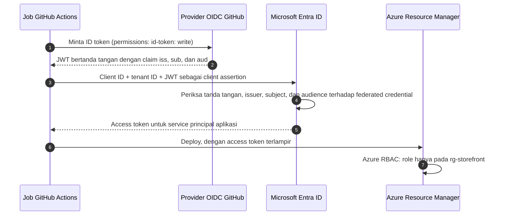
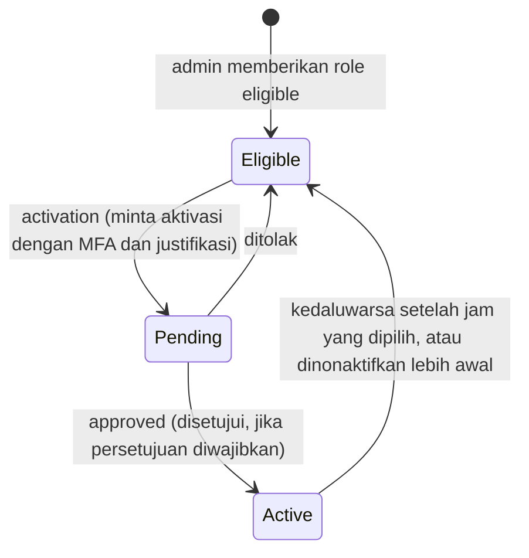

# Makan Siang 22 · Identitas dan Akses (Lanjutan)

🇬🇧 [Read in English](README.md)

> **Jalur:** Bulan pendalaman · **Level:** Lanjutan · **Bagian 5:** Pendalaman
> **Waktu:** 60 menit · **Makan siang prasyarat:** 05, 15, 20
> **Area keterampilan AZ-900:** Di luar cakupan AZ-900
> **Lab:** [Lab 22 · Pipeline tanpa kata sandi dan hak akses minimum](../../labs/22-identity-access-advanced/README.id.md) — sekitar 50 menit · biaya 💲
> **Penulis:** Stefanus Pinarta · [Tentang penulis](../../README.id.md#tentang-penulis)

| ⏱ Menit | Segmen |
|---:|---|
| 5 | Skenario dan tujuan |
| 25 | Bacaan |
| 15 | Demo: animasi interaktif (+ video panduan opsional) |
| 5 | Uji pemahaman |
| 5 | Poin penting dan pratinjau lab |
| 5 | Waktu cadangan — habiskan makan siang Anda 🍜 |

## 🍱 Menu hari ini

Setelah makan siang ini, Anda akan mampu:

- **Memilih** antara managed identity system-assigned dan user-assigned, serta menjelaskan bagaimana kode mendapatkan token tanpa secret.
- **Mengganti** client secret dengan workload identity federation untuk GitHub Actions, serta menjelaskan perbedaan app registration dan service principal.
- **Merancang** policy Conditional Access dari condition, grant control, dan session control, lalu menerapkannya dengan aman.
- **Merencanakan** administrasi just-in-time dengan Privileged Identity Management, access review, dan akun akses darurat (emergency access).
- **Menulis** custom role yang menganut prinsip hak akses minimum, lengkap dengan actions, data actions, dan assignable scopes.

## 🏪 Sementara itu di Nusantara Retail

Enam bulan telah berlalu. Toko online sudah berjalan di Azure, dan menjelang festival belanja 12.12, Ibu Sari meminta seorang auditor eksternal memeriksa siapa yang bisa melakukan apa. Laporannya mendarat di meja Anda dengan empat temuan:

1. Pipeline deployment sign-in ke Azure dengan client secret yang disimpan di GitHub. Secret itu kedaluwarsa bulan lalu dan menggagalkan sebuah rilis pada pukul 23.00 — dan ternyata secret itu juga muncul di sebuah build log lama.
2. Lima orang memegang role Owner secara permanen pada subscription (*langganan*) production. Dua di antaranya belum pernah memakainya tahun ini.
3. Kontrak Rizky berakhir bulan Maret, tetapi akun tamunya (guest) masih menjadi anggota *grp-nusa-contractors*.
4. Operator shift malam hanya pernah me-restart VM (*komputer virtual*), tetapi memegang role Contributor pada seluruh resource group (*grup sumber daya*) production.

Tidak satu pun dari temuan ini melanggar aturan dari Makan Siang 05. Namun semuanya adalah risiko yang *terus melekat* (standing): secret yang hidup berbulan-bulan, hak istimewa yang tidak dipakai siapa pun, dan akses yang tidak pernah ditinjau siapa pun.

Pertanyaan hari ini: *Bagaimana menghilangkan secret dan hak istimewa yang terus melekat tanpa memperlambat kerja tim?*

---

## 📖 Bacaan (≈25 menit)

### 1. Workload identity: app registration, service principal, dan managed identity

Bukan hanya manusia yang perlu sign-in. Pipeline, aplikasi web, function (*fungsi*), dan script juga membutuhkan identitas; Microsoft Entra ID (*ID Microsoft Entra*) menyebutnya **workload identity** — identitas untuk beban kerja, bukan untuk manusia.

**App registration** — disebut juga *application object* — adalah definisi global sebuah aplikasi di tenant asalnya (home tenant, yaitu direktori Microsoft Entra milik organisasi pembuatnya): namanya, izin (permission) yang dimintanya, redirect URI-nya, dan kredensialnya. **Service principal** adalah perwakilan lokal aplikasi itu di satu tenant tertentu, dan kepada service principal-lah Anda memberikan role. Aplikasi SaaS (*perangkat lunak sebagai layanan*) yang multi-tenant punya satu app registration dan satu service principal di setiap tenant pelanggannya; di portal, service principal muncul di bawah *Enterprise applications*. Saat Anda mendaftarkan aplikasi lewat portal, service principal di tenant Anda dibuat otomatis; dengan Azure CLI, Anda membuatnya sendiri (`az ad sp create`).

Ibaratnya waralaba martabak: resep dan merek dagangnya ditetapkan sekali di kantor pusat (app registration), sedangkan setiap gerai di mal yang berbeda (tenant) punya izin usaha dan kunci tokonya sendiri (service principal). Hak akses selalu diberikan kepada gerai, bukan kepada resepnya.

Service principal membuktikan identitasnya dengan sebuah kredensial, dan Anda punya tiga pilihan:

| Kredensial | Cara kerjanya | Masa berlaku | Risiko utama |
|---|---|---|---|
| Client secret | String acak yang dibuat sistem, dipakai seperti kata sandi | Anda yang menentukan tanggal kedaluwarsanya | Bocor ke kode, log, dan screenshot; rotasinya manual |
| Certificate | Bukti bahwa Anda memegang sebuah private key | Selama masa berlaku sertifikat | Lebih aman daripada secret, tetapi Anda tetap harus menyimpan, melindungi, dan memperbaruinya |
| Federated credential | Kepercayaan pada token yang diterbitkan identity provider lain | Tidak ada yang disimpan dalam jangka panjang | Subject yang dibuat terlalu longgar bisa memercayai workload yang salah |

Mana yang sebaiknya dipakai sebuah workload? Ada aturan praktis yang sederhana:

- **Berjalan di Azure** (VM, App Service, Functions, Container Apps, AKS): pakai managed identity — sama sekali tidak ada yang perlu disimpan.
- **Berjalan di luar Azure, di platform yang menerbitkan token OIDC** (GitHub Actions, Kubernetes, cloud lain): pakai workload identity federation, yang dibahas di bagian berikutnya.
- **Berjalan di server Anda sendiri:** hubungkan server itu ke Azure Arc, yang agent-nya memberi setiap server sebuah managed identity, atau gunakan certificate sebagai pilihan cadangan.
- **Client secret:** hanya jika tidak ada cara lain — dengan masa berlaku pendek, disimpan di Key Vault, dan dirotasi oleh otomatisasi.

**Managed identity**, yang sudah Anda temui di Makan Siang 15, adalah service principal yang kredensialnya dibuat dan dirotasi oleh Azure, dan tidak pernah diperlihatkan kepada siapa pun. Kode yang berjalan di VM, App Service, Azure Functions, Container Apps, atau AKS cukup meminta token ke endpoint lokalnya. Kedua jenisnya berbeda dalam siklus hidup (lifecycle):

| | System-assigned | User-assigned |
|---|---|---|
| Dibuat | Sebagai bagian dari satu resource (tinggal diaktifkan) | Sebagai resource Azure yang berdiri sendiri |
| Siklus hidup | Ikut terhapus bersama resource tersebut | Independen; Anda sendiri yang menghapusnya |
| Berbagi | Hanya untuk satu resource | Bisa dipasang ke banyak resource |
| Cocok untuk | Satu VM atau aplikasi dengan izinnya sendiri | Scale set (*Kumpulan Skala Komputer Virtual*) dan slot, compute yang sering dibangun ulang, izin yang diberikan sebelum workload-nya ada |

Dokumentasi Microsoft merekomendasikan identitas user-assigned, dan siklus hidupnya menjelaskan alasannya: izinnya tetap ada saat compute dibangun ulang — praktis ketika Bicep (Makan Siang 20) membuat ulang resource. Identitas system-assigned ibarat stiker langganan parkir yang menempel di kaca satu mobil: ikut hilang saat mobilnya dijual. Identitas user-assigned ibarat kartu e-toll: terpisah dari mobil, bisa dipindah ke mobil lain, dan tetap ada walau mobil lama sudah tidak dipakai. Satu catatan: layanan back-end menyimpan (cache) token managed identity cukup lama, sehingga perubahan keanggotaan grup atau role sebuah identitas bisa butuh berjam-jam, bukan hitungan menit, untuk berlaku.

Di dalam kode, library **Azure Identity** menyediakan `DefaultAzureCredential`, yang mencoba serangkaian sumber secara berurutan: environment variable, workload identity, managed identity, lalu sign-in developer seperti Visual Studio Code, Azure CLI, Azure PowerShell, dan Azure Developer CLI. Baris kode yang sama akan sign-in sebagai Dewi di laptopnya dan sebagai managed identity di Azure. Praktis, tetapi di production kuncilah ke kredensial yang Anda harapkan, misalnya `ManagedIdentityCredential`, supaya environment variable yang tak terduga tidak bisa mengubah identitas yang dipakai aplikasi Anda untuk sign-in.

Ada satu alasan lagi untuk memakai workload identity: **MFA wajib** (mandatory MFA, *autentikasi multifaktor*) di Azure berlaku untuk akun pengguna di portal, CLI, PowerShell, dan tool infrastructure as code, tetapi tidak untuk managed identity atau service principal. Otomatisasi yang masih berjalan dengan akun milik seseorang akan berhadapan dengan permintaan MFA yang tidak bisa dijawabnya.

### 2. Workload identity federation: deployment tanpa secret

Managed identity hanya ada di dalam Azure. Pipeline Dewi berjalan di GitHub Actions, di luar Azure — itulah sebabnya pipeline itu memakai client secret. **Workload identity federation** menghilangkan secret tersebut dengan cara memercayai token dari identity provider lain.

GitHub menjalankan sebuah provider OpenID Connect (OIDC), standar terbuka untuk menerbitkan token identitas. Setiap job workflow bisa meminta kepadanya token berumur pendek yang ditandatangani secara digital, yang menjelaskan dengan tepat siapa yang meminta: repository mana, branch atau environment mana, workflow mana. Anda memberi tahu Microsoft Entra ID token mana yang boleh diterima melalui **federated identity credential** pada app registration (atau pada managed identity user-assigned):

- **Issuer** (penerbit): `https://token.actions.githubusercontent.com`.
- **Subject** (subjek): workload yang mana, dengan format yang bergantung pada pemicu job-nya (lihat tabel di bawah).
- **Audience** (penerima yang dituju): `api://AzureADTokenExchange`, nilai yang direkomendasikan sekaligus nilai default action `azure/login`.

Ibaratnya naik kereta api jarak jauh: tiket diterbitkan oleh KAI (issuer), tertulis atas nama satu penumpang (subject), dan hanya berlaku untuk perjalanan tertentu (audience). Petugas boarding mencocokkan nama di tiket dengan KTP huruf demi huruf, dan tiket itu tak berguna lagi setelah keretanya berangkat.

| Yang menjalankan job | Subject di token GitHub | Gunakan untuk |
|---|---|---|
| Push atau run manual pada sebuah branch | `repo:nusantara-retail/storefront:ref:refs/heads/main` | Deployment dari satu branch tepercaya |
| Job yang memakai environment | `repo:nusantara-retail/storefront:environment:production` | Production, dijaga oleh required reviewer |
| Pull request | `repo:nusantara-retail/storefront:pull_request` | Pemeriksaan hanya-baca seperti what-if — jangan pernah untuk production |
| Tag | `repo:nusantara-retail/storefront:ref:refs/tags/v1.4` | Pipeline rilis |

Di dalam workflow, ada dua detail penting: `permissions: id-token: write`, yang tanpanya job tidak bisa meminta token, dan action `azure/login`, yang hanya menerima `client-id`, `tenant-id`, dan `subscription-id`. Tak satu pun dari nilai-nilai itu bersifat rahasia, meskipun banyak tim menyimpannya sebagai GitHub secret agar tidak muncul di log.

Pencocokannya ketat, dan memang itulah intinya. Issuer, subject, dan audience harus cocok persis, dan wildcard (karakter pengganti seperti `*`) tidak didukung (*flexible* federated credential dengan ekspresi pencocokan claim masih berstatus preview). Satu app registration atau managed identity user-assigned bisa menampung hingga 20 federated credential, jadi satu credential per branch atau environment adalah hal yang wajar. Subject yang salah tidak menimbulkan error saat Anda membuat credential-nya; pertukaran token baru gagal belakangan dengan pesan `AADSTS700213` "no matching federated identity record".

Rancang kepercayaan ini dengan prinsip hak akses minimum (least privilege). Beri setiap environment identitasnya sendiri — satu untuk development dengan Contributor pada resource group development, satu lagi untuk production dengan role yang cakupannya sempit — supaya kesalahan di workflow pengujian tidak bisa menjangkau production. Ikat identitas production ke GitHub environment yang punya required reviewer, sehingga seseorang harus menyetujui job itu sebelum job tersebut bahkan bisa meminta token. Jangan pernah memberi subject pull request sebuah role yang bisa mengubah apa pun. Client ID dan tenant ID hanya *menyebut nama* aplikasinya; federated credential-lah yang menentukan workload mana yang boleh "menjadi" aplikasi itu.

> [!IMPORTANT]
> Repository GitHub yang dibuat setelah **15 Juli 2026** memakai format subject *immutable* (tidak berubah) yang menambahkan ID numerik pemilik dan repository, misalnya `repo:nusantara-retail@123456/storefront@456789:ref:refs/heads/main`. Repository yang lebih lama tetap memakai format klasik, kecuali pemiliknya memilih ikut (opt in). Periksa format mana yang dipakai repository Anda sebelum membuat credential; sign-in yang gagal akan menampilkan subject yang benar-benar dikirim GitHub.

Kubernetes bekerja dengan cara yang sama. Cluster AKS yang OIDC issuer-nya diaktifkan menandatangani token untuk service account, dengan subject seperti `system:serviceaccount:storefront:orders-api`, dan Microsoft Entra Workload ID menukarnya dengan token Azure (Makan Siang 29).

### 3. Conditional Access secara mendalam

Makan Siang 05 memperkenalkan Conditional Access (*Akses Bersyarat*) sebagai logika jika-maka. Policy yang sesungguhnya punya tiga bagian.

**Assignments: siapa dan apa.** *Users* — sertakan grup seperti semua pengguna atau para kontraktor, dan selalu **kecualikan akun akses darurat Anda**. (Workload identity juga bisa dijadikan sasaran, dengan lisensi Workload ID terpisah.) *Target resources* — aplikasi cloud seperti Azure management atau Microsoft 365, tindakan pengguna seperti mendaftarkan informasi keamanan, atau **authentication context**, yaitu label yang bisa diminta oleh aplikasi atau PIM pada momen yang sensitif.

**Conditions: kapan.** Sign-in risk dan user risk (dari Microsoft Entra ID Protection, fitur P2), platform perangkat, lokasi (rentang IP yang diberi nama, dan negara), client app seperti legacy authentication (metode sign-in lama yang tidak mendukung MFA), dan filter perangkat.

**Access controls: lalu apa.** *Grant controls* memblokir akses, atau memberikannya dengan mensyaratkan salah satu atau semua dari: MFA, sebuah **authentication strength** (misalnya hanya metode yang tahan phishing), perangkat yang ditandai compliant oleh Intune, perangkat Microsoft Entra hybrid-joined, client app yang disetujui, app protection policy, penggantian kata sandi, atau persetujuan terms of use. *Session controls* mengatur apa yang terjadi setelah sign-in: sign-in frequency (seberapa sering harus sign-in ulang), persistent browser session, dan pemantauan sesi secara real-time melalui Microsoft Defender for Cloud Apps.

| Policy Nusantara Retail | Pengguna | Target | Kondisi | Kontrol |
|---|---|---|---|---|
| MFA untuk semua orang | Semua pengguna, kecuali akun darurat | Semua resource | — | Wajibkan MFA |
| Blokir legacy authentication | Semua pengguna | Semua resource | Client apps: legacy client | Blokir |
| Admin tahan phishing | Role administrator | Semua resource | — | Authentication strength: tahan phishing (phishing-resistant) |
| Kontraktor dari perangkat yang tidak dikelola | grp-nusa-contractors | Azure management | Perangkat tidak compliant | Wajibkan MFA; sign-in frequency 8 jam |
| Sign-in berisiko (P2) | Semua pengguna | Semua resource | Sign-in risk: high | Blokir |

Policy-policy ini saling bergabung. Setiap policy yang assignment-nya cocok dengan sebuah sign-in berlaku sekaligus: jika salah satunya memblokir, akses diblokir; jika tidak, setiap syarat grant dari setiap policy yang cocok harus dipenuhi. Itulah sebabnya segelintir policy yang luas dan namanya jelas lebih baik daripada puluhan policy yang saling tumpang-tindih. Dan ingat pembagian tugas dari Makan Siang 05: Conditional Access menentukan bagaimana seseorang memperoleh token, sedangkan Azure RBAC (*kontrol akses berbasis peran*) tetap menentukan apa yang boleh dilakukan dengan token itu.

Terapkan policy dengan aman. **Report-only mode** mengevaluasi policy dan mencatat apa yang *akan* terjadi tanpa memberlakukan apa pun, dan tool **What If** menyimulasikan sebuah sign-in terhadap semua policy Anda. Microsoft juga menyediakan **Microsoft-managed policies** yang mempertahankan perlindungan security defaults setelah Anda mematikannya. Conditional Access membutuhkan Microsoft Entra ID P1 (kondisi berbasis risiko membutuhkan P2), dan Anda mematikan security defaults ketika policy buatan Anda sendiri sudah menggantikannya.

> [!WARNING]
> Kecelakaan klasik Conditional Access adalah policy yang tidak bisa dipenuhi siapa pun — misalnya mewajibkan perangkat compliant sebelum ada satu pun perangkat yang terdaftar — sehingga semua administrator terkunci di luar. Selalu kecualikan dua akun akses darurat, mulailah dengan report-only mode, baca sign-in log selama beberapa hari, dan baru setelah itu aktifkan policy-nya.

### 4. Privileged Identity Management, access review, dan akses darurat

Temuan kedua auditor adalah role Owner yang permanen. **Privileged Identity Management (PIM)** mengganti hak istimewa yang terus melekat dengan akses **just-in-time**, yaitu akses yang diberikan tepat saat dibutuhkan. Alih-alih role assignment yang *active*, Pak Budi menerima assignment yang **eligible** (berhak, tetapi belum aktif): ia tidak memegang izin apa pun sampai ia **mengaktifkan** (activate) role tersebut, untuk durasi dalam batas maksimum yang ditetapkan administrator (antara 1 dan 24 jam). Aktivasi bisa mensyaratkan MFA atau authentication context Conditional Access, justifikasi bisnis, nomor tiket, dan persetujuan dari approver yang ditunjuk. PIM memberi tahu orang-orang terkait saat role diaktifkan, mencatat setiap aktivasi untuk keperluan audit, dan bahkan bisa membuat assignment eligible berlaku terbatas waktu, dengan tanggal mulai dan tanggal berakhir.

Ibaratnya kunci ruang server yang dititipkan di pos satpam: Pak Budi tidak membawanya pulang. Saat perlu, ia menulis nama, jam, dan alasannya di buku, meminta paraf atasan, lalu kunci itu wajib kembali ke pos sebelum jam yang tertulis.

PIM mencakup role Microsoft Entra (Global Administrator seharusnya eligible, bukan active, bagi hampir semua orang), role resource Azure di cakupan (scope) mana pun, dan **PIM for Groups**, yang membuat keanggotaan grup istimewa menjadi just-in-time. Pengguna yang terlibat membutuhkan lisensi **Microsoft Entra ID P2** atau **Microsoft Entra ID Governance**.

Beberapa kebiasaan membuat PIM benar-benar berjalan dalam praktik. Role settings berlaku untuk satu role pada satu resource dan tidak diwariskan — pengaturan di subscription tidak mengalir ke resource group di bawahnya — jadi konfigurasikan setiap scope yang Anda pakai. Buat jendela aktivasi singkat, dan wajibkan persetujuan untuk role yang paling berkuasa; Microsoft merekomendasikan minimal dua approver, supaya cuti satu orang tidak menghambat penanganan insiden. Baca alert dari PIM, yang menandai masalah seperti role yang di-assign di luar PIM. Dan jika pekerjaan selesai lebih cepat, pengguna bisa menonaktifkan role-nya sendiri alih-alih menunggu kedaluwarsa.

**Access review** menjawab temuan ketiga. Secara terjadwal, pemilik grup, manajer, atau para pengguna sendiri mengonfirmasi apakah tamu, anggota grup, atau pemegang role masih membutuhkan aksesnya, dan hasilnya bisa diterapkan otomatis — mengeluarkan siapa pun yang tidak dijamin oleh siapa pun. Review triwulanan atas *grp-nusa-contractors* tentu sudah mengeluarkan Rizky pada bulan April. Access review adalah bagian dari Microsoft Entra ID Governance; sebagian kemampuannya juga berjalan dengan P2.

**Akun akses darurat** (emergency access), yang juga disebut akun break-glass, adalah jaring pengaman di bawah semua ini — seperti palu pemecah kaca di dalam bus: jarang dipakai, tetapi harus ada dan berfungsi saat darurat. Siapkan minimal dua akun cloud-only di domain `.onmicrosoft.com`, yang aktif permanen sebagai Global Administrator. Lindungi akun-akun ini dengan metode yang tahan phishing, seperti passkey pada security key FIDO2 (kunci keamanan fisik seukuran flashdisk), karena MFA wajib juga berlaku untuk mereka. Kecualikan akun-akun ini dari policy Conditional Access yang memblokir atau membatasi sign-in, simpan kredensialnya dengan aman, pasang alert untuk setiap sign-in, dan uji setidaknya setiap 90 hari.

### 5. Custom role dan identitas eksternal

Temuan keempat — Contributor untuk operator yang hanya me-restart VM — adalah contoh buku teks untuk **Azure custom role**, yaitu definisi role yang Anda tulis sendiri dalam format JSON:

| Properti | Arti | "Nusantara VM Operator" |
|---|---|---|
| `Actions` | Operasi manajemen yang diizinkan role ini | `Microsoft.Compute/virtualMachines/read`, `…/start/action`, `…/restart/action`, `…/deallocate/action` |
| `NotActions` | Operasi yang dikurangkan dari `Actions` | Tidak diperlukan: tidak ada wildcard yang dipakai |
| `DataActions` | Operasi terhadap data di dalam resource | Tidak ada: operator tidak membaca disk atau blob |
| `NotDataActions` | Operasi data yang dikurangkan dari `DataActions` | Tidak ada |
| `AssignableScopes` | Di mana role ini boleh di-assign | Hanya resource group production |

Beberapa aturan yang perlu diketahui. Temukan nama operasi dengan `az provider operation show --namespace Microsoft.Compute`, atau mulailah dari built-in role yang mirip. Utamakan action yang eksplisit daripada wildcard, karena `Microsoft.Compute/*` diam-diam ikut mencakup operasi yang ditambahkan Microsoft di kemudian hari. Satu tenant bisa menampung hingga 5.000 custom role; assignable scope tidak boleh berupa root scope (`/`) dan paling banyak hanya boleh memuat satu management group (*grup manajemen*); role yang punya `DataActions` tidak bisa di-assign di scope management group; dan Anda harus menghapus setiap assignment sebuah custom role sebelum bisa menghapus role itu. Yang terpenting, **NotActions bukanlah deny (larangan)**. NotActions hanya memangkas role *ini*; jika role lain memberikan action yang sama, pengguna tetap memilikinya. Hanya deny assignment yang benar-benar memblokir.

Rizky adalah tamu **B2B collaboration** — objek pengguna di direktori Anda yang diautentikasi oleh organisasinya sendiri. **Cross-tenant access settings** menentukan organisasi mana yang boleh berkolaborasi dengan Anda dan apakah Anda memercayai klaim MFA dan perangkat dari mereka, sehingga tamu tidak diminta MFA dua kali. **Entitlement management** membungkus grup, aplikasi, dan situs menjadi *access package* yang bisa diminta mitra, lengkap dengan persetujuan dan kedaluwarsa otomatis. Untuk para pembeli, **Microsoft Entra External ID** di tenant eksternal adalah pilihan untuk identitas pelanggan: pendaftaran mandiri, akun media sosial seperti Google atau Facebook, dan branding Anda sendiri, terpisah dari direktori karyawan Anda. (Azure AD B2C tidak lagi dijual kepada pelanggan baru.)

### 6. Menyatukan semuanya di Nusantara Retail

Lisensi menentukan bentuk rencana, jadi periksa lisensi lebih dulu:

| Kemampuan | Lisensi |
|---|---|
| Pengguna, grup, SSO (*sistem masuk tunggal*), security defaults, tamu B2B | Microsoft Entra ID Free |
| Managed identity, app registration, workload identity federation, Azure custom role | Sudah termasuk dalam Entra ID dan subscription Azure Anda |
| Conditional Access, dynamic group | Microsoft Entra ID P1 |
| Conditional Access berbasis risiko (ID Protection), PIM | Microsoft Entra ID P2 (PIM juga dengan ID Governance) |
| Access review, entitlement management dengan semua fitur | Microsoft Entra ID Governance (sebagian fitur dengan P2) |

Dengan P2 untuk para administrator dan P1 untuk semua orang lainnya, jawaban Anda kepada auditor cukup satu halaman:

1. **Pipeline:** workflow GitHub sign-in melalui satu federated credential untuk branch main dan satu lagi untuk environment *production*. Client secret dihapus, dan service principal hanya memegang Contributor pada `rg-storefront`.
2. **Owner:** dua administrator menjadi *eligible* untuk Owner melalui PIM, dengan aktivasi paling lama empat jam, MFA, justifikasi, dan persetujuan Ibu Sari. Semua orang lainnya turun menjadi Reader.
3. **Tamu:** access review triwulanan mencakup *grp-nusa-contractors*, dan kontraktor berikutnya meminta access package yang kedaluwarsa setelah 90 hari.
4. **Shift malam:** operator mendapat custom role *Nusantara VM Operator* pada resource group production, tidak lebih.
5. **Jaring pengaman:** policy Conditional Access di atas berjalan dalam mode report-only selama seminggu sebelum diberlakukan, dan dua akun akses darurat dengan kunci FIDO2 disimpan di brankas kantor.

Aplikasi pelaporan mendapat managed identity user-assigned dengan role *Storage Blob Data Reader*, sehingga tidak ada satu pun secret yang tersisa di kode maupun pipeline Nusantara Retail.

> [!NOTE]
> **Renungkan sejenak:** federated credential milik pipeline memercayai `repo:nusantara-retail/storefront:ref:refs/heads/main`. Seseorang membuka pull request yang mengubah workflow agar mencoba men-deploy ke production. Apakah run itu mendapat token Azure? Subject apa yang akan dibawa token GitHub-nya?

Anda akan bertemu lagi dengan gagasan-gagasan ini dalam skala yang lebih besar: workload identity di AKS pada Makan Siang 29, serta RBAC, PIM, dan custom role lintas management group pada Makan Siang 31.

---

## 🎬 Demo (≈15 menit)

1. **Animasi interaktif (≈6–8 menit):** [Buka demo](https://stefpin.github.io/azure-fundamentals-lunches/demos/22-identity-access-advanced.html?lang=id) — tekan ▶ Putar atau telusuri langkah demi langkah sesuai kecepatan Anda. Sedang offline? Unduh [`docs/demos/22-identity-access-advanced.html`](../../docs/demos/22-identity-access-advanced.html) dan buka di browser apa pun.
2. **Video panduan (≤ 6 menit):** _segera hadir_ — [baca naskah video](demo-video-script.id.md).

Yang perlu diperhatikan:

- Tidak ada yang rahasia disimpan di GitHub: job membuktikan siapa dirinya dengan token yang hanya hidup beberapa menit.
- Microsoft Entra ID memeriksa issuer, subject, dan audience terhadap federated credential sebelum menerbitkan token Azure.
- Run dari branch yang tidak tepercaya ditolak saat pertukaran token, sebelum sempat menyentuh Azure.
- Di linimasa PIM, role Owner hanya ada di antara aktivasi dan kedaluwarsa.

## ✅ Uji pemahaman (≈5 menit)

1. Sebuah otomatisasi mengganti setiap instance VM scale set setiap minggu, dan semua instance harus membaca Key Vault yang sama. Apakah Anda memakai managed identity system-assigned atau user-assigned?
   

Lihat jawaban

   Managed identity user-assigned, dipasang pada scale set, dengan role Key Vault yang di-assign sekali saja. *alasannya:* siklus hidupnya tidak bergantung pada instance dan satu identitas bisa dipakai bersama, sehingga akses tetap bertahan setiap kali instance dibangun ulang.

   

2. Sebuah job workflow mendeklarasikan `environment: production` dan gagal dengan `AADSTS700213`, padahal aplikasinya punya federated credential dengan subject `repo:nusantara-retail/storefront:ref:refs/heads/main`. Apa yang salah?
   

Lihat jawaban

   Job yang merujuk sebuah environment mendapat subject `repo:nusantara-retail/storefront:environment:production`, yang tidak cocok. Tambahkan federated credential dengan subject persis seperti itu. *alasannya:* issuer, subject, dan audience harus cocok persis; tidak ada wildcard.

   

3. Anda menambahkan `Microsoft.Compute/virtualMachines/delete` ke `NotActions` sebuah custom role yang di-assign ke Dewi, tetapi ia masih bisa menghapus VM. Mengapa?
   

Lihat jawaban

   Ada role assignment lain — misalnya Contributor melalui salah satu grupnya — yang memberikan izin delete, dan Azure RBAC menjumlahkan semua role. *alasannya:* NotActions hanya memangkas role tempat ia ditulis; hanya deny assignment yang bisa memblokir action yang diizinkan role lain.

   

4. Ibu Sari ingin para administrator hanya memegang Owner saat mereka membutuhkannya, dengan persetujuannya dan jejak audit. Fitur apa, dan lisensi apa?
   

Lihat jawaban

   Privileged Identity Management: assignment Owner yang eligible, yang aktivasinya mensyaratkan MFA, justifikasi, dan persetujuan, untuk jumlah jam yang terbatas. Fitur ini membutuhkan Microsoft Entra ID P2 atau Microsoft Entra ID Governance. *alasannya:* PIM mengganti hak istimewa yang terus melekat dengan aktivasi just-in-time yang tercatat.

   

5. Anda hendak mengaktifkan policy Conditional Access yang mewajibkan perangkat compliant untuk semua pengguna. Dua langkah pencegahan apa yang harus didahulukan?
   

Lihat jawaban

   Kecualikan akun-akun akses darurat, dan jalankan policy dalam report-only mode (sambil memeriksa sign-in log atau tool What If) sebelum memberlakukannya. *alasannya:* policy yang tidak bisa dipenuhi siapa pun bisa mengunci semua administrator di luar tenant.

   

## 🧠 Poin penting

- Utamakan managed identity di dalam Azure — user-assigned jika compute dipakai bersama atau sering dibangun ulang — dan kunci `DefaultAzureCredential` ke kredensial tertentu di production.
- Workload identity federation menghilangkan secret yang tersimpan: Microsoft Entra ID memercayai token GitHub atau Kubernetes yang issuer, subject, dan audience-nya cocok persis.
- Policy Conditional Access menggabungkan assignment, condition, serta grant control atau session control; terapkan dulu dalam report-only, dan jangan pernah tanpa pengecualian untuk akun akses darurat.
- PIM mengubah hak admin yang terus melekat menjadi aktivasi yang eligible, terbatas waktu, dan disetujui; access review serta dua akun break-glass yang sudah diuji melengkapi gambarannya.
- Custom role memberikan tepat operasi yang dibutuhkan sebuah pekerjaan, pada scope yang Anda pilih; NotActions hanya mengurangi, dan hanya deny assignment yang memblokir.

## 🗒️ Catatan lapangan dari Stefanus

> **Apa yang bisa dilakukan pencuri laptop sebelum sarapan?** Pertanyaan itu selalu saya ajukan di setiap tinjauan akses, untuk setiap orang dan setiap pipeline. Untuk manusia, jawaban jujurnya seharusnya: "tidak ada tanpa faktor kedua, dan tidak ada di production tanpa aktivasi PIM yang pasti diketahui orang lain". Untuk pipeline: "tidak ada, karena memang tidak ada secret yang bisa dicuri — tidak di GitHub, tidak di script, tidak di laptop itu". Kebiasaan saya sederhana: satu daftar pendek berisi semua kredensial yang bisa sign-in tanpa manusia, lengkap dengan pemilik dan tanggal kedaluwarsa di setiap barisnya. Baris tanpa pemilik adalah yang pertama saya ganti dengan managed identity atau federated credential. Dan setiap federated credential saya beri nama sesuai branch atau environment yang dipercayainya, supaya peninjau berikutnya langsung melihat batasnya tanpa harus mengurai string subject.

## 🔬 Lab Anda: Pipeline tanpa kata sandi dan hak akses minimum

Anda akan menulis custom role *Nusantara VM Operator* dari sebuah file JSON dan meng-assign-nya di scope resource group, memberi managed identity user-assigned sebuah data role pada storage account (*akun penyimpanan*), dan membuat app registration yang satu-satunya kredensialnya adalah federated credential untuk sebuah repository GitHub — ditambah contoh workflow yang sign-in dengan OpenID Connect, jika Anda punya repository untuk mencobanya. Conditional Access dan PIM hadir sebagai tur portal terpandu, karena keduanya membutuhkan lisensi P1 dan P2.

- ⏱ Sekitar 50 menit · 💲 · bisa dikerjakan terpisah (tidak perlu lab sebelumnya)
- 👉 [Mulai Lab 22](../../labs/22-identity-access-advanced/README.id.md)

## 📚 Pelajari lebih lanjut

- [Microsoft Learn: Mengautentikasi ke Azure dari GitHub Actions dengan OpenID Connect](https://learn.microsoft.com/azure/developer/github/connect-from-azure-openid-connect) — panduan resmi untuk `azure/login` dengan OIDC.
- [Microsoft Learn: Mengonfigurasi aplikasi agar memercayai identity provider eksternal](https://learn.microsoft.com/entra/workload-id/workload-identity-federation-create-trust) — setiap field federated credential, dengan contoh untuk GitHub dan Kubernetes.
- [Microsoft Learn: Apa itu Microsoft Entra Privileged Identity Management?](https://learn.microsoft.com/entra/id-governance/privileged-identity-management/pim-configure) — assignment eligible versus active, dan alur kerja aktivasi.
- [Microsoft Learn: Azure custom role](https://learn.microsoft.com/azure/role-based-access-control/custom-roles) — properti role, batasan, dan siapa yang bisa membuatnya.

---

⬅️ [Makan Siang 21 · Capstone Inti: Menyatukan Semuanya (Dasar)](../21-core-capstone/README.id.md) · 🏠 [Beranda kursus](../../README.id.md) · [Makan Siang 23 · Virtual Machines (Lanjutan)](../23-virtual-machines-advanced/README.id.md) ➡️

Terakhir divalidasi: Oktober 2026 · Menemukan informasi yang sudah usang? [Buka issue](../../CONTRIBUTING.md).
