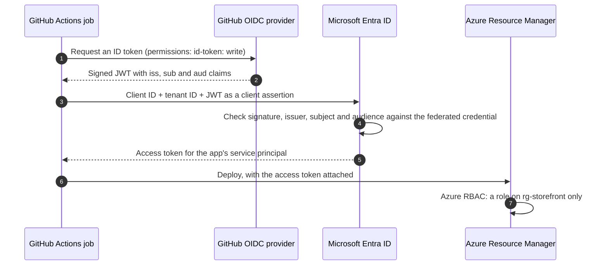
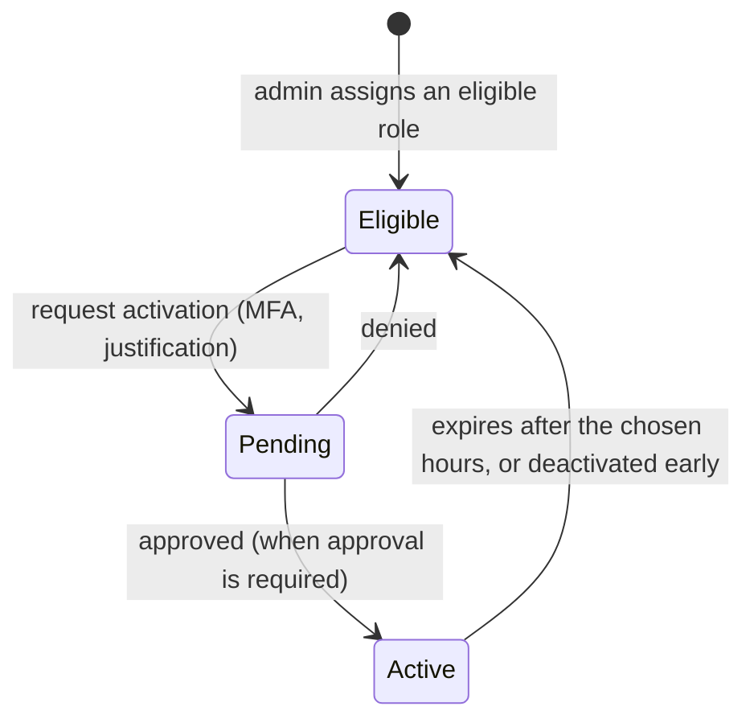

# Lunch 22 · Identity and Access (Advanced)

> **Track:** Deep-dive month · **Level:** Advanced · **Part 5:** Deep dives
> **Time:** 60 minutes · **Prerequisite lunches:** 05, 15, 20
> **AZ-900 skill area:** Beyond AZ-900
> **Lab:** [Lab 22 · Passwordless pipelines and least privilege](../../labs/22-identity-access-advanced/README.md) — about 50 minutes · cost 💲

| ⏱ Minutes | Segment |
|---:|---|
| 5 | Scenario and objectives |
| 25 | Reading |
| 15 | Demo: interactive animation (+ optional walkthrough video) |
| 5 | Knowledge check |
| 5 | Key takeaways and lab preview |
| 5 | Buffer — finish your lunch 🍜 |

## 🍱 Today's menu

By the end of this lunch you will be able to:

- **Choose** between system-assigned and user-assigned managed identities, and explain how code gets tokens without secrets.
- **Replace** a client secret with workload identity federation for GitHub Actions, and explain app registrations versus service principals.
- **Design** Conditional Access policies from conditions, grant controls and session controls, and roll them out safely.
- **Plan** just-in-time administration with Privileged Identity Management, access reviews and emergency-access accounts.
- **Write** a least-privilege custom role with actions, data actions and assignable scopes.

## 🏪 Meanwhile at Nusantara Retail

Six months have passed. The storefront runs in Azure, and before the 12.12 shopping festival Ibu Sari has asked an external auditor to look at who can do what. The report lands on your desk with four findings:

1. The deployment pipeline signs in with a client secret stored in GitHub. It expired last month and broke a release at 23:00 — and it also appears in an old build log.
2. Five people hold permanent Owner on the production subscription. Two of them haven't used it this year.
3. Rizky's contract ended in March, but his guest account is still a member of *grp-nusa-contractors*.
4. The night-shift operator only ever restarts VMs, yet holds Contributor on the whole production resource group.

None of these breaks a rule from Lunch 05. All of them are *standing* risks: secrets that live for months, privileges nobody uses, access nobody reviews.

Today's question: *How do you remove standing secrets and standing privilege without slowing the team down?*

---

## 📖 Reading (≈25 minutes)

### 1. Workload identities: app registrations, service principals and managed identities

People aren't the only ones who sign in. Pipelines, web apps, functions and scripts need identities too; Microsoft Entra calls them **workload identities**.

An **app registration** — the *application object* — is the global definition of an application in its home tenant: its name, the permissions it requests, its redirect URIs and its credentials. A **service principal** is the application's local representative in one particular tenant, and it's what you grant roles to. A multi-tenant SaaS application has one app registration and a service principal in every customer tenant; in the portal, service principals appear under *Enterprise applications*. When you register an app in the portal, its service principal in your tenant is created for you; with the Azure CLI you create it yourself (`az ad sp create`).

A service principal proves its identity with a credential, and you have three choices:

| Credential | How it works | Lifetime | Main risk |
|---|---|---|---|
| Client secret | A generated string, used like a password | You choose an expiry | Leaks into code, logs and screenshots; rotation is manual |
| Certificate | Proof that you hold a private key | The certificate's validity period | Safer than a secret, but you still store, protect and renew it |
| Federated credential | Trust in tokens issued by another identity provider | Nothing long-lived is stored | A carelessly broad subject could trust the wrong workload |

Which one should a workload use? A simple rule of thumb:

- **It runs in Azure** (a VM, App Service, Functions, Container Apps, AKS): a managed identity — there's nothing to store at all.
- **It runs outside Azure on a platform that issues OIDC tokens** (GitHub Actions, Kubernetes, another cloud): workload identity federation, described in the next section.
- **It runs on your own servers:** connect them to Azure Arc, whose agent gives each server a managed identity, or fall back to a certificate.
- **Client secrets:** only when nothing else works — with a short expiry, kept in Key Vault and rotated by automation.

**Managed identities**, which you met in Lunch 15, are service principals whose credentials Azure creates, rotates and never shows to anyone. Code running on a VM, App Service, Azure Functions, Container Apps or AKS simply asks its local endpoint for a token. The two kinds differ in lifecycle:

| | System-assigned | User-assigned |
|---|---|---|
| Created | As part of one resource (switch it on) | As a standalone Azure resource |
| Lifecycle | Deleted together with that resource | Independent; you delete it yourself |
| Sharing | One resource only | Can be attached to many resources |
| Good for | One VM or app with its own permissions | Scale sets and slots, compute that's rebuilt often, permissions granted before the workload exists |

Microsoft's documentation recommends user-assigned identities, and the lifecycle explains why: the permissions survive when the compute is rebuilt — handy when Bicep (Lunch 20) recreates resources. One caveat: back-end services cache managed-identity tokens for a long time, so a change to an identity's group memberships or roles can take hours rather than minutes to apply.

In code, the **Azure Identity** libraries offer `DefaultAzureCredential`, which tries a chain of sources in order: environment variables, workload identity, managed identity, then developer sign-ins such as Visual Studio Code, the Azure CLI, Azure PowerShell and the Azure Developer CLI. The same line of code signs in as Dewi on her laptop and as the managed identity in Azure. That's convenient, but in production pin it to the credential you expect, such as `ManagedIdentityCredential`, so an unexpected environment variable can't change who your app signs in as.

There's one more reason to use workload identities: Azure's **mandatory MFA** applies to user accounts in the portal, CLI, PowerShell and infrastructure-as-code tools, but not to managed identities or service principals. Automation that still runs under a person's account will meet an MFA prompt it cannot answer.

### 2. Workload identity federation: deployments without secrets

Managed identities exist only inside Azure. Dewi's pipeline runs in GitHub Actions, outside Azure, which is why it used a client secret. **Workload identity federation** removes that secret by trusting tokens from another identity provider.

GitHub runs an OpenID Connect (OIDC) provider. Every workflow job can ask it for a short-lived, signed token that describes exactly who is asking: which repository, which branch or environment, which workflow. You tell Microsoft Entra ID which tokens to accept with a **federated identity credential** on the app registration (or on a user-assigned managed identity):

- **Issuer**: `https://token.actions.githubusercontent.com`.
- **Subject**: which workload, in a format that depends on what triggered the job (see the table below).
- **Audience**: `api://AzureADTokenExchange`, the recommended value and the default of the `azure/login` action.

| What runs the job | Subject in GitHub's token | Use it for |
|---|---|---|
| A push or manual run on a branch | `repo:nusantara-retail/storefront:ref:refs/heads/main` | Deployments from one trusted branch |
| A job that uses an environment | `repo:nusantara-retail/storefront:environment:production` | Production, guarded by required reviewers |
| A pull request | `repo:nusantara-retail/storefront:pull_request` | Read-only checks such as a what-if — never production |
| A tag | `repo:nusantara-retail/storefront:ref:refs/tags/v1.4` | Release pipelines |

In the workflow, two details matter: `permissions: id-token: write`, without which the job can't request a token, and the `azure/login` action, which receives only `client-id`, `tenant-id` and `subscription-id`. None of those values are secrets, although many teams store them as GitHub secrets to keep them out of logs.

The matching is strict, and that's the point. Issuer, subject and audience must match exactly, and wildcards aren't supported (a *flexible* federated credential with claim-matching expressions is in preview). An app registration or user-assigned managed identity can hold up to 20 federated credentials, so one per branch or environment is normal. A wrong subject produces no error when you create the credential; the token exchange simply fails later with an `AADSTS700213` "no matching federated identity record" message.

Design the trust with least privilege in mind. Give each environment its own identity — one for development with Contributor on the development resource group, another for production with a narrowly scoped role — so a mistake in a test workflow can't reach production. Tie the production identity to a GitHub environment with required reviewers, so a person approves the job before it can even ask for a token. Never give a pull-request subject a role that can change anything. The client ID and tenant ID only *name* the app; the federated credential decides which workloads may become it.

> [!IMPORTANT]
> GitHub repositories created after **July 15, 2026** use an *immutable* subject format that adds the numeric owner and repository IDs, such as `repo:nusantara-retail@123456/storefront@456789:ref:refs/heads/main`. Older repositories keep the classic format unless their owner opts in. Check which format your repository uses before you create the credential; a failed sign-in shows the subject GitHub actually sent.

Kubernetes works the same way. An AKS cluster with its OIDC issuer enabled signs tokens for service accounts, with subjects like `system:serviceaccount:storefront:orders-api`, and Microsoft Entra Workload ID exchanges them for Azure tokens (Lunch 29).

### 3. Conditional Access in depth

Lunch 05 introduced Conditional Access as if-then logic. A real policy has three parts.

**Assignments: who and what.** *Users* — include groups such as all users or contractors, and always **exclude your emergency-access accounts**. (Workload identities can be targeted too, with a separate Workload ID licence.) *Target resources* — cloud apps such as Azure management or Microsoft 365, user actions such as registering security information, or an **authentication context**, a label that an app or PIM can demand at a sensitive moment.

**Conditions: when.** Sign-in risk and user risk (from Microsoft Entra ID Protection, a P2 feature), device platforms, locations (named IP ranges and countries), client apps such as legacy authentication, and device filters.

**Access controls: then what.** *Grant controls* block access, or grant it while requiring one or all of: MFA, an **authentication strength** (for example phishing-resistant methods only), a device marked compliant by Intune, a Microsoft Entra hybrid-joined device, an approved client app, an app protection policy, a password change, or acceptance of terms of use. *Session controls* shape what happens after sign-in: sign-in frequency, persistent browser sessions, and real-time session monitoring through Microsoft Defender for Cloud Apps.

| Nusantara Retail policy | Users | Target | Condition | Control |
|---|---|---|---|---|
| MFA for everyone | All users, except emergency accounts | All resources | — | Require MFA |
| Block legacy authentication | All users | All resources | Client apps: legacy clients | Block |
| Phishing-resistant admins | Administrator roles | All resources | — | Authentication strength: phishing-resistant |
| Contractors from unmanaged devices | grp-nusa-contractors | Azure management | Device isn't compliant | Require MFA; sign-in frequency 8 hours |
| Risky sign-ins (P2) | All users | All resources | Sign-in risk: high | Block |

Policies combine. Every policy whose assignments match a sign-in applies at once: if any of them blocks, access is blocked; otherwise every grant requirement of every matching policy must be met. That's why a handful of broad, clearly named policies beats dozens of overlapping ones. And keep the division of labour from Lunch 05 in mind: Conditional Access decides how someone obtains a token, while Azure RBAC still decides what that token may do.

Roll policies out safely. **Report-only mode** evaluates a policy and logs what *would* have happened without enforcing anything, and the **What If** tool simulates a sign-in against all your policies. Microsoft also offers **Microsoft-managed policies** that keep the protections of security defaults once you switch them off. Conditional Access needs Microsoft Entra ID P1 (risk conditions need P2), and you switch security defaults off when your own policies replace them.

> [!WARNING]
> The classic Conditional Access accident is a policy nobody can satisfy — for example, requiring a compliant device before any device is enrolled — which locks out every administrator. Always exclude two emergency-access accounts, start in report-only mode, read the sign-in logs for a few days, and only then switch the policy on.

### 4. Privileged Identity Management, access reviews and emergency access

The auditor's second finding was permanent Owner. **Privileged Identity Management (PIM)** replaces standing privilege with **just-in-time** access. Instead of an *active* role assignment, Pak Budi receives an **eligible** one: he holds no permissions until he **activates** the role, for a duration within a maximum the administrator sets (between 1 and 24 hours). Activation can require MFA or a Conditional Access authentication context, a business justification, a ticket number, and approval by designated approvers. PIM notifies people when roles are activated, records every activation for audits, and can make even eligible assignments time-bound, with start and end dates.

PIM covers Microsoft Entra roles (Global Administrator should be eligible, not active, for almost everyone), Azure resource roles at any scope, and **PIM for Groups**, which makes membership of a privileged group just-in-time. The users involved need **Microsoft Entra ID P2** or **Microsoft Entra ID Governance** licences.

A few habits make PIM work in practice. Role settings belong to one role on one resource and aren't inherited — settings on the subscription don't flow down to its resource groups — so configure every scope you use. Keep activation windows short, and require approval for the most powerful roles; Microsoft recommends at least two approvers, so one person's holiday can't block an incident. Read PIM's alerts, which flag problems such as roles assigned outside PIM. And when the work is done early, users can deactivate a role themselves instead of waiting for it to expire.

**Access reviews** answer the third finding. On a schedule, group owners, managers or the users themselves confirm whether guests, group members or role holders still need their access, and the results can be applied automatically, removing anyone nobody vouched for. A quarterly review of *grp-nusa-contractors* would have removed Rizky in April. Access reviews are part of Microsoft Entra ID Governance; some capabilities also work with P2.

**Emergency-access accounts**, also called break-glass accounts, are the safety net under all of this. Keep at least two cloud-only accounts on the `.onmicrosoft.com` domain, permanently active as Global Administrator. Protect them with a phishing-resistant method such as a passkey on a FIDO2 security key, because mandatory MFA applies to them too. Exclude them from Conditional Access policies that block or restrict sign-in, store their credentials securely, alert on every sign-in, and test them at least every 90 days.

### 5. Custom roles and external identities

The fourth finding — Contributor for an operator who only restarts VMs — is the textbook case for an **Azure custom role**, a role definition you write as JSON:

| Property | Meaning | "Nusantara VM Operator" |
|---|---|---|
| `Actions` | Management operations the role allows | `Microsoft.Compute/virtualMachines/read`, `…/start/action`, `…/restart/action`, `…/deallocate/action` |
| `NotActions` | Operations subtracted from `Actions` | None needed: no wildcards were used |
| `DataActions` | Operations on data inside resources | None: operators don't read disks or blobs |
| `NotDataActions` | Data operations subtracted from `DataActions` | None |
| `AssignableScopes` | Where the role may be assigned | The production resource group only |

Some rules worth knowing. Find operation names with `az provider operation show --namespace Microsoft.Compute`, or start from a similar built-in role. Prefer explicit actions to wildcards, because `Microsoft.Compute/*` silently includes operations Microsoft adds later. A tenant can hold up to 5,000 custom roles; assignable scopes can't be the root scope (`/`) and can include at most one management group; roles with `DataActions` can't be assigned at management-group scope; and you must remove every assignment of a custom role before you can delete it. Above all, **NotActions isn't a deny**. It only trims *this* role; if another role grants the same action, the user still has it. Only deny assignments block.

Rizky was a **B2B collaboration** guest — a user object in your directory, authenticated by his own organisation. **Cross-tenant access settings** decide which organisations may collaborate with you and whether you trust their MFA and device claims, so guests aren't prompted twice. **Entitlement management** bundles groups, apps and sites into *access packages* that partners request, with approvals and automatic expiry. For shoppers, **Microsoft Entra External ID** in an external tenant is the customer-identity option: self-service sign-up, social accounts such as Google or Facebook, and your own branding, separate from your workforce directory. (Azure AD B2C isn't sold to new customers any more.)

### 6. Putting it together at Nusantara Retail

Licensing shapes the plan, so check it first:

| Capability | Licence |
|---|---|
| Users, groups, SSO, security defaults, B2B guests | Microsoft Entra ID Free |
| Managed identities, app registrations, workload identity federation, Azure custom roles | Included with Entra ID and your Azure subscription |
| Conditional Access, dynamic groups | Microsoft Entra ID P1 |
| Risk-based Conditional Access (ID Protection), PIM | Microsoft Entra ID P2 (PIM also with ID Governance) |
| Access reviews, entitlement management with all features | Microsoft Entra ID Governance (some features with P2) |

With P2 for the administrators and P1 for everyone else, your answer to the auditor fits on one page:

1. **Pipeline:** the GitHub workflow signs in through a federated credential for the main branch and another for the *production* environment. The client secret is deleted, and the service principal holds Contributor on `rg-storefront` only.
2. **Owners:** two administrators become *eligible* for Owner through PIM, with activation of at most four hours, MFA, a justification and Ibu Sari's approval. Everyone else drops to Reader.
3. **Guests:** a quarterly access review covers *grp-nusa-contractors*, and future contractors request an access package that expires after 90 days.
4. **Night shift:** the operator gets the custom *Nusantara VM Operator* role on the production resource group, nothing more.
5. **Safety net:** the Conditional Access policies above run in report-only for a week before going live, and two emergency-access accounts with FIDO2 keys sit in the office safe.

The reporting app gets a user-assigned managed identity with *Storage Blob Data Reader*, so not a single secret remains in Nusantara Retail's code or pipelines.

> [!NOTE]
> **Pause and think:** the pipeline's federated credential trusts `repo:nusantara-retail/storefront:ref:refs/heads/main`. Someone opens a pull request whose changed workflow tries to deploy to production. Does that run get an Azure token? What subject would its GitHub token carry?

You'll meet these ideas again at scale: workload identity on AKS in Lunch 29, and RBAC, PIM and custom roles across management groups in Lunch 31.

---

## 🎬 Demo (≈15 minutes)

1. **Interactive animation (≈6–8 min):** [Open the demo](https://stefpin.github.io/azure-fundamentals-lunches/demos/22-identity-access-advanced.html) —
   press ▶ Play or step through it at your own pace. Offline? Download
   [`docs/demos/22-identity-access-advanced.html`](../../docs/demos/22-identity-access-advanced.html) and open it in any browser.
2. **Walkthrough video (≤ 6 min):** _coming soon_ — [read the walkthrough script](demo-video-script.md).

What to watch for:

- Nothing secret is stored in GitHub: the job proves who it is with a token that lives for minutes.
- Microsoft Entra ID checks issuer, subject and audience against the federated credential before issuing an Azure token.
- A run from an untrusted branch is refused at the token exchange, before it can touch Azure.
- In the PIM timeline, Owner exists only between activation and expiry.

## ✅ Knowledge check (≈5 minutes)

1. Automation replaces every instance of a VM scale set each week, and all instances must read the same Key Vault. Do you use a system-assigned or a user-assigned managed identity?
   

Show answer

   A user-assigned managed identity, attached to the scale set, with the Key Vault role assigned once. *Why:* its lifecycle is independent of the instances and one identity can be shared, so access survives every rebuild.

   

2. A workflow job declares `environment: production` and fails with `AADSTS700213`, although the app has a federated credential with the subject `repo:nusantara-retail/storefront:ref:refs/heads/main`. What's wrong?
   

Show answer

   Jobs that reference an environment get the subject `repo:nusantara-retail/storefront:environment:production`, which doesn't match. Add a federated credential with exactly that subject. *Why:* issuer, subject and audience must match exactly; there are no wildcards.

   

3. You add `Microsoft.Compute/virtualMachines/delete` to the `NotActions` of a custom role assigned to Dewi, yet she can still delete VMs. Why?
   

Show answer

   Another role assignment — for example Contributor through one of her groups — grants delete, and Azure RBAC adds roles together. *Why:* NotActions only trims the role it's written in; only a deny assignment blocks an action that another role allows.

   

4. Ibu Sari wants administrators to hold Owner only when they need it, with her approval and an audit trail. Which feature and which licence?
   

Show answer

   Privileged Identity Management: eligible Owner assignments whose activation requires MFA, a justification and approval, for a limited number of hours. It needs Microsoft Entra ID P2 or Microsoft Entra ID Governance. *Why:* PIM replaces standing privilege with just-in-time, logged activations.

   

5. You're about to turn on a Conditional Access policy requiring compliant devices for all users. Which two precautions come first?
   

Show answer

   Exclude the emergency-access accounts, and run the policy in report-only mode (checking sign-in logs or the What If tool) before enforcing it. *Why:* a policy nobody can satisfy can lock every administrator out of the tenant.

   

## 🧠 Key takeaways

- Prefer managed identities inside Azure — user-assigned when compute is shared or rebuilt — and pin `DefaultAzureCredential` to a specific credential in production.
- Workload identity federation removes stored secrets: Microsoft Entra ID trusts GitHub or Kubernetes tokens whose issuer, subject and audience match exactly.
- A Conditional Access policy combines assignments, conditions and grant or session controls; roll it out in report-only and never without emergency-access exclusions.
- PIM turns standing admin rights into eligible, time-limited, approved activations; access reviews and two tested break-glass accounts complete the picture.
- Custom roles grant exactly the operations a job needs at a scope you choose; NotActions only subtracts, and only deny assignments block.

## 🔬 Your lab: Passwordless pipelines and least privilege

You'll write the *Nusantara VM Operator* custom role from a JSON file and assign it at resource-group scope, give a user-assigned managed identity a data role on a storage account, and create an app registration whose only credential is a federated credential for a GitHub repository — plus a sample workflow that signs in with OpenID Connect if you have a repository to try it in. Conditional Access and PIM appear as a guided portal tour, because they need P1 and P2 licences.

- ⏱ About 50 minutes · 💲 · works on its own (no earlier lab needed)
- 👉 [Start Lab 22](../../labs/22-identity-access-advanced/README.md)

## 📚 Go further

- [Microsoft Learn: Authenticate to Azure from GitHub Actions by OpenID Connect](https://learn.microsoft.com/azure/developer/github/connect-from-azure-openid-connect) — the official walkthrough for `azure/login` with OIDC.
- [Microsoft Learn: Configure an app to trust an external identity provider](https://learn.microsoft.com/entra/workload-id/workload-identity-federation-create-trust) — every field of a federated credential, with GitHub and Kubernetes examples.
- [Microsoft Learn: What is Microsoft Entra Privileged Identity Management?](https://learn.microsoft.com/entra/id-governance/privileged-identity-management/pim-configure) — eligible versus active assignments and the activation workflow.
- [Microsoft Learn: Azure custom roles](https://learn.microsoft.com/azure/role-based-access-control/custom-roles) — role properties, limits and who can create them.

---

⬅️ [Lunch 21 · Core Capstone: Putting It All Together](../21-core-capstone/README.md) · 🏠 [Course home](../../README.md) · [Lunch 23 · Virtual Machines (Advanced)](../23-virtual-machines-advanced/README.md) ➡️

Last validated: October 2026 · Spotted something out of date? [Open an issue](../../CONTRIBUTING.md).
