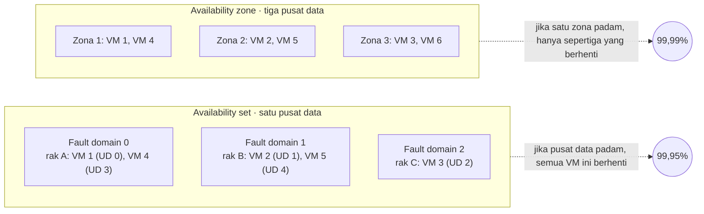
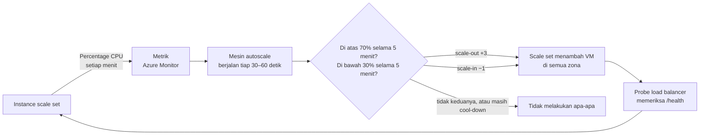
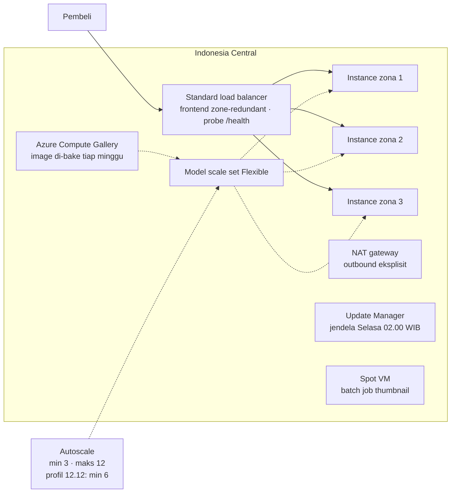

# Makan Siang 23 · Virtual Machines (Lanjutan)

🇬🇧 [Read in English](README.md)

> **Jalur:** Bulan pendalaman · **Level:** Lanjutan · **Bagian 5:** Pendalaman
> **Waktu:** 60 menit · **Makan siang prasyarat:** 06 (Virtual Machines, Dasar), 03, 09
> **Area keterampilan AZ-900:** Di luar cakupan AZ-900
> **Lab:** [Lab 23 · Siap menghadapi promo 12.12](../../labs/23-virtual-machines-advanced/README.id.md) — sekitar 60 menit · biaya 💲💲
> **Penulis:** Stefanus Pinarta · [Tentang penulis](../../README.id.md#tentang-penulis)

| ⏱ Menit | Segmen |
|---:|---|
| 5 | Skenario dan tujuan |
| 25 | Bacaan |
| 15 | Demo: animasi interaktif (+ video panduan opsional) |
| 5 | Uji pemahaman |
| 5 | Poin penting dan pratinjau lab |
| 5 | Waktu cadangan — habiskan makan siang Anda 🍜 |

## 🍱 Menu hari ini

Setelah makan siang ini, Anda akan mampu:

- **Membandingkan** virtual machine (*komputer virtual*) tunggal, availability set (*set ketersediaan*), dan availability
  zone (*zona ketersediaan*) berdasarkan kegagalan yang sanggup dilewati masing-masing dan SLA (perjanjian tingkat
  layanan) yang diperolehnya.
- **Memilih** antara orkestrasi Flexible dan Uniform untuk Virtual Machine Scale Set (*Kumpulan Skala Komputer
  Virtual*), sekaligus merencanakan akses keluar (outbound) yang eksplisit.
- **Merancang** pengaturan autoscale dengan aturan metrik, profil jadwal, dan cool-down yang tidak membuat jumlah server
  naik-turun tak keruan.
- **Menjelaskan** bagaimana image, cloud-init, extension, upgrade policy, dan automatic repairs menjaga banyak instance
  tetap identik dan sehat.
- **Memutuskan** kapan Spot VM, dedicated host, dan proximity placement group cocok dipakai, serta bagaimana Azure Update
  Manager dan Trusted Launch menjaga armada VM tetap ter-patch dan aman.

## 🏪 Sementara itu di Nusantara Retail

Setiap tanggal 12 Desember — *Harbolnas*, Hari Belanja Online Nasional — kunjungan ke toko online Nusantara Retail
melonjak selama beberapa jam. Tahun lalu, server tua di pantry kantor membeku tujuh menit lewat tengah malam, dan flash
sale sudah berakhir sebelum sempat dimulai. Tahun ini toko sudah berjalan di Azure, tetapi masih di atas dua VM
berukuran tetap di belakang sebuah load balancer.

Ibu Sari punya dua aturan. "Saya tidak mau membayar sepuluh server sepanjang tahun hanya demi satu malam. Dan saya tidak
mau ada yang begadang tengah malam sambil mengklik tombol." Dewi bertanya bagaimana sepuluh server bisa tetap identik dan
selalu ter-patch. Pak Budi mengingatkan semua orang bahwa satu pusat data (datacenter) utuh pun bisa lumpuh. Tim keuangan
ikut bersuara: mereka membaca tentang kapasitas "sisa" Azure yang murah dan ingin tahu apakah toko bisa memakainya.

Jadi, pertanyaan hari ini: bagaimana toko online bisa membesar menyambut puncak 12.12, tetap bertahan saat satu pusat
data hilang, lalu menyusut lagi sebelum sarapan — semuanya dengan sendirinya?

---

## 📖 Bacaan (≈25 menit)

### 1. Ketersediaan: apa yang bisa gagal, dan apa yang sanggup dilewati setiap opsi

Mulailah dari kegagalan yang ingin Anda antisipasi. Sebuah **host** — server fisik tempat VM Anda menumpang — bisa rusak
atau di-restart untuk pemeliharaan. Sebuah **rak** server (*rack*) bisa kehilangan catu daya atau switch jaringannya.
Satu **pusat data** utuh — yaitu satu availability zone — bisa kehilangan listrik, pendingin, atau jaringan. Satu
**region** (*wilayah*) pun bisa gagal, tetapi itu urusan pemulihan bencana (disaster recovery, Makan Siang 17). Bayangkan
sebuah kompleks apartemen: satu unit bisa korsleting (host), satu lantai bisa padam karena panelnya rusak (rak), satu
gedung bisa gelap gulita (pusat data), dan satu kota bisa dilanda banjir besar (region). Setiap opsi ketersediaan VM
melindungi dari potongan yang berbeda dari daftar itu.

**VM tunggal** mengandalkan Azure untuk menyalakannya kembali di host yang sehat setelah terjadi kerusakan perangkat
keras, dan SLA-nya — *service level agreement*, janji tertulis Microsoft tentang persentase waktu sebuah layanan bisa
dijangkau — bergantung pada jenis disknya (Makan Siang 06). **Availability set** mengelompokkan dua VM atau lebih di satu
pusat data dan menyebarkannya ke maksimal tiga **fault domain** — kelompok server yang berbagi sumber listrik dan switch
jaringan yang sama — serta maksimal 20 **update domain**, yaitu kelompok yang di-reboot Azure bersamaan saat
pemeliharaan terencana. Update domain diproses satu per satu, dan masing-masing diberi waktu 30 menit untuk pulih sebelum
giliran berikutnya — mirip pemadaman bergilir yang tidak pernah memadamkan semua gardu sekaligus. Availability set tidak
menambah biaya dan menjaga VM tetap berdekatan secara fisik, tetapi tidak sanggup bertahan jika pusat datanya sendiri
lumpuh. **Availability zone** menempatkan VM di pusat data yang terpisah secara fisik di dalam region yang sama, sehingga
gangguan pada satu zona hanya menghilangkan sebagian kapasitas Anda. Sebuah VM bisa bersifat **zonal** — dipatok ke zona
yang Anda pilih — atau **regional**, ditaruh di mana pun Azure menemukan tempat, tanpa janji zona sama sekali. Scale set
yang membentang di beberapa zona melakukan pematokan itu untuk Anda dan menjaga agar isi setiap zona tetap seimbang.

Azure membantu VM yang sendirian lebih banyak daripada yang dikira orang. Saat sebuah host rusak, **service healing**
otomatis menyalakan ulang VM tersebut di host yang sehat. Sebagian besar pemeliharaan platform terencana tidak menyentuh
VM yang sedang berjalan, atau hanya menjedanya beberapa detik. Ketika reboot atau jeda akan terjadi, endpoint **Scheduled
Events** di dalam VM mengumumkannya lebih dulu, sehingga aplikasi yang ditulis dengan baik bisa menuntaskan koneksi yang
sedang berjalan (*drain*) sebelum waktunya tiba. Namun, semua itu tidak menghapus waktu henti (*downtime*) selama restart
— hanya VM kedua di tempat lain yang bisa melakukannya.

| Opsi | Sanggup melewati | SLA konektivitas VM (Oktober 2026) | Perlu diketahui |
|---|---|---|---|
| VM tunggal, semua disk Premium SSD atau Ultra Disk | Kegagalan host, setelah restart otomatis | 99,9% | Standard SSD: 99,5%; Standard HDD: 95% |
| Availability set, 2+ VM | Kegagalan host dan rak, pemeliharaan terencana | 99,95% | Satu pusat data; fault domain dan update domain ditetapkan saat dibuat |
| 2+ VM di 2+ availability zone | Kegagalan host, rak, dan seluruh pusat data | 99,99% | Frontend load balancer dan disk yang zone-redundant ikut membantu |

Angka-angka ini berasal dari
[service level agreement](https://www.microsoft.com/licensing/docs/view/Service-Level-Agreements-SLA-for-Online-Services)
Microsoft pada saat tulisan ini dibuat; periksa kembali sebelum Anda menjanjikan apa pun kepada direktur. Ingat juga apa
yang dijaminnya: *konektivitas ke VM*, bukan aplikasi Anda. Bug, disk yang penuh, atau satu server database tunggal
tetap bisa membuat toko berhenti berjualan — desain Anda hanya setangguh komponen tunggal terlemahnya. Ketersediaan juga
saling mengalikan: jika tier web mendapat 99,99% tetapi setiap request membutuhkan satu VM database dengan 99,9%, rantai
keduanya kira-kira 0,9999 × 0,999 ≈ 99,89% — lebih buruk daripada masing-masing bagiannya. Ibaratnya mudik dengan kereta
lalu kapal feri: peluang Anda tiba tepat waktu adalah peluang *keduanya* lancar, dan itu selalu lebih kecil daripada
peluang masing-masing. Perbaiki mata rantai terlemah lebih dulu.

Untuk desain baru yang menuntut *ketersediaan tinggi* (high availability), Microsoft kini merekomendasikan **Virtual
Machine Scale Sets dengan orkestrasi Flexible**: VM disebar ke beberapa zona *atau* fault domain, lengkap dengan fitur
penskalaan yang Anda butuhkan untuk 12.12.

### 2. Virtual Machine Scale Sets: Flexible atau Uniform

**Virtual Machine Scale Set** mengelola sekelompok VM dari satu **model** — resep baku yang berisi image, ukuran,
pengaturan jaringan, extension, dan cloud-init. Setiap VM anggotanya disebut **instance**. Ibaratnya waralaba martabak:
satu resep standar memastikan setiap gerobak, di cabang mana pun, menghasilkan rasa yang sama. Scale set menyebarkan
instance ke beberapa zona dan fault domain, menghubungkannya ke load balancer atau Application Gateway, menambah dan
mengurangi instance (secara manual atau dengan autoscale), meng-upgrade, dan memperbaikinya. Menambah instance disebut
**scale-out**; menguranginya disebut **scale-in**. Dua keputusan mengatur apa yang terjadi saat instance dikurangi:
**scale-in policy** (*Default* menyeimbangkan zona dan fault domain; *NewestVM* dan *OldestVM* bekerja persis seperti
namanya, membuang VM terbaru atau tertua lebih dulu) dan **instance protection**, yang menjaga instance pilihan agar
tidak ikut dibuang saat scale-in.

Setiap scale set punya **orchestration mode** (mode orkestrasi) yang dipilih saat dibuat dan tidak bisa diubah seumur
hidupnya.

| | **Flexible** (direkomendasikan) | **Uniform** |
|---|---|---|
| Instance berupa | VM standar (`Microsoft.Compute/virtualMachines`) | VM scale set yang dikelola lewat API scale set |
| Instance dikelola dengan | Perintah VM biasa, tag, RBAC (*kontrol akses berbasis peran*), Azure Backup, Site Recovery | Hanya perintah VM scale set |
| Mencampur ukuran, OS, dan skema harga | Ya — bahkan instance Spot dan reguler dalam satu set | Tidak — instance identik, semuanya Spot atau semuanya reguler |
| Skala | Hingga 1.000 VM | Armada besar berisi instance yang identik |
| Akses internet keluar bawaan (default outbound) | **Tidak** — butuh metode eksplisit | Ya |
| Sinyal kesehatan untuk perbaikan | Application Health extension | Application Health extension atau probe load balancer |
| Upgrade image OS otomatis | Tidak (gunakan guest patching sebagai gantinya) | Ya |
| Penggunaan umum | Beban kerja baru, termasuk toko online Nusantara | Armada lama dan platform yang dibangun di atasnya |

Sejak November 2023, Azure CLI dan PowerShell membuat scale set Flexible kecuali Anda meminta yang lain. Bagi Nusantara
Retail, pilihannya mudah: instance Flexible adalah VM biasa, jadi semua yang dipelajari di Makan Siang 06 tetap berlaku.
Scale set Flexible bahkan bisa "mengadopsi" VM yang sudah ada, dan instance yang ditambahkan autoscale diberi nama
berupa awalan (prefix) pilihan Anda ditambah akhiran (suffix) yang unik.

Ada dua gaya penyebaran. Dengan **max spreading** — pengaturan yang dipakai bersama zona — Azure menaruh instance di
sebanyak mungkin fault domain. Dengan **fixed spreading**, instance mendarat di dua atau tiga fault domain yang bisa Anda
lihat, bahkan Anda pilih sendiri. Cara ini cocok untuk perangkat lunak berbasis kuorum — sistem yang baru boleh mengambil
keputusan jika mayoritas anggotanya sepakat — seperti database berkluster yang harus tahu di mana setiap replikanya
berada.

> [!WARNING]
> Instance di scale set Flexible **tidak mendapat akses internet keluar bawaan** (*default outbound access*). Tanpa NAT
> gateway di subnet (pilihan yang paling umum; NAT = *Network Address Translation*, yang membuat koneksi keluar dari
> alamat privat memakai alamat IP publik bersama), outbound rule di load balancer, atau IP publik untuk setiap
> instance, pemasangan paket dan update OS akan gagal, dan penilaian patch (*patch assessment*) tidak bisa menjangkau
> sumber update. Sementara itu situs web tetap menjawab lewat load balancer, sehingga tidak ada yang sadar sampai hari
> patch tiba. Ibaratnya warung yang pintu depannya terbuka untuk pembeli, tetapi karyawannya tidak bisa keluar untuk
> kulakan.

### 3. Autoscale: aturan, profil, dan cool-down

**Autoscale** adalah fitur Azure Monitor: sebuah **autoscale setting** (pengaturan autoscale) yang dipasang pada scale
set (satu per resource) menentukan kapan instance ditambah atau dikurangi. Inilah wujud nyata *elastisitas*
(elasticity): kapasitas yang mengikuti permintaan, naik maupun turun. Satu pengaturan bisa memuat hingga 20
**profil**. Profil *default* berlaku ketika tidak ada profil lain yang cocok; profil **recurrence** berulang pada
hari-hari tertentu, misalnya akhir pekan; profil **fixed-date** mencakup satu acara, misalnya 12.12. Setiap profil
menetapkan jumlah instance **minimum**, **maksimum**, dan **default**, ditambah hingga sepuluh aturan.

| Bagian aturan metrik | Contoh | Artinya |
|---|---|---|
| Metrik | Percentage CPU dari scale set | Metrik host, dikumpulkan tanpa agen apa pun |
| Time grain dan statistik | 1 menit, Average | Satu sampel per menit, dirata-ratakan dari semua instance |
| Durasi dan agregasi waktu | 5 menit, Average | Melihat lima menit ke belakang, sehingga satu lonjakan sesaat tidak memicu apa pun |
| Operator dan ambang batas | Greater than 70 | Kondisi yang memicu aturan |
| Aksi | Increase count by 3 | Atau naik sekian persen, atau tetapkan jumlah yang persis |
| Cool-down | 5 menit | Berapa lama aturan ini menunggu setelah aksi penskalaan apa pun sebelum boleh bertindak lagi |

Mesin autoscale berjalan setiap 30 sampai 60 detik. Jika *salah satu saja* aturan scale-out terpicu, ia melakukan
scale-out — ke jumlah terbesar yang diminta aturan mana pun. Ia baru melakukan scale-in jika *semua* aturan scale-in
sepakat, dan itu pun dengan jumlah terkecil. Bayangkan supermarket menjelang Lebaran: begitu antrean di kasir memanjang,
manajer langsung membuka beberapa kasir tambahan sekaligus; tetapi kasir ditutup satu per satu, dan hanya ketika semua
antrean benar-benar sepi. Hitungan untuk 12.12 sederhana: tiga instance dengan rata-rata CPU 90% memicu aturan, tiga
instance baru datang, dan pekerjaan yang sama dibagi ke enam instance menghasilkan rata-rata sekitar 45% — masuk ke
"zona tenang", sehingga tidak ada lagi yang terjadi sampai jumlah pengunjung berubah.

Sebelum melakukan scale-in, autoscale memeriksa apakah set yang lebih kecil akan langsung memicu aturan scale-out.
Misalkan empat instance rata-rata 60% dan aturan scale-in berbunyi "di bawah 65%". Membuang satu instance berarti beban
yang sama ditanggung tiga instance — sekitar 80% masing-masing, di atas ambang scale-out 70% — sehingga autoscale menahan
diri alih-alih **flapping**, yaitu bolak-balik antara tiga dan empat instance. Sebaiknya beri jarak yang lebar: scale-out
di atas 70%, scale-in di bawah 30%. Dua detail lagi penting di produksi: jika metrik tidak bisa dibaca dan jumlah
instance berada di bawah nilai *default*, autoscale melakukan scale-out ke nilai default itu sebagai jaring pengaman; dan
setiap pengaturan bisa mengirim email ke orang tertentu atau memanggil webhook saat melakukan penskalaan, sementara *Run
history* di portal menampilkan setiap keputusannya.

Aturan metrik *bereaksi*; **jadwal** *mengantisipasi*. Untuk 12.12, Nusantara menambahkan profil fixed-date dari pukul
22.00 tanggal 11 Desember sampai 03.00 tanggal 13 Desember dengan *minimum* enam instance, sehingga gelombang pertama
pembeli pada tengah malam disambut server yang sudah siap, bukan menunggu lima menit sampai aturan terpicu ditambah
beberapa menit lagi sampai VM baru selesai booting — seperti warung bakso yang sudah menyiapkan kuah sejak sore karena
tahu malam takbiran pasti ramai. Aturan metrik tetap bekerja di dalam profil itu. Autoscale juga bisa memakai metrik lain
— memori guest dari sebuah agen, panjang antrean Service Bus, jumlah request dari Application Insights — jika CPU bukan
hambatan yang sebenarnya.

> [!TIP]
> Lakukan scale-out lebih awal dan dengan murah hati; lakukan scale-in pelan-pelan, satu instance setiap kali. Dan uji
> dengan beban sungguhan: aturan CPU pada ukuran *burstable* seri B bisa menyesatkan. VM burstable mengumpulkan kredit
> CPU saat santai dan memakainya saat sibuk; VM yang kreditnya sudah habis dibatasi ke tingkat dasarnya (*baseline*) dan
> justru melaporkan CPU rendah ketika sedang kewalahan.

### 4. Instance yang identik dan tetap sehat

Scale set hanya berguna jika setiap instance-nya sama persis. Ada dua cara untuk mencapainya, dan sebagian besar tim
memadukan keduanya:

| Pendekatan | Cara kerja | Kekuatan | Kelemahan |
|---|---|---|---|
| **Bake** (dipanggang dulu) | Membuat custom image yang aplikasinya sudah terpasang | Booting cepat dan mudah diprediksi | Setiap perubahan berarti image baru |
| **Fry** (digoreng di tempat) | Mulai dari image Marketplace; konfigurasi dilakukan saat boot pertama dengan cloud-init atau extension | Mudah diubah | Booting lebih lambat; bergantung pada sumber unduhan |

Ibaratnya katering: *bake* seperti nasi kotak yang sudah dimasak dan dikemas di dapur pusat, tinggal dibagikan; *fry*
seperti gorengan yang dimasak saat dipesan — lebih luwes, tetapi pembeli harus menunggu dan bergantung pada pasokan
bahan. Untuk cara *bake*, **Azure Compute Gallery** menyimpan **image definition** (OS, generasi, tipe keamanan) dan
**image version** yang bernomor, mereplikasinya ke region pilihan Anda, dan membagikannya lintas subscription
(*langganan*) — serta mendukung Trusted Launch, yang tidak didukung managed image versi lama. **Azure VM Image Builder**
mengotomatiskan proses *bake*: berbekal sebuah template, ia memulai dari base image, menjalankan skrip dan update Anda,
lalu menerbitkan versi baru ke gallery. Untuk cara *fry*, **cloud-init** (program standar di image Linux yang
menjalankan instruksi konfigurasi) membaca custom data saat boot pertama, dan **extension** — aplikasi kecil yang dipasang
Azure di dalam VM untuk tugas konfigurasi dan otomatisasi, seperti Custom Script, Application Health, Azure Monitor
Agent, dan lainnya — menjadi bagian dari model scale set, sehingga setiap instance baru otomatis menerimanya.

Ketika model berubah, **upgrade policy** menentukan nasib instance yang sudah ada. *Manual* hanya mengubah instance baru
sampai Anda meng-upgrade sisanya. *Automatic* memperbarui semua instance sekaligus, yang berisiko menimbulkan downtime.
*Rolling* meng-upgrade secara bertahap per batch — secara default paling banyak 20% instance per batch — memeriksa
kesehatan di antara batch, dan bisa membuat instance tambahan lebih dulu (*max surge*) sehingga kapasitas tidak pernah
turun.

**Automatic instance repairs** memantau sinyal kesehatan, biasanya dari Application Health extension yang memanggil
endpoint seperti `/health` di dalam setiap instance: jawaban `200 OK` berarti sehat, jawaban lain — termasuk tidak
menjawab sama sekali — berarti tidak sehat. Jika sebuah instance terus tidak sehat, scale set menggantinya dengan
instance baru yang dibangun dari model terkini (perilaku default), atau melakukan reimage (memasang ulang disk OS dari
image), atau me-restart-nya. Masa tenggang (*grace period*) 10 sampai 90 menit setelah setiap perubahan mencegah
perbaikan selagi instance masih booting; instance yang dilindungi dilewati; dan perbaikan berjalan dalam batch kecil —
tidak pernah lebih dari 5% set sekaligus, satu per satu untuk set di bawah 20 instance — sehingga deployment yang buruk
tidak bisa menyapu bersih semuanya sekaligus.

### 5. Lebih murah, terisolasi, dan ter-patch: Spot, host, penempatan, dan update

**Azure Spot Virtual Machines** berjalan di atas kapasitas sisa Azure dengan diskon besar, tanpa SLA. Ketika Azure
membutuhkan kapasitas itu kembali — atau ketika harga naik melebihi batas maksimum yang Anda tetapkan — VM akan
**di-evict** (diusir), dengan peringatan paling lama 30 detik sebelumnya lewat Scheduled Events. Ibaratnya menyewa lapak
kosong di pasar dengan harga miring, dengan syarat harus angkat kaki dalam setengah menit begitu pemilik lapak datang.
**Eviction policy**-nya adalah *Deallocate* (disk tetap ada dan tetap ditagih; VM bisa dinyalakan lagi nanti) atau
*Delete*. Harga maksimum **-1** berarti "jangan pernah usir saya karena harga, dan jangan pernah tagih lebih dari harga
reguler". Spot punya kuota vCPU (CPU virtual) tersendiri, tidak mendukung ukuran seri B, dan hanya tersedia pada sebagian
jenis penawaran subscription. Saat Anda membuatnya, portal menampilkan harga Spot terbaru dan tingkat eviction per jam
untuk setiap ukuran, dan Azure Resource Graph menyediakan riwayat yang sama, sehingga Anda bisa memilih ukuran yang
jarang di-evict. Prioritas VM ditetapkan saat dibuat: VM reguler tidak bisa diubah menjadi Spot, begitu pula sebaliknya.
Scale set Flexible bahkan bisa memadukan sejumlah instance reguler sebagai fondasi dengan instance Spot di atasnya. Spot
cocok untuk batch job, build agent, dan lingkungan uji — pekerjaan yang boleh berhenti lalu dilanjutkan — tetapi jangan
pernah untuk checkout.

Spot adalah kapasitas *termurah*; kadang Anda justru butuh yang *paling pasti*. Pada 12.12, semua peritel di region yang
sama melakukan scale-out tepat tengah malam. **On-demand capacity reservation** menahan kapasitas untuk satu ukuran VM di
sebuah region atau zona, dan ditagih seperti VM yang sedang berjalan, dipakai atau tidak. Jangan tertukar dengan
*reservation* dari Makan Siang 06, yang hanya berupa diskon tagihan dan sama sekali tidak menjamin kapasitas. Bedanya
seperti voucher diskon restoran dan meja yang sudah dipesan: voucher membuat makan lebih murah tetapi tidak menjamin ada
kursi kosong, sedangkan meja yang dipesan pasti tersedia — dan tetap dibayar walaupun Anda tidak datang.

**Azure Dedicated Hosts** memberi Anda satu server fisik utuh yang hanya dipakai VM Anda — untuk isolasi ketat, kendali
atas jadwal pemeliharaan, atau lisensi yang dihitung per core fisik; yang Anda bayar adalah host-nya. **Proximity
placement group** menjaga VM tetap berdekatan secara fisik demi latensi (jeda waktu jaringan) serendah mungkin di antara
mereka. Ini berlawanan dengan prinsip menyebar VM — karena itu proximity placement group dipakai dengan satu zona saja
atau tanpa zona sama sekali.

**Azure Update Manager** menjaga armada tetap ter-patch tanpa memerlukan Azure Automation atau Log Analytics. Ia menilai
mesin sesuai permintaan atau setiap 24 jam (*periodic assessment*), memasang update saat itu juga, atau mengikuti
**maintenance configuration** — jadwal dengan jendela waktu tertentu yang bisa menyasar mesin secara dinamis, misalnya
berdasarkan tag atau resource group (*grup sumber daya*). Setiap VM juga punya **patch orchestration mode**: di Linux,
*ImageDefault* menyerahkan urusan patch ke pengaturan sistem operasi itu sendiri, sedangkan *AutomaticByPlatform*
membiarkan Azure memasang sendiri update kritis dan update keamanan lewat peluncuran yang mengutamakan ketersediaan, yang
tidak pernah mem-patch dua availability zone pada saat yang sama (VM yang berdiri sendiri di-patch pada jam sepinya).
**Hotpatching** memasang update tanpa reboot pada edisi Windows Server yang didukung. Update Manager gratis untuk VM
Azure dan ditagih per server untuk mesin yang terhubung lewat Azure Arc, serta menggantikan Automation Update Management
yang sudah dipensiunkan. Seperti alat patch lainnya, ia membutuhkan akses keluar ke sumber update.

**Trusted Launch** melindungi proses boot dengan Secure Boot, TPM virtual (*Trusted Platform Module*, chip keamanan yang
menyimpan kunci dan mencatat "sidik jari" proses boot), dan pemantauan integritas boot yang dilaporkan ke Microsoft
Defender for Cloud (*Microsoft Defender untuk Cloud*). Trusted Launch menjadi pengaturan default untuk VM Generation 2
dan scale set baru yang dibuat dari portal, CLI, atau PowerShell, tanpa biaya tambahan.

Terakhir, **Azure Virtual Desktop** menghadirkan desktop dan aplikasi Windows dari VM di Azure. Kumpulan (pool) host
multi-session Windows 11 Enterprise bisa melayani banyak pengguna per host dan di-scale sesuai jadwal — kandidat untuk
aplikasi back-office para manajer toko, tetapi itu topik untuk lain hari.

### 6. Desain 12.12 Nusantara Retail

Beginilah cara semua kepingan tadi menjawab dua aturan Ibu Sari:

- **Zona, bukan satu VM tunggal.** Scale set Flexible membentang di zona 1, 2, dan 3 di Indonesia Central, dengan minimal
  tiga instance — satu per zona — di belakang Standard load balancer dari Makan Siang 09.
- **Autoscale.** CPU di atas 70% selama lima menit menambah tiga instance; di bawah 30% selama lima menit mengurangi satu;
  cool-down lima menit; maksimum 12. Profil fixed-date menjaga minimal enam instance sepanjang malam 12.12.
- **Ruang cadangan jika satu zona hilang.** Jika satu dari tiga zona gagal saat puncak, dua zona lainnya harus menanggung
  semuanya, sehingga batas maksimum harus menyisakan ruang untuk tumbuh — alasan lain mengapa batasnya 12, bukan 6.
- **Identik dan sehat.** Image mingguan dari VM Image Builder di Azure Compute Gallery, Application Health extension di
  `/health`, automatic repairs, dan rolling upgrade dengan max surge.
- **Ter-patch dan aman.** Trusted Launch di setiap instance, NAT gateway untuk akses keluar yang eksplisit, dan
  maintenance configuration Update Manager setiap Selasa pukul 02.00 WIB.
- **Hemat di tempat yang aman.** Spot VM memproses thumbnail foto produk pada malam hari; checkout tidak pernah berjalan
  di Spot.

Beberapa makan siang berikutnya dibangun di atas desain ini: Application Gateway dan Front Door (Makan Siang 27) memasang
"pintu depan" layer 7 di depan scale set, node pool Kubernetes di Makan Siang 29 sebenarnya juga scale set, dan Makan
Siang 30 mengubah metrik scale set menjadi dashboard dan alert (*pemberitahuan*).

> [!NOTE]
> **Renungkan sejenak:** pada puncak 12.12, toko online membutuhkan sembilan instance yang sibuk. Zona 2 gagal pukul
> 00.40. Dengan maksimum 9, apa yang terjadi pada waktu respons — dan kombinasi minimum, maksimum, serta tata letak zona
> seperti apa yang memungkinkan dua zona yang tersisa menanggung seluruh beban puncak?

---

## 🎬 Demo (≈15 menit)

1. **Animasi interaktif (≈6–8 menit):** [Buka demo](https://stefpin.github.io/azure-fundamentals-lunches/demos/23-virtual-machines-advanced.html?lang=id) —
   tekan ▶ Putar atau telusuri langkah demi langkah sesuai kecepatan Anda. Sedang offline? Unduh
   [`docs/demos/23-virtual-machines-advanced.html`](../../docs/demos/23-virtual-machines-advanced.html) lalu buka di browser apa pun.
2. **Video panduan (≤ 6 menit):** _segera hadir_ — [baca naskah video](demo-video-script.id.md).

Yang perlu diperhatikan:

- Mengapa aturan scale-out menunggu lima menit CPU tinggi, dan apa fungsi cool-down setelah aturan itu terpicu.
- Bagaimana instance baru disebar satu per zona, dan mengapa mereka baru menerima lalu lintas setelah lolos health probe.
- Apa yang dilakukan load balancer ketika zona 2 gagal, dan mengapa batas maksimum autoscale membutuhkan ruang cadangan.
- Apa beda fault domain dan update domain pada availability set dibandingkan availability zone.
- Seperti apa eviction pada Spot VM, dan mengapa eviction policy serta checkpoint itu penting.

## ✅ Uji pemahaman (≈5 menit)

1. Pak Budi mengusulkan agar dua VM toko online dimasukkan ke availability set "karena gratis dan SLA-nya 99,95%".
   Indonesia Central punya tiga zona. Apa rekomendasi Anda, dan mengapa?
   

Lihat jawaban

   Sebarkan VM ke beberapa availability zone — idealnya dengan scale set Flexible — untuk mendapat 99,99% dan
   perlindungan dari kegagalan satu pusat data utuh — *alasannya:* availability set hanya melindungi dari kegagalan rak
   dan pemeliharaan di dalam satu pusat data.

   

2. Dewi ingin menjalankan beberapa instance Spot berdampingan dengan instance reguler dalam satu scale set, memberi tag
   pada instance tertentu, dan mem-backup salah satunya dengan Azure Backup. Mode orkestrasi apa yang ia butuhkan?
   

Lihat jawaban

   Orkestrasi Flexible — *alasannya:* instance-nya adalah VM standar yang mendukung tag, RBAC, dan Azure Backup, dan
   scale set ini bisa mencampur instance berprioritas Spot dan reguler; instance pada set Uniform semuanya Spot atau
   semuanya reguler.

   

3. Sebuah pengaturan autoscale melakukan scale-out saat rata-rata CPU di atas 70% dan scale-in saat di bawah 65%. Run
   history-nya menunjukkan bahwa ia jarang melakukan scale-in, dan ketika melakukannya, tak lama kemudian ia scale-out
   lagi. Apa yang salah?
   

Lihat jawaban

   Ambang batasnya terlalu berdekatan: membuang satu instance langsung mendorong rata-rata kembali ke atas 70%, sehingga
   pemeriksaan flapping memblokir sebagian besar scale-in dan sisanya memantul balik — *alasannya:* autoscale membutuhkan
   jarak yang lebar antar-ambang (misalnya scale-in di bawah 30%) ditambah cool-down pada setiap aturan.

   

4. Tim keuangan menyarankan agar tier checkout dijalankan sepenuhnya di Spot VM dengan harga maksimum -1 "supaya tidak
   pernah di-evict". Apa kelemahannya?
   

Lihat jawaban

   Harga maksimum -1 hanya mencegah eviction *karena harga*; Spot VM tetap di-evict setiap kali Azure membutuhkan
   kapasitasnya, dengan pemberitahuan sekitar 30 detik dan tanpa SLA — *alasannya:* Spot cocok untuk pekerjaan yang
   boleh terputus seperti batch job, bukan checkout.

   

5. Scale set Flexible baru di belakang load balancer publik melayani situs web dengan sempurna, tetapi assessment Update
   Manager gagal dan `apt-get update` kehabisan waktu (*time out*) di setiap instance. Apa yang kurang?
   

Lihat jawaban

   Metode outbound yang eksplisit — NAT gateway di subnet, outbound rule load balancer, atau IP publik per instance —
   *alasannya:* instance Flexible tidak mendapat akses keluar bawaan, dan lalu lintas masuk lewat load balancer tidak
   memberi mereka jalan keluar.

   

## 🧠 Poin penting

- VM tunggal, availability set, dan availability zone sanggup melewati kegagalan yang berbeda; pada saat tulisan ini
  dibuat, 2+ VM di beberapa zona mendapat 99,99% dan 2+ VM dalam availability set mendapat 99,95%.
- Scale set Flexible adalah pilihan default yang direkomendasikan: VM standar, ukuran campuran dan Spot, tersebar di
  beberapa zona — dan membutuhkan akses keluar yang eksplisit.
- Autoscale = profil (default, recurrence, fixed-date) + aturan metrik (metrik, jendela waktu, ambang batas, aksi,
  cool-down); scale-out dengan cepat, scale-in dengan pelan, dan jaga jarak yang lebar antar-ambang.
- Image dari Azure Compute Gallery, cloud-init, dan extension menjaga instance tetap identik; upgrade policy dan automatic
  repairs menjaganya tetap mutakhir dan sehat.
- Spot untuk pekerjaan yang boleh terputus; dedicated host dan proximity placement group menjawab kebutuhan khusus akan
  isolasi dan latensi; Update Manager dan Trusted Launch menjaga armada tetap ter-patch dan rantai boot-nya terlindungi.

## 🗒️ Catatan lapangan dari Stefanus

> **Hilangkan satu zona di atas kertas sebelum memercayai autoscale.** Sebelum menyetujui pengaturan autoscale apa pun,
> saya selalu berhitung bersama tim: ambil jam tersibuk, coret semua instance di satu zona, lalu periksa apakah instance
> yang masih diizinkan oleh batas maksimum sanggup menanggung seluruh beban di bawah ambang scale-out. Kalau tidak
> sanggup, angka maksimum itu sebenarnya keputusan anggaran yang menyamar sebagai rencana kapasitas, dan saya minta
> keputusan itu ditulis hitam di atas putih. Berikutnya, saya menjalankan update paket dari dalam satu instance — bukan
> sekadar membuka halaman lewat load balancer — karena armada yang lancar melayani pembeli tetapi tidak bisa menjangkau
> sumber update akan tampak sehat sampai hari patch tiba. Terakhir, saya minta ditunjukkan scale-in, bukan hanya
> scale-out: set yang sigap membesar tetapi tak pernah menyusut adalah cara termahal untuk lulus uji beban.

## 🔬 Lab Anda: Siap menghadapi promo 12.12

Anda akan membangun scale set Flexible di zona 1–3 di belakang Standard load balancer, memakai web server cloud-init
milik kursus ini; memasang pengaturan autoscale dengan aturan CPU; membangkitkan beban CPU pada instance dan menyaksikan
VM baru muncul lalu menghilang lagi; menilai patch yang tertunda dengan Azure Update Manager; dan, secara opsional,
membuat Spot VM lalu sengaja meng-evict-nya. Satu kerusakan yang disengaja —
mencopot NAT gateway — menunjukkan mengapa instance Flexible membutuhkan akses keluar yang eksplisit.

- ⏱ Sekitar 60 menit · 💲💲 biaya kecil selama resource berjalan · bisa dikerjakan terpisah (tidak perlu lab sebelumnya)
- 👉 [Mulai Lab 23](../../labs/23-virtual-machines-advanced/README.id.md)

## 📚 Pelajari lebih lanjut

- [Microsoft Learn: Mode orkestrasi Virtual Machine Scale Sets](https://learn.microsoft.com/azure/virtual-machine-scale-sets/virtual-machine-scale-sets-orchestration-modes) — perbandingan lengkap fitur Flexible dan Uniform.
- [Microsoft Learn: Memahami pengaturan autoscale](https://learn.microsoft.com/azure/azure-monitor/autoscale/autoscale-understanding-settings) — profil, skema aturan, serta cara kerja evaluasi dan cool-down.
- [Microsoft Learn: Azure Spot Virtual Machines](https://learn.microsoft.com/azure/virtual-machines/spot-vms) — eviction policy, riwayat harga, dan keterbatasannya.
- [Microsoft Learn: Apa itu Azure Update Manager?](https://learn.microsoft.com/azure/update-manager/overview) — assessment, patching terjadwal, dan hotpatching.

---

⬅️ [Makan Siang 22 · Identitas dan Akses (Lanjutan)](../22-identity-access-advanced/README.id.md) · 🏠 [Beranda kursus](../../README.id.md) · [Makan Siang 24 · Penyimpanan (Lanjutan)](../24-storage-advanced/README.id.md) ➡️

Terakhir divalidasi: Oktober 2026 · Menemukan informasi yang sudah usang? [Buka issue](../../CONTRIBUTING.md).
