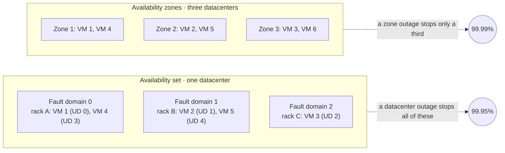
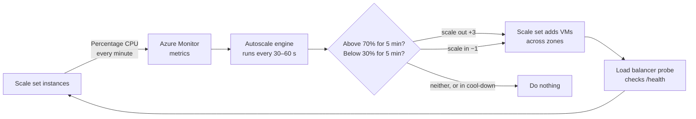
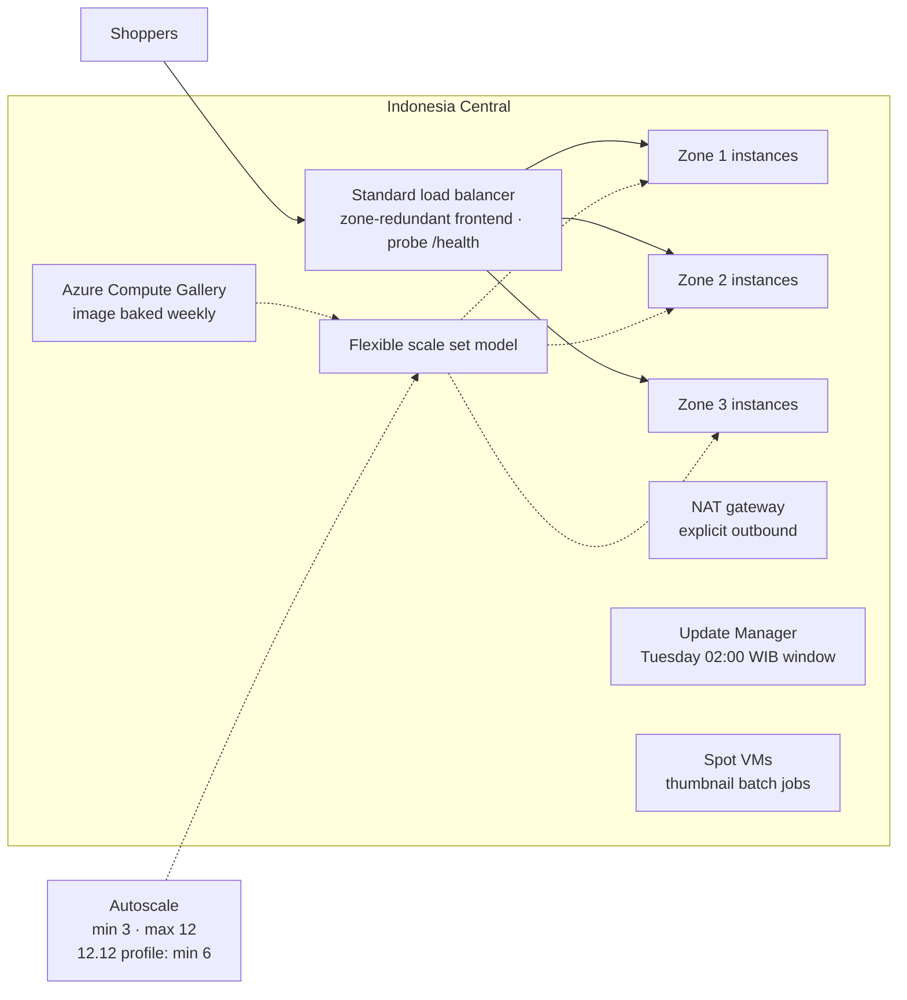

# Lunch 23 · Virtual Machines (Advanced)

> **Track:** Deep-dive month · **Level:** Advanced · **Part 5:** Deep dives
> **Time:** 60 minutes · **Prerequisite lunches:** 06 (Virtual Machines, Basic), 03, 09
> **AZ-900 skill area:** Beyond AZ-900
> **Lab:** [Lab 23 · Ready for the 12.12 sale](../../labs/23-virtual-machines-advanced/README.md) — about 60 minutes · cost 💲💲

| ⏱ Minutes | Segment |
|---:|---|
| 5 | Scenario and objectives |
| 25 | Reading |
| 15 | Demo: interactive animation (+ optional walkthrough video) |
| 5 | Knowledge check |
| 5 | Key takeaways and lab preview |
| 5 | Buffer — finish your lunch 🍜 |

## 🍱 Today's menu

By the end of this lunch you will be able to:

- **Compare** a single VM, an availability set and availability zones by what they survive and the SLA each one earns.
- **Choose** between Flexible and Uniform orchestration for a Virtual Machine Scale Set, and plan explicit outbound access.
- **Design** an autoscale setting with metric rules, schedule profiles and cool-downs that won't flap.
- **Explain** how images, cloud-init, extensions, upgrade policies and automatic repairs keep many instances identical and healthy.
- **Decide** when Spot VMs, dedicated hosts and proximity placement groups fit, and how Azure Update Manager and Trusted Launch keep a fleet patched and secure.

## 🏪 Meanwhile at Nusantara Retail

Every year on 12 December — *Harbolnas*, Indonesia's national online shopping day — traffic to the storefront jumps for
a few hours. Last year the old pantry server froze seven minutes after midnight, and the flash sale ended before it
started. This year the shop already runs in Azure, but on two fixed-size VMs behind a load balancer.

Ibu Sari has two rules. "I will not pay for ten servers all year for one night. And I don't want anyone awake at
midnight clicking buttons." Dewi asks how ten servers would stay identical and patched. Pak Budi reminds everyone that
a whole datacenter can fail. And the finance team has read about cheap "spare" Azure capacity and wants to know whether
the shop can use it.

So today's question: how does the storefront grow for the 12.12 peak, survive the loss of a datacenter, and shrink
again by breakfast — on its own?

---

## 📖 Reading (≈25 minutes)

### 1. Availability: what can fail, and what each option survives

Start with the failures you are designing for. A single **host** can fail or be rebooted for maintenance. A **rack**
can lose its power supply or network switch. A whole **datacenter** — an availability zone — can lose power, cooling
or networking. A **region** can fail too, but that is disaster recovery (Lunch 17). Each VM availability option
protects against a different slice of that list.

A **single VM** relies on Azure to restart it on a healthy host after a hardware fault, and its SLA depends on its
disks (Lunch 06). An **availability set** groups two or more VMs in one datacenter and spreads them across up to three
**fault domains** — groups of servers that share a power source and network switch — and up to 20 **update domains**,
groups that Azure reboots together during planned maintenance, one at a time, with 30 minutes for each to recover
before the next. Availability sets cost nothing extra and keep VMs physically close, but they cannot survive the loss
of the datacenter itself. **Availability zones** put VMs in physically separate datacenters within the region, so a
zone outage removes only part of your capacity. A VM is either **zonal** — pinned to the zone you choose — or
**regional**, placed wherever Azure finds room, with no zone promise at all. A zone-spanning scale set does the pinning
for you and keeps the zones balanced.

Azure helps even a lone VM more than people expect. When a host fails, **service healing** restarts the VM on a
healthy host automatically. Most planned platform maintenance either doesn't touch running VMs or pauses them for a
few seconds, and when a reboot or pause is coming, the **Scheduled Events** endpoint inside the VM announces it so a
well-written application can drain its connections first. None of that removes the downtime of a restart, though —
only a second VM somewhere else does.

| Option | Survives | VM connectivity SLA (October 2026) | Good to know |
|---|---|---|---|
| Single VM, all disks Premium SSD or Ultra Disk | Host failure, after an automatic restart | 99.9% | Standard SSD: 99.5%; Standard HDD: 95% |
| Availability set, 2+ VMs | Host and rack failures, planned maintenance | 99.95% | One datacenter; fault and update domains fixed at creation |
| 2+ VMs across 2+ availability zones | Host, rack and whole-datacenter failures | 99.99% | Zone-redundant load balancer frontends and disks help |

These figures come from the Microsoft
[service level agreements](https://www.microsoft.com/licensing/docs/view/Service-Level-Agreements-SLA-for-Online-Services)
at the time of writing; check them before you promise anything to a director. Remember what they cover: *connectivity
to a VM*, not your application. A bug, a full disk or a single database server can still take the shop down — your
design is only as available as its weakest single component. Availability also multiplies: if the web tier earns
99.99% but every request needs one database VM at 99.9%, the chain is roughly 0.9999 × 0.999 ≈ 99.89%, worse than
either part. Fix the weakest link first.

Microsoft now recommends **Virtual Machine Scale Sets with Flexible orchestration** for new highly available designs:
they spread VMs across zones *or* fault domains and add the scaling features you need for 12.12.

### 2. Virtual Machine Scale Sets: Flexible or Uniform

A **Virtual Machine Scale Set** manages a group of VMs from one **model**: image, size, network settings, extensions
and cloud-init. It spreads instances across zones and fault domains, connects them to a load balancer or Application
Gateway, adds and removes instances (manually or with autoscale), upgrades them and repairs them. Two decisions control
what happens when it removes instances: the **scale-in policy** (*Default* balances zones and fault domains; *NewestVM*
and *OldestVM* do what they say) and **instance protection**, which keeps chosen instances out of scale-in.

Every scale set has an **orchestration mode**, chosen at creation and fixed for its whole life.

| | **Flexible** (recommended) | **Uniform** |
|---|---|---|
| Instances are | Standard VMs (`Microsoft.Compute/virtualMachines`) | Scale-set VMs managed through scale-set APIs |
| Manage instances with | Normal VM commands, tags, RBAC, Azure Backup, Site Recovery | Scale-set VM commands only |
| Mix sizes, OS and pricing | Yes — even Spot and regular instances in one set | No — identical instances, all Spot or all regular |
| Scale | Up to 1,000 VMs | Large fleets of identical instances |
| Default outbound internet access | **No** — needs an explicit method | Yes |
| Health signal for repairs | Application Health extension | Application Health extension or load balancer probe |
| Automatic OS image upgrades | No (use guest patching instead) | Yes |
| Typical use | New workloads, including Nusantara's storefront | Existing fleets and platforms built on it |

Since November 2023, the Azure CLI and PowerShell create Flexible scale sets unless you ask otherwise. For
Nusantara Retail the choice is easy: Flexible instances are ordinary VMs, so everything learned in Lunch 06 still
applies. A Flexible set can even adopt existing VMs, and instances that autoscale adds get a name made of a prefix you
choose plus a unique suffix.

Spreading comes in two styles. With **max spreading** — the setting used with zones — Azure places instances across
as many fault domains as it can. With **fixed spreading**, instances land in two or three fault domains you can see and
even choose, which suits quorum-based software such as clustered databases that must know where each replica lives.

> [!WARNING]
> Instances in a Flexible scale set get **no default outbound internet access**. Without a NAT gateway on the subnet
> (the usual choice), load balancer outbound rules or a public IP per instance, package installs and OS updates fail
> and patch assessments can't reach the update sources — while the website itself keeps answering through the load
> balancer, so nobody notices until patch day.

### 3. Autoscale: rules, profiles and cool-downs

**Autoscale** is an Azure Monitor feature: an **autoscale setting** attached to the scale set (one per resource)
decides when to add or remove instances. A setting holds up to 20 **profiles**. The *default* profile applies when no
other profile matches; a **recurrence** profile repeats on chosen days, such as weekends; a **fixed-date** profile
covers one event, such as 12.12. Each profile sets a **minimum**, a **maximum** and a **default** instance count, plus
up to ten rules.

| Part of a metric rule | Example | What it means |
|---|---|---|
| Metric | Percentage CPU of the scale set | A host metric, collected without any agent |
| Time grain and statistic | 1 minute, Average | One sample per minute, averaged across all instances |
| Duration and time aggregation | 5 minutes, Average | Look back five minutes, so one spike doesn't trigger anything |
| Operator and threshold | Greater than 70 | The condition that fires the rule |
| Action | Increase count by 3 | Or by a percentage, or set an exact count |
| Cool-down | 5 minutes | How long this rule waits after any scale action before it may act again |

The autoscale engine runs every 30 to 60 seconds. If *any* scale-out rule fires, it scales out — to the largest
count any rule asks for. It scales in only if *all* scale-in rules agree, and then by the smallest amount. The
arithmetic for 12.12 is simple: three instances averaging 90% trigger the rule, three more arrive, and the same work
spread over six instances averages about 45% — inside the quiet band, so nothing else happens until the crowd changes.

Before it scales in, autoscale checks whether the smaller set would immediately trip a scale-out rule. Suppose four
instances average 60% and the scale-in rule says "below 65%". Removing one would put the same load on three instances —
about 80% each, above the 70% scale-out threshold — so autoscale holds back rather than **flap** between three and four
instances. Leave a wide gap instead: out above 70%, in below 30%. Two more details matter in production: if metrics
can't be read and the set is below its *default* count, autoscale scales out to that default as a safety net; and every
setting can email people or call a webhook when it scales, while the portal's *Run history* shows each decision.

Metric rules react; **schedules** anticipate. For 12.12, Nusantara adds a fixed-date profile from 22:00 on 11
December to 03:00 on 13 December with a *minimum* of six, so the first wave at midnight hits warm servers instead of
waiting five minutes for the rule plus a few more for new VMs to boot. Metric rules still work inside that profile.
Autoscale can also use other metrics — guest memory from an agent, the length of a Service Bus queue, requests from
Application Insights — when CPU is not the real bottleneck.

> [!TIP]
> Scale out early and generously; scale in slowly, one instance at a time. And test with real load: CPU rules
> on burstable B-series sizes can mislead you, because a VM that has spent its credits is throttled to its baseline
> and reports low CPU even while it struggles.

### 4. Identical instances, kept healthy

A scale set is only useful if every instance is the same. There are two ways to get there, and most teams mix them:

| Approach | How it works | Strength | Weakness |
|---|---|---|---|
| **Bake** | Build a custom image with the app already installed | Fast, predictable boots | Every change means a new image |
| **Fry** | Start from a Marketplace image; configure on first boot with cloud-init or an extension | Easy to change | Slower boots; depends on download sources |

For baking, an **Azure Compute Gallery** stores **image definitions** (OS, generation, security type) and numbered
**image versions**, replicates them to the regions you choose and shares them across subscriptions — and it supports
Trusted Launch, which older managed images do not. **Azure VM Image Builder** automates the bake: from a template it
starts with a base image, runs your scripts and updates, and publishes a new version to the gallery. For frying,
**cloud-init** reads custom data on first boot, and **extensions** — Custom Script, Application Health, Azure Monitor
Agent and others — are part of the scale set model, so every new instance receives them.

When the model changes, the **upgrade policy** decides what happens to existing instances. *Manual* changes only new
instances until you upgrade the others. *Automatic* updates every instance at once, which risks downtime. *Rolling*
upgrades in batches — by default at most 20% of instances per batch — checks health between batches and can create
extra instances first (*max surge*) so capacity never drops.

**Automatic instance repairs** watch a health signal, usually the Application Health extension calling an endpoint
such as `/health` inside each instance: a `200 OK` means healthy, anything else — including no answer — means
unhealthy. When an instance stays unhealthy, the scale set replaces it with a fresh one built from the current model
(the default), or reimages or restarts it. A grace period of 10 to 90 minutes after any change prevents repairs while an
instance is still booting, protected instances are skipped, and repairs run in small batches — never more than 5% of
the set at once, one at a time in sets under 20 — so a bad deployment can't wipe out everything together.

### 5. Cheaper, isolated and patched: Spot, hosts, placement and updates

**Azure Spot Virtual Machines** run on Azure's spare capacity at a deep discount, with no SLA. When Azure needs the
capacity back — or when the price rises above a maximum you set — the VM is evicted, with a warning of up to 30
seconds through Scheduled Events. The **eviction policy** is *Deallocate* (disks remain and are billed; the VM can be
restarted later) or *Delete*. A maximum price of **-1** means "never evict me for price, and never charge more than the
regular price". Spot has its own vCPU quota, doesn't support B-series sizes, and is available only on some subscription
offers. When you create one, the portal shows each size's recent Spot prices and hourly eviction rate, and Azure
Resource Graph exposes the same history, so you can pick sizes that are rarely evicted. A VM's priority is fixed at
creation: you can't turn a regular VM into a Spot VM or back. Flexible scale sets can even mix a base of regular
instances with Spot ones on top. Spot suits batch jobs, build agents and test environments — work that can stop and
resume — never the checkout.

Spot is the cheapest capacity; sometimes you need the *surest*. On 12.12 every retailer in the region scales at
midnight. An **on-demand capacity reservation** holds capacity for a VM size in a region or zone, and is billed like
running VMs whether you use it or not. Don't confuse it with a *reservation* from Lunch 06, which is only a billing
discount and guarantees no capacity at all.

**Azure Dedicated Hosts** give you a whole physical server, used only by your VMs, for strict isolation, control over
maintenance timing or licensing that counts physical cores; you pay for the host. **Proximity placement groups** keep
VMs physically close for the lowest possible latency between them, which works against spreading them out — so they
are used with a single zone or none.

**Azure Update Manager** keeps the fleet patched without Azure Automation or Log Analytics. It assesses machines on
demand or every 24 hours (*periodic assessment*), installs updates immediately, or follows **maintenance
configurations** — schedules with a time window that can target machines dynamically, for example by tag or
resource group. Each VM also has a **patch orchestration mode**: on Linux, *ImageDefault* leaves patching to the
operating system's own settings, while *AutomaticByPlatform* lets Azure install critical and security updates itself
in an availability-first rollout that never patches two availability zones at the same time (standalone VMs are
patched during their off-peak hours). Hotpatching installs updates without a reboot on supported
Windows Server editions. Update Manager is free for Azure VMs and charged per server for machines connected through
Azure Arc, and it replaces the retired Automation Update Management. Like any patching tool, it needs outbound access to
the update sources.

**Trusted Launch** protects the boot process with Secure Boot, a virtual TPM and boot integrity monitoring reported to
Microsoft Defender for Cloud. It is the default for new Generation 2 VMs and scale sets created from the portal, CLI
or PowerShell, at no extra cost.

Finally, **Azure Virtual Desktop** delivers Windows desktops and apps from VMs in Azure. Pools of multi-session
Windows 11 Enterprise hosts can serve many users each and scale on a schedule — a candidate for the store managers'
back-office applications, but a topic for another day.

### 6. Nusantara Retail's 12.12 design

Here is how the pieces answer Ibu Sari's two rules:

- **Zones, not a single VM.** A Flexible scale set spans zones 1, 2 and 3 in Indonesia Central, with at least three
  instances — one per zone — behind the Standard load balancer from Lunch 09.
- **Autoscale.** CPU above 70% for five minutes adds three instances; below 30% for five minutes removes one; a
  five-minute cool-down; maximum 12. A fixed-date profile keeps at least six instances through the 12.12 night.
- **Headroom for a lost zone.** If one zone of three fails at the peak, the other two must carry everything, so the
  maximum must leave room to grow — another reason the cap is 12, not 6.
- **Identical and healthy.** A weekly image from VM Image Builder in an Azure Compute Gallery, the Application Health
  extension on `/health`, automatic repairs, and rolling upgrades with max surge.
- **Patched and secure.** Trusted Launch on every instance, a NAT gateway for explicit outbound access, and an Update
  Manager maintenance configuration for Tuesdays at 02:00 WIB.
- **Cheap where it's safe.** Spot VMs process product-photo thumbnails overnight; checkout never runs on Spot.

Several later lunches build on this: Application Gateway and Front Door (Lunch 27) put a layer-7 front door before the
scale set, Lunch 29's Kubernetes node pools are themselves scale sets, and Lunch 30 turns the scale set's metrics into
dashboards and alerts.

> [!NOTE]
> **Pause and think:** at the 12.12 peak the storefront needs nine busy instances. Zone 2 fails at 00:40. With a
> maximum of 9, what happens to response times — and what minimum, maximum and zone layout would let two surviving
> zones carry the whole peak?

---

## 🎬 Demo (≈15 minutes)

1. **Interactive animation (≈6–8 min):** [Open the demo](https://stefpin.github.io/azure-fundamentals-lunches/demos/23-virtual-machines-advanced.html) —
   press ▶ Play or step through it at your own pace. Offline? Download
   [`docs/demos/23-virtual-machines-advanced.html`](../../docs/demos/23-virtual-machines-advanced.html) and open it in any browser.
2. **Walkthrough video (≤ 6 min):** _coming soon_ — [read the walkthrough script](demo-video-script.md).

What to watch for:

- Why the scale-out rule waits for five minutes of high CPU, and what the cool-down does after it fires.
- How new instances are spread one per zone, and why they receive traffic only after the health probe passes.
- What the load balancer does when zone 2 fails, and why the autoscale maximum needs headroom.
- How fault and update domains in an availability set differ from availability zones.
- What a Spot eviction looks like, and why the eviction policy and a checkpoint matter.

## ✅ Knowledge check (≈5 minutes)

1. Pak Budi proposes putting the two storefront VMs in an availability set "because it's free and has a 99.95% SLA".
   Indonesia Central has three zones. What do you recommend, and why?
   

Show answer

   Spread the VMs across availability zones — ideally with a Flexible scale set — for 99.99% and protection against a
   whole-datacenter failure — *why:* an availability set only protects against rack and maintenance failures inside
   one datacenter.

   

2. Dewi wants to run a few Spot instances next to regular ones in the same scale set, tag individual instances and back
   up one of them with Azure Backup. Which orchestration mode does she need?
   

Show answer

   Flexible orchestration — *why:* its instances are standard VMs that support tags, RBAC and Azure Backup, and it can
   mix Spot and regular priority instances; a Uniform set's instances are all Spot or all regular.

   

3. An autoscale setting scales out when average CPU is above 70% and scales in when it is below 65%. Its run history
   shows that it rarely scales in, and when it does, it soon scales back out. What is wrong?
   

Show answer

   The thresholds are too close: removing one instance pushes the average straight back above 70%, so the flapping
   check blocks most scale-ins and the rest bounce back — *why:* autoscale needs a wide gap between thresholds (for
   example, scale in below 30%) plus a cool-down on each rule.

   

4. The finance team suggests running the checkout tier entirely on Spot VMs with a maximum price of -1 "so they never
   get evicted". What's the flaw?
   

Show answer

   A maximum price of -1 only prevents eviction *for price*; Spot VMs are still evicted whenever Azure needs the
   capacity, with about 30 seconds' notice and no SLA — *why:* Spot suits interruptible work like batch jobs, not the
   checkout.

   

5. A new Flexible scale set behind a public load balancer serves the website perfectly, but Update Manager's
   assessment fails and `apt-get update` times out on every instance. What is missing?
   

Show answer

   An explicit outbound method — a NAT gateway on the subnet, load balancer outbound rules, or instance public IPs —
   *why:* Flexible instances get no default outbound access, and inbound traffic through the load balancer does not
   give them a way out.

   

## 🧠 Key takeaways

- Single VM, availability set and availability zones survive different failures; at the time of writing, 2+ VMs across
  zones earn 99.99% and 2+ VMs in an availability set 99.95%.
- Flexible scale sets are the recommended default: standard VMs, mixed sizes and Spot, spread across zones — and
  they need explicit outbound access.
- Autoscale = profiles (default, recurrence, fixed-date) + metric rules (metric, window, threshold, action,
  cool-down); scale out fast, scale in slowly, and keep a wide gap between thresholds.
- Images from an Azure Compute Gallery, cloud-init and extensions keep instances identical; upgrade policies and
  automatic repairs keep them current and healthy.
- Spot is for interruptible work; dedicated hosts and proximity placement groups solve niche isolation and latency
  needs; Update Manager and Trusted Launch keep the fleet patched and its boot chain protected.

## 🔬 Your lab: Ready for the 12.12 sale

You will build a Flexible scale set across zones 1–3 behind a Standard load balancer, using the course's cloud-init
web server; attach an autoscale setting with CPU rules; generate CPU load on the instances and watch a new VM appear
and disappear again; assess pending patches with Azure Update Manager; and, optionally, create and deliberately evict
a Spot VM. A deliberate break —
removing the NAT gateway — shows why Flexible instances need explicit outbound access.

- ⏱ About 60 minutes · 💲💲 small charges while running · works on its own (no earlier lab needed)
- 👉 [Start Lab 23](../../labs/23-virtual-machines-advanced/README.md)

## 📚 Go further

- [Microsoft Learn: Orchestration modes for Virtual Machine Scale Sets](https://learn.microsoft.com/azure/virtual-machine-scale-sets/virtual-machine-scale-sets-orchestration-modes) — the full Flexible versus Uniform feature comparison.
- [Microsoft Learn: Understand autoscale settings](https://learn.microsoft.com/azure/azure-monitor/autoscale/autoscale-understanding-settings) — profiles, rule schema and how evaluation and cool-downs work.
- [Microsoft Learn: Azure Spot Virtual Machines](https://learn.microsoft.com/azure/virtual-machines/spot-vms) — eviction policies, pricing history and limitations.
- [Microsoft Learn: What is Azure Update Manager?](https://learn.microsoft.com/azure/update-manager/overview) — assessment, scheduled patching and hotpatching.

---

⬅️ [Lunch 22 · Identity and Access (Advanced)](../22-identity-access-advanced/README.md) · 🏠 [Course home](../../README.md) · [Lunch 24 · Storage (Advanced)](../24-storage-advanced/README.md) ➡️

Last validated: October 2026 · Spotted something out of date? [Open an issue](../../CONTRIBUTING.md).
