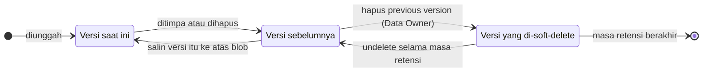
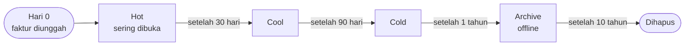
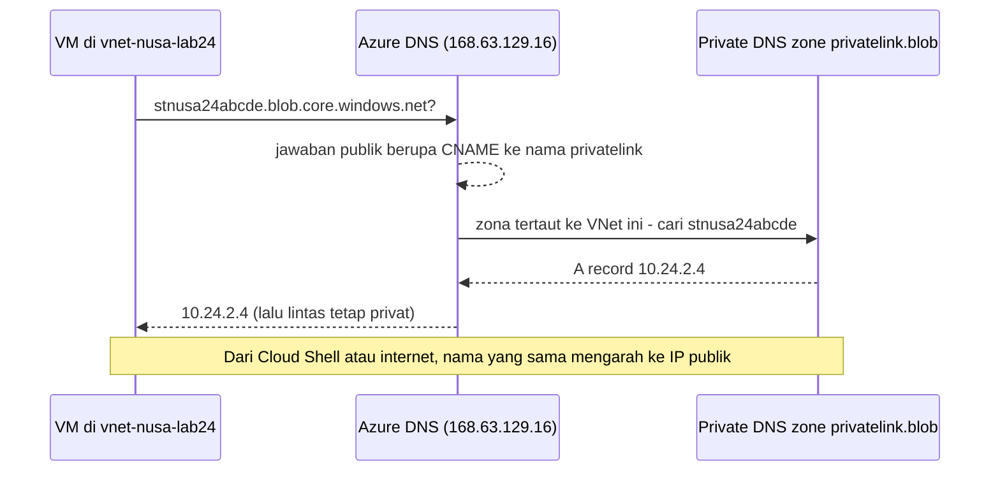

# Makan Siang 24 · Penyimpanan (Lanjutan)

🇬🇧 [Read in English](README.md)

> **Jalur:** Bulan pendalaman · **Level:** Lanjutan · **Bagian 5:** Pendalaman
> **Waktu:** 60 menit · **Makan siang prasyarat:** 07, 08
> **Area keterampilan AZ-900:** Di luar cakupan AZ-900
> **Lab:** [Lab 24 · Faktur tahan ransomware](../../labs/24-storage-advanced/README.id.md) — sekitar 60 menit · biaya 💲💲
> **Penulis:** Stefanus Pinarta · [Tentang penulis](../../README.id.md#tentang-penulis)

| ⏱ Menit | Segmen |
|---:|---|
| 5 | Skenario dan tujuan |
| 25 | Bacaan |
| 15 | Demo: animasi interaktif (+ video panduan opsional) |
| 5 | Uji pemahaman |
| 5 | Poin penting dan pratinjau lab |
| 5 | Waktu cadangan — habiskan makan siang Anda 🍜 |

## 🍱 Menu hari ini

Setelah makan siang ini, Anda akan mampu:

- **Menyusun berlapis** soft delete, versioning, point-in-time restore, immutability, replikasi, dan backup, sehingga
  blob (file yang disimpan di Blob Storage) yang tertimpa atau terhapus bisa dipulihkan — atau bahkan tidak bisa
  dihancurkan sama sekali.
- **Mengotomatiskan** perjalanan sebuah blob melintasi access tier (*tingkatan penyimpanan*), sampai penghapusannya,
  dengan aturan lifecycle management.
- **Mengunci rapat** storage account (*akun penyimpanan*) dengan aturan firewall, private endpoint (*titik akhir privat*)
  dan private DNS, tanpa shared key, kebijakan masa berlaku token SAS, serta customer-managed key.
- **Mengenali** kapan Data Lake Storage, protokol SFTP dan NFS, atau static website cocok dipakai, dan apa arti
  scalability target bagi sebuah desain.
- **Merencanakan** pemindahan data dalam jumlah besar, perubahan redundansi (*opsi redundansi*), dan failover storage
  account.

## 🏪 Sementara itu di Nusantara Retail

Senin, pukul 07.40. Pak Budi meneruskan pesan dari seorang pemasok di Surabaya: semalam, ransomware — program jahat yang
mengacak isi file lalu meminta tebusan — mengenkripsi semua file di server mereka, termasuk faktur yang biasa mereka
tukarkan dengan Nusantara Retail. Para penyerang meminta tebusan dibayar paling lambat hari Jumat.

Ibu Sari tetap tenang, tetapi pertanyaannya tajam. *"Faktur kita sudah pindah ke Azure Storage kuartal lalu. Kalau ada
yang mencuri kata sandi, bisakah faktur kita ikut dienkripsi? Bisakah kita mendapatkan kembali versi kemarin?"* Bagian
keuangan menambahkan syaratnya sendiri: kantor pajak bisa memeriksa faktur mana pun dari sepuluh tahun terakhir, dan
auditor ingin bukti bahwa tidak seorang pun — bahkan tim TI — bisa diam-diam mengubah satu faktur. Sementara itu, Dewi
menemukan dua masalah lagi: storage account menjawab request dari mana saja di internet, dan tagihan menunjukkan faktur
berumur tujuh tahun masih "nongkrong" di hot tier.

Pertanyaan hari ini: **bagaimana membuat faktur Nusantara Retail bisa dipulihkan, kebal terhadap pengubahan, murah
disimpan selama sepuluh tahun, dan hanya bisa dijangkau dari jaringannya sendiri?**

---

## 📖 Bacaan (≈25 menit)

### 1. Lapisan-lapisan perlindungan data

Makan Siang 07 menunjukkan bagaimana redundansi menyimpan salinan data Anda di disk lain, di availability zone (*zona
ketersediaan*) lain, atau di region (*wilayah*) lain. Tetapi redundansi menyalin *segalanya*, termasuk kesalahan.
Ketika ransomware menimpa sebuah faktur, semua salinannya ikut tertimpa dalam hitungan detik — ibarat fotokopi: kalau
dokumen aslinya sudah dicoret-coret, fotokopi sebanyak apa pun hanya menggandakan coretannya. Perlindungan terhadap
manusia, skrip, dan malware membutuhkan fitur yang berbeda, dan fitur-fitur itu paling ampuh jika disusun berlapis.

**Blob soft delete** menyimpan blob yang terhapus selama masa retensi yang Anda pilih (1–365 hari); sebelum masa itu
habis, Anda bisa melakukan **undelete** (membatalkan penghapusan) — mirip Recycle Bin di laptop Anda. **Container soft
delete** melakukan hal yang sama untuk container (wadah tingkat atas tempat blob disimpan) secara utuh — berguna ketika
seseorang menghapus container yang salah dengan satu klik. **Blob versioning** melangkah lebih jauh: setiap penulisan
menyimpan isi lama sebagai **previous version** (versi sebelumnya) yang hanya-baca, lengkap dengan version ID-nya
sendiri. Timpa sebuah faktur sepuluh kali, dan Anda punya sepuluh versi lama untuk dipilih. Untuk memulihkan salah
satunya, Anda *menyalin* versi itu ke atas blob, dan isinya kembali menjadi versi saat ini (*current version*).

Versioning dan soft delete saling menguatkan. Dengan versioning aktif, menghapus blob tidak menghancurkan apa pun: versi
saat ini sekadar berubah menjadi previous version. Menghapus sebuah *previous version* membutuhkan role yang lebih kuat,
yaitu **Storage Blob Data Owner**, dan bahkan setelah itu versi tersebut hanya pindah ke soft delete sampai masa
retensinya habis. Penyerang harus menembus beberapa lapis pertahanan, lalu menunggu, sebelum data Anda benar-benar
hilang.



**Point-in-time restore** menjawab permintaan "batalkan semua perubahan sejak pukul 02.00": fitur ini memutar balik
block blob (jenis blob untuk file biasa seperti dokumen dan gambar) di sebuah container, sekumpulan prefix (awalan nama),
atau seluruh account ke suatu titik waktu sebelumnya — semacam mesin waktu untuk data Anda. Fitur ini membutuhkan
versioning, change feed, dan blob soft delete, dan jendela pemulihannya harus setidaknya satu hari lebih pendek daripada
masa retensi soft delete. Point-in-time restore tidak bisa mengembalikan container yang terhapus (itu tugas container
soft delete) atau blob di archive tier, dan tidak tersedia di account dengan hierarchical namespace (lihat bagian 4) atau
bersamaan dengan kebijakan immutability. **Change feed** yang diandalkannya adalah log berurutan dan hanya-baca berisi
setiap operasi create, update, dan delete, yang disimpan di container `$blobchangefeed`. Bacalah sendiri log itu ketika
Anda perlu tahu blob mana saja yang tersentuh oleh sebuah insiden.

**Immutable storage** mencegah perubahan, alih-alih membatalkannya. Fitur ini menjaga data dalam keadaan **write once,
read many (WORM)** — tulis sekali, baca berkali-kali: blob baru boleh dibuat dan dibaca, tetapi data yang dilindungi tidak
bisa diubah atau dihapus selama **time-based retention policy** (kebijakan retensi berbasis waktu, 1 sampai 146.000 hari)
masih aktif atau selama ada **legal hold** (penahanan untuk keperluan hukum). Ibaratnya prasasti batu: sekali dipahat,
isinya bisa dibaca siapa saja, tetapi tidak bisa dihapus. Kebijakan bisa berlaku untuk satu container utuh
(**container-level**) atau untuk versi blob tertentu (**version-level**, yang membutuhkan versioning; penimpaan lalu
membuat versi baru, dan versi yang dilindungi tetap utuh). Kebijakan baru dimulai dalam keadaan **unlocked**, yang memang
dimaksudkan untuk uji singkat: ia sudah memblokir penghapusan, tetapi Anda masih bisa memperpendek atau menghapus
kebijakannya sendiri. Begitu Anda **lock** (mengunci) kebijakan itu, Anda hanya bisa memperpanjang periodenya, dan bahkan
Owner subscription (*langganan*) pun tidak bisa menghapus blob yang dilindungi — atau account yang menampungnya — sebelum
periode itu berakhir. Uji dalam keadaan unlocked, kunci dengan penuh pertimbangan.

**Object replication** menyalin block blob secara asinkron (tidak seketika, dengan sedikit jeda) dari container di satu
account ke container di account lain, sering kali di region lain. Fitur ini membutuhkan versioning di kedua sisi dan
change feed di sisi sumber. Berbeda dengan geo-redundancy, salinannya adalah account terpisah yang bisa Anda baca kapan
saja, dengan tier, aturan, dan izinnya sendiri. Account baru secara default memblokir replikasi ke tenant Microsoft
Entra lain.

Ada dua jaring pengaman di luar account. **Azure Backup** menawarkan *operational backup* untuk blob dan **vaulted
backup** yang menyalin data ke sebuah Backup vault — salinan ini selamat bahkan jika storage account-nya dihapus (Makan
Siang 17). Resource lock (*kunci sumber daya*) **CanNotDelete** (Makan Siang 18) mencegah account terhapus secara tidak
sengaja — dan jika tetap terjadi, account yang terhapus sering kali bisa dipulihkan dalam 14 hari, selama namanya belum
dipakai ulang.

| Fitur | Melindungi dari | Cara memulihkan | Perlu diketahui |
|---|---|---|---|
| Blob soft delete | Blob dan versi yang terhapus | Undelete dalam 1–365 hari | Data yang terhapus tetap ditagih sampai periodenya habis |
| Container soft delete | Container yang terhapus | Pulihkan container-nya | Tidak mencakup blob satuan |
| Versioning | Penimpaan dan penghapusan | Salin previous version ke atas blob | Setiap versi ditagih; rapikan dengan aturan lifecycle |
| Point-in-time restore | Perubahan massal ("batalkan kejadian semalam") | Pulihkan block blob ke suatu titik waktu | Butuh versioning, change feed, dan soft delete |
| Change feed | Tidak melindungi apa pun sendirian — ini jejak audit | Baca blob mana yang berubah, dan kapan | Blob log ditagih sebagai penyimpanan |
| Immutability (WORM) | Siapa pun yang mengubah atau menghapus data | Tidak ada yang perlu dipulihkan — perubahannya ditolak | Kebijakan yang terkunci tidak bisa diperpendek atau dihapus |
| Object replication | Kehilangan account atau region | Baca salinan di account lain | Asinkron; hanya block blob |
| Vaulted backup | Penghapusan account, ransomware, admin nakal | Pulihkan dari Backup vault | Dibahas di Makan Siang 17 |

### 2. Lifecycle management: biarkan aturan yang mengurus tiering

Faktur menjalani hidup yang mudah ditebak: sibuk selama sebulan, sesekali diperiksa selama satu kuartal, jarang dibuka
setelah tahun pertama, dan dihapus setelah sepuluh tahun. Mirip arsip kantor: map bulan ini ada di meja, arsip tahun lalu
di lemari, dan arsip lama dipindahkan ke gudang. Memindahkan jutaan faktur secara manual akan menjadi pekerjaan penuh
waktu. **Lifecycle management policy** melakukannya untuk Anda: sebuah dokumen JSON berisi hingga 100 **aturan** yang
dijalankan platform sekali sehari.

Setiap aturan punya **filter** — jenis blob, hingga sepuluh prefix nama yang diawali nama container, atau blob index tag
— dan **aksi** untuk versi saat ini (`baseBlob`), previous version (`version`), dan snapshot. Aksinya adalah
`tierToCool`, `tierToCold`, `tierToArchive`, dan `delete`, masing-masing dipicu oleh kondisi seperti
`daysAfterModificationGreaterThan`, `daysAfterCreationGreaterThan`, atau `daysAfterLastAccessTimeGreaterThan` (yang
membutuhkan pelacakan last access time). Inilah inti aturan yang Anda deploy di lab:

```json
"filters": { "blobTypes": [ "blockBlob" ], "prefixMatch": [ "invoices/" ] },
"actions": {
  "baseBlob": {
    "tierToCool":    { "daysAfterModificationGreaterThan": 30 },
    "tierToCold":    { "daysAfterModificationGreaterThan": 90 },
    "tierToArchive": { "daysAfterModificationGreaterThan": 365, "daysAfterLastTierChangeGreaterThan": 7 },
    "delete":        { "daysAfterModificationGreaterThan": 3650 }
  },
  "version": {
    "tierToCold": { "daysAfterCreationGreaterThan": 30 },
    "delete":     { "daysAfterCreationGreaterThan": 365 }
  }
}
```



Beberapa detail menentukan apakah aturan seperti ini menghemat uang atau malah membawa kejutan:

- **Hormati durasi penyimpanan minimum.** Beri jarak antarlangkah minimal 30 hari setelah cool, 90 hari setelah cold, dan
  180 hari setelah archive, atau Anda membayar biaya penghapusan dini (*early deletion*) — mirip kontrak kos minimum:
  keluar sebelum waktunya, sisa bulannya tetap dibayar. Aturan di atas menyimpan setiap faktur cukup lama di setiap tier.
- **Sertakan previous version.** Lifecycle management tidak menghapus versi saat ini selama ia masih punya previous
  version atau snapshot, jadi aturan penghapusan untuk faktur lama membutuhkan aksi `version` yang sepadan.
- **Perhatikan redundansinya.** Archive tier tidak tersedia di account ZRS (*zone-redundant storage*), GZRS
  (*geo-zone-redundant storage*), atau RA-GZRS (GZRS dengan akses baca di region kedua), sehingga `tierToArchive` tidak
  bisa berlaku di sana.
- **Hindari pingpong.** `daysAfterLastTierChangeGreaterThan` mencegah faktur yang baru saja di-rehydrate (dikeluarkan dari
  archive agar bisa dibaca lagi) diarsipkan kembali keesokan paginya. Dengan pelacakan last access time,
  `enableAutoTierToHotFromCool` memindahkan blob cool kembali ke hot ketika ada yang membacanya.
- **Bersabarlah.** Kebijakan yang baru atau yang diubah bisa memerlukan hingga 24 jam sebelum mulai bekerja, dan blob yang
  immutable tidak pernah dihapus selama masa retensinya masih aktif.

Jika Anda sama sekali tidak ingin menulis aturan, smart tier dari Makan Siang 07 memindahkan blob antara hot, cool, dan
cold untuk Anda.

> [!TIP]
> Menjalankan aturan lifecycle itu gratis, tetapi setiap perpindahan tier ditagih sebagai operasi tulis. Untuk jutaan
> file mungil, biaya operasi itu bisa melebihi penghematan penyimpanannya — hitung dulu di pricing calculator (*kalkulator
> harga*), atau gabungkan file-file kecil menjadi arsip yang lebih besar sebelum menua.

### 3. Mengunci pintu: jaringan, kunci, dan enkripsi

Secara default, **public endpoint** (*titik akhir publik*) sebuah storage account menerima koneksi dari jaringan mana
pun; data Anda aman semata-mata karena setiap request harus diotorisasi. Desain tingkat lanjut menambahkan kontrol
jaringan di atasnya. Bayangkan rumah dengan kunci pintu yang bagus tetapi berdiri di pinggir jalan raya: siapa pun boleh
mencoba membuka pintunya. Kontrol jaringan menambahkan pagar dan pos satpam, sehingga orang asing bahkan tidak bisa
mendekati pintu.

**Storage firewall** punya tiga pengaturan untuk public network access: aktif dari semua jaringan, aktif dari virtual
network (*jaringan virtual*) dan alamat IP tertentu, atau **Disabled**. Dengan opsi jaringan tertentu, Anda menambahkan
**IP rule** untuk alamat publik (hingga 400), **virtual network rule** untuk subnet yang memakai service endpoint,
**resource instance rule** untuk resource Azure tertentu, dan pengecualian **trusted Microsoft services** untuk layanan
seperti Azure Backup. IP rule tidak berlaku untuk klien di region Azure yang sama dengan account, karena klien itu
memakai alamat privat Azure — untuk mereka, gunakan virtual network rule atau private endpoint. Request yang diblokir
firewall mendapat `403 AuthorizationFailure`, walaupun kredensialnya sah.

Ada dua cara untuk mendekatkan virtual network ke storage:

| | Service endpoint | Private endpoint |
|---|---|---|
| Fungsinya | Membiarkan subnet menjangkau endpoint *publik* milik account lewat backbone Azure, dengan identitas sebagai subnet itu | Memberi account alamat IP privat pada sebuah network interface di subnet Anda |
| Perubahan DNS | Tidak ada | Private DNS zone seperti `privatelink.blob.core.windows.net` |
| Bisa dijangkau dari jaringan yang di-peering dan dari on-premises | Tidak, hanya dari subnet yang diaktifkan | Ya, lewat peering, VPN, atau ExpressRoute — asalkan DNS-nya benar |
| Tetap berfungsi saat public network access Disabled | Tidak | Ya |
| Granularitas | Per subnet dan layanan (`Microsoft.Storage`) | Per account dan sub-resource (`blob`, `dfs`, `file`, `queue`, `table`, `web`) |
| Biaya | Gratis | Biaya per jam plus pemrosesan data per GB |

Private endpoint hanya berguna jika klien bisa *menemukannya*. Aplikasi tetap memakai nama yang biasa, misalnya
`stnusa24abcde.blob.core.windows.net`. DNS (*Domain Name System*, "buku telepon" internet yang menerjemahkan nama menjadi
alamat IP) publik menjawab dengan CNAME — sebuah nama alias — ke `stnusa24abcde.privatelink.blob.core.windows.net`. Di
dalam virtual network yang ditautkan ke **private DNS zone** dengan nama itu, zona tersebut menjawab dengan alamat IP
privat milik endpoint; di tempat lain, nama itu tetap diterjemahkan ke alamat IP publik seperti sebelumnya. Ibaratnya
buku telepon internal kantor: karyawan di dalam gedung mendapat nomor ekstensi, sedangkan penelepon dari luar tetap
mendapat nomor kantor pusat. **DNS zone group** pada private endpoint menjaga A record (catatan yang memetakan nama ke
alamat IP) itu tetap mutakhir untuk Anda.



> [!WARNING]
> Kesalahan paling umum pada private endpoint adalah melupakan DNS. Tanpa private DNS zone yang ditautkan ke virtual
> network milik klien (atau record yang sepadan di server DNS Anda sendiri), klien tetap mendapat alamat IP publik — dan
> begitu public access dimatikan, mereka gagal dengan `403 AuthorizationFailure`. Periksa dengan `nslookup` dari dalam
> jaringan sebelum Anda mematikan public access.

Kontrol identitas mengencangkan pengamanan lebih jauh. **Melarang otorisasi Shared Key**
(`--allow-shared-key-access false`) menghentikan siapa pun yang memakai account key — kunci induk yang membuka seluruh
account — dan bersamanya semua service SAS dan account SAS (SAS = *shared access signature*, token akses sementara yang
ditandatangani dengan kunci tersebut); request dengan Microsoft Entra ID (*ID Microsoft Entra*) dan user delegation SAS
tetap berfungsi.
Periksa dulu alat-alat Anda — beberapa alat lama dan sebagian skenario Azure Files masih bergantung pada key. **SAS
expiration policy** (`--sas-expiration-period`) menetapkan masa berlaku maksimum yang disarankan untuk token SAS baru,
lalu mencatat atau memblokir token yang melebihinya.

Semua isi Azure Storage **dienkripsi saat tersimpan** (*encrypted at rest*) dengan AES 256-bit (*Advanced Encryption
Standard*), memakai kunci yang dikelola Microsoft secara default. Dengan **customer-managed key**, Anda sendiri yang
menyimpan kuncinya di Azure Key Vault atau Managed HSM (*hardware security module*; soft delete dan purge protection
wajib aktif); account membacanya lewat managed identity dan bisa otomatis mengikuti versi kunci yang baru. Nonaktifkan
atau hapus kunci itu, dan setiap operasi baca dan tulis akan gagal — sebuah sakelar darurat yang disengaja, sekaligus
alasan untuk melindungi key vault sama hati-hatinya dengan datanya. **Infrastructure encryption** menambahkan lapisan
kedua, tetapi hanya jika Anda mengaktifkannya saat membuat account.

**Microsoft Defender for Storage** (Makan Siang 15) mengawasi data plane (semua operasi yang menyentuh isi data) untuk
mencari pola akses yang tidak biasa, unggahan yang mencurigakan, dan tanda-tanda pencurian data (*exfiltration*). Fitur
opsionalnya, **malware scanning**, memeriksa blob baru begitu tiba dan ditagih per gigabyte yang dipindai, sedangkan
**sensitive data threat detection** memusatkan alert (*pemberitahuan*) pada account yang menyimpan data pribadi atau data
keuangan.

### 4. Penyimpanan untuk keperluan khusus dan skala

**Data Lake Storage** adalah storage account dengan **hierarchical namespace** (HNS, ruang nama berjenjang). Folder
menjadi direktori sungguhan, sehingga mengganti nama atau menghapus satu folder adalah satu operasi atomik (terjadi utuh
atau tidak sama sekali), bukan jutaan penyalinan blob, dan Anda bisa menetapkan **access control list** (daftar izin
akses) bergaya POSIX — standar izin ala Linux — per direktori dan file lewat endpoint `dfs`. Mesin analitik seperti
Microsoft Fabric dan Azure Databricks mengharapkannya. Beberapa fitur blob, termasuk point-in-time restore dan object
replication, tidak tersedia dengan HNS, dan mengubah account yang sudah ada menjadi HNS adalah upgrade satu arah —
periksa dulu tabel dukungan fiturnya.

Dua protokol menumpang di atas HNS. **SFTP** (*SSH File Transfer Protocol*) memungkinkan pemasok mengunggah file dengan
klien SFTP biasa, memakai **local user** dengan SSH key atau kata sandi yang terpisah dari Entra ID; fitur ini ditagih
per jam selama aktif, jadi matikan saat tidak dipakai. **NFS 3.0** (*Network File System*) untuk blob memungkinkan beban
kerja Linux dan HPC (*high-performance computing*, komputasi berkinerja tinggi) me-mount sebuah container seperti drive
jaringan. Request NFS tidak bisa diotorisasi dengan key atau Entra ID, jadi account hanya boleh menerima lalu lintas dari
virtual network, lewat service endpoint atau private endpoint. (Azure Files menawarkan NFS 4.1 pada tier SSD-nya.)

**Static website** menyajikan HTML, CSS, dan gambar langsung dari container khusus `$web` di endpoint `web`-nya sendiri,
lengkap dengan index document dan halaman 404 kustom — tanpa perlu web server. Isi `$web` selalu bisa dibaca secara
anonim, bahkan ketika akses anonim dilarang di bagian lain account. Untuk domain kustom dengan HTTPS, pasang Azure Front
Door di depannya.

Terakhir, **scalability target** menggambarkan seberapa banyak beban yang sanggup ditangani satu account sebelum
dibatasi (*throttling*): secara default hingga 5 PiB (pebibyte; satu PiB sedikit lebih dari satu juta GB), dan hingga
40.000 request per detik di region yang lebih besar seperti Southeast Asia (20.000 di region lain), dengan batas serupa
untuk throughput. Ketika sebuah account atau salah satu partisinya didorong terlalu keras, Azure Storage mengembalikan
`503 Server Busy` atau `500 Operation Timeout`; klien sebaiknya mencoba lagi dengan *exponential back-off* — jeda yang
makin panjang setiap kali gagal, seperti menelepon ulang nomor yang sibuk dengan selang yang makin lama. Beban kerja
yang sangat sibuk menyebarkan data ke beberapa account — secara default Anda bisa membuat 250 account per region per
subscription, dan hingga 1.000 atas permintaan.

### 5. Memindahkan data dalam skala besar dan bertahan saat region gagal

Makan Siang 07 memperkenalkan AzCopy dan Data Box untuk penyalinan sekali jalan. Dalam skala besar, pertanyaannya
bergeser menjadi *bagaimana terus memindahkan* data dan bagaimana melakukan failover dengan aman.

| Alat | Cara memindahkan data | Paling cocok untuk | Waspadai |
|---|---|---|---|
| `azcopy sync` | Online, lewat skrip, inkremental | Mencerminkan folder atau container secara terjadwal | `--delete-destination true` menghapus file berlebih di tujuan |
| Azure Storage Mover | Online, dikelola dari Azure | Migrasi share SMB atau NFS, proyek demi proyek | Butuh agen di dekat sumber on-premises |
| Azure Data Box | Offline, perangkat dikirim secara fisik | Puluhan hingga ratusan terabyte lewat jalur yang lambat | Pengiriman makan waktu berhari-hari; pesan lebih awal |
| Azure File Sync | Online, berkelanjutan, dua arah | File server cabang dengan cache lokal (cloud tiering) | Tidak didukung bersama customer-managed failover |
| Object replication | Online, berkelanjutan, satu arah | Salinan block blob yang bisa dibaca di region lain | Asinkron: salinannya tertinggal di belakang |

Redundansi bisa diubah belakangan. Beralih antara LRS (*locally redundant storage*) dan GRS (*geo-redundant storage*)
atau RA-GRS cukup dengan update sederhana, walaupun menambahkan geo-redundancy berarti membayar penyalinan satu kali ke
region sekunder. Menambahkan zona — LRS ke ZRS, atau GRS ke GZRS — membutuhkan **conversion** (konversi) yang dijalankan
Microsoft di latar belakang tanpa SLA waktu selesai, atau penyalinan manual ke account baru. Blob yang diarsipkan
menghalangi keduanya: pindahkan atau rehydrate blob itu lebih dulu.

Untuk account geo-redundant, Anda bisa memulai **failover** — mengalihkan peran region utama ke region sekunder —
sendiri:

| Jenis failover | Kapan dipakai | Kehilangan data | Setelahnya |
|---|---|---|---|
| Customer-managed **planned** failover | Kedua region sehat: latihan pemulihan bencana (disaster recovery), atau ada masalah dengan suatu layanan di region primer | Tidak ada — failover menunggu replikasi menyusul | Kedua region bertukar peran dan geo-redundancy tetap berjalan |
| Customer-managed (**unplanned**) failover | Endpoint primer tidak tersedia | Penulisan setelah **Last Sync Time** | Account menjadi LRS di region primer yang baru; aktifkan kembali geo-redundancy, yang menyalin semuanya dari awal |
| Microsoft-managed failover | Seluruh region hilang | Mungkin terjadi | Microsoft yang memutuskan kapan; jangan menyusun rencana Anda dengan bergantung padanya |

Failover biasanya selesai dalam satu jam, dan klien tetap memakai nama endpoint yang sama. **Last Sync Time** adalah
sebuah penanda waktu: semua penulisan sebelum titik itu dijamin sudah tersalin ke region sekunder, sedangkan penulisan
sesudahnya mungkin belum. Sebelum
unplanned failover, periksa berapa banyak data yang mungkin hilang dengan
`az storage account show --name <account> --expand geoReplicationStats --query geoReplicationStats.lastSyncTime`. Tidak
semua account bisa melakukan failover — Azure File Sync, misalnya, tidak didukung — jadi periksa daftar fitur yang tidak
didukung di dokumentasi sebelum Anda mengandalkannya.

### 6. Bagaimana semuanya menyatu untuk Nusantara Retail

Kembali ke pertanyaan Ibu Sari. Inilah desain yang dipresentasikan Dewi untuk faktur-faktur tersebut, yang tetap
disimpan di Indonesia Central:

- **Bisa dipulihkan:** account kerja untuk faktur berjalan (general-purpose v2, ZRS) mendapat versioning, soft delete blob
  dan container selama 14 hari, change feed, dan point-in-time restore selama tujuh hari. Skenario ransomware hari Senin
  berubah dari "bayar paling lambat Jumat" menjadi "pulihkan ke pukul 02.00".
- **Kebal pengubahan:** ketika satu tahun pajak ditutup, fakturnya disalin ke account ZRS kedua, ke dalam container dengan
  time-based retention policy sepuluh tahun yang **terkunci** — setelah lebih dulu diuji dalam keadaan unlocked, dan
  bagian keuangan menyetujui periodenya. Account terpisah memang diperlukan, karena immutability dan point-in-time
  restore tidak bisa berbagi satu account.
- **Murah selama sepuluh tahun:** aturan lifecycle memindahkan faktur ke cool setelah 30 hari dan ke cold setelah 90 hari.
  Karena ZRS tidak bisa memakai archive, object replication mengirim faktur yang sudah tuntas ke account LRS di Southeast
  Asia, tempat sebuah aturan mengarsipkannya — setelah tim *kepatuhan* (compliance) memastikan bahwa salinannya boleh
  keluar dari Indonesia.
- **Privat:** private endpoint blob di jaringan hub dari Makan Siang 25, zona `privatelink.blob.core.windows.net` yang
  tertaut, public network access Disabled, Shared Key dilarang, dan toko online membaca data dengan managed identity.
- **Diawasi:** Defender for Storage dengan malware scanning pada account terpisah yang mengaktifkan SFTP, tempat para
  pemasok menaruh file mereka, serta vaulted backup untuk container faktur.

> [!NOTE]
> **Renungkan sejenak:** seorang penyerang mencuri akun Dewi, yang memegang role Owner pada subscription. Perlindungan
> mana yang bisa ia matikan atau hapus begitu saja — soft delete, versioning, kebijakan unlocked, kebijakan locked,
> vaulted backup — dan mana yang masih menyelamatkan faktur tahun 2025?

Di lab, Anda membangun lapisan-lapisan perlindungan ini dalam skala kecil, menyelamatkan faktur dari serangan simulasi,
lalu menutup pintu publik. Berikutnya, Makan Siang 25 membangun jaringan hub-and-spoke, tempat private endpoint seperti
ini berada.

---

## 🎬 Demo (≈15 menit)

1. **Animasi interaktif (≈6–8 menit):** [Buka demo](https://stefpin.github.io/azure-fundamentals-lunches/demos/24-storage-advanced.html?lang=id) —
   tekan ▶ Putar atau telusuri langkah demi langkah sesuai kecepatan Anda. Sedang offline? Unduh
   [`docs/demos/24-storage-advanced.html`](../../docs/demos/24-storage-advanced.html) lalu buka di browser apa pun.
2. **Video panduan (≤ 6 menit):** _segera hadir_ — [baca naskah video](demo-video-script.id.md).

Yang perlu diperhatikan:

- Bagaimana aturan lifecycle mengantar sebuah faktur dari hot ke cool, cold, dan archive, lalu menghapusnya setelah
  sepuluh tahun.
- Apa yang terjadi pada versi saat ini ketika ransomware menimpa sebuah blob, dan bagaimana previous version dipromosikan
  kembali.
- Mengapa penghapusan di account dengan versioning menyisakan versi yang bisa dipulihkan, dan mengapa container WORM
  menolak penghapusan.
- Bagaimana nama blob yang sama diterjemahkan menjadi IP privat di dalam virtual network dan menjadi IP publik di luarnya.

## ✅ Uji pemahaman (≈5 menit)

1. Semalam, sebuah skrip yang disusupi menimpa 2.000 faktur di container yang mengaktifkan versioning, change feed, soft
   delete, dan point-in-time restore. Apa cara tercepat untuk kembali?
   <details><summary>Lihat jawaban</summary>

   Jalankan **point-in-time restore** untuk container (atau prefix) tersebut ke titik waktu sebelum skrip mulai berjalan.
   Fitur ini memakai versi dan change feed untuk memutar balik setiap block blob yang terdampak dalam satu operasi,
   alih-alih Anda mempromosikan 2.000 previous version satu per satu.

   </details>
2. Bagian keuangan ingin faktur tahun 2025 tidak bisa dihapus selama sepuluh tahun, bahkan oleh administrator, tetapi
   belum yakin periodenya sudah benar. Bagaimana Anda melanjutkannya?
   <details><summary>Lihat jawaban</summary>

   Buat time-based retention policy dan uji dalam keadaan **unlocked**, ketika kebijakan itu masih bisa diperpendek atau
   dihapus. Kunci kebijakan itu hanya setelah bagian keuangan memastikan periodenya, karena kebijakan yang terkunci hanya
   bisa diperpanjang — dan sejak itu ia memblokir penghapusan blob yang dilindungi serta account-nya sampai periode
   berakhir.

   </details>
3. Dewi membuat private endpoint untuk blob storage, tetapi `nslookup` dari VM di virtual network yang sama masih
   mengembalikan alamat IP publik. Apa yang kurang?
   <details><summary>Lihat jawaban</summary>

   **Private DNS zone** `privatelink.blob.core.windows.net` belum ditautkan ke virtual network itu (atau tidak punya A
   record untuk account tersebut, misalnya karena DNS zone group-nya tidak ada). Tanpa zona itu, CNAME ke nama
   privatelink akan "jatuh" ke DNS publik.

   </details>
4. Aturan lifecycle buatan seorang rekan memindahkan faktur ke cool setelah 10 hari dan ke archive setelah 20 hari. Apa
   yang salah?
   <details><summary>Lihat jawaban</summary>

   Aturan itu mengabaikan **durasi penyimpanan minimum**. Setiap blob meninggalkan cool setelah baru 10 dari 30 harinya,
   sehingga Anda membayar biaya penghapusan dini untuk setiap blob. Beri jarak antarlangkah setidaknya sepanjang durasi
   minimum setiap tier (30 hari untuk cool, 90 untuk cold, 180 untuk archive).

   </details>
5. Region primer sebuah account GRS tidak tersedia dan Anda memulai customer-managed failover. Apa yang perlu Anda
   sampaikan kepada pihak bisnis?
   <details><summary>Lihat jawaban</summary>

   Penulisan yang dilakukan setelah **Last Sync Time** mungkin hilang, karena replikasi ke region sekunder berjalan
   asinkron. Setelah failover, account menjadi LRS di region primer yang baru sampai Anda mengaktifkan kembali
   geo-redundancy, yang menyalin seluruh data sekali lagi.

   </details>

## 🧠 Poin penting

- Redundansi menyalin kesalahan; versioning, soft delete, point-in-time restore, dan backup memungkinkan Anda
  membatalkannya, dan immutability policy yang terkunci mencegahnya terjadi sama sekali.
- Aturan lifecycle memindahkan tier dan menghapus data secara otomatis — rancang dengan memperhatikan durasi penyimpanan
  minimum, dan sertakan previous version.
- Private endpoint memberi account alamat IP privat, tetapi hanya DNS yang membuat klien benar-benar memakainya: tautkan
  zona `privatelink.blob.core.windows.net`, uji, lalu nonaktifkan public network access.
- Larang Shared Key, batasi masa berlaku SAS, dan gunakan customer-managed key serta Defender for Storage jika datanya
  sensitif.
- Rencanakan skala dan bencana: pilih alat transfer massal yang tepat, ketahui perubahan redundansi mana yang membutuhkan
  conversion, dan periksa Last Sync Time sebelum unplanned failover.

## 🗒️ Catatan lapangan dari Stefanus

> **Tanyakan: siapa yang bisa mematikannya?** Untuk setiap lapisan perlindungan di storage account, saya selalu
> mengajukan satu pertanyaan dalam design review: *siapa yang bisa mematikan ini, dan secepat apa?* Soft delete,
> versioning, dan retention policy yang belum dikunci memang menyelamatkan Anda dari kecerobohan, tetapi siapa pun yang
> memegang role Owner bisa mematikannya dengan beberapa klik. Karena itu saya memperlakukannya sebagai tombol *undo*,
> bukan benteng terhadap akun admin yang dicuri. Ancaman itu hanya bisa dijawab oleh kebijakan yang sudah dikunci atau
> backup yang dijaga dengan izin terpisah — dan sebelum apa pun dikunci, saya minta pihak di luar TI ikut menyetujuinya.
> Setelah itu saya menjadwalkan latihan pemulihan: timpa satu file uji, hapus satu container uji, lalu catat berapa lama
> keduanya kembali. Perlindungan yang belum pernah diuji pemulihannya hanyalah harapan, bukan rencana.

## 🔬 Lab Anda: Faktur tahan ransomware

Di waktu luang, Anda akan mengaktifkan versioning, soft delete, dan change feed, lalu berperan sebagai penyerang: menimpa
satu faktur, menghapus faktur lain, bahkan menghapus seluruh container — lalu mengembalikan semuanya. Anda akan
men-deploy lifecycle policy sepuluh tahun dari file JSON dan melindungi sebuah container dengan time-based retention
policy yang masih unlocked dan menolak penghapusan. Terakhir, Anda menambahkan private endpoint dan private DNS zone,
membandingkan jawaban `nslookup` dari VM di dalam jaringan dan dari Cloud Shell, lalu menonaktifkan public network access.

- ⏱ Sekitar 60 menit · 💲💲 · bisa dikerjakan terpisah (tidak perlu lab sebelumnya)
- 👉 [Mulai Lab 24](../../labs/24-storage-advanced/README.id.md)

## 📚 Pelajari lebih lanjut

- [Microsoft Learn: Ikhtisar perlindungan data](https://learn.microsoft.com/azure/storage/blobs/data-protection-overview) — opsi perlindungan mana yang perlu digabungkan untuk setiap skenario, lengkap dengan tabel perbandingan yang praktis.
- [Microsoft Learn: Menyimpan data blob yang penting bagi bisnis dengan immutable storage](https://learn.microsoft.com/azure/storage/blobs/immutable-storage-overview) — kebijakan container-level vs version-level, penguncian, dan legal hold.
- [Microsoft Learn: Menggunakan private endpoint untuk Azure Storage](https://learn.microsoft.com/azure/storage/common/storage-private-endpoints) — DNS zone per sub-resource dan bagaimana resolusi nama berubah.
- [Microsoft Learn: Perencanaan pemulihan bencana dan failover Azure Storage](https://learn.microsoft.com/azure/storage/common/storage-disaster-recovery-guidance) — jenis failover, Last Sync Time, dan fitur yang tidak didukung.

---

⬅️ [Makan Siang 23 · Virtual Machines (Lanjutan)](../23-virtual-machines-advanced/README.id.md) · 🏠 [Beranda kursus](../../README.id.md) · [Makan Siang 25 · Virtual Networking (Lanjutan)](../25-networking-advanced/README.id.md) ➡️

<sub>Terakhir divalidasi: Oktober 2026 · Menemukan informasi yang sudah usang? [Buka issue](../../CONTRIBUTING.md).</sub>
