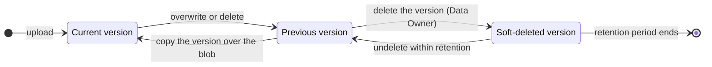
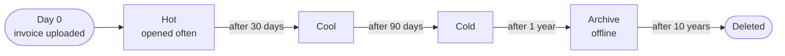
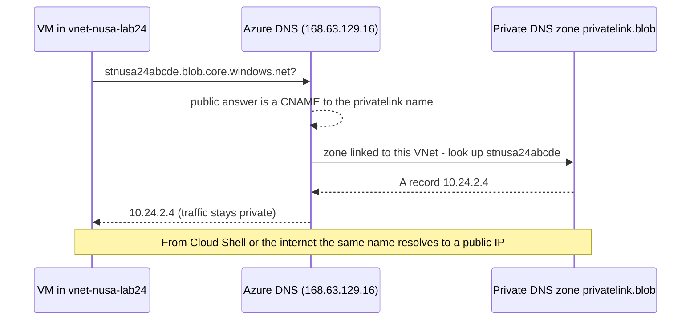

# Lunch 24 · Storage (Advanced)

🇮🇩 [Baca dalam Bahasa Indonesia](README.id.md)

> **Track:** Deep-dive month · **Level:** Advanced · **Part 5:** Deep dives
> **Time:** 60 minutes · **Prerequisite lunches:** 07, 08
> **AZ-900 skill area:** Beyond AZ-900
> **Lab:** [Lab 24 · Ransomware-proof invoices](../../labs/24-storage-advanced/README.md) — about 60 minutes · cost 💲💲
> **Author:** Stefanus Pinarta · [About the author](../../README.md#about-the-author)

| ⏱ Minutes | Segment |
|---:|---|
| 5 | Scenario and objectives |
| 25 | Reading |
| 15 | Demo: interactive animation (+ optional walkthrough video) |
| 5 | Knowledge check |
| 5 | Key takeaways and lab preview |
| 5 | Buffer — finish your lunch 🍜 |

## 🍱 Today's menu

By the end of this lunch you will be able to:

- **Layer** soft delete, versioning, point-in-time restore, immutability, replication and backup so that overwritten or
  deleted blobs can be recovered — or can't be destroyed at all.
- **Automate** a blob's journey through the access tiers, and its deletion, with lifecycle management rules.
- **Lock down** a storage account with firewall rules, private endpoints and private DNS, no shared keys, SAS expiration
  policies and customer-managed keys.
- **Recognize** when Data Lake Storage, SFTP, NFS or a static website fits, and what scalability targets mean for a design.
- **Plan** large data moves, redundancy changes and a storage account failover.

## 🏪 Meanwhile at Nusantara Retail

Monday, 7:40 a.m. Pak Budi forwards a message from a supplier in Surabaya: overnight, ransomware encrypted every file on
their server, including the invoices they exchange with Nusantara Retail. The attackers want payment by Friday.

Ibu Sari stays calm but asks pointed questions. *"Our invoices moved to Azure Storage last quarter. If someone steals a
password, can they encrypt ours too? Could we get yesterday's versions back?"* Finance adds a requirement of its own: the
tax office can audit any invoice from the last ten years, and the auditor wants proof that nobody — not even IT — can
quietly change one. Dewi, meanwhile, notices two more problems: the storage account answers requests from anywhere on
the internet, and the bill shows seven-year-old invoices still sitting in the hot tier.

Today's question: **how do you make Nusantara Retail's invoices recoverable, tamper-proof, cheap to keep for ten years
and reachable only from its own network?**

---

## 📖 Reading (≈25 minutes)

### 1. Layers of data protection

Lunch 07 showed how redundancy keeps copies of your data on other disks, in other zones or in another region. But
redundancy copies *everything*, mistakes included. When ransomware overwrites an invoice, every copy is overwritten
within seconds. Protection against people, scripts and malware needs different features, and they work best in layers.

**Blob soft delete** keeps deleted blobs for a retention period you choose (1–365 days); until it ends you can
**undelete** them. **Container soft delete** does the same for whole containers — useful when someone deletes the wrong
one with a single click. **Blob versioning** goes further: every write keeps the old content as a read-only **previous
version** with its own version ID. Overwrite an invoice ten times and you have ten older versions to choose from. To
restore one, you *copy* that version over the blob, and its content becomes current again.

Versioning and soft delete reinforce each other. With versioning on, deleting a blob destroys nothing: the current
version simply becomes a previous version. Deleting a *previous* version needs the stronger **Storage Blob Data Owner**
role, and even then the version only moves into soft delete until the retention period ends. An attacker has to get
through several layers, and wait, before your data is really gone.



**Point-in-time restore** answers "undo everything since 2 a.m.": it rolls block blobs in a container, a set of
prefixes or the whole account back to an earlier moment. It needs versioning, change feed and blob soft delete, and its
restore window must be at least one day shorter than the soft delete retention. It can't bring back deleted containers
(container soft delete does that) or blobs in the archive tier, and it isn't available in accounts with a hierarchical
namespace or alongside immutability policies. The **change feed** it relies on is an ordered, read-only log of every
create, update and delete, kept in the `$blobchangefeed` container. Read it yourself when you need to know which blobs
an incident touched.

**Immutable storage** prevents changes instead of undoing them. It keeps data in a **write once, read many (WORM)**
state: new blobs can be created and read, but protected data can't be modified or deleted while a **time-based
retention policy** (1 to 146,000 days) is active or a **legal hold** is in place. A policy can cover a whole container
(**container-level**) or individual blob versions (**version-level**, which needs versioning; an overwrite then creates
a new version and the protected one stays untouched). A new policy starts **unlocked**, which is meant for short tests:
it already blocks deletes, but you can still shorten or delete the policy itself. Once you **lock** it, you can only
lengthen the period, and not even a subscription Owner can delete the protected blobs — or the account that holds
them — before it ends. Test unlocked, lock deliberately.

**Object replication** asynchronously copies block blobs from a container in one account to a container in another,
often in another region. It needs versioning on both sides and change feed on the source. Unlike geo-redundancy, the copy
is a separate account you can read at any time, with its own tier, rules and permissions. New accounts block
replication to other Microsoft Entra tenants by default.

Two safety nets sit outside the account. **Azure Backup** offers operational backup for blobs and a **vaulted backup**
that copies data into a Backup vault, which survives even the deletion of the storage account (Lunch 17). A
**CanNotDelete** resource lock (Lunch 18) stops the account from being deleted by accident — and if it happens anyway,
a deleted account can often be recovered within 14 days, as long as nobody has reused its name.

| Feature | Protects against | How you recover | Good to know |
|---|---|---|---|
| Blob soft delete | Deleted blobs and versions | Undelete within 1–365 days | Deleted data is billed until the period ends |
| Container soft delete | A deleted container | Restore the container | Doesn't cover single blobs |
| Versioning | Overwrites and deletes | Copy a previous version over the blob | Every version is billed; tidy up with lifecycle rules |
| Point-in-time restore | Mass changes ("undo last night") | Restore block blobs to a moment | Needs versioning, change feed and soft delete |
| Change feed | Nothing by itself — it's the audit trail | Read which blobs changed, and when | Log blobs are billed as storage |
| Immutability (WORM) | Anyone changing or deleting data | Nothing to recover — the change is refused | Locked policies can't be shortened or removed |
| Object replication | Losing an account or region | Read the copy in the other account | Asynchronous; block blobs only |
| Vaulted backup | Account deletion, ransomware, rogue admins | Restore from the Backup vault | Covered in Lunch 17 |

### 2. Lifecycle management: let rules do the tiering

Invoices follow a predictable life: busy for a month, checked now and then for a quarter, rarely opened after the first
year, deleted after ten. Moving millions of them by hand would be a full-time job. A **lifecycle management policy**
does it for you: a JSON document of up to 100 **rules** that the platform runs once a day.

Each rule has **filters** — blob types, up to ten name prefixes that start with the container name, or blob index tags —
and **actions** for the current version (`baseBlob`), previous versions (`version`) and snapshots. The actions are
`tierToCool`, `tierToCold`, `tierToArchive` and `delete`, each triggered by a condition such as
`daysAfterModificationGreaterThan`, `daysAfterCreationGreaterThan` or `daysAfterLastAccessTimeGreaterThan` (which needs
last access time tracking). This is the heart of the rule you deploy in the lab:

```json
"filters": { "blobTypes": [ "blockBlob" ], "prefixMatch": [ "invoices/" ] },
"actions": {
  "baseBlob": {
    "tierToCool":    { "daysAfterModificationGreaterThan": 30 },
    "tierToCold":    { "daysAfterModificationGreaterThan": 90 },
    "tierToArchive": { "daysAfterModificationGreaterThan": 365, "daysAfterLastTierChangeGreaterThan": 7 },
    "delete":        { "daysAfterModificationGreaterThan": 3650 }
  },
  "version": {
    "tierToCold": { "daysAfterCreationGreaterThan": 30 },
    "delete":     { "daysAfterCreationGreaterThan": 365 }
  }
}
```



A few details decide whether such a rule saves money or causes surprises:

- **Respect the minimum storage durations.** Space the steps at least 30 days apart after cool, 90 after cold and 180
  after archive, or you pay early deletion charges. The rule above keeps each invoice in every tier long enough.
- **Include previous versions.** Lifecycle management doesn't delete a current version while it still has previous
  versions or snapshots, so a delete rule for old invoices needs a matching `version` action.
- **Mind the redundancy.** The archive tier isn't available on ZRS, GZRS or RA-GZRS accounts, so `tierToArchive`
  can't apply there.
- **Avoid ping-pong.** `daysAfterLastTierChangeGreaterThan` stops a freshly rehydrated invoice from being archived again
  the next morning. With last access time tracking, `enableAutoTierToHotFromCool` moves a cool blob back to hot when
  someone reads it.
- **Be patient.** A new or changed policy can take up to 24 hours to act, and immutable blobs are never deleted while
  their retention is active.

If you'd rather not write rules at all, the smart tier from Lunch 07 moves blobs between hot, cool and cold for you.

> [!TIP]
> Lifecycle rules are free to run, but every tier change is billed as a write operation. For millions of tiny files,
> those operations can cost more than the storage they save — model it in the pricing calculator first, or bundle small
> files into larger archives before they age.

### 3. Locking the doors: network, keys and encryption

By default a storage account's **public endpoint** accepts connections from any network; your data is safe only because
every request must be authorized. Advanced designs add network controls on top.

The **storage firewall** has three settings for public network access: enabled from all networks, enabled from selected
virtual networks and IP addresses, or **Disabled**. With selected networks you add **IP rules** for public addresses (up
to 400), **virtual network rules** for subnets that use a service endpoint, **resource instance rules** for specific
Azure resources, and the **trusted Microsoft services** exception for services such as Azure Backup. IP rules don't
work for clients in the same Azure region as the account, because those use private Azure addresses — use virtual
network rules or private endpoints for them. A request blocked by the firewall gets `403 AuthorizationFailure`, even
with valid credentials.

There are two ways to bring a virtual network closer to storage:

| | Service endpoint | Private endpoint |
|---|---|---|
| What it does | Lets a subnet reach the account's *public* endpoint over the Azure backbone, identified as that subnet | Gives the account a private IP address on a network interface in your subnet |
| DNS changes | None | A private DNS zone such as `privatelink.blob.core.windows.net` |
| Reachable from peered networks and on-premises | No, only from enabled subnets | Yes, over peering, VPN or ExpressRoute — once DNS is right |
| Works when public network access is Disabled | No | Yes |
| Granularity | Per subnet and service (`Microsoft.Storage`) | Per account and sub-resource (`blob`, `dfs`, `file`, `queue`, `table`, `web`) |
| Cost | Free | Hourly charge plus per-GB data processing |

A private endpoint only helps if clients *find* it. Applications keep using the normal name, such as
`stnusa24abcde.blob.core.windows.net`. Public DNS answers with a CNAME to
`stnusa24abcde.privatelink.blob.core.windows.net`. Inside a virtual network that is linked to a **private DNS zone** with
that name, the zone answers with the endpoint's private IP address; everywhere else, the name resolves to the public IP
address as before. A **DNS zone group** on the private endpoint keeps that A record up to date for you.



> [!WARNING]
> The most common private endpoint mistake is forgetting DNS. Without a private DNS zone linked to the client's virtual
> network (or a matching record on your own DNS servers), clients still resolve the public IP address — and once public
> access is disabled, they fail with `403 AuthorizationFailure`. Check with `nslookup` from inside the network before you
> switch public access off.

Identity controls tighten things further. **Disallowing Shared Key authorization** (`--allow-shared-key-access false`)
stops anyone using the account keys, and with them every service SAS and account SAS; Microsoft Entra ID requests and
user delegation SAS keep working. Check your tools first — some older tools and a few Azure Files scenarios still depend
on keys. A **SAS expiration policy** (`--sas-expiration-period`) sets a recommended maximum lifetime for new SAS tokens,
and either logs or blocks tokens that exceed it.

Everything in Azure Storage is **encrypted at rest** with 256-bit AES, using Microsoft-managed keys by default. With
**customer-managed keys** you keep the key in Azure Key Vault or Managed HSM (soft delete and purge protection
required); the account reads it through a managed identity and can follow new key versions automatically. Disable or
delete that key and every read and write fails — a deliberate kill switch, and a reason to protect the key vault as
carefully as the data. **Infrastructure encryption** adds a second layer, but only if you enable it when you create the
account.

**Microsoft Defender for Storage** (Lunch 15) watches the data plane: unusual access patterns, suspicious uploads and
signs of data exfiltration. Its optional **malware scanning** checks new blobs as they arrive and is billed per gigabyte
scanned, while **sensitive data threat detection** focuses alerts on accounts holding personal or financial data.

### 4. Special-purpose storage and scale

**Data Lake Storage** is a storage account with a **hierarchical namespace** (HNS). Folders become real directories, so
renaming or deleting one is a single atomic operation instead of millions of blob copies, and you can set POSIX-like
**access control lists** per directory and file through the `dfs` endpoint. Analytics engines such as Microsoft Fabric
and Azure Databricks expect it. Some blob features, including point-in-time restore and object replication, aren't
available with HNS, and switching an existing account to HNS is a one-way upgrade — check the feature support table
first.

Two protocols ride on top of HNS. **SFTP** lets suppliers upload files with a normal SFTP client, using **local users**
with an SSH key or password that are separate from Entra ID; it's billed per hour while enabled, so switch it off when
unused. **NFS 3.0** for blobs lets Linux and HPC workloads mount a container. NFS requests can't be authorized with keys
or Entra ID, so the account must accept traffic only from virtual networks, through service endpoints or private
endpoints. (Azure Files offers NFS 4.1 on its SSD tier.)

A **static website** serves HTML, CSS and images straight from a special `$web` container on its own `web` endpoint,
with an index document and a custom 404 page — no web server needed. Content in `$web` is always readable anonymously,
even when anonymous access is disallowed elsewhere in the account. For a custom domain with HTTPS, put Azure Front Door
in front of it.

Finally, **scalability targets** describe how much one account handles before throttling: by default up to 5 PiB, and
up to 40,000 requests per second in larger regions such as Southeast Asia (20,000 in others), with similar limits on
throughput. When an account or one of its partitions is pushed too hard, Azure Storage returns `503 Server Busy` or
`500 Operation Timeout`; clients should retry with exponential back-off. Very busy workloads spread data across several
accounts — by default you can create 250 per region per subscription, and up to 1,000 on request.

### 5. Moving data at scale and surviving a region

Lunch 07 introduced AzCopy and Data Box for one-off copies. At scale, the question becomes *how to keep moving* data and
how to fail over safely.

| Tool | Moves data | Best for | Watch out for |
|---|---|---|---|
| `azcopy sync` | Online, scripted, incremental | Mirroring a folder or container on a schedule | `--delete-destination true` deletes extra files at the target |
| Azure Storage Mover | Online, managed from Azure | Migrating SMB or NFS shares, project by project | Needs an agent near on-premises sources |
| Azure Data Box | Offline, shipped device | Tens to hundreds of terabytes over a slow line | Shipping takes days; order early |
| Azure File Sync | Online, continuous, two-way | Branch file servers with a local cache (cloud tiering) | Not supported with customer-managed failover |
| Object replication | Online, continuous, one-way | Readable copies of block blobs in another region | Asynchronous: the copy lags behind |

Redundancy can change later. Switching between LRS and GRS (or RA-GRS) is a simple update, although adding
geo-redundancy costs a one-time copy to the secondary region. Adding zones — LRS to ZRS, or GRS to GZRS — needs a
**conversion** that Microsoft runs in the background without a completion SLA, or a manual copy to a new account.
Archived blobs get in the way of both: move or rehydrate them first.

For geo-redundant accounts you can start a **failover** yourself:

| Failover type | When to use it | Data loss | Afterwards |
|---|---|---|---|
| Customer-managed **planned** failover | Both regions are healthy: disaster recovery drills, or problems with a service in the primary | None — it waits for replication to catch up | The regions swap roles and geo-redundancy keeps working |
| Customer-managed (**unplanned**) failover | The primary endpoint is unavailable | Writes after the **Last Sync Time** | The account is LRS in the new primary; re-enable geo-redundancy, which copies everything again |
| Microsoft-managed failover | A whole region is lost | Possible | Microsoft decides when; don't build your plan around it |

A failover usually completes within an hour, and clients keep the same endpoint names. Before an unplanned failover,
check how much you might lose with
`az storage account show --name <account> --expand geoReplicationStats --query geoReplicationStats.lastSyncTime`. Not
every account can fail over — Azure File Sync, for example, isn't supported — so check the documentation's
list of unsupported features before you depend on it.

### 6. How it fits together for Nusantara Retail

Back to Ibu Sari's questions. This is the design Dewi presents for the invoices, which stay in Indonesia Central:

- **Recoverable:** the working account for current invoices (general-purpose v2, ZRS) gets versioning, 14 days of blob
  and container soft delete, change feed and seven days of point-in-time restore. Monday's ransomware scenario becomes
  "restore to 2 a.m." instead of "pay by Friday".
- **Tamper-proof:** when a tax year closes, its invoices are copied to a second ZRS account, into a container with a
  **locked** ten-year time-based retention policy — tested unlocked first, with finance signing off on the period. A
  separate account is needed anyway, because immutability and point-in-time restore can't share one.
- **Cheap for ten years:** lifecycle rules move invoices to cool after 30 days and cold after 90. Because ZRS can't
  archive, object replication sends finished invoices to an LRS account in Southeast Asia, where a rule archives them —
  once the compliance team confirms that a copy may leave Indonesia.
- **Private:** blob private endpoints in the hub network from Lunch 25, a linked `privatelink.blob.core.windows.net`
  zone, public network access Disabled, Shared Key disallowed, and the storefront reading data with a managed identity.
- **Watched:** Defender for Storage with malware scanning on the separate SFTP-enabled account where suppliers drop their
  files, and a vaulted backup of the invoice containers.

> [!NOTE]
> **Pause and think:** An attacker steals Dewi's account, which holds the Owner role on the subscription. Which of these
> protections can they simply switch off or delete — soft delete, versioning, an unlocked policy, a locked policy, the
> vaulted backup — and which ones still save the 2025 invoices?

In the lab you build the protection layers on a small scale, rescue invoices from a simulated attack and then close the
public door. Next, Lunch 25 builds the hub-and-spoke network where private endpoints like this one live.

---

## 🎬 Demo (≈15 minutes)

1. **Interactive animation (≈6–8 min):** [Open the demo](https://stefpin.github.io/azure-fundamentals-lunches/demos/24-storage-advanced.html) —
   press ▶ Play or step through it at your own pace. Offline? Download
   [`docs/demos/24-storage-advanced.html`](../../docs/demos/24-storage-advanced.html) and open it in any browser.
2. **Walkthrough video (≤ 6 min):** _coming soon_ — [read the walkthrough script](demo-video-script.md).

What to watch for:

- How a lifecycle rule walks an invoice from hot to cool, cold and archive, and deletes it after ten years.
- What happens to the current version when ransomware overwrites a blob, and how a previous version is promoted back.
- Why a delete in a versioned account leaves a recoverable version, and why a WORM container refuses the delete.
- How the same blob name resolves to a private IP inside the virtual network and to a public IP outside it.

## ✅ Knowledge check (≈5 minutes)

1. Overnight, a compromised script overwrote 2,000 invoices in a container that has versioning, change feed, soft delete
   and point-in-time restore enabled. What is the fastest way back?
   <details><summary>Show answer</summary>

   Run a **point-in-time restore** of that container (or prefix) to a moment before the script started. It uses the
   versions and the change feed to roll every affected block blob back in one operation, instead of you promoting 2,000
   previous versions one by one.

   </details>
2. Finance wants the 2025 invoices undeletable for ten years, even by administrators, but isn't sure the period is
   right. How do you proceed?
   <details><summary>Show answer</summary>

   Create a time-based retention policy and test it **unlocked**, where it can still be shortened or deleted. Lock it
   only after finance confirms the period, because a locked policy can only be extended — and it then blocks deleting
   the protected blobs and the account until the period ends.

   </details>
3. Dewi created a private endpoint for blob storage, but `nslookup` from a VM in the same virtual network still returns
   a public IP address. What's missing?
   <details><summary>Show answer</summary>

   The **private DNS zone** `privatelink.blob.core.windows.net` isn't linked to that virtual network (or has no A record
   for the account, for example because the DNS zone group is missing). Without it, the CNAME to the privatelink name
   falls through to public DNS.

   </details>
4. A colleague's lifecycle rule moves invoices to cool after 10 days and to archive after 20 days. What's wrong with it?
   <details><summary>Show answer</summary>

   It ignores the **minimum storage durations**. Each blob leaves cool after only 10 of its 30 days, so you pay an early
   deletion charge on every one. Space the steps at least as far apart as each tier's minimum (30 days for cool, 90 for
   cold, 180 for archive).

   </details>
5. The primary region of a GRS account becomes unavailable and you start a customer-managed failover. What should you
   tell the business to expect?
   <details><summary>Show answer</summary>

   Writes made after the **Last Sync Time** may be lost, because replication to the secondary is asynchronous. After
   failover the account is LRS in the new primary region until you re-enable geo-redundancy, which copies all data
   again.

   </details>

## 🧠 Key takeaways

- Redundancy copies mistakes; versioning, soft delete, point-in-time restore and backup let you undo them, and a locked
  immutability policy stops them from happening at all.
- Lifecycle rules tier and delete data automatically — design them around minimum storage durations, and include
  previous versions.
- A private endpoint gives the account a private IP address, but only DNS makes clients use it: link the
  `privatelink.blob.core.windows.net` zone, test, then disable public network access.
- Disallow Shared Key, cap SAS lifetimes, and use customer-managed keys and Defender for Storage when the data is
  sensitive.
- Plan for scale and disasters: pick the right bulk-transfer tool, know which redundancy changes need a conversion, and
  check Last Sync Time before an unplanned failover.

## 🗒️ Field notes from Stefanus

> **Ask who can switch it off.** For every protection layer on a storage account, I ask one question in design reviews:
> *who can turn this off, and how fast?* Soft delete, versioning and an unlocked retention policy all rescue you from
> accidents, but anyone with the Owner role can disable them in a few clicks — so I treat them as undo buttons, not as
> protection against a stolen admin account. Only a locked policy or a backup held under separate permissions answers
> that threat, and I want someone outside IT to sign off before anything gets locked. Then I book a restore drill:
> overwrite a test file, delete a test container and time how long it takes to get both back. Protection you have never
> restored from is a hope, not a plan.

## 🔬 Your lab: Ransomware-proof invoices

On your own time you will switch on versioning, soft delete and change feed, then play the attacker: overwrite one
invoice, delete another, even delete the whole container — and bring everything back. You will deploy a ten-year
lifecycle policy from a JSON file and protect a container with an unlocked time-based retention policy that refuses
deletes. Finally you add a private endpoint and a private DNS zone, compare `nslookup` answers from a VM inside the
network and from Cloud Shell, and disable public network access.

- ⏱ About 60 minutes · 💲💲 · works on its own (no earlier lab needed)
- 👉 [Start Lab 24](../../labs/24-storage-advanced/README.md)

## 📚 Go further

- [Microsoft Learn: Data protection overview](https://learn.microsoft.com/azure/storage/blobs/data-protection-overview) — which protection options to combine for each scenario, with a handy comparison table.
- [Microsoft Learn: Store business-critical blob data with immutable storage](https://learn.microsoft.com/azure/storage/blobs/immutable-storage-overview) — container-level vs version-level policies, locking and legal holds.
- [Microsoft Learn: Use private endpoints for Azure Storage](https://learn.microsoft.com/azure/storage/common/storage-private-endpoints) — DNS zones per sub-resource and how name resolution changes.
- [Microsoft Learn: Azure storage disaster recovery planning and failover](https://learn.microsoft.com/azure/storage/common/storage-disaster-recovery-guidance) — failover types, Last Sync Time and unsupported features.

---

⬅️ [Lunch 23 · Virtual Machines (Advanced)](../23-virtual-machines-advanced/README.md) · 🏠 [Course home](../../README.md) · [Lunch 25 · Virtual Networking (Advanced)](../25-networking-advanced/README.md) ➡️

<sub>Last validated: October 2026 · Spotted something out of date? [Open an issue](../../CONTRIBUTING.md).</sub>
