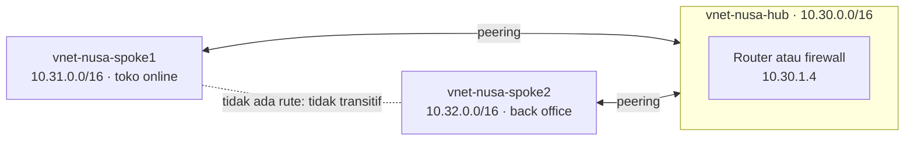
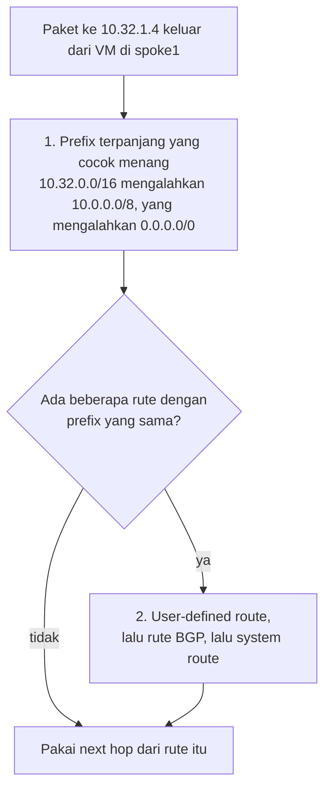
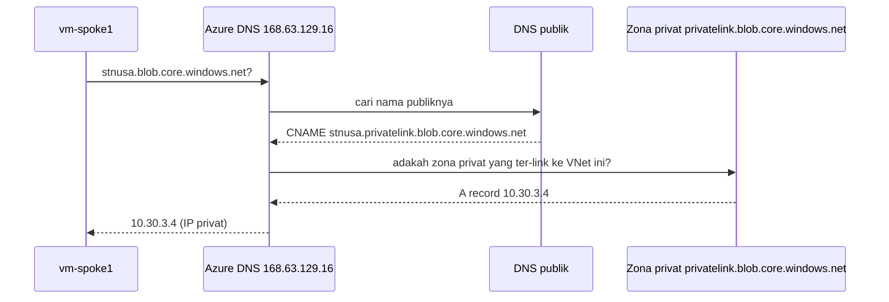

# Makan Siang 25 · Virtual Networking (Lanjutan)

🇬🇧 [Read in English](README.md)

> **Jalur:** Bulan pendalaman · **Level:** Lanjutan · **Bagian 5:** Pendalaman
> **Waktu:** 60 menit · **Makan siang prasyarat:** 08 (Virtual Networking, Dasar)
> **Area keterampilan AZ-900:** Di luar cakupan AZ-900
> **Lab:** [Lab 25 · Hub-and-spoke untuk Nusantara Retail](../../labs/25-networking-advanced/README.id.md) — sekitar 60 menit · biaya 💲💲 (jalur opsional Azure Firewall 💲💲💲)
> **Penulis:** Stefanus Pinarta · [Tentang penulis](../../README.id.md#tentang-penulis)

| ⏱ Menit | Segmen |
|---:|---|
| 5 | Skenario dan tujuan |
| 25 | Bacaan |
| 15 | Demo: animasi interaktif (+ video panduan opsional) |
| 5 | Uji pemahaman |
| 5 | Poin penting dan pratinjau lab |
| 5 | Waktu cadangan — habiskan makan siang Anda 🍜 |

## 🍱 Menu hari ini

Setelah makan siang ini, Anda akan mampu:

- **Merancang** jaringan hub-and-spoke dengan virtual network peering, serta menjelaskan mengapa peering tidak transitif
  dan apa yang ditambahkan oleh gateway transit.
- **Memprediksi** rute yang dipilih Azure untuk sebuah paket — berdasarkan system route, user-defined route, dan jenis
  next hop — lalu membuktikannya dengan effective routes dan next hop.
- **Membandingkan** SKU Azure Firewall dengan network virtual appliance, serta menempatkan NAT gateway, Azure Bastion,
  dan DDoS Protection di dalam hub.
- **Menjelaskan** bagaimana nama sebuah private endpoint di-resolve menjadi alamat IP privat, dan kapan Anda membutuhkan
  Azure DNS Private Resolver.
- **Menggunakan** Network Watcher dan Azure Virtual Network Manager untuk mengoperasikan banyak jaringan berdasarkan
  bukti, bukan harapan.

## 🏪 Sementara itu di Nusantara Retail

Enam bulan setelah Makan Siang 08, jaringan toko online berjalan begitu mulus sampai-sampai tim keuangan ingin aplikasi
back office mereka sendiri di Azure — di jaringan terpisah, dengan pemilik sendiri dan anggaran sendiri. Lalu datanglah
auditor Ibu Sari dengan dua pertanyaan yang membuat ruang rapat mendadak hening: sistem mana saja yang bisa berkomunikasi
dengan jaringan keuangan, dan bisakah Anda *membuktikan* bahwa lalu lintas di antara keduanya diperiksa?

Pak Budi sedang menyiapkan VPN ke kantor pusat untuk Makan Siang 26 dan hanya punya satu syarat: "Satu koneksi ke Azure.
Bukan satu per jaringan." Dewi cuma ingin toko online bisa memanggil API back office tanpa harus mengajukan tiket setiap
kali. Dan semua orang sepakat: storage account tempat faktur disimpan sudah waktunya berhenti meladeni internet sama
sekali.

Pertanyaan hari ini: bagaimana menghubungkan banyak jaringan melalui satu hub yang terkendali — dan membuktikan ke mana
setiap paket pergi?

---

## 📖 Bacaan (≈25 menit)

### 1. Peering dan bentuk hub-and-spoke

**Virtual network peering** menyambungkan dua VNet (*jaringan virtual*) sehingga resource (*sumber daya*) di dalamnya
bisa saling berbicara memakai alamat IP privat, melalui backbone — jaringan tulang punggung — milik Microsoft.
**Regional peering** menyambungkan VNet di region (*wilayah*) yang sama; **global peering** menyambungkan VNet di region
yang berbeda. Di region yang sama, latensi antar-VM (*komputer virtual*) yang di-peering setara dengan latensi di dalam
satu VNet, dan peering tidak menambahkan batas bandwidth sendiri — batasnya adalah ukuran VM. Peering bisa melintasi
subscription (*langganan*), bahkan tenant Microsoft Entra yang berbeda, dan tidak memerlukan gateway ataupun perangkat
enkripsi. Anda membayar biaya kecil per GB yang melewati peering, untuk masing-masing arah.

Dua aturan dari Makan Siang 08 tetap berlaku. Ruang alamat (address space) kedua VNet tidak boleh tumpang-tindih, dan
sebuah peering punya dua bagian: Anda membuat satu link dari masing-masing VNet. Dengan satu link, statusnya *Initiated*;
dengan keduanya, statusnya menjadi *Connected*. Jika salah satu link dihapus, link yang tersisa menampilkan
*Disconnected* dan harus dibuat ulang. Anda tetap bisa memperluas ruang alamat VNet yang sudah di-peering tanpa
downtime; setelah itu Anda melakukan **sync** pada peering agar sisi seberang mengetahui rentang alamat yang baru.

Aturan yang paling sering mengejutkan orang: **peering tidak transitif**. Setiap peering hanya menambahkan rute untuk
ruang alamat tetangga *langsung*-nya. Jika spoke1 dan spoke2 sama-sama di-peering dengan hub, spoke1 tetap tidak punya
rute ke spoke2:

Ibaratnya daftar kontak WhatsApp. Anda menyimpan nomor Pak Budi, dan Pak Budi menyimpan nomor Dewi — tetapi itu tidak
berarti ponsel Anda otomatis punya nomor Dewi. Untuk menghubungi Dewi, Anda harus menyimpan nomornya sendiri, atau
menitipkan pesan lewat Pak Budi. Dua pilihan itulah yang sebentar lagi kita temui: peering langsung, atau perantara di
hub.

Keterbatasan inilah alasan lahirnya desain **hub-and-spoke** (poros dan jari-jari, seperti roda sepeda). Layanan bersama
ditempatkan di **hub**: firewall atau network virtual appliance, gateway VPN atau ExpressRoute, Azure Bastion, dan
layanan DNS. Setiap workload (aplikasi beserta resource-nya) mendapat **spoke** sendiri, yang hanya di-peering dengan
hub. Secara default spoke saling terisolasi, boleh dimiliki tim dan subscription yang berbeda, dan berbagi satu titik
inspeksi serta satu koneksi ke kantor pusat. Ketika dua spoke harus berkomunikasi, Anda punya tiga pilihan: merutekan
lalu lintasnya lewat appliance di hub (diinspeksi), membuat peering langsung di antara kedua spoke (cepat, tetapi tidak
diinspeksi, dan jumlahnya membengkak menjadi N × (N − 1) / 2 peering), atau membiarkan Azure Virtual Network Manager
membuat konektivitas langsung antar-spoke (bagian 6).

| Setelan peering | Diatur di | Fungsinya |
|---|---|---|
| **Allow access** ke jaringan yang di-peering | Kedua link | Sakelar dasar; tanpanya peering tidak membawa apa pun |
| **Allow forwarded traffic** | Link milik jaringan yang *menerima* paket terusan — di sini, link setiap spoke ke hub | Menerima paket yang tidak berasal dari peer itu sendiri, misalnya paket yang diteruskan oleh appliance di hub |
| **Allow gateway transit** | Link milik hub | Memungkinkan spoke ikut memakai gateway VPN atau ExpressRoute milik hub |
| **Use remote gateways** | Link spoke ke hub | Mengirim lalu lintas spoke yang menuju on-premises (jaringan di lokasi Anda sendiri) lewat gateway hub; spoke itu tidak boleh punya gateway sendiri |

Gateway transit bekerja di regional maupun global peering, dan Makan Siang 26 memakainya. Satu kejutan lagi: DNS bawaan
Azure (Azure-provided DNS) tidak me-resolve nama VM melintasi peering — untuk itu Anda membutuhkan private DNS zone
(bagian 5).

### 2. Bagaimana Azure memilih rute

Sebuah rute pada dasarnya adalah pasangan dua hal: *awalan alamat* (address prefix) — rentang tujuan seperti
`10.32.0.0/16` — dan *next hop*, yaitu pihak berikutnya yang menerima paket. Setiap subnet punya route table (tabel
rute), bahkan jika Anda tidak pernah membuatnya. Azure mengisinya dengan **system route** (rute sistem):

| Awalan alamat | Jenis next hop | Ditambahkan saat |
|---|---|---|
| Setiap rentang alamat VNet | Virtual network | Selalu — antar-subnet bisa saling menjangkau tanpa pengaturan apa pun |
| Setiap rentang VNet yang di-peering | VNet peering | Sebuah peering berstatus connected |
| Prefix on-premises | Virtual network gateway | Gateway VPN atau ExpressRoute mempelajarinya (Makan Siang 26) |
| `0.0.0.0/0` | Internet | Selalu — lalu lintas ke IP publik layanan Azure tetap berada di backbone Microsoft |
| `10.0.0.0/8`, `172.16.0.0/12`, `192.168.0.0/16`, `100.64.0.0/10` dan beberapa rentang cadangan lainnya | None (dibuang) | Selalu — kecuali rentang itu bagian dari ruang alamat Anda sendiri |

Anda mengubah perutean dengan **user-defined route (UDR)** — rute yang Anda tentukan sendiri. UDR disimpan di dalam
resource **route table** yang Anda kaitkan (associate) dengan subnet: satu tabel boleh dipakai nol atau lebih subnet,
satu subnet paling banyak memakai satu tabel, dan secara default sebuah tabel memuat hingga 400 rute. Setiap UDR
memasangkan sebuah awalan alamat dengan salah satu dari lima jenis next hop:

| Jenis next hop (nilai CLI) | Ke mana lalu lintas yang cocok dikirim | Penggunaan umum di Nusantara Retail |
|---|---|---|
| Virtual appliance (`VirtualAppliance`) | IP privat yang Anda tentukan: network interface (NIC) milik VM appliance dengan IP forwarding aktif, atau frontend sebuah internal load balancer | Mengirim lalu lintas antar-spoke dan lalu lintas internet melalui firewall di hub |
| Virtual network gateway (`VirtualNetworkGateway`) | VPN gateway milik VNet — bukan ExpressRoute gateway, yang rutenya datang dari BGP | Memaksa lalu lintas internet keluar lewat kantor pusat melalui VPN |
| Virtual network (`VnetLocal`) | Pengiriman normal di dalam VNet | Mengecualikan lalu lintas di dalam satu subnet dari rute appliance yang lebih luas |
| Internet (`Internet`) | Jalur internet Azure; lalu lintas ke IP publik layanan Azure tetap di backbone Microsoft | Membiarkan satu prefix melewati rute `0.0.0.0/0` yang mengarah ke firewall |
| None (`None`) | Tidak ke mana-mana: paket dibuang | Sengaja memblokir sebuah rentang, misalnya spoke lain |

Anda tidak bisa membuat rute peering atau rute service endpoint sendiri; Azure yang menambahkannya. **BGP** (Border
Gateway Protocol) di tabel tadi adalah protokol yang dipakai router untuk saling mengabarkan rute; Anda akan berkenalan
lebih dekat dengannya di Makan Siang 26. Satu jebakan dari Makan Siang 08: di subnet privat, UDR dengan next hop
`Internet` tidak menciptakan jalan keluar. Tanpa NAT gateway atau IP publik, koneksi tersebut tetap gagal.

Azure memilih rute dalam dua langkah:

Bayangkan kurir paket yang membaca alamat. "Jl. Sudirman No. 5, Jakarta" jauh lebih rinci daripada sekadar "Jakarta",
jadi kurir mengikuti petunjuk yang paling rinci. Angka di belakang garis miring bekerja dengan cara yang sama: makin
besar angkanya (/16 dibanding /8, apalagi /0), makin sempit rentangnya dan makin spesifik rutenya.

Sebelum Anda menambahkan UDR, paket dari spoke1 untuk `10.32.1.4` hanya cocok dengan `10.0.0.0/8` dan `0.0.0.0/0`. /8
lebih panjang, sehingga next hop-nya **None** dan paket dibuang diam-diam. Tambahkan UDR untuk `10.32.0.0/16` dengan
next hop `VirtualAppliance 10.30.1.4`, dan /16 itulah yang menang.

Dua alat menunjukkan kenyataannya. **Effective routes** menampilkan setiap rute pada sebuah NIC beserta sumbernya
(Default, User, atau gateway) dan statusnya (Active atau Invalid). **Next hop** di Network Watcher menjawab untuk satu
tujuan tertentu.

Namun, merutekan lalu lintas lewat appliance butuh lebih dari sekadar rute:

1. UDR dengan next hop `VirtualAppliance` dan IP appliance tersebut, di setiap subnet yang lalu lintasnya harus
   diinspeksi.
2. **IP forwarding** diaktifkan pada NIC appliance. Tanpanya, Azure membuang paket yang tidak dialamatkan ke NIC itu.
3. Forwarding dinyalakan di dalam sistem operasi atau perangkat lunak appliance.
4. **Rute balik** (return route) di sisi seberang, supaya balasan kembali melalui appliance yang sama.
5. **Allow forwarded traffic** pada peering spoke penerima, serta NSG yang mengizinkan alirannya.

Ibaratnya resepsionis di lobi gedung kantor. Aturan standarnya: ia hanya menerima paket yang ditujukan kepadanya sendiri;
paket untuk orang lain ditolak di meja depan. IP forwarding adalah izin agar ia boleh menerima titipan dan meneruskannya
ke penerima yang sebenarnya — dan karena ada dua "atasan" yang berwenang, yaitu Azure (di NIC) dan sistem operasi (di
dalam VM), keduanya harus sama-sama memberi izin.

Letakkan appliance di subnet-nya sendiri: route table yang mengirim lalu lintas sebuah subnet ke appliance di subnet
yang sama bisa menciptakan loop.

> [!TIP]
> Begitu hub memiliki gateway VPN atau ExpressRoute, hub mengiklankan rute kantor pusat ke setiap spoke ter-peering yang
> memakai gateway tersebut. Rute hasil belajar itu lebih spesifik daripada UDR `0.0.0.0/0`, sehingga lalu lintas ke
> kantor pusat akan melewati (bypass) firewall Anda. Route table punya setelan untuk menghentikan propagasi rute gateway
> di subnet milik spoke; setelah itu, UDR untuk rentang kantor pusat ikut mengirim lalu lintas tersebut melalui
> firewall. Jangan pernah menonaktifkannya di `GatewaySubnet` itu sendiri.

> [!WARNING]
> Perutean asimetris (asymmetric routing) adalah bug klasik hub-and-spoke. Jika spoke1 mengirim lewat firewall, tetapi
> balasan dari spoke2 mengambil jalan langsung — atau sama sekali tidak punya rute — firewall stateful (yang mengikuti
> setiap percakapan dari awal sampai akhir) hanya melihat separuh dari setiap percakapan lalu membuangnya. Selalu buat
> rute secara berpasangan, dan periksa kedua arah dengan next hop.

### 3. Menginspeksi lalu lintas: Azure Firewall dan network virtual appliance

**Network virtual appliance (NVA)** adalah VM yang merutekan, menyaring, atau mengoptimalkan lalu lintas: firewall dari
vendor atau router SD-WAN (software-defined WAN) dari Azure Marketplace, atau — seperti di lab — VM Linux biasa yang
fitur forwarding-nya dinyalakan. Dengan NVA, Andalah yang menanggung patching, scaling, dan high availability
(*ketersediaan tinggi*)-nya. Satu VM appliance adalah titik kegagalan tunggal (single point of failure) bagi setiap
spoke, sehingga desain produksi menjalankan dua instance atau lebih di belakang internal load balancer Standard dengan
aturan HA ports, yang meneruskan semua port sekaligus (Makan Siang 09), dan UDR diarahkan ke IP frontend load balancer
itu, bukan ke satu VM.

**Azure Firewall** adalah alternatif terkelola: firewall stateful sebagai layanan, dengan high availability bawaan,
dukungan availability zone (*zona ketersediaan*), dan autoscaling. Azure Firewall tinggal di subnet khusus bernama
`AzureFirewallSubnet` dan menolak semua hal yang tidak diizinkan oleh sebuah aturan. Tersedia tiga SKU (tingkatan
produk):

| | Basic | Standard | Premium |
|---|---|---|---|
| Dirancang untuk | Lingkungan kecil dan menengah | Sebagian besar hub produksi | Workload yang sangat sensitif, seperti pembayaran |
| Throughput (saat tulisan ini dibuat) | Hingga 250 Mbps | Hingga 30 Gbps | Hingga 100 Gbps |
| Threat intelligence | Hanya memberi peringatan (alert) | Memberi peringatan dan memblokir (alert and deny) | Memberi peringatan dan memblokir (alert and deny) |
| Fitur tambahan | Aturan stateful, NAT, penyaringan FQDN aplikasi | Menambahkan penyaringan FQDN tingkat jaringan, kategori web, DNS proxy | Menambahkan inspeksi TLS (membuka enkripsi untuk diperiksa), deteksi dan pencegahan intrusi (IDPS), penyaringan URL penuh |

Aturan (rule) terbagi menjadi tiga jenis. **DNAT rule** (destination NAT; NAT atau network address translation adalah
penerjemahan alamat) memublikasikan layanan internal di IP publik firewall. **Network rule** menyaring berdasarkan
alamat IP, port, protokol, dan service tag (label siap pakai untuk sekelompok alamat IP, misalnya milik sebuah layanan
Azure). **Application rule** mengizinkan atau menolak lalu lintas keluar HTTP, HTTPS, dan SQL berdasarkan nama domain
lengkap (FQDN, fully qualified domain name), misalnya `*.ubuntu.com`. Azure memproses DNAT rule lebih dulu, lalu network
rule, lalu application rule; di dalam setiap jenis, rule collection dijalankan sesuai urutan prioritas, dan kecocokan
pertama yang menang.

Aturan disimpan di **Firewall Policy**, resource terpisah yang bisa dipakai bersama oleh beberapa firewall; aturan
"classic" lama yang disimpan langsung di firewall sudah tergolong legacy. **Azure Firewall Manager** mengelola policy
secara terpusat di banyak firewall, termasuk parent policy berisi aturan untuk seluruh perusahaan yang diwarisi oleh
child policy.

Biayanya terdiri dari dua bagian: biaya tetap untuk setiap jam firewall itu ada, dan biaya per GB yang diproses —
semuanya makin tinggi dari Basic ke Premium. Pilih SKU terendah yang memenuhi kebutuhan keamanan dan throughput, dan
jangan pernah membiarkan firewall lab menyala semalaman.

### 4. Layanan edge di hub: NAT gateway, Azure Bastion, dan DDoS Protection

Anda sudah berkenalan dengan **NAT gateway** di Makan Siang 08 sebagai jalan keluar default dari subnet privat. Dalam
skala besar, ada tiga detail yang penting. Pertama, NAT gateway membagikan **port SNAT** — port sumber yang dipakai
ketika banyak alamat privat berbagi satu alamat publik — secara dinamis ke setiap VM di subnet-subnetnya, sehingga
jarang kehabisan; setiap IP publik tambahan (hingga 16) atau sebuah public IP prefix memperbesar kumpulan port itu.
Kedua, **idle timeout** TCP-nya (batas waktu koneksi yang menganggur) secara default 4 menit dan bisa dinaikkan hingga
120 menit; keepalive (paket kecil penanda bahwa koneksi masih hidup) akan me-reset-nya. Ketiga, NAT gateway punya tempat
dalam rantai prioritas: UDR yang mengirim `0.0.0.0/0` ke appliance atau gateway mengalahkan NAT gateway, NAT gateway
mengalahkan IP publik milik VM itu sendiri, dan IP publik VM mengalahkan outbound rule load balancer. Karena itu, dalam
desain hub-and-spoke Anda mengirim lalu lintas internet dari spoke ke firewall dan memasang NAT gateway di
`AzureFirewallSubnet`, sehingga koneksi keluar firewall memakai alamat milik NAT gateway. Satu NAT gateway hanya
melayani subnet dari satu VNet. SKU **StandardV2** menambahkan zone redundancy, IPv6, dan flow log; SKU ini membutuhkan
IP publik StandardV2 dan tidak bisa di-upgrade di tempat (in place) dari Standard.

**Azure Bastion** memberi admin akses RDP (Remote Desktop Protocol) dan SSH (Secure Shell) berbasis browser, melalui
TLS (enkripsi yang sama dengan HTTPS), ke VM yang sama sekali tidak punya IP publik. Jika ditempatkan di hub, SKU
dedicated bisa menjangkau VM di spoke yang di-peering:

| SKU | Cocok untuk | Sorotan |
|---|---|---|
| Developer | Dev/test, satu VM dalam satu waktu | Gratis dan dipakai bersama; tanpa subnet khusus; tidak mendukung peering; hanya di region tertentu |
| Basic | Lingkungan produksi kecil | Host khusus dengan dua instance tetap; menjangkau VNet yang di-peering |
| Standard | Tim yang lebih besar | Host scaling, klien SSH/RDP native melalui CLI, koneksi berbasis IP, shareable link |
| Premium | Workload yang diatur regulasi | Semua fitur Standard, plus perekaman sesi dan deployment khusus privat (private-only) |

SKU dedicated membutuhkan subnet bernama `AzureBastionSubnet` berukuran /26 atau lebih besar. Anda bisa menaikkan
(upgrade) SKU, tetapi tidak bisa menurunkannya (downgrade).

**Perlindungan DDoS** — DDoS (distributed denial of service) adalah serangan banjir lalu lintas dari banyak sumber untuk
melumpuhkan sebuah layanan — dimulai secara gratis: perlindungan infrastruktur Azure otomatis menjaga setiap IP publik.
Untuk hari-hari tersibuk toko online, Anda bisa menambahkan **DDoS IP Protection**, yang ditagih per IP publik yang
dilindungi, atau **DDoS Network Protection**, paket untuk seluruh VNet yang menambahkan akses ke tim DDoS rapid
response, perlindungan biaya (cost protection), dan diskon WAF (web application firewall).

### 5. Menjangkau PaaS secara privat: endpoint dan DNS

Layanan PaaS (*platform sebagai layanan*) seperti Azure Storage dan Azure SQL Database punya public endpoint (*titik
akhir publik*) — alamat yang bisa dihubungi dari internet. Azure menawarkan dua cara untuk menjangkaunya dari sebuah
VNet:

| | Service endpoint | Private endpoint (Azure Private Link) |
|---|---|---|
| Apa itu | Rute yang dioptimalkan dari subnet ke sebuah layanan, dengan identitas VNet ikut disertakan | Network interface dengan IP privat di subnet Anda, yang dipetakan ke satu resource tertentu |
| Public endpoint milik layanan | Tetap publik; Anda membatasinya ke subnet tertentu | Bisa dimatikan sepenuhnya |
| Dari VNet yang di-peering dan dari on-premises | Tidak secara default | Ya, melalui peering, VPN, atau ExpressRoute |
| Perubahan DNS | Tidak ada | Wajib: sebuah private DNS zone |
| Biaya | Gratis | Per endpoint per jam, ditambah per GB yang diproses |

Private endpoint (*titik akhir privat*) adalah pilihan yang lebih kuat untuk akun faktur, tetapi hanya jika DNS — "buku
telepon" internet yang menerjemahkan nama menjadi alamat IP — mau bekerja sama. Aplikasi tetap memakai nama publik,
sehingga connection string dan sertifikat TLS-nya tetap cocok. Nama itu di-resolve seperti ini:

**Alias privatelink** (sebuah CNAME, yaitu record DNS yang berkata "nama ini sebenarnya alias dari nama lain") bersifat
publik: siapa pun bisa mencarinya. Yang mengubahnya menjadi IP privat adalah **private DNS zone** dengan nama yang
direkomendasikan untuk layanan tersebut — `privatelink.blob.core.windows.net` untuk blob,
`privatelink.database.windows.net` untuk Azure SQL — dan **virtual network link** dari zona itu ke setiap VNet yang harus
me-resolve secara privat. DNS zone group pada private endpoint menjaga `A` record (record yang memetakan nama ke alamat
IP) tetap mutakhir. Di luar VNet-VNet tersebut, rantai yang sama berakhir di IP publik, dan di sana akun menolak koneksi
karena public network access dinonaktifkan.

Ibaratnya buku telepon internal sebuah kantor. Orang luar menelepon nomor umum kantor, sedangkan karyawan di dalam gedung
membuka buku telepon internal yang mencantumkan nomor ekstensi untuk nama yang sama. Private DNS zone adalah buku
telepon internal itu, dan virtual network link menentukan "gedung" mana yang boleh memakainya. VNet tanpa link hanya
memegang buku telepon umum — padahal nomor umum itu sudah tidak mau mengangkat telepon.

Kegagalan yang paling umum adalah VNet yang tidak di-link ke zona itu, atau VNet yang memakai server DNS kustom (seperti
domain controller milik Pak Budi) yang tidak meneruskan kueri ke Azure DNS. VM lalu mendapat IP publik dan pesan
"access denied".

Satu detail perutean sering menjebak desain firewall: secara default, NSG dan UDR tidak berlaku untuk lalu lintas yang
*menuju* private endpoint. Jika auditor ingin lalu lintas dari spoke ke endpoint disaring NSG atau dikirim melalui
firewall, aktifkan dulu **private endpoint network policies** di subnet milik endpoint.

Kantor pusat punya masalah sebaliknya: server on-premises tidak bisa menjangkau `168.63.129.16`. **Azure DNS Private
Resolver** menyelesaikan kedua arah tanpa perlu VM DNS. **Inbound endpoint** adalah sebuah IP privat di hub. Server DNS
on-premises meneruskan secara bersyarat (conditional forwarding) zona *publik* milik layanan ke endpoint ini —
`blob.core.windows.net`, bukan zona `privatelink` — dan karena private zone di-link ke hub, jawabannya kembali dalam
bentuk privat. **Outbound endpoint** dengan **DNS forwarding ruleset** mengirim kueri untuk domain on-premises, seperti
`corp.nusantararetail.local`, dari Azure ke server DNS Pak Budi. Setiap endpoint membutuhkan subnet sendiri berukuran
/28 hingga /24 yang didelegasikan ke resolver, dan resolusi hibrida membutuhkan VPN atau ExpressRoute dari Makan
Siang 26.

### 6. Mengoperasikannya dalam skala besar untuk Nusantara Retail

Dengan dua spoke, semua hal di atas masih muat di satu papan tulis. Dengan dua puluh spoke, konsistensilah yang menjadi
masalah. **Azure Virtual Network Manager** mengelola VNet secara terpusat lintas subscription dan management group
(*grup manajemen*). Anda mendefinisikan **network group**, baik dengan memilih VNet satu per satu maupun secara dinamis
dengan kondisi Azure Policy, misalnya berdasarkan tag. Lalu Anda menerapkan **connectivity configuration**
(hub-and-spoke, opsional dengan konektivitas langsung antar-spoke, atau full mesh), **security admin rule** yang
dievaluasi *sebelum* NSG — admin rule "Deny" atau "Always allow" langsung mengakhiri evaluasi — dan **routing
configuration** yang mengelola UDR dalam skala besar. Layanan ini juga bisa mengelola IP address pool sehingga VNet baru
tidak pernah tumpang-tindih. Tagihannya dihitung per VNet yang dikelola, jadi layanan ini makin menguntungkan seiring
pertumbuhan, bukan sejak hari pertama.

Network Watcher tetap menjadi sumber bukti:

| Alat | Menjawab |
|---|---|
| **Next hop** | Ke mana Azure mengirim paket dari VM ini ke alamat itu, dan route table mana yang memutuskannya? |
| **Effective routes** | Setiap rute pada sebuah NIC, beserta sumbernya dan apakah rute itu aktif |
| **Connection troubleshoot** | Bisakah koneksi sungguhan dibuat dari VM ini ke VM, alamat, atau URL itu, dan di mana gagalnya? |
| **VNet flow logs** | Aliran mana yang diizinkan atau ditolak di seluruh VNet? NSG flow logs pensiun pada 30 September 2027. |
| **Traffic analytics** | Siapa berbicara dengan siapa, dan seberapa banyak — flow log yang diolah menjadi peta di Log Analytics (Makan Siang 30) |

Jika semuanya disatukan, hub target Nusantara Retail berisi Azure Firewall dengan Firewall Policy, NAT gateway di subnet
firewall, Azure Bastion, DNS Private Resolver untuk kantor pusat, dan — mulai Makan Siang 26 — VPN gateway yang dipakai
bersama melalui gateway transit. Spoke toko online dan spoke back office hanya di-peering dengan hub; route table mereka
mengirim `0.0.0.0/0` dan rentang milik spoke seberang ke firewall. Akun faktur dan database pesanan berada di balik
private endpoint dengan private DNS zone yang ter-link, dan VNet flow logs mengalir ke Log Analytics. Pertanyaan auditor
kini punya jawaban yang datang dari Azure, bukan dari diagram.

Mari kita ikuti sekali lagi panggilan API milik Dewi. VM toko online mengirim ke back office; user route di subnet-nya
mengirim paket ke firewall; network rule di Firewall Policy mengizinkan TCP 443 dari rentang toko online ke rentang back
office; peering hub-ke-spoke mengantarkannya; dan route table back office mengirim balasannya kembali melalui firewall
yang sama. Setiap langkah punya nama, prioritas, dan entri log.

> [!NOTE]
> **Renungkan sejenak:** Auditor meminta Anda membuktikan bahwa lalu lintas dari toko online ke back office
> diinspeksi. Dua hasil Network Watcher mana yang akan Anda tunjukkan, dan apa persisnya yang harus tertulis di
> masing-masing?

Makan siang berikutnya menghubungkan kantor pusat ke hub ini dengan VPN Gateway, serta membandingkan ExpressRoute dan
Virtual WAN.

---

## 🎬 Demo (≈15 menit)

1. **Animasi interaktif (≈6–8 menit):** [Buka demo](https://stefpin.github.io/azure-fundamentals-lunches/demos/25-networking-advanced.html?lang=id) —
   tekan ▶ Putar atau telusuri langkah demi langkah sesuai kecepatan Anda. Sedang offline? Unduh
   [`docs/demos/25-networking-advanced.html`](../../docs/demos/25-networking-advanced.html) lalu buka di browser apa pun.
2. **Video panduan (≤ 6 menit):** _segera hadir_ — [baca naskah video](demo-video-script.id.md).

Yang perlu diperhatikan:

- Panel effective routes: rute mana yang menang untuk `10.32.1.4` sebelum dan sesudah user-defined route ditambahkan.
- VM hub: paket tiba di sana, tetapi tidak bergerak lebih jauh sampai IP forwarding dinyalakan.
- Panel resolusi nama: nama publik berubah menjadi alias privatelink, dan hanya private zone yang ter-link yang
  mengubahnya menjadi IP privat.

## ✅ Uji pemahaman (≈5 menit)

1. Spoke1 dan spoke2 sama-sama di-peering dengan hub, dan semua peering menunjukkan *Connected*. Namun `vm-spoke1` tetap
   tidak bisa menjangkau `vm-spoke2`. Sebutkan dua cara untuk memperbaikinya.
   

Lihat jawaban

   Rutekan lewat hub — user-defined route di kedua spoke dengan next hop `VirtualAppliance` yang diarahkan ke firewall
   atau appliance di hub, IP forwarding di appliance tersebut, dan *allow forwarded traffic* di peering milik spoke —
   atau hubungkan kedua spoke secara langsung dengan peering mereka sendiri (atau konektivitas langsung dari Virtual
   Network Manager). *Alasannya:* peering tidak transitif; setiap peering hanya menambahkan rute untuk tetangga
   langsungnya.

   

2. Subnet spoke1 punya UDR `0.0.0.0/0 → VirtualAppliance 10.30.1.4`. Sebuah VM di spoke1 mengirim paket ke
   `10.31.1.10`, VM lain di VNet yang sama. Ke mana paket itu pergi?
   

Lihat jawaban

   Langsung ke VM lain itu di dalam VNet (next hop *Virtual network*). *Alasannya:* system route untuk `10.31.0.0/16`
   adalah prefix yang lebih panjang daripada `0.0.0.0/0`, dan prefix terpanjang yang cocok menang sebelum sumber rute
   dibandingkan.

   

3. Next hop dari `vm-spoke1` ke `vm-spoke2` menunjukkan *VirtualAppliance 10.30.1.4*, tetapi ping tetap gagal. Apa yang
   Anda periksa?
   

Lihat jawaban

   IP forwarding di NIC VM hub, forwarding di dalam sistem operasinya, rute balik di spoke2 yang mengarah kembali lewat
   hub, *allow forwarded traffic* di peering milik spoke, serta NSG atau firewall OS di sepanjang jalur. *Alasannya:*
   next hop hanya membuktikan keputusan perutean yang pertama; appliance dan jalur pulangnya juga harus ikut bekerja
   sama.

   

4. `stnusa` punya private endpoint di hub, tetapi sebuah VM di spoke2 me-resolve `stnusa.blob.core.windows.net` ke IP
   publik dan mendapat "access denied". Apa penyebab yang paling mungkin?
   

Lihat jawaban

   Private DNS zone `privatelink.blob.core.windows.net` tidak di-link ke VNet spoke2, atau spoke2 memakai server DNS
   kustom yang tidak meneruskan kueri ke Azure DNS. *Alasannya:* CNAME privatelink bersifat publik; hanya private zone
   yang ter-link yang mengubahnya menjadi IP milik private endpoint.

   

5. Setelah VPN aktif, server DNS kantor pusat milik Pak Budi harus bisa me-resolve private endpoint Nusantara. Apa yang
   Anda deploy, dan bagaimana server-server itu memakainya?
   

Lihat jawaban

   Azure DNS Private Resolver di hub dengan sebuah inbound endpoint, dan private DNS zone yang di-link ke VNet hub.
   Kantor pusat menambahkan conditional forwarder untuk zona publik milik layanan, seperti `blob.core.windows.net`, yang
   mengarah ke IP inbound endpoint. *Alasannya:* mesin on-premises tidak bisa menjangkau Azure DNS di `168.63.129.16`,
   tetapi bisa menjangkau IP privat di hub melalui VPN, dan resolver bertanya ke Azure DNS dari dalam VNet yang
   ter-link.

   

## 🧠 Poin penting

- Peering itu privat, cepat, dan tidak transitif. Hub-and-spoke memusatkan layanan bersama, dan lalu lintas antar-spoke
  membutuhkan appliance di hub, peering tambahan, atau konektivitas langsung dari Virtual Network Manager.
- Azure memilih prefix terpanjang yang cocok, lalu lebih memilih user-defined route daripada BGP, dan BGP daripada system
  route. Rentang privat yang bukan milik Anda diarahkan ke *None*. Effective routes dan next hop menunjukkan jawaban yang
  sebenarnya.
- Merutekan lewat appliance membutuhkan UDR dengan next hop `VirtualAppliance`, IP forwarding di NIC dan di OS, rute
  balik yang sepadan, serta *allow forwarded traffic* di peering penerima.
- Azure Firewall (Basic, Standard, Premium) adalah titik inspeksi terkelola, dengan DNAT rule, network rule, dan
  application rule di dalam Firewall Policy. NAT gateway memberi hub jalur keluar (egress) yang dapat diprediksi, Bastion
  menggantikan port manajemen publik, dan DDoS Protection menambahkan perlindungan berbayar di atas perlindungan dasar
  yang gratis.
- Private endpoint hanya berfungsi jika DNS-nya berfungsi: nama publik → CNAME privatelink → `A` record di private zone →
  IP privat. Link zona ke setiap VNet yang membutuhkannya, dan gunakan DNS Private Resolver untuk resolusi hibrida.

## 🗒️ Catatan lapangan dari Stefanus

> **Paket juga butuh tiket pulang.** Di setiap review desain hub-and-spoke, saya meminta satu orang "mengantar" satu
> paket dari toko online ke back office sambil bercerita: route table mana yang mengirimnya ke hub, aturan firewall mana
> yang meloloskannya, setelan peering mana yang mau menerimanya di seberang — lalu ulangi semuanya untuk balasannya.
> Begitu terdengar kalimat "nah, habis itu sampai sendiri", saya tahu di situlah bagian yang tidak ada pemiliknya.
> Sebagai bukti, saya minta hasil next hop dari kedua VM ditempel di tiket perubahan, bukan gambar diagram. Satu lagi:
> kalau ada yang bilang private endpoint "diblokir", saya tidak langsung mengutak-atik firewall. Saya jalankan nslookup
> dari VM yang gagal. Kalau jawabannya IP publik, masalahnya ada di DNS, dan aturan firewall serapi apa pun tidak akan
> menolong.

## 🔬 Lab Anda: Hub-and-spoke untuk Nusantara Retail

`setup.sh` membangun satu hub dan dua spoke, masing-masing dengan satu VM kecil tanpa IP publik. Anda membuat peering
antara setiap spoke dan hub, membuktikan bahwa lalu lintas antar-spoke gagal karena peering tidak transitif, mengubah VM
hub menjadi router dengan IP forwarding, lalu menambahkan route table agar toko online dan back office berkomunikasi
melalui hub. Effective routes, next hop, dan penghitung paket terusan (forwarded-packet counter) di hub membuktikan
setiap lompatan. Jalur opsional mengganti router tersebut dengan Azure Firewall.

- ⏱ Sekitar 60 menit · 💲💲 biaya kecil selama resource berjalan (jalur opsional Azure Firewall 💲💲💲) · bisa
  dikerjakan terpisah (tidak memerlukan lab sebelumnya)
- 👉 [Mulai Lab 25](../../labs/25-networking-advanced/README.id.md)

## 📚 Pelajari lebih lanjut

- [Microsoft Learn: Peering jaringan virtual Azure](https://learn.microsoft.com/azure/virtual-network/virtual-network-peering-overview) — regional dan global peering, gateway transit, service chaining, dan harga.
- [Microsoft Learn: Perutean lalu lintas jaringan virtual Azure](https://learn.microsoft.com/azure/virtual-network/virtual-networks-udr-overview) — setiap system route, jenis next hop, dan aturan pemilihan rute, lengkap dengan contoh kasus.
- [Microsoft Learn: Memilih SKU Azure Firewall yang tepat](https://learn.microsoft.com/azure/firewall/choose-firewall-sku) — perbandingan fitur Basic, Standard, dan Premium.
- [Microsoft Learn: Nilai private DNS zone untuk Azure Private Endpoint](https://learn.microsoft.com/azure/private-link/private-endpoint-dns) — nama zona `privatelink` yang tepat untuk setiap layanan.

---

⬅️ [Makan Siang 24 · Penyimpanan (Lanjutan)](../24-storage-advanced/README.id.md) · 🏠 [Beranda kursus](../../README.id.md) · [Makan Siang 26 · Hybrid Connectivity: VPN Gateway, ExpressRoute, dan Virtual WAN (Lanjutan)](../26-hybrid-connectivity/README.id.md) ➡️

Terakhir divalidasi: Oktober 2026 · Menemukan informasi yang sudah usang? [Buka issue](../../CONTRIBUTING.md).
