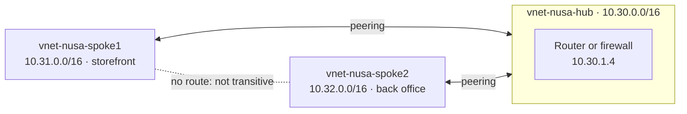
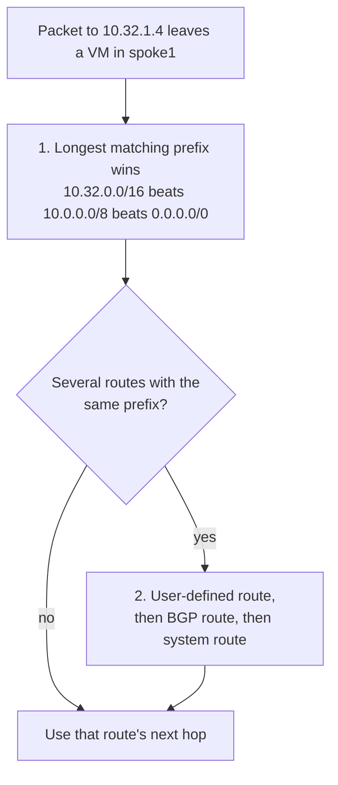
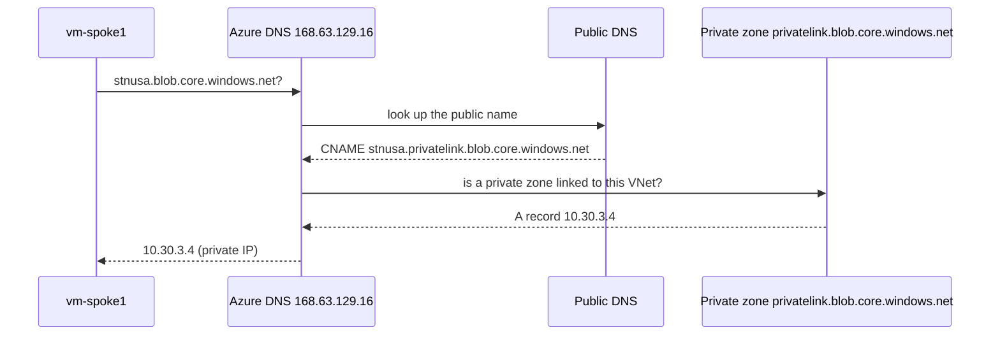

# Lunch 25 · Virtual Networking (Advanced)

> **Track:** Deep-dive month · **Level:** Advanced · **Part 5:** Deep dives
> **Time:** 60 minutes · **Prerequisite lunches:** 08 (Virtual Networking, Basic)
> **AZ-900 skill area:** Beyond AZ-900
> **Lab:** [Lab 25 · Hub and spoke for Nusantara Retail](../../labs/25-networking-advanced/README.md) — about 60 minutes · cost 💲💲 (optional Azure Firewall path 💲💲💲)

| ⏱ Minutes | Segment |
|---:|---|
| 5 | Scenario and objectives |
| 25 | Reading |
| 15 | Demo: interactive animation (+ optional walkthrough video) |
| 5 | Knowledge check |
| 5 | Key takeaways and lab preview |
| 5 | Buffer — finish your lunch 🍜 |

## 🍱 Today's menu

By the end of this lunch you will be able to:

- **Design** a hub-and-spoke network with virtual network peering, and explain why peering isn't transitive and what gateway transit adds.
- **Predict** which route Azure picks for a packet, from system routes, user-defined routes and next-hop types — and prove it with effective routes and next hop.
- **Compare** Azure Firewall SKUs with network virtual appliances, and place NAT gateway, Azure Bastion and DDoS Protection in a hub.
- **Explain** how a private endpoint's name resolves to a private IP address, and when you need Azure DNS Private Resolver.
- **Use** Network Watcher and Azure Virtual Network Manager to operate many networks with evidence rather than hope.

## 🏪 Meanwhile at Nusantara Retail

Six months after Lunch 08, the storefront network works so well that the finance team wants its own back-office
application in Azure — in a separate network, with its own owners and its own budget. Ibu Sari's auditor arrives with
two uncomfortable questions: which systems can talk to the finance network, and can you *prove* that the traffic between
them is inspected?

Pak Budi is planning the VPN to head office for Lunch 26 and has one condition: "One connection into Azure. Not one per
network." Dewi only wants the storefront to call the back-office API without filing a ticket each time. And everybody
agrees that the invoices storage account should stop answering the internet altogether.

Today's question: how do you connect many networks through one controlled hub — and prove where every packet goes?

---

## 📖 Reading (≈25 minutes)

### 1. Peering and the hub-and-spoke shape

**Virtual network peering** connects two VNets so that their resources talk over private IP addresses on Microsoft's
backbone. **Regional peering** joins VNets in the same region; **global peering** joins VNets in different regions.
In the same region, latency between peered VMs equals latency inside one VNet, and peering adds no bandwidth limit of its
own — the VM size is the limit. Peering works across subscriptions and even Microsoft Entra tenants, and needs no
gateway or encryption appliance. You pay a small charge per GB that crosses a peering, in each direction.

Two rules carry over from Lunch 08. The address spaces must not overlap, and a peering has two halves: you create one
link from each VNet. With one link the status is *Initiated*; with both it becomes *Connected*. If one link is deleted,
the other shows *Disconnected* and must be recreated. You can still grow a peered VNet's address space later without
downtime; afterwards you **sync** the peering so the other side learns the new range.

The rule that surprises people is that **peering is not transitive**. Each peering adds routes only for the *direct*
neighbour's address space. If spoke1 and spoke2 are both peered with a hub, spoke1 still has no route to spoke2:

That limitation is the reason for the **hub-and-spoke** design. Shared services live in the **hub**: a firewall or
network virtual appliance, the VPN or ExpressRoute gateway, Azure Bastion and DNS services. Each workload gets its own
**spoke**, peered only with the hub. Spokes are isolated by default, can belong to different teams and subscriptions,
and share one inspection point and one connection to head office. When two spokes must talk, you have three options:
route through an appliance in the hub (inspected), peer the two spokes directly (fast, but uninspected and growing as
N × (N − 1) / 2 peerings), or let Azure Virtual Network Manager create direct spoke connectivity (section 6).

| Peering setting | Set it on | What it does |
|---|---|---|
| **Allow access** to the peered network | Both links | The basic switch; without it the peering carries nothing |
| **Allow forwarded traffic** | The link of the network that *receives* forwarded packets — here, each spoke's link to the hub | Accepts packets that didn't originate in the peer, for example packets forwarded by the hub's appliance |
| **Allow gateway transit** | The hub's links | Lets spokes share the hub's VPN or ExpressRoute gateway |
| **Use remote gateways** | A spoke's link to the hub | Sends the spoke's on-premises traffic through the hub's gateway; the spoke can't have its own gateway |

Gateway transit works over both regional and global peering, and Lunch 26 uses it. One more surprise: Azure-provided
DNS doesn't resolve VM names across peerings — for that you need private DNS zones (section 5).

### 2. How Azure chooses a route

Every subnet has a route table, even if you never create one. Azure fills it with **system routes**:

| Address prefix | Next hop type | Added when |
|---|---|---|
| Each address range of the VNet | Virtual network | Always — subnets reach each other without any setup |
| Each range of a peered VNet | VNet peering | A peering is connected |
| On-premises prefixes | Virtual network gateway | A VPN or ExpressRoute gateway learns them (Lunch 26) |
| `0.0.0.0/0` | Internet | Always — traffic to Azure services' public IPs still stays on Microsoft's backbone |
| `10.0.0.0/8`, `172.16.0.0/12`, `192.168.0.0/16`, `100.64.0.0/10` and a few other reserved ranges | None (drop) | Always — unless the range is part of your own address space |

You change routing with **user-defined routes (UDRs)**. They live in a **route table** resource that you associate with
subnets: zero or more subnets per table, at most one table per subnet, and by default up to 400 routes per table. Each
UDR pairs an address prefix with one of five next hop types:

| Next hop type (CLI value) | Where matching traffic goes | Typical use at Nusantara Retail |
|---|---|---|
| Virtual appliance (`VirtualAppliance`) | A private IP you name: an appliance VM's NIC with IP forwarding on, or an internal load balancer's frontend | Send spoke-to-spoke and internet traffic through the hub's firewall |
| Virtual network gateway (`VirtualNetworkGateway`) | The VNet's VPN gateway — not an ExpressRoute gateway, whose routes come from BGP | Force internet-bound traffic to head office over the VPN |
| Virtual network (`VnetLocal`) | Normal delivery inside the VNet | Keep traffic inside one subnet out of a broader appliance route |
| Internet (`Internet`) | Azure's internet path; traffic to Azure services' public IPs stays on Microsoft's backbone | Let one prefix bypass a `0.0.0.0/0` route to the firewall |
| None (`None`) | Nowhere: the packet is dropped | Block a range on purpose, such as another spoke |

You can't create peering or service-endpoint routes yourself; Azure adds them. One trap from Lunch 08: in a private
subnet, a UDR with next hop `Internet` doesn't create a way out. Without a NAT gateway or public IP, those connections
still fail.

Azure picks a route in two steps:

Before you add a UDR, spoke1's packet for `10.32.1.4` matches only `10.0.0.0/8` and `0.0.0.0/0`. The /8 is longer, so
the next hop is **None** and the packet is silently dropped. Add a UDR for `10.32.0.0/16` with next hop
`VirtualAppliance 10.30.1.4`, and that /16 wins.

Two tools show the truth. **Effective routes** list every route on a NIC with its source (Default, User or gateway)
and state (Active or Invalid). **Next hop** in Network Watcher answers for a single destination.

Routing through an appliance takes more than a route, though:

1. A UDR with next hop `VirtualAppliance` and the appliance's IP, on every subnet whose traffic should be inspected.
2. **IP forwarding** enabled on the appliance's NIC. Without it, Azure drops packets that aren't addressed to that NIC.
3. Forwarding switched on inside the appliance's operating system or software.
4. A **return route** on the other side, so replies come back through the same appliance.
5. **Allow forwarded traffic** on the receiving spoke's peering, and NSGs that permit the flow.

Put the appliance in its own subnet: a route table that sends a subnet's traffic to an appliance in that same subnet can
create a loop.

> [!TIP]
> Once the hub has a VPN or ExpressRoute gateway, it advertises head-office routes to every peered spoke that uses it.
> Those learned routes are more specific than a `0.0.0.0/0` UDR and would bypass your firewall. Route tables have a
> setting to stop gateway route propagation on the spokes' subnets; then a UDR for head office's range sends that
> traffic through the firewall too. Never disable it on `GatewaySubnet` itself.

> [!WARNING]
> Asymmetric routing is the classic hub-and-spoke bug. If spoke1 sends through the firewall but spoke2's replies take
> the direct way — or have no route at all — a stateful firewall sees only half of each conversation and drops it.
> Always create routes in pairs, and check both directions with next hop.

### 3. Inspecting traffic: Azure Firewall and network virtual appliances

A **network virtual appliance (NVA)** is a VM that routes, filters or optimises traffic: a vendor firewall or an SD-WAN
router from Azure Marketplace, or — as in the lab — a plain Linux VM with forwarding switched on. With an NVA you own the
patching, the scaling and the high availability. A single appliance VM is a single point of failure for every spoke, so
production designs run two or more instances behind an internal Standard load balancer with HA ports (Lunch 09), and
the UDRs point at the load balancer's frontend IP instead of one VM.

**Azure Firewall** is the managed alternative: a stateful firewall as a service with built-in high availability,
availability zone support and autoscaling. It lives in a dedicated subnet named `AzureFirewallSubnet` and denies
everything that no rule allows. It comes in three SKUs:

| | Basic | Standard | Premium |
|---|---|---|---|
| Designed for | Small and medium environments | Most production hubs | Highly sensitive workloads such as payments |
| Throughput (at the time of writing) | Up to 250 Mbps | Up to 30 Gbps | Up to 100 Gbps |
| Threat intelligence | Alert only | Alert and deny | Alert and deny |
| Extra features | Stateful rules, NAT, application FQDN filtering | Adds network-level FQDN filtering, web categories, DNS proxy | Adds TLS inspection, intrusion detection and prevention (IDPS), full URL filtering |

Rules come in three kinds. **DNAT rules** publish an internal service on the firewall's public IP. **Network rules**
filter by IP address, port, protocol and service tag. **Application rules** allow or deny outbound HTTP, HTTPS and SQL
traffic by fully qualified domain name, such as `*.ubuntu.com`. Azure processes DNAT rules first, then network rules,
then application rules; inside each kind, rule collections run in priority order and the first match wins.

Rules live in a **Firewall Policy**, a separate resource that several firewalls can share; the older "classic" rules
stored on the firewall itself are legacy. **Azure Firewall Manager** manages policies centrally across many firewalls,
including parent policies with company-wide rules that child policies inherit.

Cost has two parts: a fixed charge for every hour the firewall exists, and a charge per GB processed — rising from
Basic to Premium. Choose the lowest SKU that meets the security and throughput needs, and never leave a lab firewall
running overnight.

### 4. Edge services in the hub: NAT gateway, Azure Bastion and DDoS Protection

You met **NAT gateway** in Lunch 08 as the default way out of a private subnet. Three details matter at scale. First,
it hands out **SNAT ports** — the source ports used when many private addresses share a public one — dynamically to
every VM in its subnets, so it rarely runs out; each extra public IP (up to 16) or a public IP prefix enlarges the pool.
Second, its TCP **idle timeout** is 4 minutes by default and can be raised to 120; keepalives reset it. Third, it has a
place in a precedence chain: a UDR that sends `0.0.0.0/0` to an appliance or gateway beats NAT gateway, which beats a
VM's own public IP, which beats load balancer outbound rules. In a hub-and-spoke design you therefore send spoke
internet traffic to the firewall and attach the NAT gateway to `AzureFirewallSubnet`, so the firewall's outbound
connections use the NAT gateway's addresses. A NAT gateway serves subnets of one VNet only. The **StandardV2** SKU adds
zone redundancy, IPv6 and flow logs; it needs StandardV2 public IPs and can't be upgraded in place from Standard.

**Azure Bastion** gives admins browser-based RDP and SSH over TLS to VMs that have no public IP at all. Placed in the
hub, the dedicated SKUs reach VMs in peered spokes:

| SKU | Good fit | Highlights |
|---|---|---|
| Developer | Dev/test, one VM at a time | Free and shared; no dedicated subnet; no peering support; selected regions |
| Basic | Small production estates | Dedicated host with two fixed instances; reaches peered VNets |
| Standard | Larger teams | Host scaling, native SSH/RDP clients through the CLI, IP-based connections, shareable links |
| Premium | Regulated workloads | Everything in Standard plus session recording and private-only deployment |

Dedicated SKUs need a subnet named `AzureBastionSubnet` of /26 or larger. You can upgrade a SKU but not downgrade it.

**DDoS protection** starts for free: Azure's infrastructure protection covers every public IP automatically. For the
storefront's busiest days you can add **DDoS IP Protection**, billed per protected public IP, or **DDoS Network
Protection**, a plan for whole VNets that adds access to the DDoS rapid response team, cost protection and a WAF
discount.

### 5. Reaching PaaS privately: endpoints and DNS

PaaS services such as Azure Storage and Azure SQL Database have public endpoints. Azure offers two ways to reach them
from a VNet:

| | Service endpoint | Private endpoint (Azure Private Link) |
|---|---|---|
| What it is | An optimised route from a subnet to a service, with the VNet identity attached | A network interface with a private IP in your subnet, mapped to one specific resource |
| The service's public endpoint | Stays public; you restrict it to selected subnets | Can be switched off completely |
| From peered VNets and on-premises | Not by default | Yes, over peering, VPN or ExpressRoute |
| DNS changes | None | Required: a private DNS zone |
| Cost | Free | Per endpoint per hour, plus per GB processed |

Private endpoints are the stronger choice for the invoices account, but only if DNS cooperates. The application keeps
using the public name, so its connection string and TLS certificate still match. The name resolves like this:

The **privatelink alias** is public: anyone can look it up. What turns it into a private IP is a **private DNS zone**
with the service's recommended name — `privatelink.blob.core.windows.net` for blobs, `privatelink.database.windows.net`
for Azure SQL — and a **virtual network link** from that zone to every VNet that must resolve privately. A DNS zone
group on the private endpoint keeps the `A` record up to date. Outside those VNets, the same chain ends at the public
IP, where the account refuses the connection because public network access is disabled.

The usual failure is a VNet that isn't linked to the zone, or one that uses custom DNS servers (such as Pak Budi's
domain controllers) that don't forward to Azure DNS. The VM then gets the public IP and an "access denied".

One routing detail catches firewall designs: by default, NSGs and UDRs don't apply to traffic *to* a private endpoint.
If the auditor wants spoke-to-endpoint traffic filtered by NSGs or sent through the firewall, enable **private endpoint
network policies** on the endpoint's subnet first.

Head office has the opposite problem: on-premises servers can't reach `168.63.129.16`. **Azure DNS Private Resolver**
solves both directions without DNS VMs. An **inbound endpoint** is a private IP in the hub. On-premises DNS servers
conditionally forward the service's *public* zone to it — `blob.core.windows.net`, not the `privatelink` zone — and
because the private zones are linked to the hub, the answers come back private. An **outbound endpoint** with a **DNS forwarding ruleset** sends queries for on-premises
domains, such as `corp.nusantararetail.local`, from Azure to Pak Budi's DNS servers. Each endpoint needs its own subnet
of /28 to /24, delegated to the resolver, and hybrid resolution needs the VPN or ExpressRoute from Lunch 26.

### 6. Operating it at scale for Nusantara Retail

With two spokes, everything above fits on a whiteboard. With twenty, consistency becomes the problem.
**Azure Virtual Network Manager** manages VNets centrally across subscriptions and management groups. You define
**network groups**, either by picking VNets or dynamically with Azure Policy conditions such as a tag. Then you apply
**connectivity configurations** (hub-and-spoke, optionally with direct connectivity between spokes, or a full mesh),
**security admin rules** that are evaluated *before* NSGs — a "Deny" or "Always allow" admin rule ends the evaluation
— and **routing configurations** that manage UDRs at scale. It can also manage IP address pools so new VNets never
overlap. It's billed per managed VNet, so it pays off with growth rather than on day one.

Network Watcher remains the source of evidence:

| Tool | Answers |
|---|---|
| **Next hop** | Where does Azure send a packet from this VM to that address, and which route table decided? |
| **Effective routes** | Every route on a NIC, with its source and whether it's active |
| **Connection troubleshoot** | Can a real connection be made from this VM to that VM, address or URL, and where does it fail? |
| **VNet flow logs** | Which flows were allowed or denied across a whole VNet? NSG flow logs retire on September 30, 2027. |
| **Traffic analytics** | Who talks to whom, and how much — flow logs turned into maps in Log Analytics (Lunch 30) |

Put together, Nusantara Retail's target hub holds Azure Firewall with a Firewall Policy, a NAT gateway on its subnet,
Azure Bastion, a DNS Private Resolver for head office and, from Lunch 26, a VPN gateway shared through gateway transit.
The storefront and back-office spokes peer only with the hub; their route tables send `0.0.0.0/0` and each other's
ranges to the firewall. The invoices account and the orders database sit behind private endpoints with linked private
DNS zones, and VNet flow logs feed Log Analytics. The auditor's questions now have answers that come from Azure, not
from a diagram.

Follow Dewi's API call once more. The storefront VM sends to the back office; the user route on its subnet sends the
packet to the firewall; a network rule in the Firewall Policy allows TCP 443 from the storefront range to the
back-office range; the hub-to-spoke peering delivers it; and the back office's route table sends the reply back through
the same firewall. Every step has a name, a priority and a log entry.

> [!NOTE]
> **Pause and think:** The auditor asks you to prove that storefront-to-back-office traffic is inspected. Which two
> Network Watcher results would you show, and what exactly should each one say?

Next lunch connects head office to this hub with VPN Gateway and compares ExpressRoute and Virtual WAN.

---

## 🎬 Demo (≈15 minutes)

1. **Interactive animation (≈6–8 min):** [Open the demo](https://stefpin.github.io/azure-fundamentals-lunches/demos/25-networking-advanced.html) —
   press ▶ Play or step through it at your own pace. Offline? Download
   [`docs/demos/25-networking-advanced.html`](../../docs/demos/25-networking-advanced.html) and open it in any browser.
2. **Walkthrough video (≤ 6 min):** _coming soon_ — [read the walkthrough script](demo-video-script.md).

What to watch for:

- The effective-routes panel: which route wins for `10.32.1.4` before and after the user-defined route.
- The hub VM: the packet arrives there but goes no further until IP forwarding is switched on.
- The name-resolution panel: the public name becomes a privatelink alias, and only a linked private zone turns it into
  a private IP.

## ✅ Knowledge check (≈5 minutes)

1. Spoke1 and spoke2 are both peered with the hub, and all peerings show *Connected*. `vm-spoke1` still can't reach
   `vm-spoke2`. Name two ways to fix it.
   

Show answer

   Route through the hub — user-defined routes on both spokes with next hop `VirtualAppliance` set to the hub's
   firewall or appliance, IP forwarding on that appliance and *allow forwarded traffic* on the spoke peerings — or
   connect the spokes directly with their own peering (or Virtual Network Manager's direct connectivity). *Why:*
   peering is non-transitive; each peering only adds routes for its direct neighbour.

   

2. Spoke1's subnet has a UDR `0.0.0.0/0 → VirtualAppliance 10.30.1.4`. A VM in spoke1 sends a packet to `10.31.1.10`,
   another VM in the same VNet. Where does it go?
   

Show answer

   Straight to the other VM inside the VNet (next hop *Virtual network*). *Why:* the system route for `10.31.0.0/16` is
   a longer prefix than `0.0.0.0/0`, and the longest matching prefix wins before route sources are compared.

   

3. Next hop from `vm-spoke1` to `vm-spoke2` says *VirtualAppliance 10.30.1.4*, yet the ping fails. What do you check?
   

Show answer

   IP forwarding on the hub VM's NIC, forwarding inside its operating system, a return route on spoke2 that points back
   through the hub, *allow forwarded traffic* on the spokes' peerings, and any NSG or OS firewall on the way. *Why:*
   next hop only proves the first routing decision; the appliance and the return path must cooperate too.

   

4. `stnusa` has a private endpoint in the hub, but a VM in spoke2 resolves `stnusa.blob.core.windows.net` to a public
   IP and gets "access denied". What is the most likely cause?
   

Show answer

   The private DNS zone `privatelink.blob.core.windows.net` isn't linked to spoke2's VNet, or spoke2 uses custom DNS
   servers that don't forward to Azure DNS. *Why:* the privatelink CNAME is public; only a linked private zone turns it
   into the private endpoint's IP.

   

5. Once the VPN is up, Pak Budi's head-office DNS servers must resolve Nusantara's private endpoints. What do you deploy,
   and how do his servers use it?
   

Show answer

   Azure DNS Private Resolver in the hub with an inbound endpoint, and private DNS zones linked to the hub VNet. Head
   office adds conditional forwarders for the services' public zones, such as `blob.core.windows.net`, that point to
   the inbound endpoint's IP. *Why:* on-premises machines can't reach Azure DNS at `168.63.129.16`, but they can reach a
   private IP in the hub over the VPN, and the resolver asks Azure DNS from inside a linked VNet.

   

## 🧠 Key takeaways

- Peering is private, fast and non-transitive. Hub-and-spoke centralises shared services, and spoke-to-spoke traffic
  needs a hub appliance, an extra peering or Virtual Network Manager's direct connectivity.
- Azure picks the longest matching prefix, then prefers a user-defined route over BGP over system routes. Private ranges
  you don't own go to *None*. Effective routes and next hop show the real answer.
- Routing through an appliance takes a UDR with next hop `VirtualAppliance`, IP forwarding on the NIC and in the OS, a
  matching return route and *allow forwarded traffic* on the receiving peering.
- Azure Firewall (Basic, Standard, Premium) is the managed inspection point, with DNAT, network and application rules
  in a Firewall Policy. NAT gateway gives the hub predictable egress, Bastion replaces public management ports, and
  DDoS Protection adds paid protection on top of the free baseline.
- Private endpoints only work when DNS does: public name → privatelink CNAME → private zone `A` record → private IP.
  Link the zones to every VNet that needs them, and use DNS Private Resolver for hybrid resolution.

## 🔬 Your lab: Hub and spoke for Nusantara Retail

`setup.sh` builds a hub and two spokes with one small VM each and no public IPs. You peer the spokes with the hub,
prove that spoke-to-spoke traffic fails because peering isn't transitive, turn the hub VM into a router with IP
forwarding, and add route tables so the storefront and back office talk through the hub. Effective routes, next hop and
a forwarded-packet counter on the hub prove every hop. An optional path swaps the router for Azure Firewall.

- ⏱ About 60 minutes · 💲💲 small charges while running (optional Azure Firewall path 💲💲💲) · works on its own (no
  earlier lab needed)
- 👉 [Start Lab 25](../../labs/25-networking-advanced/README.md)

## 📚 Go further

- [Microsoft Learn: Azure virtual network peering](https://learn.microsoft.com/azure/virtual-network/virtual-network-peering-overview) — regional and global peering, gateway transit, service chaining and pricing.
- [Microsoft Learn: Azure virtual network traffic routing](https://learn.microsoft.com/azure/virtual-network/virtual-networks-udr-overview) — every system route, next-hop type and the route selection rules, with a worked example.
- [Microsoft Learn: Choose the right Azure Firewall SKU](https://learn.microsoft.com/azure/firewall/choose-firewall-sku) — the Basic, Standard and Premium feature comparison.
- [Microsoft Learn: Azure Private Endpoint private DNS zone values](https://learn.microsoft.com/azure/private-link/private-endpoint-dns) — the right `privatelink` zone name for each service.

---

⬅️ [Lunch 24 · Storage (Advanced)](../24-storage-advanced/README.md) · 🏠 [Course home](../../README.md) · [Lunch 26 · Hybrid Connectivity: VPN Gateway, ExpressRoute and Virtual WAN](../26-hybrid-connectivity/README.md) ➡️

Last validated: October 2026 · Spotted something out of date? [Open an issue](../../CONTRIBUTING.md).
