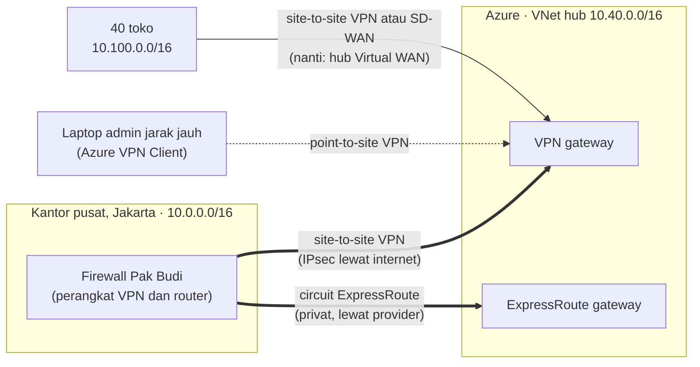
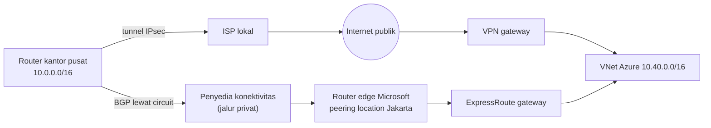
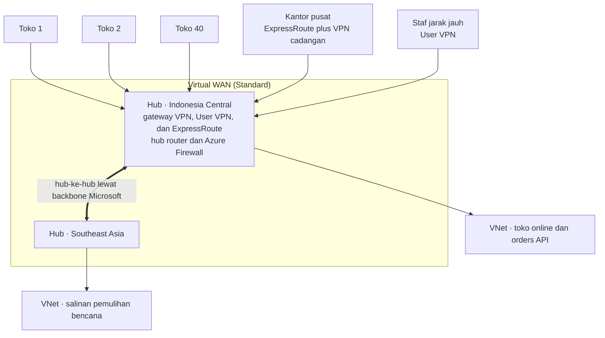

# Makan Siang 26 · Hybrid Connectivity: VPN Gateway, ExpressRoute, dan Virtual WAN (Lanjutan)

🇬🇧 [Read in English](README.md)

> **Jalur:** Bulan pendalaman · **Level:** Lanjutan · **Bagian 5:** Pendalaman
> **Waktu:** 60 menit · **Makan siang prasyarat:** 08 (Virtual Networking, Dasar), 25 (Virtual Networking, Lanjutan)
> **Area keterampilan AZ-900:** Di luar cakupan AZ-900
> **Lab:** [Lab 26 · Menghubungkan kantor pusat](../../labs/26-hybrid-connectivity/README.id.md) — sekitar 90 menit termasuk pembuatan gateway · biaya 💲💲💲
> **Penulis:** Stefanus Pinarta · [Tentang penulis](../../README.id.md#tentang-penulis)

| ⏱ Menit | Segmen |
|---:|---|
| 5 | Skenario dan tujuan |
| 25 | Bacaan |
| 15 | Demo: animasi interaktif (+ video panduan opsional) |
| 5 | Uji pemahaman |
| 5 | Poin penting dan pratinjau lab |
| 5 | Waktu cadangan — habiskan makan siang Anda 🍜 |

## 🍱 Menu hari ini

Setelah makan siang ini, Anda akan mampu:

- **Memilih** antara site-to-site VPN, point-to-site VPN, VNet-to-VNet, ExpressRoute, dan Virtual WAN untuk suatu
  kebutuhan.
- **Menjelaskan** bagaimana VPN gateway berbasis rute (route-based) dibangun: GatewaySubnet, IP publik, local network
  gateway, connection, IPsec/IKE, BGP, dan active-active.
- **Menentukan** SKU VPN Gateway yang berlaku saat ini, serta SKU circuit ExpressRoute, model penagihan, dan tingkat
  ketahanannya.
- **Merencanakan** ruang alamat yang tidak tumpang-tindih untuk kantor pusat, empat puluh toko, pengguna jarak jauh, dan
  Azure.

## 🏪 Sementara itu di Nusantara Retail

Orders API yang baru — API pesanan — berjalan di Azure pada 10.40.0.0/16, tetapi sistem gudang dan database keuangan
masih tinggal di ruang server Pak Budi di kantor pusat Jakarta, pada 10.0.0.0/16. Saat ini keduanya berkomunikasi lewat
public endpoint yang dilindungi daftar IP yang diizinkan (allow list) — dan daftar itu diedit Pak Budi dengan tangan.
Keempat puluh toko mengunggah data penjualan harian setiap malam melalui internet. Saat promo 12.12 yang lalu, unggahan
dari satu toko gagal tiga malam berturut-turut, dan tidak ada yang sadar sampai tim keuangan mencoba tutup buku akhir
bulan.

Pak Budi menginginkan "jalur privat yang layak, bukan tambal sulam". Ibu Sari ingin tahu tiga hal: apakah jalurnya
privat, apa yang terjadi kalau jalurnya putus, dan berapa biayanya setiap bulan?

Pertanyaan hari ini: **jalur privat mana yang sebaiknya menghubungkan kantor pusat dan toko-toko ke Azure — dan
bagaimana menjaganya tetap hidup ketika satu link gagal?**

---

## 📖 Bacaan (≈25 menit)

### 1. Mengapa hibrida, dan tiga keluarga koneksi

**Hybrid networking** (jaringan hibrida) menyambungkan jaringan yang Anda kelola sendiri — kantor pusat, toko, sebuah
pusat data — dengan virtual network (*jaringan virtual*) di Azure, sehingga mesin-mesin bisa saling menjangkau lewat
alamat IP privat seolah-olah berada dalam satu jaringan. Inilah wujud nyata dari hybrid cloud (*cloud hibrid*).
Nusantara Retail membutuhkannya karena migrasi berjalan bertahap: sistem gudang tetap di kantor pusat setidaknya satu
tahun lagi, sementara setiap layanan baru mendarat di Azure.

Azure menawarkan tiga keluarga konektivitas hibrida:

- **VPN Gateway** membangun tunnel (terowongan) terenkripsi melintasi internet publik — VPN adalah singkatan dari
  virtual private network. Cepat disiapkan, murah untuk memulai, dan bekerja di mana pun ada koneksi internet.
- **ExpressRoute** adalah koneksi privat ke jaringan Microsoft melalui penyedia konektivitas (connectivity provider).
  Koneksi ini tidak pernah melintasi internet publik dan kinerjanya dapat diprediksi, tetapi pemesanannya memakan
  waktu berminggu-minggu.
- **Virtual WAN** adalah hub yang dikelola Microsoft, yang menggabungkan koneksi VPN, ExpressRoute, dan virtual network
  dalam skala besar, untuk organisasi dengan banyak lokasi.

Ibaratnya mengirim dokumen penting dari kantor pusat ke gudang. VPN adalah koper bergembok yang dibawa lewat jalan umum:
isinya aman, tetapi waktu tempuhnya bergantung pada macet. ExpressRoute adalah jalur khusus seperti jalur busway: tidak
bercampur dengan kendaraan umum sehingga waktu tempuhnya bisa ditebak — tetapi kopernya tidak otomatis bergembok.
Ingat poin terakhir ini; kita akan kembali kepadanya di bagian 4.

**Rencanakan alamat lebih dulu.** Setiap desain hibrida akan rusak jika dua jaringan yang terhubung memakai alamat yang
sama: tidak ada router yang bisa menebak 10.0.1.10 mana yang Anda maksud. Bayangkan dua rumah di satu kota dengan
alamat persis sama, "Jl. Melati No. 10": kurir paket mana pun akan bingung harus mengantar ke rumah yang mana. Seperti
di Makan Siang 08, pilih rentang yang tidak akan pernah bertabrakan dan catat sebelum siapa pun membangun apa pun.
Rencana Nusantara Retail:

| Jaringan | Ruang alamat | Catatan |
|---|---|---|
| Kantor pusat (Jakarta) | 10.0.0.0/16 | Jaringan Pak Budi yang sudah ada; tidak bisa diubah |
| Hub dan workload Azure | 10.40.0.0/16 | Subnet gateway berada di sini |
| Toko | 10.100.0.0/16 | Satu /24 per toko (10.100.1.0/24 sampai 10.100.40.0/24), dengan ruang untuk tumbuh |
| Klien point-to-site | 172.16.200.0/24 | Alamat yang dibagikan ke laptop pengguna VPN |

Jika tumpang-tindih tidak bisa dihindari — misalnya Nusantara Retail membeli perusahaan yang jaringannya juga memakai
10.0.0.0/16 — VPN Gateway dapat menerjemahkan alamat salah satu sisi dengan aturan NAT (network address translation).
Anggap itu jalan terakhir: troubleshooting dan DNS jadi lebih sulit.

**Rencanakan juga resolusi nama.** Tunnel yang berfungsi baru separuh pekerjaan; nama juga harus bisa di-resolve di
kedua sisi. DNS bawaan Azure di 168.63.129.16 hanya menjawab dari dalam virtual network Azure, sehingga server kantor
pusat tidak bisa mengirim kueri ke sana melalui VPN. Jawaban yang umum adalah **Azure DNS Private Resolver** di hub
(Makan Siang 25): inbound endpoint-nya memungkinkan server DNS Pak Budi meneruskan pencarian untuk private zone Azure ke
dalam Azure, sedangkan outbound endpoint-nya, bersama sebuah forwarding ruleset, mengirim pencarian untuk domain
internal kantor pusat kembali ke server DNS miliknya.

### 2. VPN Gateway: tunnel terenkripsi lewat internet

**VPN gateway** adalah sekumpulan instance yang dikelola Microsoft, yang di-deploy Azure ke dalam subnet khusus di
virtual network Anda, yaitu **GatewaySubnet**. Namanya harus persis `GatewaySubnet`, tidak boleh ada apa pun lagi di
dalamnya, dan Anda tidak boleh memasang network security group padanya. Microsoft merekomendasikan /27 atau lebih
besar, supaya ada ruang untuk tambahan di kemudian hari, misalnya ExpressRoute gateway di sampingnya. Gateway mendapat
**IP publik Standard** (Standard public IP address): alamat yang dihubungi perangkat on-premises — perangkat di lokasi
Anda sendiri.

Dua resource (*sumber daya*) lagi melengkapi setup site-to-site:

- **Local network gateway** menggambarkan sisi seberang: IP publik perangkat VPN milik Pak Budi dan rentang alamat di
  belakangnya (10.0.0.0/16), atau setelan BGP-nya.
- **Connection** menghubungkan virtual network gateway dengan local network gateway dan menyimpan autentikasinya —
  biasanya berupa **pre-shared key** (kunci rahasia bersama) yang harus diketahui kedua sisi; autentikasi berbasis
  sertifikat juga tersedia.

Di dalam tunnel, **IKE** (Internet Key Exchange) menegosiasikan kunci dan **IPsec** mengenkripsi setiap paket. Kebijakan
IPsec/IKE default dari Azure cocok untuk sebagian besar perangkat, dan Anda bisa menetapkan kebijakan kustom jika tim
keamanan mensyaratkan algoritma tertentu.

**Bagaimana tunnel terbentuk.** Pertama, kedua ujung memakai IKE untuk membuktikan bahwa mereka memegang kunci yang sama
(atau saling memercayai sertifikat masing-masing) dan untuk menyepakati algoritma; hasilnya adalah *IKE security
association* — semacam surat kesepakatan berisi kunci dan algoritma yang disetujui kedua pihak. Melalui kanal yang
terlindungi itu, mereka menegosiasikan *IPsec security association*, yang membawa lalu lintas sebenarnya, dan mereka
memperbarui kunci secara terjadwal. Hanya jika kedua fase berhasil, status koneksi berubah dari **Connecting** menjadi
**Connected**. Sebagian besar tunnel yang gagal disebabkan ketidakcocokan: pre-shared key yang berbeda, algoritma yang
tidak diterima perangkat, atau rentang alamat yang tidak sejalan. Langkah diagnosis pertama Anda adalah status koneksi
serta penghitung byte ingress dan egress-nya; untuk kasus yang lebih sulit, VPN troubleshoot di Network Watcher dan
packet capture di gateway menunjukkan apa yang diusulkan masing-masing sisi.

Ibaratnya satpam kompleks dan kurir langganan yang punya kata sandi rahasia. Sebelum gerbang dibuka, keduanya memastikan
mereka tahu kata sandi yang sama — tanpa pernah meneriakkannya di jalan. Kalau satpam yang baru bertugas diberi kata
sandi yang berbeda, gerbang tetap tertutup, semulus apa pun jalan menuju kompleks itu.

**Route-based atau policy-based?** Gateway **route-based** mengirim lalu lintas apa pun yang cocok dengan rutenya ke
dalam tunnel; gateway **policy-based** hanya mengenkripsi lalu lintas di antara pasangan alamat yang sudah ditetapkan.
Pilih route-based: point-to-site, BGP, active-active, dan VNet-to-VNet semuanya membutuhkannya, dan policy-based hanya
ditawarkan pada SKU Basic. Firewall lama yang hanya mengenal VPN policy-based tetap bisa terhubung ke gateway
route-based dengan *policy-based traffic selectors*.

**Active-active dan BGP.** Secara default, gateway berjalan dalam mode **active-standby**: satu instance membawa tunnel
dan instance lainnya mengambil alih saat pemeliharaan atau kegagalan, dengan gangguan singkat. Dalam mode
**active-active**, setiap instance punya IP publik sendiri dan membawa tunnel sendiri, sehingga failover (perpindahan ke
instance lain saat terjadi masalah) jauh lebih mulus; inilah setup produksi yang direkomendasikan. **BGP** (Border
Gateway Protocol) memungkinkan gateway dan router Pak Budi bertukar rute secara otomatis alih-alih Anda mengetik prefix
satu per satu di local network gateway, dan BGP membuat banyak tunnel serta transit routing (meneruskan lalu lintas dari
satu jaringan ke jaringan lain) bisa berjalan. VPN gateway Azure memakai nomor AS (autonomous system, semacam nomor
identitas jaringan dalam BGP) privat 65515 kecuali Anda memilih yang lain.

**Satu gateway untuk banyak VNet.** Dalam jaringan hub-and-spoke (Makan Siang 25), hanya hub yang membutuhkan gateway.
Aktifkan *Allow gateway transit* di sisi hub pada setiap peering dan *Use remote gateways* di sisi spoke, maka setiap
spoke menjangkau kantor pusat melalui gateway VPN atau ExpressRoute milik hub — cukup satu gateway yang perlu dibayar
dan dipantau. Azure menambahkan prefix on-premises ke rute setiap subnet secara otomatis, dengan **virtual network
gateway** sebagai next hop; Anda akan melihat rute persis seperti itu di lab.

Tiga jenis koneksi VPN berbagi gateway yang sama:

| Jenis | Menghubungkan | Penggunaan di Nusantara Retail | Autentikasi | Yang perlu diwaspadai |
|---|---|---|---|---|
| **Site-to-site (S2S)** | Jaringan on-premises ke sebuah VNet, melalui perangkat VPN dengan IP publik | Kantor pusat sekarang, toko-toko nanti | Pre-shared key atau sertifikat | Perangkat harus kompatibel; kualitas internet membatasi kinerja |
| **Point-to-site (P2S)** | Satu komputer ke sebuah VNet, melalui VPN client | Pak Budi bekerja dari rumah; Rizky menjangkau VM privat | Microsoft Entra ID, sertifikat, atau RADIUS | Entra ID membutuhkan OpenVPN dan Azure VPN Client, serta tidak tersedia di SKU Basic; pool alamat klien tidak boleh tumpang-tindih |
| **VNet-to-VNet** | Dua virtual network, melalui gateway di masing-masing | Link terenkripsi antar-region; lab makan siang ini | Pre-shared key | Untuk lalu lintas Azure-ke-Azure, VNet peering (Makan Siang 25) biasanya lebih murah dan lebih cepat |

Point-to-site dengan **autentikasi Microsoft Entra ID** (*ID Microsoft Entra*) adalah pilihan modern untuk staf: orang
masuk dengan akun yang biasa mereka pakai, sehingga MFA (*autentikasi multifaktor*) dan Conditional Access (*Akses
Bersyarat*) ikut berlaku, dan tidak ada sertifikat klien yang harus diterbitkan lalu dicabut. Azure VPN Client berjalan
di Windows dan macOS.

Kesabaran adalah bagian dari desain. Membuat VPN gateway sering memakan waktu **45 menit atau lebih**, dan beberapa
perubahan, seperti beralih ke active-active, juga butuh waktu cukup lama. Rencanakan perubahan gateway jauh-jauh hari;
jangan klik lalu menunggu sambil berharap.

### 3. SKU VPN Gateway di 2026

**SKU** (tingkatan produk) gateway menentukan throughput (berapa banyak data yang bisa lewat per detik), jumlah tunnel
dan koneksi, serta fitur yang Anda dapat. Susunannya baru saja berubah, jadi tutorial lama bisa menyesatkan:

- Sejak 1 November 2025, Anda tidak bisa lagi membuat SKU non-zonal lama **VpnGw1–5**. Gateway yang sudah ada
  dipindahkan ke padanan zonalnya, dan SKU lama itu berstatus deprecated mulai 30 September 2026. SKU legacy Standard
  dan HighPerformance bahkan sudah lebih dulu pensiun, pada 30 September 2025.
- **SKU AZ**, yaitu **VpnGw1AZ sampai VpnGw5AZ**, adalah yang dipakai untuk setiap gateway baru. Di region (*wilayah*)
  yang punya availability zone (*zona ketersediaan*), gateway bersifat zone-redundant; di region tanpa zona, gateway
  di-deploy secara regional.
- **Basic** masih ada dan tidak akan pensiun, tetapi hanya untuk dev/test: tanpa BGP, tanpa IKEv2 atau OpenVPN untuk
  point-to-site, tanpa RADIUS, dan tanpa IPv6. SKU ini membutuhkan IP publik Standard dan hanya bisa dibuat dengan
  PowerShell atau CLI.

| SKU | Generasi | Tunnel site-to-site (maks.) | Gunakan untuk |
|---|---|---|---|
| Basic | 1 | 10 | Hanya dev/test dan proof of concept |
| VpnGw1AZ | 1 | 30 | Produksi kecil: satu kantor pusat dan beberapa cabang |
| VpnGw2AZ, VpnGw3AZ | 1 atau 2 | 30 | Throughput lebih besar dan lebih banyak pengguna point-to-site |
| VpnGw4AZ, VpnGw5AZ | 2 | 100 | Lingkungan besar; di atas 100 tunnel, gunakan Virtual WAN |

Saat tulisan ini dibuat, benchmark throughput agregat dari Microsoft berkisar dari sekitar 650 Mbps untuk VpnGw1AZ
hingga 10 Gbps untuk VpnGw5AZ. Angka itu adalah benchmark, bukan jaminan, dan satu tunnel saja mendapat lebih sedikit,
jadi periksa halaman SKU dan uji dengan lalu lintas Anda sendiri. Gateway ditagih untuk setiap jam keberadaannya, sejak
pembuatan dimulai, ada atau tidak ada lalu lintas, dan data yang keluar dari Azure dikenai biaya tambahan. Tidak ada
tombol jeda: untuk berhenti membayar, Anda harus menghapus gateway.

Ibaratnya parkir di mal: argo berjalan selama mobil ada di dalam gedung, entah mobil itu dipakai atau hanya diam di
tempat, dan satu-satunya cara menghentikan argo adalah keluar dari area parkir.

> [!WARNING]
> **SKU default CLI adalah Basic.** `az network vnet-gateway create` tanpa `--sku` diam-diam membuat gateway Basic —
> tanpa BGP, tanpa Entra ID untuk point-to-site, dan hanya didukung untuk dev/test. Selalu sertakan `--sku` (misalnya
> `VpnGw1AZ`). Dua kesalahan klasik lainnya: memasang network security group atau rute 0.0.0.0/0 di GatewaySubnet, dan
> menghubungkan jaringan yang ruang alamatnya tumpang-tindih.

### 4. ExpressRoute: jalur privat ke jaringan Microsoft

**ExpressRoute** menghubungkan jaringan Anda ke Microsoft melalui **penyedia konektivitas** (connectivity provider),
seperti perusahaan telekomunikasi atau exchange, di sebuah **lokasi ExpressRoute** (disebut juga peering location):
sebuah fasilitas kolokasi, yaitu gedung tempat banyak perusahaan menaruh perangkat jaringannya berdampingan, termasuk
router edge milik Microsoft. Saat tulisan ini dibuat, Jakarta punya beberapa lokasi, termasuk opsi Jakarta Metro. Lalu
lintas berjalan dari router Pak Budi melintasi jaringan penyedia menuju edge Microsoft, tanpa menyentuh internet publik.

- **Circuit** adalah koneksi logisnya, yang dikenali lewat **service key** — sebuah GUID (pengenal unik) yang Anda
  serahkan ke penyedia, bukan sebuah rahasia. Setiap circuit punya dua koneksi ke dua router edge Microsoft sebagai
  redundansi bawaan, dan rute dipertukarkan dengan BGP. Bandwidth melalui penyedia berkisar dari 50 Mbps hingga 10 Gbps.
- **Azure private peering** menjangkau virtual network Anda pada alamat privat melalui **ExpressRoute gateway** di VNet
  (ErGw1Az, ErGw2Az, ErGw3Az, atau ErGwScale yang bisa diskalakan). **Microsoft peering** menjangkau layanan publik
  Microsoft, seperti endpoint layanan PaaS (*platform sebagai layanan*) Azure dan, dalam skenario tertentu, Microsoft
  365, melalui alamat publik milik Anda.
- **SKU circuit:** **Local** (hanya region Azure di dekat peering location, transfer data sudah termasuk dalam harga
  port), **Standard** (semua region di area geopolitik yang sama), dan **Premium** (seluruh dunia, dengan lebih banyak
  rute dan lebih banyak link VNet). Penagihannya **metered** (bayar per GB yang keluar) atau **unlimited** (biaya
  tetap); Anda bisa beralih dari metered ke unlimited, tetapi tidak sebaliknya.
- **ExpressRoute Direct** melewati penyedia: port ganda 10, 100, atau 400 Gbps langsung ke jaringan Microsoft.
- **Global Reach** menghubungkan lokasi-lokasi Anda sendiri satu sama lain melalui circuit masing-masing, lewat backbone
  Microsoft. **FastPath** mengirim lalu lintas langsung ke VM (*komputer virtual*), melewati gateway (membutuhkan
  ErGw3Az atau ErGwScale).

**Memesan circuit** mengikuti urutan yang tetap. Anda membuat circuit di Azure — penyedia, peering location, bandwidth,
SKU, dan model penagihan — lalu menerima service key-nya. Penyedia memakai key itu untuk menyiapkan sisinya, dan provider
status circuit berubah menjadi *Provisioned*. Kemudian Anda (atau penyedia) mengonfigurasi Azure private peering dengan
BGP, membuat ExpressRoute gateway di GatewaySubnet milik hub, dan menautkan virtual network ke circuit dengan sebuah
connection. Virtual network di subscription (*langganan*) lain juga bisa ditautkan, menggunakan authorization yang
dibuat oleh pemilik circuit.

**Ketahanan** (resiliency) hadir dalam tiga tingkat. Ketahanan **Standard** adalah satu circuit di satu lokasi: dua
koneksi, tetapi satu gedung. Ketahanan **High**, yaitu **ExpressRoute Metro**, membagi satu circuit ke dua lokasi di
kota yang sama. Ketahanan **Maximum** memakai dua circuit di dua peering location yang berbeda — rekomendasi Microsoft
untuk workload kritis. Banyak organisasi juga mempertahankan **site-to-site VPN sebagai jalur cadangan**, karena VPN
gateway dan ExpressRoute gateway bisa berdampingan di virtual network yang sama.

> [!IMPORTANT]
> **Privat tidak sama dengan terenkripsi.** ExpressRoute menjauhkan lalu lintas dari internet, tetapi tidak
> mengenkripsinya secara default — seperti jalur busway tadi: jalannya khusus, tetapi kopernya tidak otomatis bergembok.
> Ketika data harus terenkripsi selama transit, gunakan TLS (enkripsi yang juga dipakai HTTPS) di aplikasi, MACsec
> (enkripsi pada sambungan fisik) di ExpressRoute Direct, atau VPN IPsec di atas private peering.

| | Site-to-site VPN | ExpressRoute |
|---|---|---|
| Jalur | Tunnel terenkripsi melintasi internet publik | Koneksi privat melalui penyedia; tidak pernah lewat internet |
| Enkripsi | IPsec, selalu | Tidak secara default (tambahkan TLS, MACsec, atau IPsec) |
| Bandwidth | Hingga throughput SKU gateway, dibagi oleh semua tunnel | 50 Mbps hingga 10 Gbps per circuit; port hingga 400 Gbps dengan Direct |
| Latensi dan jitter (naik-turunnya jeda) | Berubah-ubah mengikuti kondisi internet | Dapat diprediksi |
| Waktu penyiapan | Hitungan jam, ditambah 45 menit atau lebih untuk gateway | Berminggu-minggu, selama penyedia menyiapkan circuit |
| Model biaya | Gateway per jam, ditambah data keluar | Circuit per bulan (plus data jika metered), gateway per jam, biaya penyedia |
| Redundansi | Gateway active-active, dua perangkat on-premises | Dua koneksi per circuit; Metro atau lokasi kedua untuk ketahanan lebih tinggi |
| Paling cocok untuk | Memulai, lokasi kecil, jalur cadangan | Lalu lintas yang besar, stabil, dan kritis bagi bisnis |

### 5. Virtual WAN: hub untuk banyak lokasi

Empat puluh toko, satu kantor pusat, staf jarak jauh, dan virtual network yang terus bertambah di dua region: dengan
VPN gateway biasa, Anda harus mengelola puluhan koneksi, local network gateway, dan peering, serta membangun transit
routing sendiri. **Azure Virtual WAN** — WAN adalah wide area network, jaringan yang membentang antar-lokasi berjauhan —
mengubah semua itu menjadi layanan terkelola. Anda membuat sebuah **virtual WAN** dan sebuah **virtual hub** di setiap
region yang Anda pakai. Hub adalah virtual network yang dikelola Microsoft, berisi gateway untuk site-to-site VPN,
point-to-site (disebut *User VPN*), dan ExpressRoute, ditambah router yang menyediakan **transit any-to-any**: toko ke
kantor pusat, toko ke VNet, VNet ke VNet. Hub-hub dalam virtual WAN yang sama saling terhubung dalam full mesh lewat
backbone Microsoft. **Secured virtual hub** menambahkan Azure Firewall untuk inspeksi terpusat, dan partner SD-WAN
(software-defined WAN) dapat mengotomatiskan koneksi toko, sehingga router toko baru membangun tunnel-nya sendiri.

Ibaratnya terminal bus terpadu: daripada setiap toko membuka trayek sendiri ke setiap tujuan, semua cukup masuk ke
terminal, dan pengelola terminal yang mengatur perpindahannya.

Virtual WAN hadir dalam dua jenis. **Basic** hanya mendukung site-to-site VPN. **Standard** menambahkan ExpressRoute,
User VPN, transit antar-VNet dan antar-hub, Azure Firewall, dan network virtual appliance. Anda bisa meng-upgrade dari
Basic ke Standard, tetapi tidak sebaliknya.

> [!TIP]
> Jangan buru-buru memakai gateway ketika dua virtual network Azure hanya perlu saling bicara: **VNet peering** (Makan
> Siang 25) lebih murah, lebih cepat, dan tidak memerlukan gateway. Gunakan VPN VNet-to-VNet hanya jika Anda memang
> menginginkan IPsec di antara keduanya — atau, seperti di lab makan siang ini, untuk melatih koneksi site-to-site tanpa
> perangkat keras sungguhan.

### 6. Bagaimana semuanya menyatu untuk Nusantara Retail

Rekomendasi Anda untuk Ibu Sari terbagi dalam tiga fase:

1. **Sekarang — site-to-site VPN.** Gateway VpnGw1AZ dalam mode active-active di VNet hub (10.40.0.0/16, Indonesia
   Central), BGP dengan firewall Pak Budi, dan point-to-site dengan Microsoft Entra ID untuk tim TI. Bisa aktif dalam
   hitungan hari, dan biayanya berupa jam gateway ditambah data keluar.
2. **Kuartal depan — ExpressRoute untuk kantor pusat.** Circuit Standard dengan data unlimited, dari peering location
   Jakarta ke Indonesia Central, untuk sinkronisasi gudang setiap malam. VPN tetap menjadi jalur cadangan. Jika kelak
   bisnis membutuhkan lebih, ExpressRoute Metro atau circuit kedua di lokasi lain akan menaikkan tingkat ketahanan.
3. **Saat toko-toko bergabung — Virtual WAN Standard.** Perangkat SD-WAN di setiap toko terhubung ke hub Indonesia
   Central, secured hub menginspeksi lalu lintas toko, dan rencana alamat dari bagian 1 menjaga setiap toko tidak
   bertabrakan dengan kantor pusat maupun Azure.

Tiga pertanyaan Ibu Sari kini punya jawaban. Privat: VPN mengenkripsi lalu lintas yang melintasi internet, dan
ExpressRoute tidak lewat internet sama sekali (dengan enkripsi ditambahkan di mana data membutuhkannya). Tangguh:
gateway active-active, dua koneksi per circuit, dan VPN cadangan. Biaya: sebagian besar berupa biaya tetap per jam dan
per bulan yang bisa Anda perkirakan di pricing calculator (*kalkulator harga*) sebelum menandatangani apa pun.

Apa pun yang Anda bangun, pantau terus. VPN gateway memublikasikan metrik seperti bandwidth tunnel dan status BGP peer
ke Azure Monitor, sehingga Anda bisa memunculkan alert (*pemberitahuan*) begitu sebuah tunnel putus (Makan Siang 16).
Circuit ExpressRoute melaporkan ketersediaan dan throughput, dan Connection Monitor bisa menguji jalurnya dari ujung ke
ujung, dari VM di Azure sampai ke server di kantor pusat. Toko yang unggahannya gagal tiga malam berturut-turut itu akan
memicu alert sejak malam pertama.

> [!NOTE]
> **Renungkan sejenak:** saat promo 12.12 berikutnya, jalur internet kantor pusat putus selama 30 menit. Jika hanya
> ada site-to-site VPN, apa yang berhenti berfungsi? Bagaimana jika ada ExpressRoute plus VPN cadangan? Dan apa yang
> tetap gagal jika seluruh gedung kantor pusat kehilangan listrik?

Di Makan Siang 27, Anda beralih dari tepi jaringan ke toko online itu sendiri, dengan Application Gateway, Front Door,
dan Traffic Manager.

---

## 🎬 Demo (≈15 menit)

1. **Animasi interaktif (≈6–8 menit):** [Buka demo](https://stefpin.github.io/azure-fundamentals-lunches/demos/26-hybrid-connectivity.html?lang=id) —
   tekan ▶ Putar atau telusuri langkah demi langkah sesuai kecepatan Anda. Sedang offline? Unduh
   [`docs/demos/26-hybrid-connectivity.html`](../../docs/demos/26-hybrid-connectivity.html) lalu buka di browser apa pun.
2. **Video panduan (≤ 6 menit):** _segera hadir_ — [baca naskah video](demo-video-script.id.md).

Yang perlu diperhatikan:

- Tidak ada yang menyeberang sebelum kedua sisi sepakat: IKE bernegosiasi lebih dulu, baru kemudian IPsec membawa lalu
  lintasnya.
- Paket yang sama menempuh dua rute yang sangat berbeda: melintasi internet publik, atau melalui jalur privat
  ExpressRoute.
- Dengan hub Virtual WAN, sebuah toko menjangkau kantor pusat dan Azure melalui satu router terkelola, bukan lewat
  jaring-jaring tunnel.

## ✅ Uji pemahaman (≈5 menit)

1. Pak Budi membutuhkan server gudang di kantor pusat bisa menjangkau Azure secara privat paling lambat minggu depan,
   dengan anggaran yang terbatas. VPN atau ExpressRoute?
   

Lihat jawaban

   Site-to-site VPN ke gateway route-based dengan SKU AZ (misalnya VpnGw1AZ). Ini hanya membutuhkan koneksi internet dan
   perangkat yang kompatibel, sedangkan ExpressRoute membutuhkan penyedia untuk menyiapkan circuit, yang memakan waktu
   berminggu-minggu. *Alasannya:* VPN adalah cara cepat dengan komitmen rendah untuk memulai; ExpressRoute bisa menyusul
   kemudian.

   

2. Rizky harus menjangkau alamat IP privat sebuah VM dari rumah, dengan masuk memakai akun Entra ID dan MFA. Apa yang
   Anda siapkan?
   

Lihat jawaban

   Point-to-site VPN dengan autentikasi Microsoft Entra ID (OpenVPN dan Azure VPN Client) di gateway route-based yang
   bukan Basic, dengan pool alamat klien yang tidak tumpang-tindih dengan apa pun. *Alasannya:* autentikasi Entra ID
   membawa MFA dan Conditional Access ke VPN, tanpa sertifikat klien yang harus dikelola.

   

3. Skrip milik seorang rekan menjalankan `az network vnet-gateway create --gateway-type Vpn --vpn-type RouteBased …`
   tanpa `--sku`. Seminggu kemudian, upaya mengaktifkan BGP gagal. Mengapa?
   

Lihat jawaban

   Tanpa `--sku`, CLI membuat gateway **Basic**, dan Basic tidak mendukung BGP. Buat gateway dengan SKU AZ seperti
   `--sku VpnGw1AZ`. *Alasannya:* SKU default CLI adalah Basic, yang hanya ditujukan untuk dev/test.

   

4. Tim keuangan bertanya apakah lalu lintas di circuit ExpressRoute yang direncanakan akan terenkripsi. Apa jawaban
   Anda?
   

Lihat jawaban

   Tidak secara default. ExpressRoute adalah jalur privat yang tidak pernah melintasi internet, tetapi tidak
   terenkripsi. Gunakan TLS di aplikasi, MACsec di ExpressRoute Direct, atau VPN IPsec di atas private peering.
   *Alasannya:* privat dan terenkripsi adalah dua sifat yang berbeda.

   

5. Empat puluh toko, kantor pusat, staf jarak jauh, dan VNet di dua region membutuhkan konektivitas any-to-any, dengan
   firewall yang menginspeksi lalu lintas toko secara terpusat. Virtual WAN Basic atau Standard?
   

Lihat jawaban

   Standard. Basic hanya mendukung site-to-site VPN; Standard menambahkan User VPN, ExpressRoute, transit antar-VNet dan
   antar-hub, serta Azure Firewall di secured hub. *Alasannya:* transit any-to-any dan inspeksi terpusat adalah fitur
   Standard.

   

## 🧠 Poin penting

- Rencanakan ruang alamat yang tidak tumpang-tindih sebelum Anda membangun link hibrida apa pun — jaringan yang
  tumpang-tindih tidak bisa dirutekan.
- VPN Gateway membangun tunnel IPsec melalui internet: site-to-site untuk lokasi, point-to-site (idealnya dengan Entra
  ID) untuk orang, VNet-to-VNet di antara VNet. Di produksi, gunakan route-based, SKU AZ, active-active, dan BGP.
- Gateway butuh 45 menit atau lebih untuk dibuat dan ditagih setiap jam keberadaannya; Basic hanya untuk dev/test dan
  merupakan SKU default CLI.
- ExpressRoute adalah koneksi privat yang dapat diprediksi melalui penyedia — tidak terenkripsi secara default. Pilih
  Local, Standard, atau Premium, metered atau unlimited, dan rancang ketahanan dengan Metro, lokasi kedua, dan VPN
  cadangan.
- Virtual WAN Standard memberi Anda hub terkelola dengan transit any-to-any untuk banyak cabang; Basic hanya melayani
  site-to-site.

## 🗒️ Catatan lapangan dari Stefanus

> **Jalur cadangan yang belum pernah dicoba hanyalah kabar burung.** Setiap kali sebuah desain menulis "VPN sebagai
> cadangan ExpressRoute", saya mengajukan dua pertanyaan. Pertama: kapan terakhir kali kita sengaja pindah ke jalur
> cadangan? Saya ingin uji terjadwal di jam sepi — circuit dinonaktifkan sementara, lalu kita lihat lalu lintas
> berpindah ke tunnel, pastikan sinkronisasi malam tetap selesai, kemudian kembalikan. Kedua: dari mana kita tahu bahwa
> kita sedang berjalan di jalur cadangan? Tunnel yang diam-diam memikul semua beban selama berminggu-minggu tetap tampak
> sehat di setiap dashboard, jadi saya minta alert untuk circuit-nya sendiri, bukan hanya untuk tunnel. Terakhir, saya
> selalu bertanya di mana kedua jalur itu bertemu secara fisik. Kalau keduanya keluar dari kantor pusat lewat router yang
> sama, listrik yang sama, atau galian kabel yang sama, itu bukan dua jalur — itu satu jalur dengan dua tagihan.

## 🔬 Lab Anda: Menghubungkan kantor pusat

`setup.sh` membangun dua virtual network — jaringan Azure milik Nusantara Retail (10.40.0.0/16) dan kantor pusat
simulasi (10.0.0.0/16) — masing-masing dengan GatewaySubnet dan sebuah VM kecil, lalu mulai membuat dua gateway
route-based **VpnGw1AZ**. Selagi gateway dibangun (30–45 menit, dengan daftar bacaan untuk mengisi waktu), Anda
memeriksa bahwa kedua jaringan belum bisa saling menjangkau. Kemudian Anda membuat koneksi VNet-to-VNet di kedua arah
dengan shared key yang dibuat saat runtime, menyaksikan statusnya mencapai **Connected**, mengirim lalu lintas ping dan
HTTP melalui tunnel, dan memeriksa effective routes. Tugas opsional membandingkan hasilnya dengan VNet peering. Gateway
menimbulkan biaya setiap jam, jadi lab diakhiri dengan pembersihan segera.

- ⏱ Sekitar 90 menit, termasuk pembuatan gateway · 💲💲💲 · bisa dikerjakan terpisah (tidak memerlukan lab sebelumnya)
- 👉 [Mulai Lab 26](../../labs/26-hybrid-connectivity/README.id.md)

## 📚 Pelajari lebih lanjut

- [Microsoft Learn: Tentang SKU gateway](https://learn.microsoft.com/azure/vpn-gateway/about-gateway-skus) — SKU VPN Gateway saat ini, jumlah tunnel, benchmark throughput, dan fiturnya.
- [Microsoft Learn: Konsolidasi dan migrasi SKU VPN Gateway](https://learn.microsoft.com/azure/vpn-gateway/gateway-sku-consolidation) — perpindahan dari SKU non-zonal ke SKU AZ, lengkap dengan tanggal dan FAQ.
- [Microsoft Learn: Apa itu Azure ExpressRoute?](https://learn.microsoft.com/azure/expressroute/expressroute-introduction) — circuit, peering, SKU, model penagihan, Direct, dan Global Reach.
- [Microsoft Learn: Apa itu Azure Virtual WAN?](https://learn.microsoft.com/azure/virtual-wan/virtual-wan-about) — hub, Basic versus Standard, dan konektivitas transit.

---

⬅️ [Makan Siang 25 · Virtual Networking (Lanjutan)](../25-networking-advanced/README.id.md) · 🏠 [Beranda kursus](../../README.id.md) · [Makan Siang 27 · Load Balancing (Lanjutan): Application Gateway, Front Door, dan Traffic Manager](../27-load-balancing-advanced/README.id.md) ➡️

Terakhir divalidasi: Oktober 2026 · Menemukan informasi yang sudah usang? [Buka issue](../../CONTRIBUTING.md).
