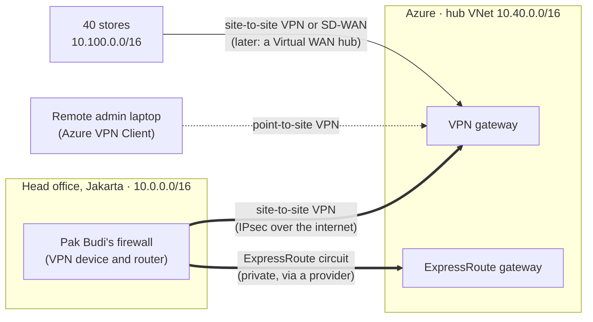
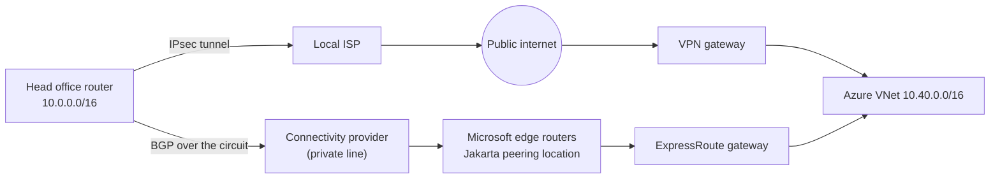
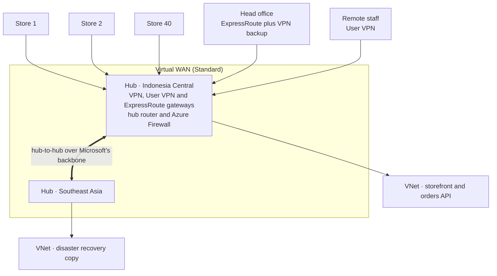

# Lunch 26 · Hybrid Connectivity: VPN Gateway, ExpressRoute and Virtual WAN (Advanced)

🇮🇩 [Baca dalam Bahasa Indonesia](README.id.md)

> **Track:** Deep-dive month · **Level:** Advanced · **Part 5:** Deep dives
> **Time:** 60 minutes · **Prerequisite lunches:** 08 (Virtual Networking, Basic), 25 (Virtual Networking, Advanced)
> **AZ-900 skill area:** Beyond AZ-900
> **Lab:** [Lab 26 · Connect head office](../../labs/26-hybrid-connectivity/README.md) — about 90 minutes including gateway creation · cost 💲💲💲
> **Author:** Stefanus Pinarta · [About the author](../../README.md#about-the-author)

| ⏱ Minutes | Segment |
|---:|---|
| 5 | Scenario and objectives |
| 25 | Reading |
| 15 | Demo: interactive animation (+ optional walkthrough video) |
| 5 | Knowledge check |
| 5 | Key takeaways and lab preview |
| 5 | Buffer — finish your lunch 🍜 |

## 🍱 Today's menu

By the end of this lunch you will be able to:

- **Choose** between site-to-site VPN, point-to-site VPN, VNet-to-VNet, ExpressRoute and Virtual WAN for a requirement.
- **Explain** how a route-based VPN gateway is built: GatewaySubnet, public IP, local network gateway, connection,
  IPsec/IKE, BGP and active-active.
- **Pick** a current VPN Gateway SKU, and an ExpressRoute circuit SKU, billing model and resiliency level.
- **Plan** non-overlapping address space for head office, forty stores, remote users and Azure.

## 🏪 Meanwhile at Nusantara Retail

The new orders API runs in Azure on 10.40.0.0/16, but the warehouse system and the finance database still live in Pak
Budi's server room at head office in Jakarta, on 10.0.0.0/16. Today the two talk through a public endpoint protected by
an IP allow list that Pak Budi edits by hand. The forty stores upload the day's sales every night across the internet.
During the last 12.12 sale, one store's upload failed three nights in a row, and nobody noticed until finance tried to
close the month.

Pak Budi wants "a proper private line". Ibu Sari wants to know three things: is it private, what happens when the line
goes down, and what will it cost every month?

Today's question: **which private path should connect head office and the stores to Azure — and how do you keep it up
when one link fails?**

---

## 📖 Reading (≈25 minutes)

### 1. Why hybrid, and the three families of connections

**Hybrid networking** joins networks you run yourself — head office, stores, a datacenter — to virtual networks in Azure,
so that machines reach each other on private IP addresses as if they shared one network. Nusantara Retail needs it
because migration is gradual: the warehouse system stays at head office for at least another year, while every new
service lands in Azure.

Azure offers three families of hybrid connectivity:

- **VPN Gateway** builds encrypted tunnels across the public internet. It's quick to set up, cheap to start and works
  wherever there is an internet connection.
- **ExpressRoute** is a private connection into Microsoft's network through a connectivity provider. It never crosses
  the public internet and performs predictably, but ordering one takes weeks.
- **Virtual WAN** is a Microsoft-managed hub that combines VPN, ExpressRoute and virtual network connections at scale,
  for organisations with many sites.

**Plan the addresses first.** Every hybrid design breaks if two connected networks use the same addresses: no router
can tell which 10.0.1.10 you mean. As in Lunch 08, pick ranges that will never collide and write them down before
anyone builds anything. Nusantara Retail's plan:

| Network | Address space | Notes |
|---|---|---|
| Head office (Jakarta) | 10.0.0.0/16 | Pak Budi's existing network; it can't change |
| Azure hub and workloads | 10.40.0.0/16 | The gateway subnets live here |
| Stores | 10.100.0.0/16 | One /24 per store (10.100.1.0/24 to 10.100.40.0/24), with room to grow |
| Point-to-site clients | 172.16.200.0/24 | Addresses handed to VPN users' laptops |

If an overlap can't be avoided — say Nusantara Retail buys a company whose network also uses 10.0.0.0/16 — VPN Gateway
can translate one side's addresses with NAT rules. Treat that as a last resort: it makes troubleshooting and DNS harder.

**Plan name resolution, too.** A working tunnel is only half the job; names must resolve on both sides. Azure's
built-in DNS at 168.63.129.16 answers only from inside Azure virtual networks, so head-office servers can't query it
across a VPN. The usual answer is **Azure DNS Private Resolver** in the hub (Lunch 25): its inbound endpoint lets Pak
Budi's DNS servers forward lookups for Azure private zones into Azure, and its outbound endpoint, with a forwarding
ruleset, sends lookups for head office's internal domain back to his DNS servers.

### 2. VPN Gateway: encrypted tunnels over the internet

A **VPN gateway** is a set of Microsoft-managed instances that Azure deploys into a special subnet of your virtual
network, the **GatewaySubnet**. The name must be exactly `GatewaySubnet`, nothing else may live in it, and you must not
attach a network security group to it. Microsoft recommends /27 or larger, which leaves room for later additions such
as an ExpressRoute gateway alongside. The gateway gets a **Standard public IP address**: the address the on-premises
device connects to.

Two more resources complete a site-to-site setup:

- A **local network gateway** describes the other side: the public IP address of Pak Budi's VPN device and the address
  ranges behind it (10.0.0.0/16), or its BGP settings.
- A **connection** joins the virtual network gateway to the local network gateway and holds the authentication —
  usually a **pre-shared key** that both sides must know; certificate-based authentication is also available.

Inside the tunnel, **IKE** (Internet Key Exchange) negotiates keys and **IPsec** encrypts every packet. Azure's
default IPsec/IKE policies suit most devices, and you can set a custom policy when a security team requires specific
algorithms.

**How a tunnel comes up.** First the two ends use IKE to prove that they share the same key (or trust each other's
certificates) and to agree on algorithms; the result is an *IKE security association*. Over that protected channel
they negotiate *IPsec security associations*, which carry the actual traffic, and they renew the keys on a schedule.
Only when both phases succeed does the connection status change from **Connecting** to **Connected**. Most failed
tunnels come from a mismatch: a different pre-shared key, algorithms the device doesn't accept, or address ranges that
don't line up. Your first diagnostics are the connection status and its ingress and egress byte counters; for harder
cases, Network Watcher's VPN troubleshoot and the gateway's packet capture show what each side proposed.

**Route-based or policy-based?** A **route-based** gateway sends any traffic that matches its routes into the tunnel; a
**policy-based** gateway encrypts only traffic between fixed address pairs. Choose route-based: point-to-site, BGP,
active-active and VNet-to-VNet all need it, and policy-based is offered only on the Basic SKU. An older firewall that
speaks only policy-based VPN can still connect to a route-based gateway with *policy-based traffic selectors*.

**Active-active and BGP.** By default a gateway runs **active-standby**: one instance carries the tunnels and the other
takes over during maintenance or a failure, with a short interruption. In **active-active** mode each instance has its
own public IP and carries its own tunnel, so failover is much smoother; it's the recommended production setup. **BGP**
(Border Gateway Protocol) lets the gateway and Pak Budi's router exchange routes automatically instead of you typing
prefixes into the local network gateway, and it makes multiple tunnels and transit routing work. Azure VPN gateways use
the private AS number 65515 unless you choose another.

**One gateway for many VNets.** In a hub-and-spoke network (Lunch 25), only the hub needs a gateway. Turn on *Allow
gateway transit* on the hub's side of each peering and *Use remote gateways* on the spoke's side, and every spoke
reaches head office through the hub's VPN or ExpressRoute gateway — one gateway to pay for and monitor. Azure adds the
on-premises prefixes to every subnet's routes automatically, with **virtual network gateway** as the next hop; you'll
see exactly such a route in the lab.

Three kinds of VPN connection share the same gateway:

| Type | Connects | Nusantara Retail use | Authentication | Watch out for |
|---|---|---|---|---|
| **Site-to-site (S2S)** | An on-premises network to a VNet, through a VPN device with a public IP | Head office now, stores later | Pre-shared key or certificates | The device must be compatible; internet quality limits performance |
| **Point-to-site (P2S)** | One computer to a VNet, through a VPN client | Pak Budi working from home; Rizky reaching a private VM | Microsoft Entra ID, certificates or RADIUS | Entra ID needs OpenVPN and the Azure VPN Client, and isn't available on the Basic SKU; the client pool must not overlap |
| **VNet-to-VNet** | Two virtual networks, through a gateway in each | Encrypted links between regions; this lunch's lab | Pre-shared key | For Azure-to-Azure traffic, VNet peering (Lunch 25) is usually cheaper and faster |

Point-to-site with **Microsoft Entra ID authentication** is the modern choice for staff: people sign in with their
normal account, so MFA and Conditional Access apply, and there are no client certificates to issue and revoke. The
Azure VPN Client runs on Windows and macOS.

Patience is part of the design. Creating a VPN gateway often takes **45 minutes or more**, and some changes, such as
switching to active-active, take a while too. Plan gateway changes in advance; don't click and wait.

### 3. VPN Gateway SKUs in 2026

The gateway **SKU** sets throughput, the number of tunnels and connections, and the features you get. The line-up
changed recently, so older tutorials can mislead you:

- Since 1 November 2025 you can't create the old non-zonal **VpnGw1–5** SKUs. Existing ones move to their zonal
  equivalents, and the old SKUs are deprecated from 30 September 2026. The legacy Standard and HighPerformance SKUs went
  even earlier, on 30 September 2025.
- The **AZ SKUs**, **VpnGw1AZ to VpnGw5AZ**, are the ones to use for every new gateway. In a region with availability
  zones the gateway is zone-redundant; in a region without zones it is deployed regionally.
- **Basic** still exists and isn't retiring, but it's for dev/test only: no BGP, no IKEv2 or OpenVPN for point-to-site,
  no RADIUS and no IPv6. It needs a Standard public IP and can only be created with PowerShell or the CLI.

| SKU | Generation | Site-to-site tunnels (max) | Use it for |
|---|---|---|---|
| Basic | 1 | 10 | Dev/test and proofs of concept only |
| VpnGw1AZ | 1 | 30 | Small production: one head office and a few branches |
| VpnGw2AZ, VpnGw3AZ | 1 or 2 | 30 | More throughput and more point-to-site users |
| VpnGw4AZ, VpnGw5AZ | 2 | 100 | Large estates; beyond 100 tunnels, use Virtual WAN |

At the time of writing, Microsoft's aggregate throughput benchmarks run from about 650 Mbps for VpnGw1AZ to 10 Gbps for
VpnGw5AZ. They are benchmarks, not guarantees, and a single tunnel gets less, so check the SKU page and test with your
own traffic. A gateway bills for every hour it exists, from the moment creation starts, whether or not traffic flows,
and data leaving Azure is charged on top. There is no pause button: to stop paying, you delete the gateway.

> [!WARNING]
> **The CLI's default SKU is Basic.** `az network vnet-gateway create` without `--sku` quietly creates a Basic gateway —
> no BGP, no Entra ID for point-to-site, dev/test support only. Always pass `--sku` (for example `VpnGw1AZ`). Two more
> classic mistakes: putting a network security group or a 0.0.0.0/0 route on the GatewaySubnet, and connecting networks
> whose address spaces overlap.

### 4. ExpressRoute: a private line into Microsoft's network

**ExpressRoute** connects your network to Microsoft through a **connectivity provider**, such as a telco or an
exchange, at an **ExpressRoute location** (also called a peering location): a colocation facility where Microsoft's
edge routers sit. Jakarta has several at the time of writing, including a Jakarta Metro option. Traffic goes from Pak
Budi's router across the provider's network to Microsoft's edge, without touching the public internet.

- The **circuit** is the logical connection, identified by a **service key** — a GUID you hand to the provider, not a
  secret. Every circuit has two connections to two Microsoft edge routers for built-in redundancy, and routes are
  exchanged with BGP. Bandwidths through providers range from 50 Mbps to 10 Gbps.
- **Azure private peering** reaches your virtual networks on private addresses through an **ExpressRoute gateway** in the
  VNet (ErGw1Az, ErGw2Az, ErGw3Az or the scalable ErGwScale). **Microsoft peering** reaches Microsoft's public services,
  such as Azure PaaS endpoints and, in specific scenarios, Microsoft 365, over public addresses you own.
- **Circuit SKUs:** **Local** (only Azure regions near the peering location, data transfer included in the port price),
  **Standard** (all regions in the same geopolitical area) and **Premium** (worldwide, with more routes and more VNet
  links). Billing is **metered** (pay per GB going out) or **unlimited** (flat fee); you can switch from metered to
  unlimited but not back.
- **ExpressRoute Direct** skips the provider: dual 10, 100 or 400 Gbps ports straight into Microsoft's network.
- **Global Reach** links your own sites to each other through their circuits over Microsoft's backbone. **FastPath**
  sends traffic straight to the VMs, bypassing the gateway (it needs ErGw3Az or ErGwScale).

**Ordering a circuit** follows a fixed sequence. You create the circuit in Azure — provider, peering location,
bandwidth, SKU and billing model — and receive its service key. The provider uses the key to provision its side, and
the circuit's provider status changes to *Provisioned*. Then you (or the provider) configure Azure private peering with
BGP, create an ExpressRoute gateway in the hub's GatewaySubnet, and link the virtual network to the circuit with a
connection. Virtual networks in other subscriptions can be linked too, using an authorization that the circuit's owner
creates.

**Resiliency** comes in three levels. **Standard** resiliency is one circuit at one location: two connections, but one
building. **High** resiliency, **ExpressRoute Metro**, splits one circuit across two sites in the same city.
**Maximum** resiliency uses two circuits at two different peering locations — Microsoft's recommendation for critical
workloads. Many organisations also keep a **site-to-site VPN as a backup** path, because VPN and ExpressRoute gateways
can coexist in the same virtual network.

> [!IMPORTANT]
> **Private is not the same as encrypted.** ExpressRoute keeps traffic off the internet, but it doesn't encrypt it by
> default. When data must be encrypted in transit, use TLS in the application, MACsec on ExpressRoute Direct, or an
> IPsec VPN over the private peering.

| | Site-to-site VPN | ExpressRoute |
|---|---|---|
| Path | Encrypted tunnel across the public internet | Private connection through a provider; never on the internet |
| Encryption | IPsec, always | Not by default (add TLS, MACsec or IPsec) |
| Bandwidth | Up to the gateway SKU's throughput, shared by all tunnels | 50 Mbps to 10 Gbps per circuit; up to 400 Gbps ports with Direct |
| Latency and jitter | Varies with the internet | Predictable |
| Time to set up | Hours, plus 45 minutes or more for the gateway | Weeks, while a provider provisions the circuit |
| Cost model | Gateway per hour, plus outbound data | Circuit per month (plus data if metered), gateway per hour, provider fees |
| Redundancy | Active-active gateway, two on-premises devices | Two connections per circuit; Metro or a second location for more |
| Best for | Getting started, small sites, a backup path | Heavy, steady, business-critical traffic |

### 5. Virtual WAN: hubs for many sites

Forty stores, a head office, remote staff and a growing number of virtual networks in two regions: with plain VPN
gateways you would manage dozens of connections, local network gateways and peerings, and build transit routing
yourself. **Azure Virtual WAN** turns that into a managed service. You create a **virtual WAN** and a **virtual hub** in
each region you use. A hub is a Microsoft-managed virtual network with gateways for site-to-site VPN, point-to-site
(called *User VPN*) and ExpressRoute, plus a router that provides **any-to-any transit**: store to head office, store to
VNet, VNet to VNet. Hubs in the same virtual WAN connect to each other in a full mesh over Microsoft's backbone. A
**secured virtual hub** adds Azure Firewall for central inspection, and SD-WAN partners can automate store connections,
so a new store's router builds its own tunnel.

Virtual WAN comes in two types. **Basic** supports site-to-site VPN only. **Standard** adds ExpressRoute, User VPN,
transit between VNets and hubs, Azure Firewall and network virtual appliances. You can upgrade from Basic to Standard,
but not back.

> [!TIP]
> Don't reach for gateways when two Azure virtual networks just need to talk: **VNet peering** (Lunch 25) is cheaper,
> faster and needs no gateway. Use VNet-to-VNet VPN only when you specifically want IPsec between them — or, as in this
> lunch's lab, to rehearse a site-to-site connection without real hardware.

### 6. How it fits together for Nusantara Retail

Your recommendation to Ibu Sari comes in three phases:

1. **Now — site-to-site VPN.** A VpnGw1AZ gateway in active-active mode in the hub VNet (10.40.0.0/16, Indonesia
   Central), BGP with Pak Budi's firewall, and point-to-site with Microsoft Entra ID for the IT team. It's live within
   days and costs gateway hours plus outbound data.
2. **Next quarter — ExpressRoute for head office.** A Standard circuit with unlimited data, from a Jakarta peering
   location to Indonesia Central, for the nightly warehouse synchronisation. The VPN stays as the backup path. If the
   business later needs more, ExpressRoute Metro or a second circuit at another location raises resiliency.
3. **When the stores join — Virtual WAN Standard.** Each store's SD-WAN box connects to the Indonesia Central hub, a
   secured hub inspects store traffic, and the address plan from section 1 keeps every store clear of head office and
   Azure.

Ibu Sari's three questions now have answers. Private: the VPN encrypts traffic over the internet, and ExpressRoute stays
off the internet (with encryption added where the data needs it). Resilient: active-active gateways, two connections
per circuit and a VPN backup. Cost: mostly fixed hourly and monthly fees that you can estimate in the pricing calculator
before signing anything.

Whatever you build, watch it. VPN gateways publish metrics such as tunnel bandwidth and BGP peer status to Azure
Monitor, so you can raise an alert the moment a tunnel drops (Lunch 16). ExpressRoute circuits report availability and
throughput, and Connection Monitor can test the path end to end, from a VM in Azure to a server at head office. The
store whose upload failed three nights running would have raised an alert on the first night.

> [!NOTE]
> **Pause and think:** during the next 12.12 sale, head office's internet line drops for 30 minutes. With only the
> site-to-site VPN, what stops working? With ExpressRoute plus a VPN backup? And what would still fail if the whole
> head-office building lost power?

In Lunch 27 you move from the network edge to the storefront itself, with Application Gateway, Front Door and Traffic
Manager.

---

## 🎬 Demo (≈15 minutes)

1. **Interactive animation (≈6–8 min):** [Open the demo](https://stefpin.github.io/azure-fundamentals-lunches/demos/26-hybrid-connectivity.html) —
   press ▶ Play or step through it at your own pace. Offline? Download
   [`docs/demos/26-hybrid-connectivity.html`](../../docs/demos/26-hybrid-connectivity.html) and open it in any browser.
2. **Walkthrough video (≤ 6 min):** _coming soon_ — [read the walkthrough script](demo-video-script.md).

What to watch for:

- Nothing crosses until both sides agree: IKE negotiates first, then IPsec carries the traffic.
- The same packet takes two very different routes: across the public internet, or on the private ExpressRoute path.
- With a Virtual WAN hub, a store reaches head office and Azure through one managed router instead of a mesh of tunnels.

## ✅ Knowledge check (≈5 minutes)

1. Pak Budi needs the warehouse server at head office to reach Azure privately by next week, on a modest budget. VPN or
   ExpressRoute?
   

Show answer

   A site-to-site VPN to a route-based gateway with an AZ SKU (for example VpnGw1AZ). It needs only an internet
   connection and a compatible device, while ExpressRoute needs a provider to provision a circuit, which takes weeks.
   *Why:* VPN is the fast, low-commitment way to start; ExpressRoute can follow later.

   

2. Rizky must reach a VM's private IP address from home, signing in with his Entra ID account and MFA. What do you set
   up?
   

Show answer

   Point-to-site VPN with Microsoft Entra ID authentication (OpenVPN and the Azure VPN Client) on a non-Basic,
   route-based gateway, with a client address pool that overlaps nothing. *Why:* Entra ID authentication brings MFA and
   Conditional Access to the VPN, with no client certificates to manage.

   

3. A colleague's script runs `az network vnet-gateway create --gateway-type Vpn --vpn-type RouteBased …` without
   `--sku`. A week later, enabling BGP fails. Why?
   

Show answer

   Without `--sku` the CLI creates a **Basic** gateway, and Basic doesn't support BGP. Create the gateway with an AZ SKU
   such as `--sku VpnGw1AZ`. *Why:* the CLI's default SKU is Basic, which is meant for dev/test only.

   

4. The finance team asks whether traffic on the planned ExpressRoute circuit will be encrypted. What do you answer?
   

Show answer

   Not by default. ExpressRoute is a private path that never crosses the internet, but it isn't encrypted. Use TLS in the
   applications, MACsec on ExpressRoute Direct, or an IPsec VPN over the private peering. *Why:* private and encrypted
   are different properties.

   

5. Forty stores, head office, remote staff and VNets in two regions need any-to-any connectivity, with a firewall
   inspecting store traffic centrally. Basic or Standard Virtual WAN?
   

Show answer

   Standard. Basic supports site-to-site VPN only; Standard adds User VPN, ExpressRoute, transit between VNets and hubs,
   and Azure Firewall in a secured hub. *Why:* any-to-any transit and central inspection are Standard features.

   

## 🧠 Key takeaways

- Plan non-overlapping address space before you build any hybrid link — overlapping networks can't be routed.
- VPN Gateway builds IPsec tunnels over the internet: site-to-site for sites, point-to-site (ideally with Entra ID) for
  people, VNet-to-VNet between VNets. In production use route-based, AZ SKUs, active-active and BGP.
- Gateways take 45 minutes or more to create and bill every hour they exist; Basic is dev/test only and is the CLI's
  default SKU.
- ExpressRoute is a private, predictable connection through a provider — not encrypted by default. Choose Local,
  Standard or Premium, metered or unlimited, and design resiliency with Metro, a second location and a VPN backup.
- Virtual WAN Standard gives you managed hubs with any-to-any transit for many branches; Basic does site-to-site only.

## 🗒️ Field notes from Stefanus

> **An untested backup path is only a rumour.** Whenever a design says "VPN as backup for ExpressRoute", I ask two
> questions. First: when did we last fail over on purpose? I want a planned test in a quiet window — take the circuit
> out of service, watch the traffic move to the tunnel, confirm that the nightly sync still finishes, then move back.
> Second: how would we know we are running on the backup? A tunnel that quietly carries everything for weeks looks
> healthy on every dashboard, so I want an alert on the circuit itself, not just on the tunnel. Finally, I ask where
> the two paths physically meet. If both leave head office through the same router, the same power feed or the same
> cable trench, they are not two paths. They are one path with two invoices.

## 🔬 Your lab: Connect head office

`setup.sh` builds two virtual networks — Nusantara Retail's Azure network (10.40.0.0/16) and a simulated head office
(10.0.0.0/16) — each with a GatewaySubnet and a small VM, and starts creating two route-based **VpnGw1AZ** gateways.
While they build (30–45 minutes, with a reading list to fill the time), you check that the networks can't reach each
other yet. Then you create VNet-to-VNet connections in both directions with a shared key generated at run time, watch
them reach **Connected**, send ping and HTTP traffic through the tunnel, and inspect the effective routes. An optional
task compares the result with VNet peering. The gateways cost money every hour, so the lab ends with immediate cleanup.

- ⏱ About 90 minutes, including gateway creation · 💲💲💲 · works on its own (no earlier lab needed)
- 👉 [Start Lab 26](../../labs/26-hybrid-connectivity/README.md)

## 📚 Go further

- [Microsoft Learn: About gateway SKUs](https://learn.microsoft.com/azure/vpn-gateway/about-gateway-skus) — current VPN Gateway SKUs, tunnel counts, throughput benchmarks and features.
- [Microsoft Learn: VPN Gateway SKU consolidation and migration](https://learn.microsoft.com/azure/vpn-gateway/gateway-sku-consolidation) — the move from non-zonal to AZ SKUs, with dates and FAQs.
- [Microsoft Learn: What is Azure ExpressRoute?](https://learn.microsoft.com/azure/expressroute/expressroute-introduction) — circuits, peering, SKUs, billing models, Direct and Global Reach.
- [Microsoft Learn: What is Azure Virtual WAN?](https://learn.microsoft.com/azure/virtual-wan/virtual-wan-about) — hubs, Basic versus Standard, and transit connectivity.

---

⬅️ [Lunch 25 · Virtual Networking (Advanced)](../25-networking-advanced/README.md) · 🏠 [Course home](../../README.md) · [Lunch 27 · Load Balancing (Advanced): Application Gateway, Front Door and Traffic Manager](../27-load-balancing-advanced/README.md) ➡️

Last validated: October 2026 · Spotted something out of date? [Open an issue](../../CONTRIBUTING.md).
