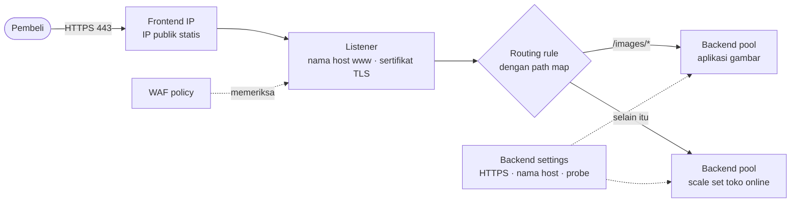
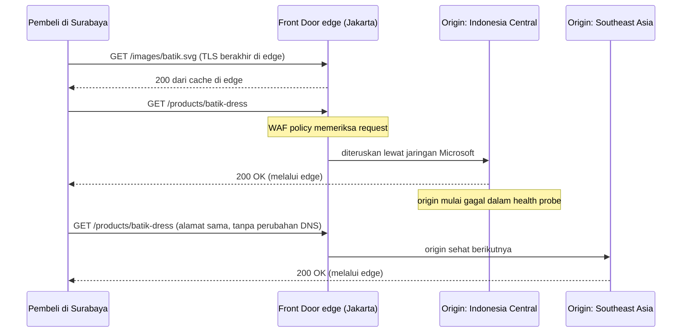
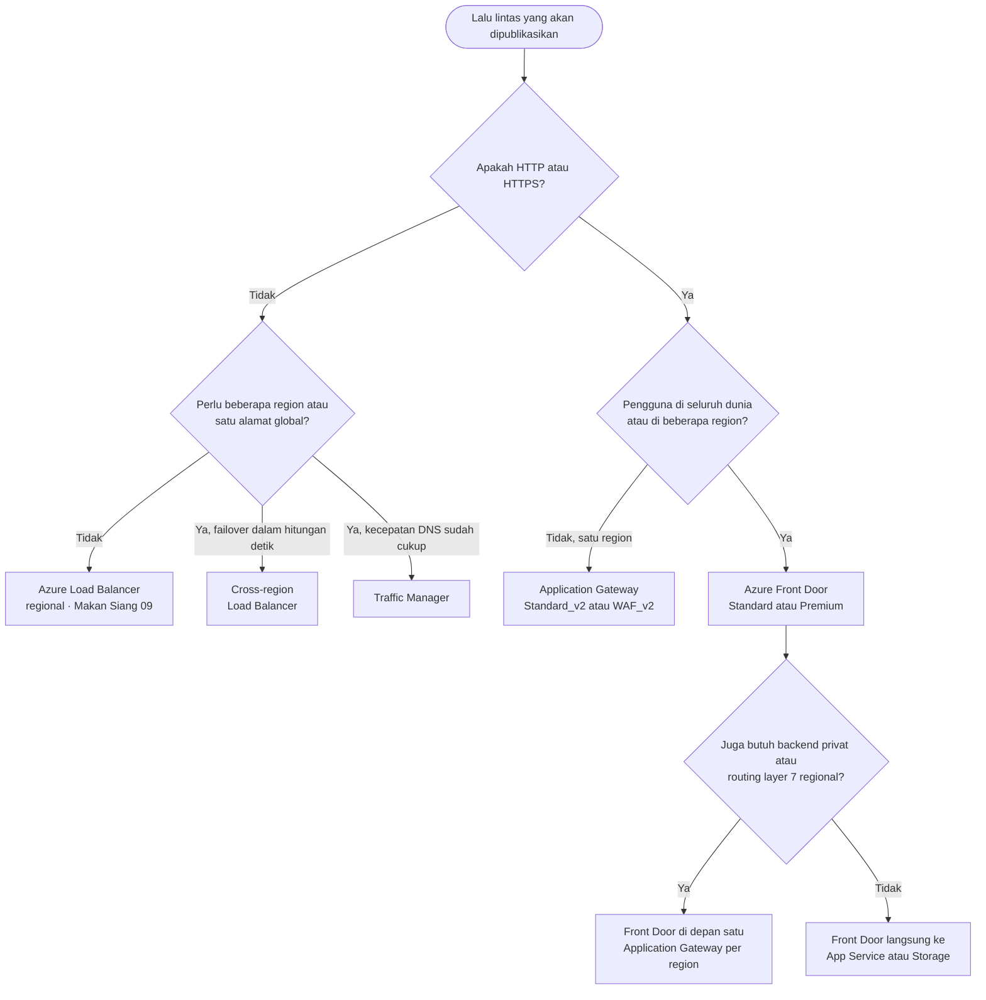

# Makan Siang 27 · Load Balancing (Lanjutan): Application Gateway, Front Door, dan Traffic Manager

🇬🇧 [Read in English](README.md)

> **Jalur:** Bulan pendalaman · **Level:** Lanjutan · **Bagian 5:** Pendalaman
> **Waktu:** 60 menit · **Makan siang prasyarat:** 09 (Load Balancing, Dasar), 10, 08
> **Area keterampilan AZ-900:** Di luar cakupan AZ-900
> **Lab:** [Lab 27 · Melindungi dan merutekan toko online](../../labs/27-load-balancing-advanced/README.id.md) — sekitar 75 menit · biaya 💲💲💲
> **Penulis:** Stefanus Pinarta · [Tentang penulis](../../README.id.md#tentang-penulis)

| ⏱ Menit | Segmen |
|---:|---|
| 5 | Skenario dan tujuan |
| 25 | Bacaan |
| 15 | Demo: animasi interaktif (+ video panduan opsional) |
| 5 | Uji pemahaman |
| 5 | Poin penting dan pratinjau lab |
| 5 | Waktu cadangan — habiskan makan siang Anda 🍜 |

## 🍱 Menu hari ini

Setelah makan siang ini, Anda akan mampu:

- **Menjelaskan** apa yang ditambahkan sebuah reverse proxy layer 7 pada load balancing, dan apa harga yang harus Anda
  bayar untuk itu.
- **Menguraikan** bagian-bagian Application Gateway v2 — listener, rule, backend pool, backend settings, dan health
  probe — serta cara kerja routing berbasis path dan multi-site.
- **Merencanakan** sebuah WAF policy: managed rule set, custom rule, exclusion, serta mode Detection dan Prevention.
- **Membandingkan** cara Azure Front Door, Traffic Manager, dan cross-region Load Balancer memindahkan pengguna dari
  satu region (*wilayah*) ke region lain.
- **Memilih** layanan yang tepat — atau kombinasi layanan — dengan pohon keputusan dua pertanyaan.

## 🏪 Sementara itu di Nusantara Retail

Sejak Makan Siang 23, toko online berjalan di atas sebuah scale set (*Kumpulan Skala Komputer Virtual*) yang tersebar
di tiga availability zone (*zona ketersediaan*) di Indonesia Central, di belakang load balancer Standard dari
Makan Siang 09. Toko itu selamat melewati promo besar terakhir. Sekarang tiga permintaan baru mendarat di meja Anda.

Dewi sudah memindahkan foto-foto produk ke aplikasi tersendiri, aplikasi gambar (images app), dan ingin
`www.nusantararetail.co.id/images/...` dilayani oleh aplikasi itu, tetap di bawah alamat toko. Rizky meneruskan log
web server: setiap hari ada ribuan request yang mengandung string seperti `' OR 1=1--`, yaitu upaya mengelabui
database agar menyerahkan data semua pelanggan. Lalu Ibu Sari membaca berita tentang gangguan cloud yang
membuat satu region lumpuh selama satu sore: *"Kalau Jakarta down saat 12.12, apakah pembeli di Medan dan Makassar cuma melihat halaman error?"*
Pembeli di Indonesia timur pun sudah mengeluh bahwa halaman produk lambat terbuka.

Load balancer layer 4 tidak bisa membantu untuk semua ini, karena ia tidak pernah membaca isi sebuah request.
Pertanyaan hari ini: **layanan Azure mana yang sebaiknya berdiri di depan toko online — dan kapan Anda butuh lebih
dari satu?**

---

## 📖 Bacaan (≈25 menit)

### 1. Melampaui layer 4: apa yang ditambahkan reverse proxy

Sedikit istilah dulu. Kata "layer" di sini merujuk pada lapisan model jaringan OSI. Layer 4 adalah lapisan transport:
alamat IP, nomor port, TCP, dan UDP. Layer 7 adalah lapisan aplikasi: isi percakapan HTTP itu sendiri, seperti alamat
URL, header, dan cookie.

Azure Load Balancer meneruskan paket tanpa membukanya. Karena itu ia cepat dan bisa membawa protokol apa pun, tetapi
ia "buta": ia tidak bisa membedakan halaman produk dari formulir login, atau pembeli dari penyerang. Layanan-layanan
dalam makan siang ini justru membaca request-nya.

Ibaratnya, load balancer layer 4 adalah tukang parkir di mal: ia mengarahkan setiap mobil ke slot yang kosong hanya
berdasarkan lajurnya, tanpa pernah melihat siapa penumpangnya. Reverse proxy layer 7 lebih mirip resepsionis gedung
perkantoran: ia menanyakan Anda mau bertemu siapa, memeriksa kartu identitas Anda, lalu mengarahkan Anda ke lantai
yang benar.

**Reverse proxy** berdiri di depan server Anda dan berperan sebagai server di mata klien. Ia menerima koneksi dari
klien, membaca seluruh request HTTP, memutuskan ke mana request itu harus pergi, lalu meneruskannya lewat koneksi
kedua miliknya sendiri. Karena membaca setiap request, proxy layer 7 bisa:

- **merutekan berdasarkan isi** — nama host (`www` atau `partners`), path URL (`/images/*`), header, atau query
  string;
- **mengakhiri TLS** — TLS (Transport Layer Security) adalah enkripsi di balik ikon gembok HTTPS; proxy mendekripsi
  HTTPS satu kali saja, dengan sertifikat yang dikelola di satu tempat, lalu mengenkripsinya ulang ke server bila
  perlu;
- **memeriksa** request dengan **web application firewall (WAF)** dan membuang serangan sebelum sampai ke kode Anda;
- **mengubah** request dan response — mengalihkan HTTP ke HTTPS, menulis ulang header, atau menjaga seorang pembeli
  tetap di satu server dengan bantuan cookie;
- **menyimpan cache** jawaban di dekat pengguna (Front Door).

Kompromi (trade-off)-nya lahir dari desain yang sama. Proxy berbicara HTTP dan HTTPS (Application Gateway juga bisa
mem-proxy TCP dan TLS biasa, tetapi HTTP adalah "kandang"-nya), ia menambah sedikit latensi, dan server Anda melihat
alamat proxy; alamat asli pembeli dibawa di header `X-Forwarded-For`.

Selain load balancer regional yang sudah Anda kenal, Azure menawarkan empat layanan yang bisa berdiri di depan sebuah
aplikasi. Dua pertanyaan memilahnya: **apakah lalu lintasnya berbicara HTTP(S)?** dan **apakah ia dilayani dari satu
region atau beberapa?** Dua istilah lagi sebelum tabelnya: **DNS** (Domain Name System) adalah "buku telepon" internet
yang mengubah nama seperti `www.nusantararetail.co.id` menjadi alamat IP, dan **edge** adalah lokasi-lokasi milik
Microsoft yang tersebar di kota-kota besar dunia, dekat dengan pengguna.

| | Application Gateway | Azure Front Door | Traffic Manager | Cross-region Load Balancer |
|---|---|---|---|---|
| Bekerja dengan | HTTP(S), layer 7 | HTTP(S), layer 7 | DNS, jadi protokol apa pun | TCP dan UDP, layer 4 |
| Cakupan | satu region, di dalam virtual network (*jaringan virtual*) Anda | global, di edge Microsoft | global | global |
| Berada di jalur lalu lintas? | ya, sebagai proxy | ya, sebagai proxy di edge | tidak — ia hanya menjawab kueri DNS | ya, meneruskan paket |
| Saat kegagalan terdeteksi, klien… | langsung berhenti diarahkan ke backend yang tidak sehat | tetap memakai alamat yang sama; edge memilih origin lain | baru pindah ketika jawaban DNS yang mereka simpan (cache) kedaluwarsa | tetap memakai alamat yang sama; region lain yang menjawab |
| Tugas khas | routing path, TLS, dan WAF untuk aplikasi di satu region | satu pintu masuk global dengan caching dan WAF | failover DNS atau aturan lokasi untuk endpoint apa pun | satu IP statis untuk layanan TCP atau UDP global |

### 2. Application Gateway v2, komponen demi komponen

**Azure Application Gateway** adalah reverse proxy terkelola (managed) — Microsoft yang mengurus server, patch, dan
kapasitasnya — yang Anda deploy ke dalam virtual network Anda sendiri, di satu region. Ia membutuhkan **subnet
khusus** (dedicated subnet; disarankan /24, yaitu 256 alamat IP, agar ada ruang untuk bertambah besar), memiliki
alamat IP frontend statis yang publik atau privat, dan dirakit dari beberapa komponen yang akan Anda temui lagi di
portal dan di Lab 27. Server-server yang berada di belakang proxy disebut **backend**:

| Komponen | Fungsinya | Contoh di Lab 27 |
|---|---|---|
| **Frontend IP** | alamat publik dan/atau privat yang dihubungi klien | `pip-agw-nusa` |
| **Listener** | menunggu di sebuah frontend, port, dan protokol — bisa juga khusus untuk nama host tertentu; listener HTTPS menyimpan sertifikat TLS | HTTP di port 80 |
| **Request routing rule** | menghubungkan satu listener ke target backend-nya; *basic* (satu pool) atau *path-based*; rule v2 punya prioritas | `rule1`, path-based |
| **Backend pool** | server-servernya: NIC VM, scale set, alamat IP, atau nama host seperti aplikasi App Service | `pool-images` berisi aplikasi gambar |
| **Backend settings** | *cara* berbicara dengan sebuah pool: protokol, port, nama host, timeout, cookie affinity, probe | HTTPS di 443, nama host diambil dari backend |
| **Health probe** | pemeriksaan rutin terhadap setiap backend; anggota yang gagal tidak diberi request | `probe-app`: HTTPS GET `/` |
| **WAF policy** (WAF_v2) | aturan dan mode firewall, dipasang ke gateway, ke sebuah listener, atau ke sebuah path | `waf-nusa` dalam mode Prevention |

Rule menentukan *ke mana* sebuah request pergi; backend settings menentukan *bagaimana* gateway mengantarkannya. Tiga
fitur routing mengerjakan sebagian besar tugasnya:

- **Routing berbasis path.** Sebuah **URL path map** berisi daftar pola seperti `/images/*` atau `/api/*`,
  masing-masing dengan pool-nya sendiri, ditambah satu pool default untuk semua yang lain. Gateway meneruskan path
  lengkapnya, kecuali Anda menulis ulang (rewrite) path tersebut.
- **Multi-site hosting.** Listener *basic* menerima nama host apa pun; listener *multi-site* hanya cocok dengan nama
  tertentu, termasuk wildcard. Dengan begitu `www.nusantararetail.co.id` dan `partners.nusantararetail.co.id` bisa
  berbagi satu gateway, satu alamat IP, dan port 443, masing-masing dengan rule-nya sendiri.
- **Redirect dan rewrite.** Alihkan HTTP ke HTTPS, tambahkan header keamanan, atau ubah URL sebelum backend
  melihatnya.

Dengan **TLS termination**, listener-lah yang memegang sertifikat — v2 bisa membacanya dari Azure Key Vault, sehingga
perpanjangan sertifikat cukup dilakukan di satu tempat — dan gateway melihat request yang sudah didekripsi, yang
memang dibutuhkan WAF. Dengan **end-to-end TLS**, backend settings juga memakai HTTPS, sehingga lalu lintas dienkripsi
lagi dalam perjalanannya ke server, dan gateway memeriksa sertifikat setiap backend seperti yang dilakukan browser
yang teliti.

Setiap backend diperiksa kesehatannya: gateway rutin mengirim request kecil ke setiap server dan hanya mengirim
pembeli ke server yang menjawab dengan benar. Tanpa konfigurasi apa pun, **default probe** meminta `/` dengan nama
host `127.0.0.1`; **custom probe** memungkinkan Anda memilih path, nama host, interval, dan kode status yang dianggap
sehat. Jika semua anggota sebuah pool gagal, gateway menjawab **502 Bad Gateway**.

Ada dua SKU (varian produk) untuk produksi: **Standard_v2**, dan **WAF_v2** yang menambahkan web application firewall.
SKU **Basic** yang lebih ringan masih berstatus preview saat tulisan ini dibuat, dan SKU **v1** yang asli sudah
pensiun pada 28 April 2026. Kedua SKU v2 melakukan **autoscale** di antara jumlah instance minimum dan maksimum yang
Anda pilih, atau berjalan dengan kapasitas tetap. Di region yang memiliki availability zone, keduanya secara default
tersebar di setidaknya dua zona. Instance baru butuh hitungan menit, bukan detik, jadi naikkan jumlah minimumnya
sebelum puncak yang sudah bisa diduga seperti 12.12 — sama seperti warung yang memanggil karyawan tambahan sehari
sebelum ramai, bukan saat antrean sudah mengular. Untuk lalu lintas Kubernetes, Microsoft juga menawarkan produk
terpisah, **Application Gateway for Containers** (Makan Siang 29).

> [!WARNING]
> **App Service di belakang Application Gateway butuh nama host yang tepat.** App Service menjalankan banyak aplikasi
> di front end bersama dan memilih aplikasi berdasarkan nama host di dalam request — mirip penjaga kos yang hanya mau
> menerima paket bila kurir menyebut nama penghuninya, bukan sekadar alamat rumah. Gateway meneruskan nama yang
> diketik pembeli, dan default probe-nya memakai `127.0.0.1` — nama-nama yang tidak dikenali App Service — sehingga
> probe gagal dan pembeli mendapat 502. Ada dua jalan keluar: berikan aplikasi itu custom domain yang sama dengan
> listener (perbaikan paling rapi), atau atur backend settings agar **mengambil nama host dari target backend** (*pick
> host name from backend target*) dan tambahkan custom probe yang melakukan hal yang sama. Lab 27 sengaja menabrak
> tembok ini.

### 3. Web application firewall: rule set, mode, dan skor

**Web application firewall** memeriksa isi setiap request HTTP untuk mencari pola serangan umum: SQL injection
(menyisipkan potongan perintah database ke dalam input, seperti `' OR 1=1--` tadi), cross-site scripting (menyisipkan
skrip jahat yang kemudian berjalan di browser pengguna lain), penyalahgunaan protokol, dan bot jahat. Di Application
Gateway, WAF membutuhkan SKU WAF_v2 dan menerima instruksinya dari sebuah **WAF policy**, yaitu resource (*sumber
daya*) Azure tersendiri. Anda bisa memasang policy ke seluruh gateway, ke satu listener (*per-site*), atau ke satu
path rule (*per-URI*), sehingga portal mitra bisa dijaga lebih ketat daripada toko.

Sebuah policy punya empat bagian:

- **Managed rule set**, yang ditulis dan diperbarui oleh Microsoft. **Default Rule Set (DRS)** — versi 2.2 disarankan
  untuk policy baru — dibangun di atas OWASP Core Rule Set (kumpulan aturan dari OWASP, komunitas keamanan aplikasi
  web yang terbuka) dan menambahkan aturan milik Microsoft sendiri. Rule set **Bot Manager** yang opsional memilah bot
  menjadi baik, jahat, dan tidak dikenal.
- **Custom rule** yang Anda tulis sendiri, dievaluasi sebelum managed rule: mengizinkan rentang IP kantor pusat,
  memblokir sebuah negara, atau melakukan **rate-limit** (membatasi jumlah request per menit) pada halaman login.
- **Exclusion**, yang meminta managed rule mengabaikan satu header, cookie, atau field formulir yang memang sah tetapi
  tampak mencurigakan.
- Sebuah **mode**: **Detection** hanya mencatat apa yang seharusnya diblokir; **Prevention** benar-benar memblokirnya.

DRS memakai **anomaly scoring** (penilaian anomali). Request yang cocok dengan sebuah rule tidak langsung ditolak di
tempat. Setiap kecocokan menambah poin sesuai tingkat keparahannya — 5 untuk *critical*, 4 untuk *error*, 3 untuk
*warning*, 2 untuk *notice* — dan begitu total poin sebuah request mencapai ambang 5, mode Prevention menghentikannya
dengan **HTTP 403 Forbidden**. Satu kecocokan critical, seperti `' OR 1=1--` di query string, sudah cukup dengan
sendirinya. Satu warning saja, seperti request yang dialamatkan ke alamat IP alih-alih nama host, belum cukup — itulah
sebabnya Lab 27 bisa membuka gateway lewat alamat IP-nya. Front Door punya WAF policy sendiri, dibangun di atas ide
yang sama dan diterapkan di edge.

Cara kerjanya mirip buku poin pelanggaran di sekolah. Terlambat masuk kelas dapat sedikit poin, tidak memakai atribut
seragam dapat sedikit lagi, dan seorang siswa baru dipanggil ke ruang BK setelah poinnya mencapai batas. Bedanya, di
WAF satu pelanggaran berat (critical) langsung bernilai 5, sehingga langsung mencapai batas dan request diblokir saat
itu juga.

WAF adalah jaring pengaman, bukan pengganti kode yang aman. Query buatan Dewi tetap harus memakai parameter, bukan
string yang ditempel-tempel.

> [!TIP]
> Mulailah setiap policy baru dalam mode **Detection**. Alirkan lalu lintas nyata melewatinya selama beberapa hari,
> idealnya termasuk satu hari promo yang ramai, lalu baca log WAF untuk mencari false positive (lalu lintas sah yang
> keliru dianggap serangan). Tambahkan exclusion atau custom rule untuk kasus-kasus itu, baru kemudian beralih ke
> **Prevention**. Policy yang dibiarkan di mode Detection selama berbulan-bulan tidak melindungi apa pun.

### 4. Azure Front Door: pintu depan di edge Microsoft

**Azure Front Door** adalah layanan layer 7 global yang berjalan di **edge location** Microsoft — titik kehadiran
(point of presence) di kawasan metropolitan di seluruh dunia, termasuk Jakarta dan Singapura. DNS dan jaringan Front
Door mengirim setiap pembeli ke edge location terdekat yang sehat. TLS berakhir di sana, WAF memeriksa request di
sana, dan konten yang di-cache dilayani dari sana. Selebihnya menempuh perjalanan ke **origin** Anda — server asal
tempat aplikasi sebenarnya berjalan — melalui jaringan milik Microsoft sendiri, bukan lewat internet publik.

Bayangkan jaringan minimarket yang ada di hampir setiap sudut kota. Barang yang laris, seperti air mineral, sudah
tersedia di rak minimarket terdekat; itulah cache di edge. Barang yang tidak ada di rak dipesan dari gudang pusat
(origin) dan diantar dengan armada truk milik jaringan itu sendiri, bukan dengan menumpang angkutan umum; itulah
jaringan internal Microsoft.

Sebuah profil Front Door memiliki satu atau lebih **endpoint**, masing-masing dengan nama host `azurefd.net`, ditambah
custom domain Anda dengan sertifikat terkelola. Sebuah **route** mencocokkan domain, pola path, dan protokol, lalu
mengirim request ke sebuah **origin group**: sekumpulan **origin** — aplikasi App Service, storage account (*akun
penyimpanan*), Application Gateway, atau nama host publik apa pun — lengkap dengan health probe dan pengaturan load
balancing. Di antara origin yang sehat, Front Door memilih yang **priority**-nya terbaik, lalu yang latensinya paling
rendah, lalu membagi lalu lintas menurut **weight** (bobot). **Rule set** mengubah perilaku per request (redirect,
perubahan header, pengaturan cache), dan **caching** dengan kompresi melayani file statis seperti foto produk langsung
dari edge.

Pembeli tetap berbicara dengan edge location yang sama, yang cukup memilih origin lain, sehingga failover origin
langsung berlaku begitu health probe menyadarinya — tidak ada jawaban DNS yang perlu berubah. Front Door hadir dalam
dua tier:

| Fitur | Standard | Premium |
|---|---|---|
| Konten statis dan dinamis, caching, kompresi, rule set | ✓ | ✓ |
| Custom domain dengan HTTPS | ✓ | ✓ |
| Custom rule WAF, termasuk geo-filtering dan rate limit | ✓ | ✓ |
| Rule set WAF yang dikelola Microsoft dan perlindungan bot | — | ✓ |
| Koneksi Private Link ke origin | — | ✓ |
| Laporan bawaan | ✓ | ✓, plus laporan WAF |

Origin yang bisa dihubungi siapa saja secara langsung mengubah WAF di edge menjadi sekadar imbauan. Kunci origin itu.
Untuk App Service, tambahkan access restriction yang hanya mengizinkan service tag **AzureFrontDoor.Backend** (label
siap pakai dari Microsoft yang mewakili kumpulan alamat IP sebuah layanan) *dan* mewajibkan header `X-Azure-FDID`
berisi ID profil Anda — service tag saja akan meloloskan semua profil Front Door, termasuk milik penyerang. Dengan
Premium, Anda bisa menjangkau origin lewat **Private Link**, sehingga origin sama sekali tidak memerlukan public
endpoint (*titik akhir publik*).

> [!IMPORTANT]
> **Front Door (classic)** pensiun pada **31 Maret 2027**, dan profil classic baru sudah tidak bisa dibuat lagi.
> **Azure CDN Standard from Microsoft (classic)** menyusul pada 30 September 2027. Tutorial lama yang memakai perintah
> `az network front-door` menyasar versi classic; gunakan `az afd` untuk Standard dan Premium.

### 5. Traffic Manager dan cross-region Load Balancer

**Azure Traffic Manager** mengarahkan klien dengan DNS. Anda membuat sebuah profil dengan nama seperti
`nusa-shop.trafficmanager.net`, menambahkan **endpoint**, lalu mengarahkan domain Anda sendiri ke profil itu dengan
record CNAME (alias yang berbunyi "nama ini sebenarnya adalah nama itu"). Ketika klien mencari nama tersebut, Traffic
Manager memilih endpoint yang sehat sesuai **routing method** profil, lalu menjawab dengan nama endpoint itu. Setelah
itu klien terhubung langsung ke endpoint tersebut. Traffic Manager tidak pernah menyentuh lalu lintasnya, jadi ia
bekerja untuk protokol apa pun — dan ia tidak bisa merutekan berdasarkan path, mengakhiri TLS, atau menyaring
serangan.

| Routing method | Mengembalikan… | Contoh Nusantara Retail |
|---|---|---|
| **Priority** | endpoint sehat dengan prioritas terbaik (1 yang pertama) | Indonesia Central; Southeast Asia hanya jika Indonesia Central gagal |
| **Weighted** | endpoint secara acak, sebanding dengan bobotnya | mengirim 10% pembeli ke versi toko online yang baru |
| **Performance** | endpoint dengan latensi jaringan terendah dari DNS resolver pengguna | toko online masa depan yang hadir di dua benua |
| **Geographic** | endpoint yang ditetapkan untuk wilayah geografis asal kueri | menjaga pembeli Indonesia tetap di infrastruktur Indonesia |
| **MultiValue** | beberapa endpoint sehat sekaligus (hanya endpoint eksternal IPv4 atau IPv6) | klien yang sendiri mencoba ulang ke alamat lain |
| **Subnet** | endpoint yang dipetakan ke rentang IP sumber | staf kantor pusat menguji versi pratinjau |

Endpoint bisa berupa **Azure endpoints** (resource seperti alamat IP publik, atau aplikasi App Service di tier
Standard atau lebih tinggi), **external endpoints** (nama host atau alamat IP apa pun, bahkan di luar Azure — Lab 27
memakai jenis ini), atau **nested endpoints**: profil anak, sehingga Anda bisa menggabungkan beberapa metode, misalnya
Geographic di lapisan atas dan Priority di dalam setiap wilayah geografis. Traffic Manager mem-probe setiap endpoint
lewat HTTP, HTTPS, atau TCP setiap 30 detik, atau setiap 10 detik dengan fast probing. Setelah gagal berturut-turut
lebih banyak daripada batas toleransi yang Anda tetapkan, endpoint ditandai **Degraded** dan menghilang dari jawaban.

Menjawab lewat DNS membuat Traffic Manager sederhana dan netral terhadap protokol, tetapi membawa beberapa catatan
yang harus Anda perhitungkan dalam desain. Yang bertanya kepada Traffic Manager adalah **DNS resolver**, yaitu server
DNS yang mencarikan jawaban atas nama pengguna, biasanya milik penyedia internet atau layanan DNS publik:

- **Caching.** Resolver dan klien menyimpan jawaban selama **TTL** (time to live, "masa berlaku" sebuah jawaban) milik
  profil, dan sebagian klien menyimpannya lebih lama. Failover memakan waktu kira-kira waktu deteksi ditambah TTL
  ditambah caching tambahan. TTL yang rendah mempercepat failover, tetapi melipatgandakan kueri DNS.
- **Koneksi yang sudah terbuka tetap di tempatnya.** Pembeli yang sudah terhubung terus berbicara dengan endpoint yang
  gagal sampai koneksinya putus dan namanya dicari ulang.
- **"Lokasi" berarti lokasi resolver.** Routing Performance dan Geographic melihat DNS resolver yang bertanya, bukan
  pembelinya. Seseorang di Surabaya yang memakai public resolver di luar negeri bisa ditempatkan secara keliru.
- **Nama host.** Setiap endpoint harus menerima nama yang diminta klien, jadi aplikasi web membutuhkan custom domain
  Anda terpasang di setiap endpoint.

Ibaratnya layanan informasi nomor telepon: petugasnya hanya memberi tahu nomor toko, tidak ikut menyambungkan telepon
Anda. Dan kalau toko pindah nomor, pelanggan yang sudah menyimpan nomor lama di ponselnya tetap menelepon ke nomor itu
sampai ia bertanya lagi. Itulah DNS caching.

Untuk lalu lintas non-HTTP yang harus failover lebih cepat daripada yang dimungkinkan DNS, Azure Load Balancer punya
tier global, yaitu **cross-region load balancer**. Ia memberi Anda satu alamat IP publik **anycast** yang statis —
satu alamat yang sama diumumkan dari banyak lokasi sekaligus, sehingga setiap klien otomatis mencapai lokasi terdekat
— di depan beberapa Standard public load balancer di beberapa region. Ia memeriksa load balancer regional setiap 5
detik dan mengirim koneksi baru ke region yang sehat tanpa perubahan DNS apa pun, dan server tetap melihat alamat IP
asli klien. Frontend-nya hanya bisa publik, dan load balancer regionalnya harus berada di participating region (region
yang ikut serta). Saat tulisan ini dibuat, Indonesia Central belum termasuk di dalamnya, jadi periksa daftarnya
sebelum Anda mendesain dengan mengandalkannya.

### 6. Memilih — dan menggabungkan — untuk Nusantara Retail

Pohon keputusannya hanya butuh dua pertanyaan dari bagian 1, ditambah satu pertanyaan lanjutan di masing-masing
cabang:

Desain nyata sering menumpuk dua layanan: satu layanan global di depan satu layanan regional.

| Kombinasi | Kapan masuk akal |
|---|---|
| Front Door → App Service atau Storage | aplikasi web global yang paling sederhana: TLS di edge, caching dan WAF, origin dikunci ke profil Anda |
| Front Door → Application Gateway di setiap region | satu pintu masuk global plus routing layer 7 regional ke backend privat di dalam virtual network |
| Traffic Manager → Application Gateway di setiap region | gateway regional dengan failover DNS, bila failover yang lebih lambat masih bisa diterima |
| Application Gateway → internal Load Balancer | gateway melayani web tier; API pesanan berada di belakang internal load balancer |
| Cross-region Load Balancer → regional public load balancer | layanan TCP atau UDP global dengan satu alamat statis |

Inilah desain tim untuk promo 12.12 berikutnya:

- **Front Door Premium** menjawab `www.nusantararetail.co.id` dari edge: sertifikat terkelola, WAF dengan managed rule
  set dan perlindungan bot, serta foto produk yang di-cache di edge location seperti Jakarta.
- Sebuah **Application Gateway** di Indonesia Central menjadi origin prioritas 1. Gateway ini zone-redundant (tersebar
  di beberapa zona, sehingga tetap hidup bila satu zona padam), mengirim `/images/*` ke aplikasi gambar dan semua yang
  lain ke scale set, serta hanya menerima lalu lintas dari Front Door: sebuah NSG (network security group, daftar
  aturan yang mengizinkan atau menolak lalu lintas jaringan) mengizinkan service tag AzureFrontDoor.Backend, dan
  sebuah custom rule WAF memeriksa `X-Azure-FDID`. Standard_v2 sebenarnya sudah cukup di belakang WAF milik Front
  Door; tim keamanan memilih WAF_v2 sebagai lapisan kedua.
- Salinan yang lebih kecil di **Southeast Asia** menjadi origin prioritas 2. Data pelanggan harus tetap berada di
  Indonesia, jadi untuk sementara standby ini melayani katalog dalam mode browse-only (pembeli hanya bisa
  melihat-lihat); Makan Siang 28 membahas database pesanan.
- Sinkronisasi point-of-sale (mesin kasir) di toko-toko, sebuah layanan TCP biasa, mendapat profil **Traffic Manager**
  dengan routing priority di depan public load balancer di setiap region. Cross-region load balancer akan failover
  lebih cepat, begitu Indonesia Central masuk ke daftar participating region-nya.

> [!NOTE]
> **Renungkan sejenak:** pukul 20.00 pada 12.12, toko online di Indonesia Central berhenti menjawab. Seorang pembeli
> di Makassar sedang di tengah proses checkout. Apa yang ia alami jika alamat toko mengarah ke Traffic Manager dengan
> TTL 60 detik — dan bagaimana jika alamat itu mengarah ke Front Door?

Pasangan tingkat dasarnya: [Makan Siang 09 · Load Balancing (Dasar): Azure Load Balancer](../09-load-balancing-basic/README.id.md) membahas
Azure Load Balancer, health probe, dan outbound rule.

---

## 🎬 Demo (≈15 menit)

1. **Animasi interaktif (≈6–8 menit):**
   [Buka demo](https://stefpin.github.io/azure-fundamentals-lunches/demos/27-load-balancing-advanced.html?lang=id) —
   tekan ▶ Putar atau telusuri langkah demi langkah sesuai kecepatan Anda. Sedang offline? Unduh
   [`docs/demos/27-load-balancing-advanced.html`](../../docs/demos/27-load-balancing-advanced.html) lalu buka di
   browser apa pun.
2. **Video panduan (≤ 6 menit):** _segera hadir_ — [baca naskah video](demo-video-script.id.md).

Yang perlu diperhatikan:

- Dua pertanyaan pertama di pohon keputusan: HTTP(S) atau bukan, satu region atau beberapa.
- Pembeli di Surabaya tetap terhubung ke edge Jakarta sementara Front Door berganti origin — tanpa perubahan DNS.
- WAF menjumlahkan poin anomali dan menjawab 403 sebelum serangan mencapai aplikasi.
- Traffic Manager hanya mengubah jawaban DNS; jawaban yang sudah tersimpan di cache membuat sebagian klien tetap
  mengarah ke endpoint yang gagal sampai TTL-nya habis.

## ✅ Uji pemahaman (≈5 menit)

1. Dewi menambahkan aplikasi gambar (`app-nusa-img.azurewebsites.net`) ke backend pool baru di gateway. Backend health
   menunjukkan statusnya **Unhealthy** dan `/images/` mengembalikan 502, padahal aplikasinya berfungsi saat Dewi
   membukanya langsung. Apa yang kurang?
   

Lihat jawaban

   Backend settings yang **mengambil nama host dari target backend** (*pick host name from backend target*), ditambah
   custom probe yang mengambil nama host-nya dari pengaturan itu — atau custom domain yang sama di aplikasi dan di
   listener. *Alasannya:* App Service memilih aplikasi berdasarkan nama host, sedangkan gateway mengirim nama yang
   tidak dikenalinya.

   

2. Pada pagi pertama promo, WAF yang berada di mode Prevention mulai mengembalikan 403 untuk ulasan produk seperti
   *"Drop by the store and select your size"* (ulasan berbahasa Inggris yang kebetulan memuat *drop* dan *select*, dua
   kata kunci SQL). Lalu lintas serangan juga tetap terblokir. Apa yang sebaiknya dilakukan tim?
   

Lihat jawaban

   Cari rule yang cocok di log WAF, lalu tambahkan **exclusion** untuk field ulasan (atau custom rule yang cakupannya
   sempit), dan pertahankan mode Prevention untuk semua yang lain. *Alasannya:* managed rule mencocokkan pola, bukan
   niat, sehingga exclusion menghapus false positive tanpa mematikan perlindungan.

   

3. Toko online memakai routing priority Traffic Manager dengan TTL 300 detik. Indonesia Central gagal; endpoint-nya
   berstatus *Degraded* setelah sekitar 30 detik, tetapi sebagian pembeli masih mendapat error lima menit kemudian.
   Mengapa, dan apa yang bisa mempersingkatnya?
   

Lihat jawaban

   Resolver dan klien menyimpan jawaban DNS di cache selama TTL, sebagian bahkan lebih lama. Turunkan TTL-nya, atau
   gunakan Front Door, yang edge-nya berganti origin sementara klien tetap memakai alamat yang sama. *Alasannya:*
   Traffic Manager hanya mengubah jawaban DNS berikutnya; ia tidak pernah memindahkan lalu lintas yang sudah tahu
   harus ke mana.

   

4. Perangkat point-of-sale di toko-toko mengirim data penjualan ke sistem kantor pusat lewat protokol TCP khusus di
   port 9000. Pak Budi menginginkan satu alamat IP publik tetap yang bisa failover antara dua region dalam hitungan
   detik. Layanan mana yang cocok?
   

Lihat jawaban

   **Cross-region load balancer** di depan sebuah Standard public load balancer di setiap region — jika keduanya
   termasuk participating region; jika tidak, Traffic Manager, dengan failover secepat DNS. *Alasannya:* Application
   Gateway dan Front Door dibuat untuk HTTP(S); hanya cross-region load balancer yang memberi TCP satu alamat global
   yang statis.

   

5. Rizky melihat percobaan SQL injection yang dikirim langsung ke `app-nusa-store.azurewebsites.net`, melewati Front
   Door beserta WAF-nya. Aplikasi itu sudah hanya mengizinkan service tag AzureFrontDoor.Backend. Bagaimana ia menutup
   celah ini?
   

Lihat jawaban

   Di access restriction, wajibkan juga header `X-Azure-FDID` cocok dengan ID profil Front Door milik Nusantara — atau
   gunakan origin Private Link dengan Premium. *Alasannya:* service tag mencakup semua profil Front Door, termasuk
   profil yang dibuat penyerang.

   

## 🧠 Poin penting

- **Reverse proxy** layer 7 membaca setiap request, sehingga ia bisa merutekan berdasarkan host dan path, mengakhiri
  TLS, dan menjalankan **WAF**; untuk lalu lintas non-HTTP di satu region, Azure Load Balancer (Makan Siang 09) tetap
  alat yang tepat.
- **Application Gateway v2** (Standard_v2 atau WAF_v2; v1 sudah pensiun 28 April 2026) bersifat regional,
  zone-redundant, dan bisa autoscale: listener, rule, backend pool, backend settings, dan probe. Backend App Service
  membutuhkan nama host yang tepat.
- **WAF policy** menggabungkan managed rule set (DRS 2.2 untuk policy baru), custom rule, dan exclusion; mulailah di
  mode **Detection**, setel, lalu beralih ke **Prevention**, tempat skor anomali 5 atau lebih dijawab dengan 403.
- **Azure Front Door** (Standard atau Premium; versi classic pensiun 31 Maret 2027) bekerja di edge Microsoft: TLS,
  caching, WAF, dan failover origin tanpa jeda DNS. Kunci origin ke profil Anda.
- **Traffic Manager** mengarahkan protokol apa pun dengan DNS (enam routing method), tetapi failover-nya menunggu TTL
  dan cache; **cross-region load balancer** memberi TCP dan UDP satu IP anycast. Layanan global sering ditempatkan di
  depan layanan regional.

## 🗒️ Catatan lapangan dari Stefanus

> **Jangan lupa mengetuk pintu belakang.** Setiap kali ada tim yang dengan bangga menunjukkan Front Door atau
> Application Gateway baru lengkap dengan WAF, tes pertama saya justru tidak lewat pintu depan. Saya ambil alamat asli
> origin-nya — nama `azurewebsites.net` atau IP publik servernya — lalu mengirim satu request langsung ke sana dari
> laptop di luar jaringan kantor. Kalau origin itu menjawab, WAF Anda ibarat satpam yang berjaga di gerbang depan
> sementara pintu dapur tidak dikunci: tamu yang sopan diperiksa, penyerang tinggal lewat samping. Tes kecil ini saya
> ulangi setiap kali ada perubahan, karena pintu belakang jarang dibuka dengan sengaja; biasanya ia terbuka lagi
> gara-gara aturan akses "sementara". Satu lagi: kalau WAF masih di mode Detection, saya selalu menanyakan tanggal
> pindahnya ke Prevention, lalu mencatat tanggal itu di dokumen desain.

## 🔬 Lab Anda: Melindungi dan merutekan toko online

`setup.sh` men-deploy dua aplikasi App Service kecil, yaitu toko online dan layanan gambar. Anda menempatkan
Application Gateway WAF_v2 di depan keduanya, memperbaiki masalah klasik nama host App Service, merutekan `/images/*`
ke aplikasi gambar, dan menyaksikan sebuah WAF policy berubah dari sekadar mencatat percobaan SQL injection menjadi
memblokirnya dengan 403. Lalu Anda membangun profil Traffic Manager dengan routing priority, menghentikan toko online,
dan melihat jawaban DNS berpindah, dengan Front Door Standard opsional di bagian akhir. Selesaikan dalam sekali duduk
dan langsung bersihkan resource-nya.

- ⏱ Sekitar 75 menit · 💲💲💲 gateway ditagih setiap jam selama ia ada · bisa dikerjakan terpisah (tidak perlu lab
  sebelumnya)
- 👉 [Mulai Lab 27](../../labs/27-load-balancing-advanced/README.id.md)

## 📚 Pelajari lebih lanjut

- [Azure Architecture Center: Opsi load balancing](https://learn.microsoft.com/azure/architecture/guide/technology-choices/load-balancing-overview)
  — pohon keputusan versi Microsoft sendiri beserta kombinasi yang umum, dibahas lebih mendalam.
- [Microsoft Learn: Apa itu Azure Application Gateway v2?](https://learn.microsoft.com/azure/application-gateway/overview-v2)
  — SKU, fitur v2, dan pensiunnya v1.
- [Microsoft Learn: Perbandingan Azure Front Door dan Azure Content Delivery Network](https://learn.microsoft.com/azure/frontdoor/front-door-cdn-comparison)
  — isi setiap tier, serta tanggal pensiun layanan classic.
- [Microsoft Learn: Routing method di Traffic Manager](https://learn.microsoft.com/azure/traffic-manager/traffic-manager-routing-methods)
  — keenam metode, beserta catatan DNS di balik masing-masing.

---

⬅️ [Makan Siang 26 · Hybrid Connectivity: VPN Gateway, ExpressRoute, dan Virtual WAN (Lanjutan)](../26-hybrid-connectivity/README.id.md) · 🏠 [Beranda kursus](../../README.id.md) · [Makan Siang 28 · Database Relasional (Lanjutan)](../28-relational-databases-advanced/README.id.md) ➡️

Terakhir divalidasi: Oktober 2026 · Menemukan informasi yang sudah usang? [Buka issue](../../CONTRIBUTING.md).
