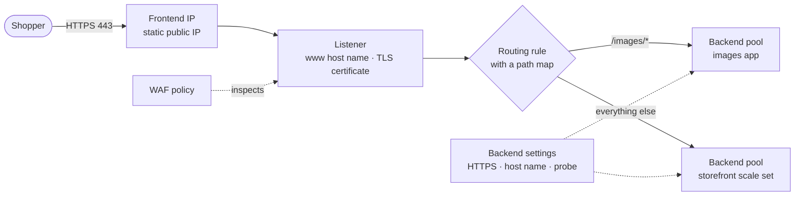
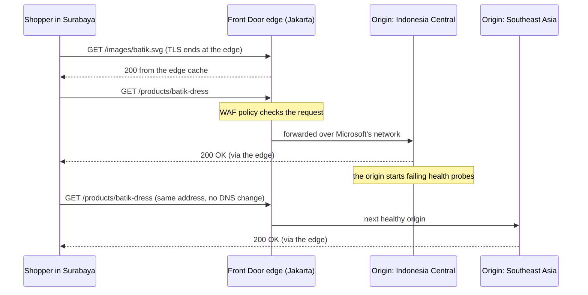
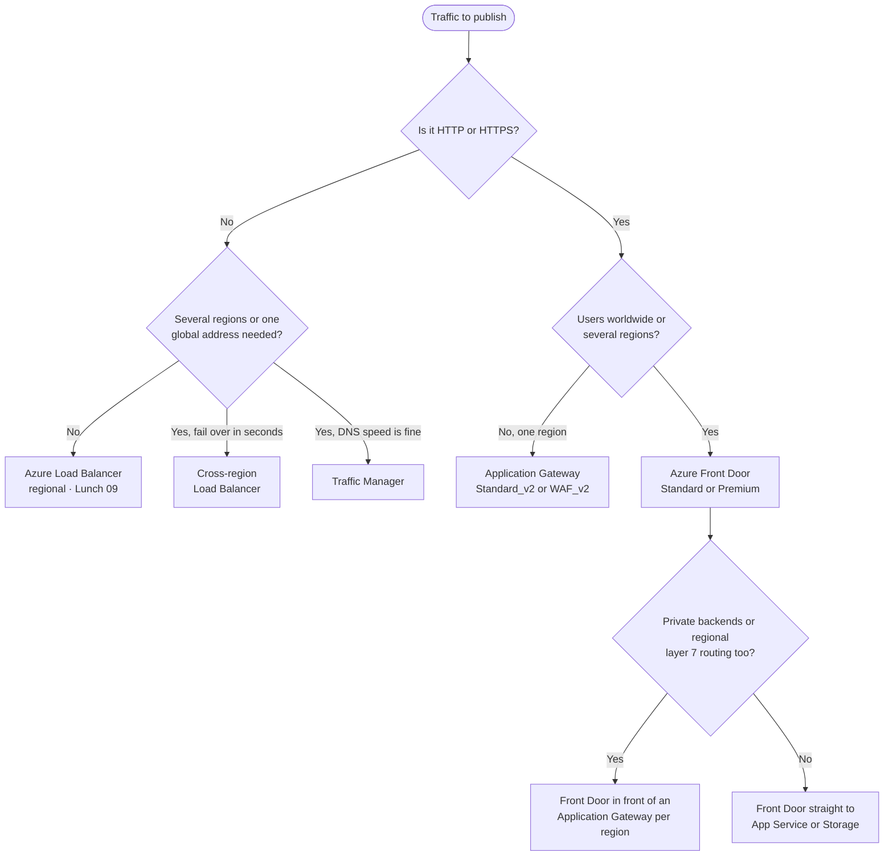

# Lunch 27 · Load Balancing (Advanced): Application Gateway, Front Door and Traffic Manager

🇮🇩 [Baca dalam Bahasa Indonesia](README.id.md)

> **Track:** Deep-dive month · **Level:** Advanced · **Part 5:** Deep dives
> **Time:** 60 minutes · **Prerequisite lunches:** 09 (Load Balancing, Basic), 10, 08
> **AZ-900 skill area:** Beyond AZ-900
> **Lab:** [Lab 27 · Protect and route the storefront](../../labs/27-load-balancing-advanced/README.md) — about 75 minutes · cost 💲💲💲
> **Author:** Stefanus Pinarta · [About the author](../../README.md#about-the-author)

| ⏱ Minutes | Segment |
|---:|---|
| 5 | Scenario and objectives |
| 25 | Reading |
| 15 | Demo: interactive animation (+ optional walkthrough video) |
| 5 | Knowledge check |
| 5 | Key takeaways and lab preview |
| 5 | Buffer — finish your lunch 🍜 |

## 🍱 Today's menu

By the end of this lunch you will be able to:

- **Explain** what a layer 7 reverse proxy adds to load balancing, and what it costs you.
- **Describe** the parts of an Application Gateway v2 — listeners, rules, backend pools, backend settings and health
  probes — and how path-based and multi-site routing work.
- **Plan** a WAF policy: managed rule sets, custom rules, exclusions, Detection and Prevention modes.
- **Compare** how Azure Front Door, Traffic Manager and the cross-region Load Balancer move users between regions.
- **Choose** the right service — or combination of services — with a two-question decision tree.

## 🏪 Meanwhile at Nusantara Retail

Since Lunch 23 the storefront runs on a scale set across three zones in Indonesia Central, behind the Standard load
balancer from Lunch 09. It survived the last sale. Now three new requests land on your desk.

Dewi has moved the product photos into a separate images app and wants `www.nusantararetail.co.id/images/...` served
by it, under the shop's address. Rizky forwards the web server logs: thousands of requests a day contain strings such
as `' OR 1=1--`, attempts to trick the database into returning every customer. And Ibu Sari has read a news
story about a cloud outage that took a whole region offline for an afternoon: *"If Jakarta goes down during 12.12, do shoppers in Medan and Makassar just see an
error?"* Shoppers in eastern Indonesia already complain that product pages load slowly.

The layer 4 load balancer can't help with any of this, because it never reads a request. Today's question: **which
Azure service should stand in front of the storefront — and when do you need more than one?**

---

## 📖 Reading (≈25 minutes)

### 1. Beyond layer 4: what a reverse proxy adds

Azure Load Balancer forwards packets without opening them. That makes it fast and able to carry any protocol, but it
is blind: it can't tell a product page from a login form, or a shopper from an attacker. The services in this lunch
read the request.

A **reverse proxy** stands in front of your servers and plays the server's role towards the client. It accepts the
client's connection, reads the whole HTTP request, decides where it should go, and sends it on over a second
connection of its own. Because it reads every request, a layer 7 proxy can:

- **route by content** — the host name (`www` or `partners`), the URL path (`/images/*`), headers or query strings;
- **terminate TLS** — decrypt HTTPS once, with certificates managed in one place, and re-encrypt to the servers if
  you need to;
- **inspect** requests with a **web application firewall (WAF)** and drop attacks before they reach your code;
- **change** requests and responses — redirect HTTP to HTTPS, rewrite headers, keep a shopper on one server with a
  cookie;
- **cache** answers close to users (Front Door).

The trade-offs come from the same design. A proxy speaks HTTP and HTTPS (Application Gateway can also proxy plain TCP
and TLS, but HTTP is its home ground), it adds a little latency, and your servers see the proxy's address; the
shopper's own address travels in the `X-Forwarded-For` header.

Azure offers four services that can stand in front of an application, besides the regional load balancer you already
know. Two questions sort them: **does the traffic speak HTTP(S)?** and **is it served from one region or several?**

| | Application Gateway | Azure Front Door | Traffic Manager | Cross-region Load Balancer |
|---|---|---|---|---|
| Works with | HTTP(S), layer 7 | HTTP(S), layer 7 | DNS, so any protocol | TCP and UDP, layer 4 |
| Scope | one region, inside your virtual network | global, at Microsoft's edge | global | global |
| In the traffic path? | yes, as a proxy | yes, as a proxy at the edge | no — it only answers DNS queries | yes, passing packets through |
| When a failure is detected, clients… | stop getting the unhealthy backend at once | keep the same address; the edge picks another origin | move only when their cached DNS answer expires | keep the same address; another region answers |
| Typical job | path routing, TLS and WAF for one region's apps | one global entry point with caching and WAF | DNS failover or location rules for any endpoint | one static IP for a global TCP or UDP service |

### 2. Application Gateway v2, piece by piece

**Azure Application Gateway** is a managed reverse proxy that you deploy into your own virtual network, in one region.
It needs a **dedicated subnet** (a /24 is recommended, so it has room to scale), has a static public or private
frontend IP address, and is assembled from a handful of parts that you will meet again in the portal and in Lab 27:

| Component | What it does | Lab 27 example |
|---|---|---|
| **Frontend IP** | the public and/or private address clients connect to | `pip-agw-nusa` |
| **Listener** | waits on a frontend, port and protocol — optionally for specific host names; an HTTPS listener holds the TLS certificate | HTTP on port 80 |
| **Request routing rule** | connects one listener to its backend targets; *basic* (one pool) or *path-based*; v2 rules have a priority | `rule1`, path-based |
| **Backend pool** | the servers: VM NICs, scale sets, IP addresses or host names such as App Service apps | `pool-images` with the images app |
| **Backend settings** | *how* to talk to a pool: protocol, port, host name, timeout, cookie affinity, probe | HTTPS on 443, host name taken from the backend |
| **Health probe** | regular checks of every backend; members that fail get no requests | `probe-app`: HTTPS GET `/` |
| **WAF policy** (WAF_v2) | the firewall's rules and mode, attached to the gateway, a listener or a path | `waf-nusa` in Prevention mode |

A rule decides *where* a request goes; backend settings decide *how* the gateway delivers it. Three routing features do
most of the work:

- **Path-based routing.** A **URL path map** lists patterns such as `/images/*` or `/api/*`, each with its own pool,
  plus a default pool for everything else. The gateway forwards the full path unless you rewrite it.
- **Multi-site hosting.** A *basic* listener accepts any host name; a *multi-site* listener matches specific names,
  wildcards included. That lets `www.nusantararetail.co.id` and `partners.nusantararetail.co.id` share one gateway, one
  IP address and port 443, each with its own rules.
- **Redirects and rewrites.** Send HTTP to HTTPS, add security headers, or change a URL before the backend sees it.

With **TLS termination**, the listener holds the certificate — v2 can read it from Azure Key Vault, so renewal happens
in one place — and the gateway sees the decrypted request, which the WAF needs. With **end-to-end TLS**, the backend
settings use HTTPS too, so traffic is encrypted again on its way to the servers, and the gateway checks each backend's
certificate the way a careful browser would.

Every backend is checked. Without configuration a **default probe** requests `/` with the host name `127.0.0.1`; a
**custom probe** lets you choose the path, host name, interval and accepted status codes. If every member of a pool
fails, the gateway answers **502 Bad Gateway**.

There are two production SKUs: **Standard_v2**, and **WAF_v2**, which adds the web application firewall. A lighter
**Basic** SKU is in preview at the time of writing, and the original **v1** SKUs retired on April 28, 2026. Both v2 SKUs
**autoscale** between a minimum and a maximum instance count you choose, or run at a fixed capacity. In regions with
availability zones they spread across at least two zones by default. New instances take minutes rather than seconds,
so raise the minimum before a known peak such as 12.12. For Kubernetes traffic Microsoft also offers a separate
product, **Application Gateway for Containers** (Lunch 29).

> [!WARNING]
> **App Service behind Application Gateway needs the right host name.** App Service runs many apps on shared front
> ends and picks the app by the request's host name. The gateway forwards the name the shopper typed, and its default
> probe uses `127.0.0.1` — names App Service doesn't recognise — so the probe fails and shoppers get 502. Either give
> the app the same custom domain as the listener (the cleanest fix), or set the backend settings to **pick the host
> name from the backend target** and add a custom probe that does the same. Lab 27 hits this wall on purpose.

### 3. The web application firewall: rule sets, modes and scores

A **web application firewall** looks inside every HTTP request for the patterns of common attacks: SQL injection,
cross-site scripting, protocol abuse, malicious bots. On Application Gateway it needs the WAF_v2 SKU and takes its
instructions from a **WAF policy**, a separate Azure resource. You can attach a policy to the whole gateway, to one
listener (*per-site*) or to one path rule (*per-URI*), so a partner portal can be stricter than the shop.

A policy has four parts:

- **Managed rule sets**, written and updated by Microsoft. The **Default Rule Set (DRS)** — version 2.2 is recommended
  for new policies — builds on the OWASP Core Rule Set and adds Microsoft's own rules. An optional **Bot Manager**
  rule set sorts bots into good, bad and unknown.
- **Custom rules** that you write, evaluated before the managed rules: allow head office's IP range, block a country,
  or **rate-limit** the login page.
- **Exclusions**, which tell the managed rules to ignore one header, cookie or form field that legitimately looks
  suspicious.
- A **mode**: **Detection** only logs what it would have blocked; **Prevention** blocks it.

DRS uses **anomaly scoring**. A request that matches a rule isn't rejected on the spot. Each match adds points by
severity — 5 for *critical*, 4 for *error*, 3 for *warning*, 2 for *notice* — and once a request's total reaches the
threshold of 5, Prevention mode stops it with **HTTP 403 Forbidden**. One critical match, such as `' OR 1=1--` in a
query string, is enough by itself. A single warning, such as a request addressed to an IP address instead of a host
name, is not, which is why Lab 27 can browse the gateway by its IP address. Front Door has WAF policies of its own,
built on the same ideas and applied at the edge.

A WAF is a safety net, not a replacement for secure code. Dewi's queries still need parameters, not strings glued
together.

> [!TIP]
> Start every new policy in **Detection** mode. Send real traffic through it for a few days, ideally including a busy
> sale day, and read the WAF logs for false positives. Add exclusions or custom rules for them, then switch to
> **Prevention**. A policy left in Detection for months protects nothing.

### 4. Azure Front Door: the front door at Microsoft's edge

**Azure Front Door** is a global layer 7 service that runs in Microsoft's **edge locations** — points of presence in
metro areas around the world, Jakarta and Singapore among them. Front Door's DNS and network send each shopper to a
nearby, healthy edge location. TLS ends there, the WAF inspects the request there, and cached content is served from
there. Everything else travels to your **origin** over Microsoft's own network rather than the public internet.

A Front Door profile has one or more **endpoints**, each with an `azurefd.net` host name, plus your custom domains with
managed certificates. A **route** matches domains, path patterns and protocols, and sends requests to an **origin
group**: a set of **origins** — App Service apps, storage accounts, Application Gateways or any public host name — with
a health probe and load-balancing settings. Among the healthy origins, Front Door picks those with the best
**priority**, then the lowest latency, then splits traffic by **weight**. **Rule sets** change behaviour per request
(redirects, header changes, cache settings), and **caching** with compression serves static files such as product
photos straight from the edge.

Shoppers keep talking to the same edge location, which simply picks another origin, so an origin failover takes
effect as soon as the health probes notice — no DNS answer has to change. Front Door comes in two tiers:

| Feature | Standard | Premium |
|---|---|---|
| Static and dynamic content, caching, compression, rule sets | ✓ | ✓ |
| Custom domains with HTTPS | ✓ | ✓ |
| WAF custom rules, including geo-filtering and rate limits | ✓ | ✓ |
| Microsoft-managed WAF rule set and bot protection | — | ✓ |
| Private Link connection to origins | — | ✓ |
| Built-in reports | ✓ | ✓, plus a WAF report |

An origin that anyone can reach directly turns the edge WAF into a suggestion. Lock it down. For App Service, add access
restrictions that allow only the **AzureFrontDoor.Backend** service tag *and* require the `X-Azure-FDID` header to
carry your profile's ID — the service tag alone admits every Front Door profile, an attacker's included. With
Premium you can reach the origin over **Private Link** instead, so it needs no public endpoint at all.

> [!IMPORTANT]
> **Front Door (classic)** retires on **March 31, 2027**, and new classic profiles can no longer be created. **Azure CDN
> Standard from Microsoft (classic)** follows on September 30, 2027. Older tutorials that use the
> `az network front-door` commands target classic; use `az afd` for Standard and Premium.

### 5. Traffic Manager and the cross-region Load Balancer

**Azure Traffic Manager** steers clients with DNS. You create a profile with a name such as
`nusa-shop.trafficmanager.net`, add **endpoints**, and point your own domain at the profile with a CNAME record. When a
client looks the name up, Traffic Manager chooses a healthy endpoint according to the profile's **routing method** and
answers with that endpoint's name. The client then connects to the endpoint directly. Traffic Manager never touches
the traffic, so it works for any protocol — and it can't route by path, end TLS or filter attacks.

| Routing method | Returns… | Nusantara Retail example |
|---|---|---|
| **Priority** | the healthy endpoint with the best priority (1 is first) | Indonesia Central; Southeast Asia only if it fails |
| **Weighted** | endpoints at random, in proportion to their weights | send 10% of shoppers to a new storefront version |
| **Performance** | the endpoint with the lowest network latency from the user's DNS resolver | a future storefront on two continents |
| **Geographic** | the endpoint assigned to the region the query comes from | keep Indonesian shoppers on Indonesian infrastructure |
| **MultiValue** | several healthy endpoints at once (external IPv4 or IPv6 endpoints only) | a client that retries another address itself |
| **Subnet** | the endpoint mapped to the source IP range | head-office staff test a preview version |

Endpoints are **Azure endpoints** (resources such as public IP addresses, or App Service apps on the Standard tier or
higher), **external endpoints** (any host name or IP address, even outside Azure — Lab 27 uses these), or **nested
endpoints**: child profiles, so you can combine methods, for example Geographic on top and Priority inside each
geography. Traffic Manager probes every endpoint over HTTP, HTTPS or TCP every 30 seconds, or every 10 seconds with
fast probing. After more consecutive failures than you tolerate, the endpoint is marked **Degraded** and disappears from
the answers.

Answering with DNS makes Traffic Manager simple and protocol-neutral, but it brings caveats you must design for:

- **Caching.** Resolvers and clients keep an answer for the profile's **TTL** (time to live), and some clients keep it
  longer. Failover takes roughly detection time plus the TTL plus any extra caching. A low TTL speeds failover but
  multiplies DNS queries.
- **Open connections stay put.** A shopper who is already connected keeps talking to the failed endpoint until the
  connection breaks and the name is looked up again.
- **"Location" means the resolver's location.** Performance and Geographic routing see the DNS resolver that asked,
  not the shopper. Someone in Surabaya using a public resolver abroad can be placed wrongly.
- **Host names.** Each endpoint must accept the name the client asked for, so web apps need your custom domain bound
  on every endpoint.

For non-HTTP traffic that must fail over faster than DNS allows, Azure Load Balancer has a global tier, the
**cross-region load balancer**. It gives you one static **anycast** public IP address in front of Standard public load
balancers in several regions. It checks the regional load balancers every 5 seconds and sends new connections to a
healthy region without any DNS change, and the servers still see the client's own IP address. Its frontend is public
only, and the regional load balancers must sit in participating regions. At the time of writing Indonesia Central is
not one of them, so check the list before you design around it.

### 6. Choosing — and combining — for Nusantara Retail

The decision tree needs only the two questions from section 1, plus one follow-up on each side:

Real designs often stack two services, a global one in front of a regional one:

| Combination | When it makes sense |
|---|---|
| Front Door → App Service or Storage | the simplest global web app: edge TLS, caching and WAF, origins locked to your profile |
| Front Door → Application Gateway in each region | a global entry point plus regional layer 7 routing to private backends in a virtual network |
| Traffic Manager → Application Gateway in each region | regional gateways with DNS failover, when a slower failover is acceptable |
| Application Gateway → internal Load Balancer | the gateway serves the web tier; the order API sits behind an internal load balancer |
| Cross-region Load Balancer → regional public load balancers | a global TCP or UDP service with one static address |

Here is the team's design for the next 12.12 sale:

- **Front Door Premium** answers `www.nusantararetail.co.id` from the edge: managed certificate, WAF with the managed
  rule set and bot protection, and product photos cached in edge locations such as Jakarta.
- An **Application Gateway** in Indonesia Central is the priority 1 origin. It is zone-redundant, sends `/images/*` to
  the images app and everything else to the scale set, and accepts only Front Door traffic: an NSG allows the
  AzureFrontDoor.Backend service tag, and a custom WAF rule checks `X-Azure-FDID`. Standard_v2 would do behind Front
  Door's WAF; the security team chose WAF_v2 for a second layer.
- A smaller copy in **Southeast Asia** is the priority 2 origin. Customer data must stay in Indonesia, so for now the
  standby serves the catalogue in browse-only mode; Lunch 28 deals with the orders database.
- The stores' point-of-sale sync, a plain TCP service, gets a **Traffic Manager** priority profile in front of a public
  load balancer in each region. A cross-region load balancer would fail over faster, once Indonesia Central joins its
  list of participating regions.

> [!NOTE]
> **Pause and think:** at 20:00 on 12.12, the storefront in Indonesia Central stops answering. A shopper in Makassar
> is halfway through checkout. What does she experience if the shop's address points at Traffic Manager with a
> 60-second TTL — and what if it points at Front Door?

Basic partner: [Lunch 09 · Load Balancing (Basic)](../09-load-balancing-basic/README.md) covers Azure Load Balancer,
health probes and outbound rules.

---

## 🎬 Demo (≈15 minutes)

1. **Interactive animation (≈6–8 min):** [Open the demo](https://stefpin.github.io/azure-fundamentals-lunches/demos/27-load-balancing-advanced.html) —
   press ▶ Play or step through it at your own pace. Offline? Download
   [`docs/demos/27-load-balancing-advanced.html`](../../docs/demos/27-load-balancing-advanced.html) and open it in any browser.
2. **Walkthrough video (≤ 6 min):** _coming soon_ — [read the walkthrough script](demo-video-script.md).

What to watch for:

- The decision tree's first two questions: HTTP(S) or not, one region or several.
- The Surabaya shopper stays on the Jakarta edge while Front Door switches origins — no DNS change.
- The WAF adds up anomaly points and answers 403 before the attack reaches the app.
- Traffic Manager only changes DNS answers; cached ones keep some clients on the failed endpoint until the TTL ends.

## ✅ Knowledge check (≈5 minutes)

1. Dewi adds the images app (`app-nusa-img.azurewebsites.net`) to a new backend pool on the gateway. Backend health
   shows it as **Unhealthy** and `/images/` returns 502, yet the app works when she browses to it directly. What is
   missing?
   

Show answer

   Backend settings that **pick the host name from the backend target**, plus a custom probe that takes its host name
   from them — or the same custom domain on the app and the listener. *Why:* App Service chooses the app by host name,
   and the gateway was sending one it doesn't recognise.

   

2. On the first morning of the sale the WAF, in Prevention mode, starts returning 403 for product reviews such as
   *"Drop by the store and select your size"*. Attack traffic is still being blocked too. What should the team do?
   

Show answer

   Find the matching rule in the WAF logs and add an **exclusion** for the review field (or a narrowly scoped custom
   rule), keeping Prevention mode for everything else. *Why:* managed rules match patterns, not intentions, so an
   exclusion removes the false positive without switching off protection.

   

3. The storefront uses Traffic Manager priority routing with a 300-second TTL. Indonesia Central fails; the endpoint
   shows *Degraded* after about 30 seconds, yet some shoppers still get errors five minutes later. Why, and what would
   shorten it?
   

Show answer

   Resolvers and clients keep the cached DNS answer for the TTL, some even longer. Lower the TTL, or use Front Door,
   whose edge switches origins while clients keep the same address. *Why:* Traffic Manager only changes future DNS
   answers; it never moves traffic that already knows where to go.

   

4. The stores' point-of-sale devices send sales to head office systems over a custom TCP protocol on port 9000. Pak
   Budi wants one fixed public IP address that fails over between two regions within seconds. Which service fits?
   

Show answer

   The **cross-region load balancer** in front of a Standard public load balancer in each region — if both are
   participating regions; otherwise Traffic Manager, with DNS-speed failover. *Why:* Application Gateway and Front
   Door are built for HTTP(S); only the cross-region load balancer gives TCP one static global address.

   

5. Rizky notices SQL-injection attempts sent straight to `app-nusa-store.azurewebsites.net`, bypassing Front Door and
   its WAF. The app already allows only the AzureFrontDoor.Backend service tag. How does he close the gap?
   

Show answer

   Also require the `X-Azure-FDID` header to match Nusantara's Front Door profile ID in the access restriction — or use
   a Private Link origin with Premium. *Why:* the service tag covers every Front Door profile, including one an
   attacker creates.

   

## 🧠 Key takeaways

- A layer 7 **reverse proxy** reads each request, so it can route by host and path, end TLS and run a **WAF**; for
  non-HTTP traffic in one region, Azure Load Balancer (Lunch 09) is still the tool.
- **Application Gateway v2** (Standard_v2 or WAF_v2; v1 retired April 28, 2026) is regional, zone-redundant and
  autoscaling: listeners, rules, backend pools, backend settings and probes. App Service backends need the right host name.
- A **WAF policy** combines managed rule sets (DRS 2.2 for new policies), custom rules and exclusions; start in
  **Detection**, tune, then switch to **Prevention**, where anomaly scores of 5 or more get a 403.
- **Azure Front Door** (Standard or Premium; classic retires March 31, 2027) works at Microsoft's edge: TLS, caching,
  WAF and origin failover without DNS delays. Lock origins to your profile.
- **Traffic Manager** steers any protocol with DNS (six routing methods), but failover waits for TTLs and caches; the
  **cross-region load balancer** gives TCP and UDP one anycast IP. Global services often sit in front of regional ones.

## 🗒️ Field notes from Stefanus

> **Always knock on the back door.** When a team shows me a new Front Door or Application Gateway with a WAF, my
> first test is not the front door. I take the origin's own address — the `azurewebsites.net` name or the server's
> public IP — and send one request straight to it from a laptop outside the corporate network. If it answers, the WAF
> only protects the visitors who are polite enough to use the official address; an attacker simply walks around it.
> I repeat that test after every change, because back doors are rarely left open on purpose: they are reopened by a
> "temporary" access rule. And if the WAF is still in Detection mode, I ask for the date it moves to Prevention and
> write that date into the design.

## 🔬 Your lab: Protect and route the storefront

`setup.sh` deploys two small App Service apps, a storefront and an images service. You put an Application Gateway
WAF_v2 in front of them, fix the classic App Service host-name problem, route `/images/*` to the images app, and watch
a WAF policy go from logging a SQL-injection attempt to blocking it with 403. Then you build a Traffic Manager priority
profile, stop the storefront and watch the DNS answer move, with an optional Front Door Standard at the end. Finish
it in one sitting and clean up straight away.

- ⏱ About 75 minutes · 💲💲💲 the gateway is billed every hour it exists · works on its own (no earlier lab needed)
- 👉 [Start Lab 27](../../labs/27-load-balancing-advanced/README.md)

## 📚 Go further

- [Azure Architecture Center: Load balancing options](https://learn.microsoft.com/azure/architecture/guide/technology-choices/load-balancing-overview) — Microsoft's own decision tree and the common combinations, in more depth.
- [Microsoft Learn: What is Azure Application Gateway v2?](https://learn.microsoft.com/azure/application-gateway/overview-v2) — SKUs, v2 features and the v1 retirement.
- [Microsoft Learn: Comparison between Azure Front Door and Azure Content Delivery Network](https://learn.microsoft.com/azure/frontdoor/front-door-cdn-comparison) — what each tier includes, and the retirement dates for the classic services.
- [Microsoft Learn: Traffic Manager routing methods](https://learn.microsoft.com/azure/traffic-manager/traffic-manager-routing-methods) — all six methods, with the DNS caveats behind each.

---

⬅️ [Lunch 26 · Hybrid Connectivity: VPN Gateway, ExpressRoute and Virtual WAN (Advanced)](../26-hybrid-connectivity/README.md) · 🏠 [Course home](../../README.md) · [Lunch 28 · Relational Databases (Advanced)](../28-relational-databases-advanced/README.md) ➡️

Last validated: October 2026 · Spotted something out of date? [Open an issue](../../CONTRIBUTING.md).
