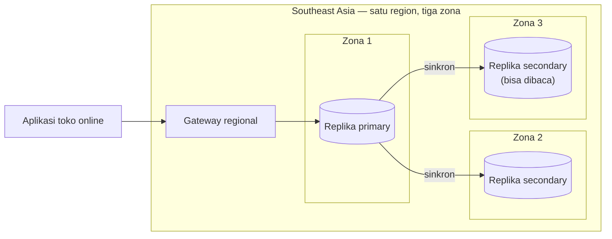
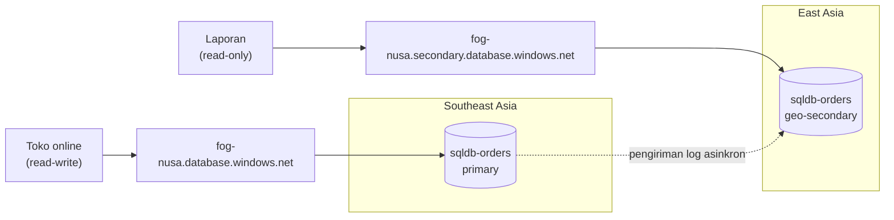

# Makan Siang 28 · Database Relasional (Lanjutan)

🇬🇧 [Read in English](README.md)

> **Jalur:** Bulan pendalaman · **Level:** Lanjutan · **Bagian 5:** Pendalaman
> **Waktu:** 60 menit · **Makan siang prasyarat:** 11, 17
> **Area keterampilan AZ-900:** Di luar cakupan AZ-900
> **Lab:** [Lab 28 · Pesanan yang selamat dari gangguan region](../../labs/28-relational-databases-advanced/README.id.md) — sekitar 60 menit · biaya 💲💲
> **Penulis:** Stefanus Pinarta · [Tentang penulis](../../README.id.md#tentang-penulis)

| ⏱ Menit | Segmen |
|---:|---|
| 5 | Skenario dan tujuan |
| 25 | Bacaan |
| 15 | Demo: animasi interaktif (+ video panduan opsional) |
| 5 | Uji pemahaman |
| 5 | Poin penting dan pratinjau lab |
| 5 | Waktu cadangan — habiskan makan siang Anda 🍜 |

## 🍱 Menu hari ini

Setelah makan siang ini, Anda akan mampu:

- **Menjelaskan** bagaimana tier General Purpose, Business Critical, dan Hyperscale menjaga database tetap tersedia di
  dalam satu region (*wilayah*), dan apa yang ditambahkan oleh zone redundancy.
- **Merancang** pemulihan bencana (disaster recovery) lintas region dengan active geo-replication atau failover group,
  lalu menyebutkan RPO (berapa banyak data yang boleh hilang) dan RTO (berapa lama layanan boleh berhenti) yang
  benar-benar bisa Anda janjikan.
- **Memulihkan** database dari kesalahan manusia dengan point-in-time restore dan long-term retention, serta memilih
  backup storage redundancy.
- **Memilih** fitur keamanan, penskalaan, dan performa yang tepat: autentikasi Entra-only, yang hanya menerima
  identitas Microsoft Entra ID (*ID Microsoft Entra*) dan menolak login SQL; TDE dengan customer-managed key; Always
  Encrypted; dynamic data masking; row-level security; auditing; Microsoft Defender for SQL; read scale-out; elastic
  pool; dan Query Store.

## 🏪 Sementara itu di Nusantara Retail

Sejak Makan Siang 11, data pesanan tinggal di Azure SQL Database. Tidak ada lagi flashdisk USB, tidak ada lagi
password `sa` (akun admin bawaan SQL Server) yang dipakai bersama-sama. Lalu Ibu Sari membaca berita tentang gangguan
cloud yang membuat satu region penuh offline selama satu sore, dan ia membawanya ke rapat hari Senin: *"Kalau itu
terjadi pada region kita, berapa lama kita tidak bisa jualan — dan berapa banyak pesanan yang hilang?"*

Peserta rapat lainnya juga datang dengan permintaan sendiri. Tim layanan pelanggan perlu mencari data pesanan, tetapi
tidak boleh melihat alamat e-mail dan nomor telepon secara lengkap. Bagian keuangan harus menyimpan salinan data akhir
bulan selama bertahun-tahun. Dan hari Jumat lalu Dewi menjalankan `UPDATE` tanpa klausa `WHERE` — perintah yang
mengubah *semua* baris karena tidak ada syarat yang membatasinya — di database pengujian. "Cuma" database pengujian,
kali ini.

Hari ini Anda membuat data pesanan sanggup bertahan dari tiga bencana yang berbeda: zona yang gagal, region yang
gagal, dan manusia yang khilaf. Anda juga mengunci data itu dari dalam. **Berapa banyak data yang bisa hilang dari
Nusantara Retail jika satu region Azure gagal total, dan seberapa cepat toko bisa berjualan lagi?**

---

## 📖 Bacaan (≈25 menit)

### 1. Ketersediaan tinggi di dalam satu region

Azure SQL Database menyimpan lebih dari satu salinan setiap database dan melakukan failover — berpindah otomatis ke
salinan lain — saat perangkat keras, perangkat lunak, atau jaringan gagal, juga selama pemeliharaan terencana seperti
patching. Anda tidak perlu mengonfigurasi semua ini; bagian Anda adalah **retry logic** (logika coba ulang) di
aplikasi, karena failover terlihat sebagai sambungan yang terputus sebentar. Cara salinan itu disimpan bergantung pada
service tier:

- **General Purpose** (serta tier DTU Basic dan Standard; DTU adalah model harga lama yang menggabungkan CPU, memori,
  dan I/O dalam satu angka) memakai **remote storage** (penyimpanan jarak jauh). Database engine berjalan di compute
  node yang stateless (tidak menyimpan data sendiri), sementara file data dan log berada di Azure Storage, yang
  menyimpan salinannya sendiri. Jika node itu gagal, platform menyalakan engine di node cadangan dan memasang file
  yang sama.
- **Business Critical** (serta Premium) memakai **local storage**. Sebuah cluster replika database engine — satu
  primary dan hingga tiga secondary — masing-masing menyimpan salinan lengkap data di SSD lokal yang cepat. Sebuah
  transaksi baru di-commit (dinyatakan final) jika kuorum replika sudah memilikinya, persis seperti rapat yang baru
  sah jika jumlah peserta minimum terpenuhi, sehingga failover berlangsung cepat dan tidak kehilangan apa pun. Satu
  secondary bisa dibaca tanpa biaya tambahan.
- **Hyperscale** memecah engine menjadi beberapa bagian: compute replica, **page server** yang masing-masing menyimpan
  sepotong data, sebuah **log service**, dan penyimpanan jangka panjang. Anda bisa menambahkan nol hingga empat
  high-availability replica dan hingga 30 named replica, dan database-nya bisa tumbuh hingga 128 TB.

**Zone redundancy** menyebarkan salinan-salinan itu ke availability zone (*zona ketersediaan*) di region tersebut
(Makan Siang 03). Fitur ini tersedia untuk General Purpose, Business Critical, Hyperscale, dan Premium, tetapi tidak
untuk Basic atau Standard. Untuk Hyperscale, Anda harus memilihnya saat membuat database. Dengan zone redundancy, satu
zona penuh boleh gagal dan database tetap berjalan setelah failover singkat. Panduan business continuity dari
Microsoft menggambarkannya sebagai tanpa kehilangan data, dengan waktu pemulihan yang biasanya di bawah 30 detik.

| Tier | Tempat data disimpan | Salinan bawaan yang bisa dibaca | Zone redundancy | Paling cocok untuk |
|---|---|---|---|---|
| Basic / Standard (DTU) | remote storage | tidak | tidak | database kecil yang tidak kritis |
| General Purpose | remote storage | tidak | ya | sebagian besar beban kerja bisnis |
| Business Critical / Premium | SSD lokal di beberapa replika | ya, satu secondary | ya | latensi rendah, failover cepat, pelaporan berat |
| Hyperscale | page server + log service + Azure Storage | ya, dengan HA replica atau named replica | ya, dipilih saat pembuatan | database besar atau yang tumbuh cepat |

Seperti apa failover dari sisi aplikasi? Koneksi yang sedang terbuka terputus, dan selama beberapa detik koneksi baru
bisa gagal dengan transient error (gangguan sesaat) seperti 40613, "database not currently available". Aplikasi yang
menunggu sebentar lalu mencoba lagi — dengan jeda yang makin panjang di antara percobaan — tidak akan menyadarinya.
Aplikasi tanpa retry logic menampilkan halaman error kepada pelanggan setiap kali ada failover dan setiap kali ada
patch. Sebagian besar library akses data modern sudah menyertakan opsi retry; menyalakannya adalah salah satu
peningkatan keandalan yang paling murah.

Ketersediaan tinggi menjawab pertanyaan "bagaimana jika sebuah server atau satu zona gagal?". Ia **tidak** menjawab
pertanyaan Ibu Sari, karena semua salinan ini tinggal di satu region yang sama.

### 2. Pemulihan bencana lintas region: geo-replication dan failover group

Untuk bertahan dari gangguan regional, Anda membutuhkan salinan data di region lain. Azure SQL Database menawarkan
tiga cara.

**Geo-restore** adalah opsi hemat. Jika cadangan (backup) Anda memakai geo-redundant storage, Anda bisa me-restore
backup terbaru yang sudah direplikasi ke region mana pun. Tidak ada yang berjalan di region kedua sampai Anda
membutuhkannya, tetapi Anda kehilangan perubahan yang dibuat sejak backup itu direplikasi, dan proses restore-nya
sendiri butuh waktu yang makin lama seiring besarnya database. Rencanakan dalam hitungan menit hingga jam.

**Active geo-replication** bekerja per database. Anda membuat hingga empat **geo-secondary** yang bisa dibaca,
biasanya di region lain. Primary mengirim transaction log-nya (catatan berurutan dari setiap perubahan) ke sana secara
**asinkron**: sebuah transaksi di-commit di primary lebih dulu, lalu menyusul ke secondary sesaat kemudian. Failover
dilakukan manual dan per database. Setelah failover, primary yang baru punya nama server yang berbeda, sehingga setiap
connection string — alamat dan cara login yang dipakai aplikasi untuk tersambung ke database — harus diubah.

Ibaratnya mengirim foto ke grup chat keluarga saat sinyal sedang lemah. Foto itu sudah tersimpan di ponsel Anda
(commit di primary), tetapi keluarga baru menerimanya beberapa detik kemudian. Kalau ponsel Anda jatuh ke sungai
sebelum unggahan selesai, foto-foto terakhir itulah yang hilang — persis seperti transaksi yang belum sempat
direplikasi.

**Failover group** dibangun di atas geo-replication dan menyelesaikan masalah connection string tadi. Sebuah failover
group mereplikasi sebagian atau semua database dari satu logical server (wadah administratif untuk database, bukan
mesin fisik) ke server di region lain, lalu memindahkan semuanya bersama-sama saat failover. Failover group yang sudah
generally available (GA) memiliki satu secondary server; secondary tambahan masih berstatus preview saat tulisan ini
dibuat. Setiap group mendapat dua nama **listener** yang tidak pernah berubah:

- `<fog-name>.database.windows.net` — **read-write listener**, selalu mengarah ke primary saat ini;
- `<fog-name>.secondary.database.windows.net` — **read-only listener**, mengarah ke secondary.

Listener-listener ini adalah alias DNS dengan time-to-live 30 detik. Setelah failover, namanya tetap sama dan
targetnya bertukar, sehingga aplikasi tersambung kembali tanpa perubahan konfigurasi apa pun — asalkan aplikasi itu
mencoba ulang (retry).

Bayangkan nomor hotline toko yang dicetak di semua brosur. Pelanggan selalu menelepon nomor yang sama, dan nomor itu
diteruskan ke cabang yang sedang bertugas. Kalau cabang utama tutup, yang diubah hanya penerusannya, bukan ribuan
brosur yang sudah tersebar.

Failover ada dua jenis. **Planned failover** (failover terencana) lebih dulu menyinkronkan secondary sepenuhnya, baru
kemudian menukar peran, sehingga tidak ada yang hilang; gunakan untuk latihan (drill) dan untuk pindah antar-region.
**Forced failover** (failover paksa, `--allow-data-loss`) langsung menukar peran, sehingga transaksi yang sudah
di-commit di primary tetapi belum terkirim akan hilang. Anda juga memilih **failover policy**. *Customer managed*
(disarankan Microsoft) berarti Anda yang memutuskan kapan failover. *Microsoft managed* berarti Microsoft yang
memindahkan semua group dengan policy itu di sebuah region saat terjadi gangguan yang meluas, dan itu pun baru setelah
masa tenggang (grace period) minimal satu jam.

Sekarang angka-angka untuk Ibu Sari. **RPO** (recovery point objective: berapa banyak data yang boleh hilang) dari
replikasi asinkron sama dengan **replication lag**: perubahan yang belum diterima secondary. Biasanya hanya hitungan
detik. Anda bisa memantaunya di kolom `replication_lag_sec` pada `sys.dm_geo_replication_link_status` di primary.
**RTO** (recovery time objective: berapa lama layanan berhenti) adalah waktu Anda mengambil keputusan ditambah
failover itu sendiri; panduan Microsoft menyebut biasanya kurang dari 60 detik setelah failover customer-managed
dimulai.

| | Geo-restore | Active geo-replication | Failover group |
|---|---|---|---|
| Cakupan | satu database | satu database | sekelompok database |
| Secondary berjalan terus-menerus | tidak | ya, hingga empat, bisa dibaca | ya, satu secondary server (GA) |
| Koneksi setelah failover | nama database baru | nama server baru | nama listener tetap sama |
| RPO umumnya | sejak backup terakhir yang sudah direplikasi | replication lag (hitungan detik) | replication lag (hitungan detik) |
| RTO umumnya | menit hingga jam | di bawah satu menit setelah dimulai | di bawah satu menit setelah dimulai |
| Biaya tambahan | tidak ada sampai dipakai | compute dan penyimpanan secondary | compute dan penyimpanan secondary |

Dua pilihan desain perlu perhatian khusus. Saat Anda membuat failover group, secondary lebih dulu di-**seed** (diisi
awal) dengan salinan lengkap setiap database, dan proses ini makin lama untuk database yang besar. Lalu secondary
sebaiknya memiliki **service tier dan compute size yang sama** dengan primary. Secondary yang lebih kecil akan
tertinggal saat beban tulis berat, sehingga RPO Anda membesar, dan ia menjadi bottleneck begitu berubah menjadi
primary. Jika secondary itu murni untuk pemulihan bencana, database vCore (model harga berdasarkan jumlah inti CPU
virtual) General Purpose dan Business Critical bisa memakai secondary **standby** bebas lisensi untuk menekan biaya.

> [!TIP]
> Latihlah sebelum Anda membutuhkannya, seperti simulasi evakuasi gempa di gedung kantor. **Failover drill** adalah
> planned failover pada jam sepi: umumkan, lakukan failover, periksa bahwa aplikasi tersambung kembali lewat listener
> dan laporan tetap berjalan, catat berapa lama setiap langkah, lalu kembalikan (fail back) dengan cara yang sama. Tim
> yang sudah melakukannya dua kali akan mengambil keputusan sungguhan dalam hitungan menit, bukan jam.

> [!WARNING]
> Failover group menyalin database, bukan server yang membungkusnya. **Server-level firewall rule**, Entra admin milik
> server, dan server-level auditing juga harus dikonfigurasi di secondary server, atau failover pertama akan berubah
> menjadi gangguan kedua. Item tingkat database — contained user, database-level firewall rule, masking rule — ikut
> berpindah bersama database.

Region pair (*pasangan wilayah*, Makan Siang 03) tidak membatasi Anda: geo-replication bekerja di antara dua region
mana pun. Ini penting untuk **Indonesia Central**, yang tidak memiliki pasangan region. Jika data pelanggan harus
tetap di Indonesia, tanyakan dulu kepada tim kepatuhan (compliance) sebelum Anda menempatkan replika di luar negeri.

### 3. Backup secara mendalam: tombol undo

Replikasi bukan backup. `UPDATE` tanpa klausa `WHERE` milik Dewi akan sampai ke setiap geo-secondary dalam hitungan
detik, disalin dengan setia. Ibaratnya mesin fotokopi: kalau dokumen aslinya salah ketik, semua fotokopinya ikut salah
ketik. Untuk membatalkan sebuah kesalahan, Anda harus kembali ke masa lalu dengan backup.

Azure SQL Database membuat full backup (salinan lengkap) setiap minggu, differential backup (hanya perubahan sejak
full backup terakhir) setiap 12 atau 24 jam, dan log backup (catatan transaksi) kira-kira setiap 10 menit.
**Point-in-time restore** (PITR) membangun ulang database seperti keadaannya pada momen mana pun di dalam retention
window (rentang masa simpan) — default 7 hari, bisa diatur dari 1 sampai 35 hari (Basic: hingga 7) — ke sebuah
**database baru** di server yang sama. Anda lalu membandingkan, menyalin kembali baris yang Anda perlukan, atau
mengalihkan aplikasi ke salinan itu. Ada tiga detail yang sering menjebak. Pertama, database baru belum punya restore
point: full backup pertama dimulai segera setelah database dibuat dan biasanya selesai dalam 30 menit, dan PITR baru
bisa dilakukan setelah log backup pertama yang menyusulnya. Kedua, Anda tidak bisa menjalankan PITR pada
geo-secondary; lakukan restore dari primary. Ketiga, database yang **terhapus** pun bisa di-restore selama masih
berada di dalam retention window-nya.

Ambil kesalahan Dewi sebagai contoh kasus. Ia menjalankan `UPDATE` yang keliru pada pukul 16.59. Anda me-restore
database seperti keadaannya pada pukul 16.58 ke `sqldb-orders-restored`, lalu membandingkan kedua salinan. Jika hanya
sedikit baris yang berubah, Anda menyalin kembali nilai yang benar dengan alat yang biasa Anda pakai, sementara toko
tetap berjualan. Jika kerusakannya meluas, Anda mengarahkan aplikasi ke salinan hasil restore. Apa pun pilihannya,
makin tepat Anda tahu *kapan* kesalahan terjadi, makin sedikit data baik yang terbuang — satu alasan lagi untuk
membiarkan auditing tetap menyala.

**Long-term retention** (LTR) menyimpan full backup mingguan, bulanan, dan tahunan pilihan hingga 10 tahun — jawaban
untuk permintaan akhir bulan dari bagian keuangan. **Backup storage redundancy** (*opsi redundansi* untuk penyimpanan
backup) menentukan di mana file backup disimpan: locally redundant (LRS), zone-redundant (ZRS), geo-redundant (GRS,
default), atau geo-zone-redundant (GZRS). Hanya GRS dan GZRS yang memungkinkan geo-restore. Anda bisa
mengubahnya belakangan, tetapi hanya backup berikutnya yang memakai pengaturan baru (penerapannya bisa memakan waktu
hingga 48 jam); penawaran gratis hanya mendukung LRS, dan tidak semua opsi tersedia di setiap region — periksa region Anda.

| Masalah | Alat pertama yang dipakai |
|---|---|
| Seseorang menghapus atau mengubah baris secara tidak sengaja | point-in-time restore ke database baru |
| Seseorang menghapus (drop) seluruh database | me-restore database yang terhapus |
| Satu availability zone gagal | zone redundancy (otomatis) |
| Seluruh region tidak tersedia | failover lewat failover group (atau geo-restore) |
| Auditor meminta data akhir bulan dari tiga tahun lalu | backup long-term retention |

### 4. Penskalaan dan performa

Anda bisa mengubah jumlah vCore atau service tier selagi database tetap online; hanya ada reconnect singkat di bagian
akhir. Compute serverless (Makan Siang 11) melakukan scale secara otomatis. **Elastic pool** membagi kapasitas di
antara banyak database yang puncak bebannya terjadi pada waktu berbeda, mirip paket kuota internet keluarga yang
dipakai bergantian oleh anggota rumah yang jam sibuknya tidak sama. **Hyperscale** menumbuhkan penyimpanannya dengan
sendirinya dan menambah compute dengan cepat, karena data tidak perlu disalin ke node baru.

Pelaporan adalah masalah performa klasik: satu query akhir bulan yang berat memperlambat checkout untuk semua orang.
**Read scale-out** menyelesaikannya di Premium, Business Critical, dan Hyperscale, dan di tier-tier itu fitur ini
menyala secara default. Tambahkan `ApplicationIntent=ReadOnly` ke connection string milik alat pelaporan, dan
query-nya akan berjalan di replika read-only tanpa biaya tambahan. Read-only listener milik failover group melakukan
hal yang sama lintas region.

Untuk mencari tahu *mengapa* sebuah query lambat, mulailah dari **Query Store**, yang menyala secara default di Azure
SQL Database. Cara kerjanya seperti flight recorder atau "kotak hitam" pesawat: ia menyimpan query, execution plan-nya
("rute" yang dipilih database untuk mengambil data), dan statistik runtime dari waktu ke waktu, sehingga Anda bisa
melihat kapan sebuah plan berubah menjadi lebih buruk. **Automatic tuning** bertindak berdasarkan data itu:
`FORCE_LAST_GOOD_PLAN` menyala secara default dan kembali ke plan sebelumnya ketika plan baru mengalami regresi.
`CREATE_INDEX` dan `DROP_INDEX` bisa menambah dan menghapus index untuk Anda, tetapi keduanya mati secara default.

Ukur dulu sebelum menambah kapasitas. Metrik database menunjukkan apakah CPU, data I/O, atau log I/O yang menjadi
bottleneck. Jika biang keladinya satu query yang ditulis dengan buruk, menambah vCore hanya membuat masalahnya lebih
mahal; memperbaiki query atau menambahkan index yang tepat lebih murah dan lebih tahan lama.

### 5. Keamanan berlapis

Makan Siang 15 sudah memperkenalkan defense in depth (*pertahanan mendalam*). Untuk sebuah database,
lapisan-lapisannya terlihat seperti ini:

| Lapisan | Fitur | Melindungi dari | Tidak melindungi dari |
|---|---|---|---|
| Jaringan | firewall rule; **private endpoint** (*titik akhir privat*) dengan akses publik dimatikan | koneksi dari jaringan yang tidak dikenal | orang dalam yang sudah sign-in |
| Identitas | **autentikasi Microsoft Entra-only**, managed identity, peran dengan hak akses minimum (least privilege) | password yang dicuri atau dipakai bersama | akun dengan hak berlebihan |
| Data saat disimpan (at rest) | **TDE** dengan kunci yang dikelola layanan atau **customer-managed key** | disk dan file backup yang dicuri | siapa pun yang diizinkan menjalankan query |
| Kolom sensitif | **Always Encrypted** | administrator yang membaca plaintext; data tetap terenkripsi di dalam engine | klien yang sudah dibobol dan memegang kuncinya |
| Hasil query | **dynamic data masking** | paparan sepintas, misalnya staf support yang melihat e-mail lengkap | pengguna gigih yang menebak nilai lewat query yang cerdik |
| Baris | **row-level security** | pengguna yang melihat baris milik toko lain | pengguna dengan hak luas yang bisa mengubah policy-nya |
| Deteksi | **auditing**; **Microsoft Defender for SQL** | penyalahgunaan yang tak terdeteksi, SQL injection, pengaturan yang rentan | tidak ada dengan sendirinya — harus ada orang yang menindaklanjuti alert (*pemberitahuan*) |

Beberapa detail penting dalam praktik. **Transparent data encryption** menyala untuk setiap database baru. Dengan
customer-managed key di Azure Key Vault atau Managed HSM, Anda yang mengendalikan rotasi kunci, dan mencabut kunci itu
membuat database tidak bisa diakses — jadi kedua server dalam sebuah failover group perlu akses ke kunci tersebut.
**Always Encrypted** mengenkripsi kolom tertentu di driver klien, sehingga database engine tidak pernah melihat
plaintext-nya; secure enclave memungkinkan query yang lebih kaya pada kolom terenkripsi.

**Dynamic data masking** adalah kompromi kebalikannya: data disimpan sebagai teks biasa, dan hanya hasil query yang
disamarkan bagi pengguna tanpa permission `UNMASK`. Server admin, Microsoft Entra admin, dan anggota `db_owner` selalu
melihat nilai aslinya. Fungsi masking mencakup *default*, *email*, *random*, *custom string*, dan *datetime*;
contohnya `ALTER TABLE dbo.Customers ALTER COLUMN Email ADD MASKED WITH (FUNCTION = 'email()');`. Ibaratnya struk ATM
yang hanya mencetak empat digit terakhir nomor kartu Anda: nomor lengkapnya tetap tersimpan utuh di bank, hanya
cetakannya yang disamarkan. **Row-level security** memakai predicate function dan security policy untuk menyaring
baris per pengguna — manajer toko di Medan hanya melihat pesanan Medan.

**Auditing** menulis event database ke storage account (*akun penyimpanan*), Log Analytics workspace, atau Event Hubs;
Microsoft menyarankan untuk mengaktifkannya di level server. **Microsoft Defender for SQL** menambahkan vulnerability
assessment (penilaian kerentanan) serta alert untuk ancaman seperti SQL injection dan sign-in yang tidak biasa,
sebagai paket berbayar.

Keamanan dan pemulihan bencana bertemu di satu tempat lagi. Dengan **private endpoint**, setiap server dalam failover
group membutuhkan endpoint sendiri di sebuah virtual network (*jaringan virtual*) di region-nya masing-masing, serta
private DNS yang menerjemahkan nama dengan benar di kedua region. Makan Siang 25 menunjukkan cara kerja private DNS
zone; rancang untuk skenario failover sejak awal.

### 6. PostgreSQL, MySQL, dan rencana untuk Nusantara Retail

Engine open source dari Makan Siang 11 punya fitur ketahanan sendiri. Flexible server **Azure Database for
PostgreSQL** dan **Azure Database for MySQL** menawarkan **ketersediaan tinggi** (HA) dengan standby server di zona
lain (zone-redundant) atau di zona yang sama, yang dijaga tetap sama secara sinkron. Failover berjalan otomatis dan
biasanya memakan 60–120 detik. HA tidak tersedia pada compute tier Burstable. Untuk pembacaan dan untuk DR regional,
keduanya menawarkan **read replica** asinkron, yang bisa Anda tempatkan di region lain dan promosikan menjadi server
mandiri. PostgreSQL mengizinkan hingga lima replika per server (lebih banyak lagi dengan cascading replica), MySQL
hingga sepuluh. **Azure SQL Managed Instance** tidak memiliki active geo-replication, tetapi mendukung failover group
untuk seluruh instance, dengan konsep listener yang sama.

Kembali ke Nusantara Retail. Inilah rencana yang Anda bawa ke Ibu Sari:

- **Kegagalan zona:** database pesanan berjalan di **General Purpose dengan zone redundancy** di region asalnya.
  Gangguan pada satu zona hanya berarti reconnect singkat, tanpa kehilangan data.
- **Kegagalan region:** sebuah **failover group** dengan policy customer-managed mereplikasi data ke region kedua,
  setelah tim kepatuhan menyetujui di mana salinan DR boleh disimpan. Toko online tersambung lewat read-write
  listener; laporan toko memakai read-only listener. Tim melatih planned failover setiap kuartal.
- **Kegagalan manusia:** retensi PITR dinaikkan menjadi 14 hari, dan LTR menyimpan backup bulanan selama periode yang
  diwajibkan bagian keuangan.
- **Di dalam database:** autentikasi Entra-only dengan managed identity untuk aplikasi, private endpoint
  (Makan Siang 25), dynamic data masking pada e-mail dan nomor telepon pelanggan untuk tim support, row-level security
  untuk manajer toko, server-level auditing ke Log Analytics (Makan Siang 30), dan Defender for SQL.

Jawaban untuk pertanyaan Ibu Sari memang jujur, bukan sempurna. Dalam bencana regional, Nusantara Retail bisa
kehilangan pesanan yang masih dalam perjalanan — sebesar replication lag, biasanya hitungan detik. Toko bisa berjualan
lagi dalam hitungan menit setelah keputusan failover diambil, dan drill membuat semua orang tahu persis siapa yang
mengambil keputusan itu.

> [!NOTE]
> **Renungkan sejenak:** Dewi mengusulkan failover policy Microsoft-managed "supaya Azure yang mengurusnya untuk
> kita". Apa artinya bagi waktu pemulihan Nusantara Retail saat terjadi gangguan regional, dan siapa yang akan
> memutuskan kapan toko pindah ke region lain?

---

## 🎬 Demo (≈15 menit)

1. **Animasi interaktif (≈6–8 menit):**
   [Buka demo](https://stefpin.github.io/azure-fundamentals-lunches/demos/28-relational-databases-advanced.html?lang=id)
   — tekan ▶ Putar atau telusuri langkah demi langkah sesuai kecepatan Anda. Sedang offline? Unduh
   [`docs/demos/28-relational-databases-advanced.html`](../../docs/demos/28-relational-databases-advanced.html) lalu
   buka di browser apa pun.
2. **Video panduan (≤ 6 menit):** _segera hadir_ — [baca naskah video](demo-video-script.id.md).

Yang perlu diperhatikan:

- Urutan kejadian saat data ditulis: commit di primary lebih dulu, replikasi ke secondary sesudahnya.
- Transaksi mana yang hilang dalam forced failover, dan mengapa jumlahnya sama dengan replication lag.
- Bagaimana nama listener tetap sama sementara targetnya bertukar — dan mengapa `DELETE` yang keliru tetap membutuhkan
  backup.

## ✅ Uji pemahaman (≈5 menit)

1. Database pesanan sudah berada di dalam failover group, tetapi connection string toko online masih memakai
   `sql-nusa-main-ab12c.database.windows.net`. Setelah failover ke region secondary, checkout gagal dengan pesan "the
   database is read-only". Mengapa, dan bagaimana memperbaikinya?
   

Lihat jawaban

   Aplikasi masih tersambung ke **primary lama**, yang sekarang menjadi secondary read-only. Gunakan read-write
   listener `<fog-name>.database.windows.net`, yang targetnya selalu mengikuti primary di setiap failover.

   

2. Dua puluh menit lalu seseorang menjalankan `DELETE FROM dbo.Orders` tanpa klausa `WHERE`. Apakah failover ke region
   secondary akan mengembalikan baris-barisnya?
   

Lihat jawaban

   **Tidak.** Replikasi sudah menyalin penghapusan itu ke secondary dalam hitungan detik. Jalankan **point-in-time
   restore** dari primary ke momen tepat sebelum penghapusan, ke database baru, lalu salin kembali baris-barisnya.

   

3. Ibu Sari bertanya: "Dengan failover group, bisakah kita menjanjikan nol kehilangan data jika seluruh region mati?"
   Apa jawaban Anda?
   

Lihat jawaban

   **Tidak untuk gangguan yang tidak terencana.** Replikasinya asinkron, sehingga forced failover bisa kehilangan
   transaksi yang belum direplikasi — RPO sama dengan replication lag, biasanya hitungan detik. Hanya planned failover
   yang menyinkronkan lebih dulu dan tidak kehilangan apa pun.

   

4. Layanan pelanggan perlu melihat pesanan, tetapi tidak boleh melihat alamat e-mail pelanggan secara lengkap, tanpa
   mengubah aplikasi. Fitur mana yang cocok, dan siapa yang tetap melihat nilai aslinya?
   

Lihat jawaban

   **Dynamic data masking**, misalnya fungsi `email()` pada kolom `Email`. Admin, anggota `db_owner`, dan siapa pun
   yang diberi `UNMASK` tetap melihat nilai asli. Untuk menyembunyikan data bahkan dari administrator, Anda
   membutuhkan Always Encrypted.

   

5. Laporan akhir bulan memperlambat checkout pada database Business Critical. Apa cara termurah untuk memindahkan
   laporan itu dari primary?
   

Lihat jawaban

   **Read scale-out.** Tambahkan `ApplicationIntent=ReadOnly` ke connection string pelaporan agar query-nya berjalan
   di replika secondary bawaan yang bisa dibaca, tanpa biaya tambahan.

   

## 🧠 Poin penting

- Ketersediaan tinggi sudah bawaan; zone redundancy (General Purpose, Business Critical, Hyperscale, Premium) membuat
  database bisa bertahan dari gangguan satu zona tanpa kehilangan data.
- Failover group mereplikasi secara asinkron ke region lain dan memberi Anda nama listener yang selalu mengikuti
  primary; RPO sama dengan replication lag, dan RTO adalah waktu Anda mengambil keputusan ditambah failover-nya.
- Replikasi juga menyalin kesalahan — point-in-time restore (1–35 hari) dan long-term retention (hingga 10 tahun)
  adalah tombol undo-nya, dan Anda tidak bisa menjalankan PITR pada geo-secondary.
- Amankan database secara berlapis: jaringan (private endpoint), identitas (Entra-only), data (TDE, Always Encrypted,
  masking, row-level security), dan deteksi (auditing, Defender for SQL).
- Lakukan scale dan tuning dengan vCore, elastic pool, Hyperscale, read scale-out, Query Store, dan automatic tuning;
  flexible server PostgreSQL dan MySQL menawarkan HA zone-redundant dan read replica.

## 🗒️ Catatan lapangan dari Stefanus

> **Failover group itu keputusan, bukan sekadar fitur.** Dalam setiap design review, saya selalu mengajukan dua
> pertanyaan tentang failover group. Pertama: siapa yang memutuskan failover kalau gangguan datang pukul dua dini
> hari, dan siapa penggantinya kalau orang itu tidak bisa dihubungi? Dengan policy customer-managed, Azure menunggu
> keputusan manusia, jadi manusia itu perlu nama, runbook, dan wewenang yang jelas. Kedua: connection string mana yang
> masih memakai nama server? Saya mencari `database.windows.net` di semua pengaturan aplikasi; setiap temuan yang
> bukan nama listener akan patah pada failover pertama. Tombol undo pun saya uji dengan cara yang sama: tiap kuartal
> saya minta tim me-restore database kemarin ke nama baru sambil mencatat waktunya. Backup yang belum pernah dicoba
> di-restore baru sebatas harapan.

## 🔬 Lab Anda: Pesanan yang selamat dari gangguan region

Anda akan memulai dari dua logical server di dua region dan sebuah database pesanan kecil, lalu menyamarkan alamat
e-mail pelanggan, membuat failover group, dan tersambung lewat listener-nya. Anda akan memulihkan keadaan dari sebuah
"oops" yang disengaja dengan point-in-time restore, menjalankan drill planned failover, dan secara opsional mengirim
log audit ke Log Analytics. Latihan rusak-lalu-perbaiki menunjukkan apa yang terjadi pada aplikasi yang masih memakai
nama server alih-alih listener.

- ⏱ Sekitar 60 menit · 💲💲 · bisa dikerjakan terpisah (tidak perlu lab sebelumnya)
- 👉 [Mulai Lab 28](../../labs/28-relational-databases-advanced/README.id.md)

## 📚 Pelajari lebih lanjut

- [Microsoft Learn: Ikhtisar dan praktik terbaik failover group (Azure SQL Database)](https://learn.microsoft.com/azure/azure-sql/database/failover-group-sql-db)
  — listener, failover policy, initial seeding, dan izin yang Anda perlukan.
- [Microsoft Learn: Ketersediaan melalui redundansi (Azure SQL Database)](https://learn.microsoft.com/azure/azure-sql/database/high-availability-sla-local-zone-redundancy)
  — model ketersediaan remote storage, local storage, dan Hyperscale, dengan dan tanpa zona.
- [Microsoft Learn: Backup otomatis di Azure SQL Database](https://learn.microsoft.com/azure/azure-sql/database/automated-backups-overview)
  — frekuensi backup, retensi, dan backup storage redundancy secara rinci.
- [Microsoft Learn: Dynamic data masking](https://learn.microsoft.com/azure/azure-sql/database/dynamic-data-masking-overview)
  — fungsi masking, permission, dan batasannya.

---

⬅️ [Makan Siang 27 · Load Balancing (Lanjutan): Application Gateway, Front Door, dan Traffic Manager](../27-load-balancing-advanced/README.id.md) · 🏠 [Beranda kursus](../../README.id.md) · [Makan Siang 29 · Containers (Lanjutan): Azure Kubernetes Service](../29-containers-advanced-aks/README.id.md) ➡️

Terakhir divalidasi: Oktober 2026 · Menemukan informasi yang sudah usang? [Buka issue](../../CONTRIBUTING.md).
