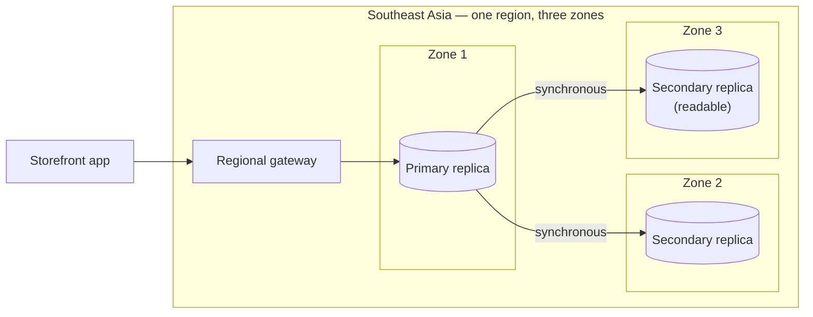
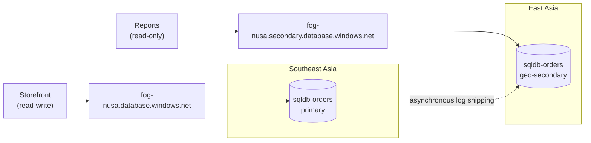

# Lunch 28 · Relational Databases (Advanced)

> **Track:** Deep-dive month · **Level:** Advanced · **Part 5:** Deep dives
> **Time:** 60 minutes · **Prerequisite lunches:** 11, 17
> **AZ-900 skill area:** Beyond AZ-900
> **Lab:** [Lab 28 · Orders that survive a regional outage](../../labs/28-relational-databases-advanced/README.md) — about 60 minutes · cost 💲💲

| ⏱ Minutes | Segment |
|---:|---|
| 5 | Scenario and objectives |
| 25 | Reading |
| 15 | Demo: interactive animation (+ optional walkthrough video) |
| 5 | Knowledge check |
| 5 | Key takeaways and lab preview |
| 5 | Buffer — finish your lunch 🍜 |

## 🍱 Today's menu

By the end of this lunch you will be able to:

- **Explain** how the General Purpose, Business Critical and Hyperscale tiers keep a database available inside one region, and what zone redundancy adds.
- **Design** cross-region disaster recovery with active geo-replication or failover groups, and state the RPO and RTO you can honestly promise.
- **Recover** from human mistakes with point-in-time restore and long-term retention, and choose a backup storage redundancy.
- **Choose** the right security, scaling and performance features: Entra-only authentication, TDE with customer-managed keys, Always Encrypted, dynamic data masking, row-level security, auditing, Microsoft Defender for SQL, read scale-out, elastic pools and Query Store.

## 🏪 Meanwhile at Nusantara Retail

Since Lunch 11 the orders have lived in Azure SQL Database. No more USB drive, no more shared `sa` password. Then Ibu
Sari reads a news story about a cloud outage that took a whole region offline for an afternoon, and she brings it to
the Monday meeting: *"If that happens to our region, how long can't we sell — and how many orders do we lose?"*

The rest of the table has requests of its own. The customer service team needs to look up orders but should not see
full e-mail addresses and phone numbers. Finance must keep month-end copies of the data for years. And on Friday Dewi
ran an `UPDATE` without a `WHERE` clause on the test database — "only" the test database, this time.

Today you make the orders survive three different disasters: a failed zone, a failed region and a failed human. You
also lock the data down from the inside. **How much data could Nusantara Retail lose if a whole Azure region failed,
and how quickly could it sell again?**

---

## 📖 Reading (≈25 minutes)

### 1. High availability inside one region

Azure SQL Database keeps more than one copy of every database and fails over automatically when hardware, software or
the network fails, and during planned maintenance such as patching. You do not configure any of this; your part is
**retry logic** in the application, because a failover shows up as a short disconnect. How the copies are kept depends
on the service tier:

- **General Purpose** (and the DTU tiers Basic and Standard) uses **remote storage**. The database engine runs on a
  stateless compute node, while data and log files sit in Azure Storage, which keeps its own copies. If the node fails,
  the platform starts the engine on a spare node and attaches the same files.
- **Business Critical** (and Premium) uses **local storage**. A cluster of database engine replicas — a primary and
  up to three secondaries — each holds a full copy of the data on fast local SSD. A transaction commits only when a
  quorum of replicas has it, so a failover is quick and loses nothing. One secondary is readable at no extra cost.
- **Hyperscale** splits the engine into parts: compute replicas, **page servers** that each hold a slice of the data, a
  **log service**, and long-term storage. You can add zero to four high-availability replicas and up to 30 named
  replicas, and the database can grow to 128 TB.

**Zone redundancy** spreads those copies across the region's availability zones (Lunch 03). It is available for General
Purpose, Business Critical, Hyperscale and Premium, but not for Basic or Standard. For Hyperscale you must choose it when
you create the database. With zone redundancy, a whole zone can fail and the database keeps running after a short
failover. Microsoft's business continuity guidance describes this as no data loss and a recovery time typically under
30 seconds.

| Tier | Where the data lives | Built-in readable copy | Zone redundancy | Best for |
|---|---|---|---|---|
| Basic / Standard (DTU) | remote storage | no | no | small, non-critical databases |
| General Purpose | remote storage | no | yes | most business workloads |
| Business Critical / Premium | local SSD on several replicas | yes, one secondary | yes | low latency, fast failover, heavy reporting |
| Hyperscale | page servers + log service + Azure Storage | yes, with HA or named replicas | yes, chosen at creation | large or fast-growing databases |

What does a failover look like from the application's side? Open connections drop, and for a few seconds new ones
may fail with a transient error such as 40613, "database not currently available". An app that waits briefly and
tries again — with growing pauses between attempts — never notices. An app without retry logic shows customers an
error page for every failover and every patch. Most modern data-access libraries include a retry option; turning it
on is one of the cheapest reliability improvements you can make.

High availability answers "what if a server or a zone fails?". It does **not** answer Ibu Sari's question, because all
of these copies live in one region.

### 2. Disaster recovery across regions: geo-replication and failover groups

To survive a regional outage you need a copy of the data in another region. Azure SQL Database offers three ways.

**Geo-restore** is the budget option. If your backups use geo-redundant storage, you can restore the latest
replicated backup into any region. Nothing runs in the second region until you need it, but you lose the changes
made since that backup was replicated, and the restore itself takes time that grows with the database size. Plan
for minutes to hours.

**Active geo-replication** works per database. You create up to four readable **geo-secondaries**, usually in other
regions. The primary sends its transaction log to them **asynchronously**: a transaction commits on the primary first
and travels to the secondaries a moment later. Failover is manual and per database. After a failover the new primary
has a different server name, so every connection string must change.

**Failover groups** build on geo-replication and fix that connection-string problem. A failover group replicates some
or all databases of one logical server to a server in another region, and fails them over together. Generally
available failover groups have one secondary server; more secondaries were in preview at the time of writing. Each
group gets two **listener** names that never change:

- `<fog-name>.database.windows.net` — the **read-write listener**, always pointing at the current primary;
- `<fog-name>.secondary.database.windows.net` — the **read-only listener**, pointing at the secondary.

The listeners are DNS aliases with a 30-second time-to-live. After a failover, the names stay the same and their targets
swap, so applications reconnect without any configuration change — provided they retry.

Failovers come in two kinds. A **planned failover** first synchronises the secondary fully, then swaps the roles, so it
loses nothing; use it for drills and for moving between regions. A **forced failover** (`--allow-data-loss`) swaps
immediately, so transactions committed on the primary but not yet shipped are lost. You also choose a **failover
policy**. *Customer managed* (recommended by Microsoft) means you decide when to fail over. *Microsoft managed* means
Microsoft fails over all such groups in a region during a widespread outage, and only after a grace period of at
least one hour.

Now Ibu Sari's numbers. The **RPO** (how much data you can lose) of asynchronous replication equals the **replication
lag**: the changes the secondary has not received yet. It is usually seconds. You can watch it in the
`replication_lag_sec` column of `sys.dm_geo_replication_link_status` on the primary. The **RTO** (how long you are
down) is your decision time plus the failover itself; Microsoft's guidance quotes typically less than 60 seconds
once a customer-managed failover starts.

| | Geo-restore | Active geo-replication | Failover group |
|---|---|---|---|
| Scope | one database | one database | a group of databases |
| Secondary running all the time | no | yes, up to four, readable | yes, one secondary server (GA) |
| Connection after failover | new database name | new server name | same listener names |
| Typical RPO | since the last replicated backup | replication lag (seconds) | replication lag (seconds) |
| Typical RTO | minutes to hours | under a minute once started | under a minute once started |
| Extra cost | none until used | secondary compute and storage | secondary compute and storage |

Two design choices deserve care. When you create a failover group, the secondary is first **seeded** with a full copy
of each database, which takes longer for large databases. And the secondary should have the **same service tier and
compute size** as the primary. A smaller secondary falls behind under a heavy write load, which raises your RPO, and
it becomes the bottleneck the moment it turns into the primary. If the secondary exists purely for disaster recovery,
vCore General Purpose and Business Critical databases can use a licence-free **standby** secondary to reduce cost.

> [!TIP]
> Rehearse before you need it. A **failover drill** is a planned failover during a quiet hour: announce it, fail over,
> check that the app reconnects through the listener and that reports still run, write down how long each step took,
> then fail back the same way. A team that has done this twice will make the real decision in minutes, not hours.

> [!WARNING]
> A failover group copies databases, not the server around them. **Server-level firewall rules**, the server's Entra
> admin and server-level auditing must be configured on the secondary server too, or the first failover becomes a
> second outage. Database-level items — contained users, database-level firewall rules, masking rules — travel with
> the database.

Region pairs (Lunch 03) do not limit you: geo-replication works between any two regions. That matters for
**Indonesia Central**, which has no paired region. If customer data must stay in Indonesia, check with your
compliance team before you place a replica abroad.

### 3. Backups in depth: the undo button

Replication is not a backup. Dewi's `UPDATE` without a `WHERE` clause reaches every geo-secondary within seconds,
faithfully copied. To undo a mistake, you go back in time with backups.

Azure SQL Database takes full backups weekly, differential backups every 12 or 24 hours, and log backups about every 10
minutes. **Point-in-time restore** (PITR) rebuilds the database as it was at any moment in the retention window —
7 days by default, configurable from 1 to 35 days (Basic: up to 7) — into a **new database** on the same server. You
compare, copy the rows you need back, or switch the application over. Three details trip people up. First, a new
database has no restore points yet: the first full backup starts right after creation and usually finishes within 30
minutes, and PITR becomes possible after the first log backup that follows it. Second, you cannot run PITR on a
geo-secondary; restore from the primary. Third, a **deleted** database can also be restored while it is inside its
retention window.

Take Dewi's mistake as a worked example. She ran the bad `UPDATE` at 16:59. You restore the database as it was at
16:58 into `sqldb-orders-restored` and compare the two copies. If only a few rows changed, you copy the correct
values back with your usual tools while the shop keeps selling. If the damage is widespread, you point the
application at the restored copy instead. Either way, the more precisely you know *when* the mistake happened, the
less good data you throw away — another reason to keep auditing on.

**Long-term retention** (LTR) keeps selected weekly, monthly and yearly full backups for up to 10 years — the answer to
finance's month-end request. **Backup storage redundancy** decides where the backup files live: locally redundant (LRS),
zone-redundant (ZRS), geo-redundant (GRS, the default) or geo-zone-redundant (GZRS). Only GRS and GZRS make geo-restore
possible. You cannot change it later on Basic or Hyperscale databases, the free offer supports LRS only, and not
every option exists in every region — check yours.

| Problem | First tool to reach for |
|---|---|
| Someone deleted or changed rows by mistake | point-in-time restore to a new database |
| Someone dropped the whole database | restore the deleted database |
| One availability zone fails | zone redundancy (automatic) |
| The whole region is unavailable | failover group failover (or geo-restore) |
| An auditor wants month-end data from three years ago | long-term retention backup |

### 4. Scaling and performance

You can change the number of vCores or the service tier while the database stays online; only a short reconnect
happens at the end. Serverless compute (Lunch 11) scales automatically. **Elastic pools** share capacity between
many databases whose peaks happen at different times. **Hyperscale** grows storage on its own and adds compute quickly,
because the data does not have to be copied to new nodes.

Reporting is a classic performance problem: one heavy month-end query slows down checkout for everyone. **Read
scale-out** solves it in Premium, Business Critical and Hyperscale, where it is on by default. Add
`ApplicationIntent=ReadOnly` to the reporting tool's connection string and its queries run on a read-only replica
at no extra cost. A failover group's read-only listener does the same across regions.

To find out *why* a query is slow, start with **Query Store**, which is on by default in Azure SQL Database. It works
like a flight recorder, keeping queries, their execution plans and runtime statistics over time, so you can see when a
plan changed for the worse. **Automatic tuning** acts on that data: `FORCE_LAST_GOOD_PLAN` is on by default and reverts
to the previous plan when a new one regresses. `CREATE_INDEX` and `DROP_INDEX` can add and remove indexes for you,
but they are off by default.

Measure before you scale. The database's metrics show whether CPU, data I/O or log I/O is the bottleneck. If one
badly written query is to blame, more vCores only make the problem more expensive; fixing the query or adding the
right index is cheaper and lasts longer.

### 5. Security in layers

Lunch 15 introduced defense in depth. For a database, the layers look like this:

| Layer | Feature | Protects against | Does not protect against |
|---|---|---|---|
| Network | firewall rules; **private endpoints** with public access disabled | connections from unknown networks | a signed-in insider |
| Identity | **Microsoft Entra-only authentication**, managed identities, least-privilege roles | stolen or shared passwords | an over-privileged account |
| Data at rest | **TDE** with a service-managed or **customer-managed key** | stolen disks and backup files | anyone allowed to query |
| Sensitive columns | **Always Encrypted** | administrators reading plaintext; data stays encrypted in the engine | a compromised client that holds the keys |
| Query results | **dynamic data masking** | casual exposure, such as support staff seeing full e-mails | determined users who infer values with clever queries |
| Rows | **row-level security** | users seeing other stores' rows | users with broad rights who can change the policy |
| Detection | **auditing**; **Microsoft Defender for SQL** | unnoticed misuse, SQL injection, vulnerable settings | nothing by itself — someone must act on the alerts |

A few details matter in practice. **Transparent data encryption** is on for every new database. With a customer-managed
key in Azure Key Vault or Managed HSM you control rotation, and revoking the key makes the database inaccessible —
so both servers of a failover group need access to it. **Always Encrypted** encrypts selected columns in the client
driver, so the database engine never sees the plaintext; secure enclaves allow richer queries on encrypted columns.

**Dynamic data masking** is the opposite trade-off: the data is stored in clear text, and only query results are masked
for users without the `UNMASK` permission. The server admin, the Microsoft Entra admin and members of `db_owner`
always see real values. Masking functions include *default*, *email*, *random*, *custom string* and *datetime*; for
example `ALTER TABLE dbo.Customers ALTER COLUMN Email ADD MASKED WITH (FUNCTION = 'email()');`. **Row-level
security** uses a predicate function and a security policy to filter rows per user — store managers in Medan see only
Medan's orders.

**Auditing** writes database events to a storage account, a Log Analytics workspace or Event Hubs; Microsoft
recommends enabling it at the server level. **Microsoft Defender for SQL** adds vulnerability assessment and alerts for
threats such as SQL injection and unusual sign-ins, as a paid plan.

Security and disaster recovery meet in one more place. With **private endpoints**, each server in a failover group
needs its own endpoint in a virtual network in its own region, and private DNS that resolves the names correctly in
both regions. Lunch 25 shows how private DNS zones work; design them for the failover case from the start.

### 6. PostgreSQL, MySQL and the plan for Nusantara Retail

The open-source engines from Lunch 11 have their own resilience features. **Azure Database for PostgreSQL** and
**Azure Database for MySQL** flexible servers offer **high availability** with a standby server in another zone
(zone-redundant) or in the same zone, kept in sync synchronously. Failover is automatic and typically takes 60–120
seconds. HA is not available on the Burstable compute tier. For reads and for regional DR, both offer asynchronous
**read replicas**, which you can place in other regions and promote. PostgreSQL allows up to five replicas per server
(more with cascading replicas), MySQL up to ten. **Azure SQL Managed Instance** has no active geo-replication, but it
supports failover groups for the whole instance, with the same listener idea.

Back to Nusantara Retail. Here is the plan you take to Ibu Sari:

- **Zone failure:** the orders database runs on **General Purpose with zone redundancy** in its home region. A zone
  outage costs a short reconnect and no data.
- **Region failure:** a **failover group** with a customer-managed policy replicates to a second region, after the
  compliance team approves where the DR copy may live. The storefront connects through the read-write listener; store
  reports use the read-only listener. The team rehearses a planned failover every quarter.
- **Human failure:** PITR retention is raised to 14 days, and LTR keeps monthly backups for the period finance
  requires.
- **Inside the database:** Entra-only authentication with a managed identity for the app, a private endpoint
  (Lunch 25), dynamic data masking on customer e-mail and phone for the support team, row-level security for store
  managers, server-level auditing to Log Analytics (Lunch 30), and Defender for SQL.

The answer to Ibu Sari's question is honest rather than perfect. In a regional disaster, Nusantara Retail could lose
the orders still in flight — the replication lag, usually seconds. It can sell again within minutes of the decision
to fail over, and the drill tells everyone exactly who makes that decision.

> [!NOTE]
> **Pause and think:** Dewi suggests the Microsoft-managed failover policy "so Azure handles it for us". What would
> that mean for Nusantara Retail's recovery time during a regional outage, and who would decide when the shop moves
> to the other region?

---

## 🎬 Demo (≈15 minutes)

1. **Interactive animation (≈6–8 min):** [Open the demo](https://stefpin.github.io/azure-fundamentals-lunches/demos/28-relational-databases-advanced.html) —
   press ▶ Play or step through it at your own pace. Offline? Download
   [`docs/demos/28-relational-databases-advanced.html`](../../docs/demos/28-relational-databases-advanced.html) and open it in any browser.
2. **Walkthrough video (≤ 6 min):** _coming soon_ — [read the walkthrough script](demo-video-script.md).

What to watch for:

- The order in which things happen on a write: commit on the primary first, replication to the secondary afterwards.
- Which transactions are lost in a forced failover, and why that amount equals the replication lag.
- How the listener names stay the same while their targets swap — and why a mistaken `DELETE` still needs a backup.

## ✅ Knowledge check (≈5 minutes)

1. The orders database is in a failover group, but the storefront's connection string still uses
   `sql-nusa-main-ab12c.database.windows.net`. After a failover to the secondary region, checkout fails with "the
   database is read-only". Why, and what is the fix?
   

Show answer

   The app still connects to the **old primary**, which is now the read-only secondary. Use the read-write listener
   `<fog-name>.database.windows.net`, whose target follows the primary through every failover.

   

2. Twenty minutes ago someone ran `DELETE FROM dbo.Orders` without a `WHERE` clause. Will a failover to the
   secondary region bring the rows back?
   

Show answer

   **No.** Replication copied the delete to the secondary within seconds. Run a **point-in-time restore** of the primary
   to a moment just before the delete, into a new database, and copy the rows back.

   

3. Ibu Sari asks: "With a failover group, can we promise zero data loss if the whole region goes down?" What do you
   answer?
   

Show answer

   **Not for an unplanned outage.** Replication is asynchronous, so a forced failover can lose the transactions not yet
   replicated — the RPO equals the replication lag, usually seconds. Only planned failovers synchronise first and lose
   nothing.

   

4. Customer service should see orders but not customers' full e-mail addresses, without changing the application.
   Which feature fits, and who will still see the real values?
   

Show answer

   **Dynamic data masking**, for example the `email()` function on the `Email` column. Admins, `db_owner` members and
   anyone granted `UNMASK` still see real values. To hide data even from administrators, you would need Always
   Encrypted instead.

   

5. Month-end reports slow down checkout on a Business Critical database. What is the cheapest way to move the reports
   off the primary?
   

Show answer

   **Read scale-out.** Add `ApplicationIntent=ReadOnly` to the reporting connection string so its queries run on the
   built-in readable secondary replica, at no extra cost.

   

## 🧠 Key takeaways

- High availability is built in; zone redundancy (General Purpose, Business Critical, Hyperscale, Premium) lets a database survive a zone outage without data loss.
- Failover groups replicate asynchronously to another region and give you listener names that follow the primary; RPO equals the replication lag, and RTO is your decision time plus the failover.
- Replication copies mistakes too — point-in-time restore (1–35 days) and long-term retention (up to 10 years) are the undo button, and you cannot run PITR on a geo-secondary.
- Secure a database in layers: network (private endpoints), identity (Entra-only), data (TDE, Always Encrypted, masking, row-level security) and detection (auditing, Defender for SQL).
- Scale and tune with vCores, elastic pools, Hyperscale, read scale-out, Query Store and automatic tuning; PostgreSQL and MySQL flexible servers offer zone-redundant HA and read replicas.

## 🔬 Your lab: Orders that survive a regional outage

You will start from two logical servers in two regions and a small orders database, then mask customer e-mail
addresses, create a failover group and connect through its listeners. You will recover from a deliberate "oops" with
point-in-time restore, run a planned failover drill, and optionally send audit logs to Log Analytics. A break-and-fix
exercise shows what happens to an app that still uses a server name instead of the listener.

- ⏱ About 60 minutes · 💲💲 · works on its own (no earlier lab needed)
- 👉 [Start Lab 28](../../labs/28-relational-databases-advanced/README.md)

## 📚 Go further

- [Microsoft Learn: Failover groups overview & best practices (Azure SQL Database)](https://learn.microsoft.com/azure/azure-sql/database/failover-group-sql-db) — listeners, failover policies, initial seeding and the permissions you need.
- [Microsoft Learn: Availability through redundancy (Azure SQL Database)](https://learn.microsoft.com/azure/azure-sql/database/high-availability-sla-local-zone-redundancy) — the remote-storage, local-storage and Hyperscale availability models, with and without zones.
- [Microsoft Learn: Automated backups in Azure SQL Database](https://learn.microsoft.com/azure/azure-sql/database/automated-backups-overview) — backup frequency, retention and backup storage redundancy in detail.
- [Microsoft Learn: Dynamic data masking](https://learn.microsoft.com/azure/azure-sql/database/dynamic-data-masking-overview) — masking functions, permissions and limitations.

---

⬅️ [Lunch 27 · Load Balancing (Advanced): Application Gateway, Front Door and Traffic Manager](../27-load-balancing-advanced/README.md) · 🏠 [Course home](../../README.md) · [Lunch 29 · Containers (Advanced): Azure Kubernetes Service](../29-containers-advanced-aks/README.md) ➡️

Last validated: October 2026 · Spotted something out of date? [Open an issue](../../CONTRIBUTING.md).
