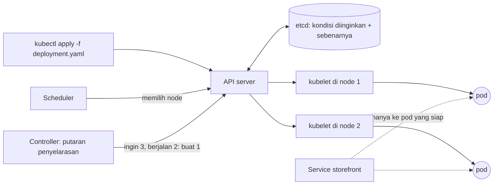
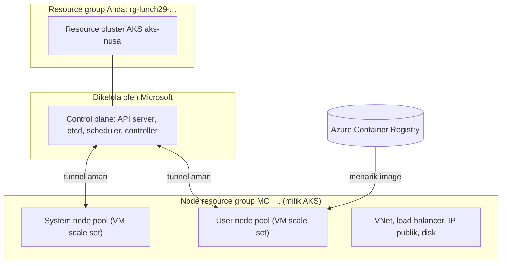

# Makan Siang 29 · Containers (Lanjutan): Azure Kubernetes Service

🇬🇧 [Read in English](README.md)

> **Jalur:** Bulan pendalaman · **Level:** Lanjutan · **Bagian 5:** Pendalaman
> **Waktu:** 60 menit · **Makan siang prasyarat:** 13, 08
> **Area keterampilan AZ-900:** Di luar cakupan AZ-900
> **Lab:** [Lab 29 · Kubernetes untuk tim microservices](../../labs/29-containers-advanced-aks/README.id.md) — sekitar 60 menit · biaya 💲💲💲
> **Penulis:** Stefanus Pinarta · [Tentang penulis](../../README.id.md#tentang-penulis)

| ⏱ Menit | Segmen |
|---:|---|
| 5 | Skenario dan tujuan |
| 25 | Bacaan |
| 15 | Demo: animasi interaktif (+ video panduan opsional) |
| 5 | Uji pemahaman |
| 5 | Poin penting dan pratinjau lab |
| 5 | Waktu cadangan — habiskan makan siang Anda 🍜 |

## 🍱 Menu hari ini

Setelah makan siang ini, Anda akan mampu:

- Menjelaskan cara Kubernetes menjaga *desired state* (kondisi yang diinginkan) dengan pod, deployment, service, probe,
  dan resource request.
- Menjelaskan apa yang dijalankan Azure Kubernetes Service (AKS) untuk Anda dan apa yang tetap menjadi milik Anda:
  control plane, node pool, node resource group, pricing tier, dan AKS Automatic.
- Memilih model jaringan, rencana alamat IP, dan opsi ingress untuk sebuah cluster AKS.
- Merencanakan scaling, identitas, upgrade, dan pemantauan, serta memutuskan kapan memakai AKS dan kapan Azure
  Container Apps.

## 🏪 Sementara itu di Nusantara Retail

Enam bulan setelah toko online pindah ke container (*kontainer*), tim Dewi memecahnya menjadi beberapa layanan:
katalog, keranjang, checkout, dan mesin promosi yang mengubah harga ratusan produk setiap jam selama masa promo. Vendor
poin loyalitas mengirim produknya sebagai Helm chart (semacam paket instalasi siap pakai untuk Kubernetes), lengkap
dengan Kubernetes operator miliknya sendiri, dan Rizky bersikeras bahwa hanya cluster Kubernetes sungguhan yang bisa
menjalankannya.

Pak Budi punya satu syarat: tidak boleh ada apa pun di dalam cluster yang bentrok dengan jaringan kantor pusat,
10.0.0.0/16, karena koneksi VPN ke Azure segera menyusul. Ibu Sari punya dua: "Saya tidak mau merekrut satu tim hanya
untuk mengasuh server," dan "Tunjukkan berapa biayanya pada pukul tiga pagi."

Hari ini Anda akan mengetahui apa yang dijalankan AKS untuk Anda, apa yang tetap menjadi pekerjaan Anda, dan cara
menyiapkan cluster yang bisa memulihkan dirinya sendiri, ikut membesar saat serbuan pembeli 12.12, dan diperbarui tanpa
downtime. Anda juga akan tahu kapan sebaiknya *tidak* memakainya.

---

## 📖 Bacaan (≈25 menit)

### 1. Kubernetes dalam satu makan siang: desired state

**Kubernetes** adalah *container orchestrator*, yaitu sistem yang mengatur banyak container di banyak server sekaligus.
Anda tidak memberinya perintah "jalankan tiga container di server 2"; Anda menuliskan **desired state** atau kondisi
yang diinginkan ("tiga salinan storefront v1 harus selalu berjalan") dalam sebuah **manifest** berformat YAML, lalu
Kubernetes bekerja tanpa henti agar kenyataan cocok dengan keinginan itu. Setiap **controller** menjalankan
*reconciliation loop* (putaran penyelarasan): bandingkan kondisi yang diinginkan dengan kondisi sebenarnya, bertindak
atas selisihnya, lalu ulangi. Putaran inilah yang membuat Kubernetes bisa memulihkan dirinya sendiri.

Ibaratnya pemilik warung yang berpesan kepada penjaganya: "Etalase harus selalu berisi tiga termos es teh." Ia tidak
perlu mengawasi seharian. Setiap kali satu termos habis, penjaga melihat selisihnya dan langsung mengisi yang baru.
Pemilik warung menulis keinginan; penjaga yang mengejar kenyataan.

Sebuah **cluster** terdiri atas dua bagian. **Control plane** adalah otaknya: **API server** adalah pintu depan yang
dilewati setiap perintah, **etcd** adalah database yang menyimpan kondisi yang diinginkan dan kondisi sebenarnya,
**scheduler** memilih node untuk setiap pod baru, dan **controller manager** menjalankan putaran-putaran penyelarasan
tadi. **Node** adalah ototnya: virtual machine (*komputer virtual*) yang menjalankan **kubelet** (agen di setiap node),
sebuah container runtime (containerd), dan **kube-proxy**, yang mengatur jaringan untuk service.



Ada beberapa objek yang akan Anda temui berulang kali:

| Objek | Fungsinya | Contoh di Nusantara Retail |
|---|---|---|
| **Pod** | Unit terkecil: satu atau beberapa container yang berbagi alamat IP dan volume | Satu salinan web server storefront |
| **Deployment** | Menjaga N pod yang identik tetap berjalan dan meluncurkan versi baru secara bertahap | `storefront`, tiga replica, image `v1` |
| **Service** | Nama dan IP virtual yang stabil di depan pod-pod yang terus berganti | `storefront`, bisa dihubungi dari dalam cluster sebagai `storefront.nusa` |
| **Namespace** | Semacam folder untuk objek, dengan izin dan kuotanya sendiri | `nusa` untuk toko, `loyalty` untuk chart milik vendor |
| **ConfigMap / Secret** | Pengaturan dan nilai sensitif yang disuntikkan ke dalam pod | Pengaturan promosi; connection string database |
| **Ingress / Gateway** | Pintu masuk layer 7: satu alamat, routing berdasarkan host name atau path, plus TLS | `shop.nusantara.example/cart` ke service keranjang |
| **HorizontalPodAutoscaler** | Mengubah jumlah replica sebuah deployment berdasarkan metrik | 3 sampai 10 pod storefront selama promo |

Deployment hanyalah salah satu jenis workload (beban kerja). **StatefulSet** memberi setiap pod nama yang tetap dan disk
permanennya sendiri, cocok untuk perangkat lunak seperti message broker. **DaemonSet** menjalankan tepat satu pod di
setiap node, pas untuk agen log dan agen keamanan. **Job** menjalankan pod sampai tugasnya selesai, dan **CronJob**
memulai Job sesuai jadwal, seperti impor harga setiap malam dari Makan Siang 13.

Dua detail dalam setiap pod template yang baik menentukan seberapa jauh cluster bisa menjaga Anda. **Probe**
memberi tahu Kubernetes tentang kesehatan pod. **Readiness probe** menjawab pertanyaan "bolehkah pod ini sudah menerima
traffic?", sehingga service hanya mengirim request ke pod yang sudah siap (ready). **Liveness probe** menjawab
"apakah proses ini macet?", dan jika gagal, container dijalankan ulang (di-restart). **Startup probe** memberi waktu
bagi aplikasi yang lambat menyala sebelum dua probe lainnya mulai bekerja.

Bayangkan loket di kantor bank. Readiness probe ibarat satpam yang baru mengarahkan antrean ke sebuah loket setelah
petugasnya benar-benar siap melayani. Liveness probe ibarat supervisor yang melihat seorang petugas terpaku lama tanpa
melayani siapa pun, lalu memintanya memulai lagi dari awal.

**Resource request dan limit** menggambarkan "nafsu makan" pod. Scheduler menempatkan pod berdasarkan *request*-nya;
pod yang melewati *limit* CPU akan diperlambat (throttled), sedangkan pod yang melewati *limit* memori akan dimatikan
(`OOMKilled`) lalu dijalankan ulang.

```yaml
spec:
  replicas: 3
  template:
    spec:
      containers:
        - name: storefront
          image: mcr.microsoft.com/azuredocs/aks-helloworld:v1
          resources:
            requests: { cpu: 50m, memory: 64Mi }    # what the scheduler reserves
            limits:   { cpu: 250m, memory: 256Mi }  # the hard ceiling
          readinessProbe: { httpGet: { path: /, port: 80 } }   # gate for traffic
          livenessProbe:  { httpGet: { path: /, port: 80 } }   # restart if stuck
```

Kemampuan memulihkan diri (self-healing) itu nyata, tetapi tidak instan. Jika sebuah container crash, kubelet
menjalankannya ulang dalam hitungan detik. Jika seluruh node berhenti merespons, Kubernetes menandainya `NotReady` dan,
secara default, mengusir (evict) pod-podnya setelah sekitar lima menit; Deployment controller lalu membuat pengganti
di node yang sehat. Itulah sebabnya satu replica tidak pernah cukup untuk apa pun yang penting, dan replica sebaiknya
disebar ke beberapa node dan zona.

Versi baru diluncurkan dengan cara deklaratif yang sama. Ubah tag image di manifest lalu terapkan: Deployment membuat
ReplicaSet baru (objek di balik layar yang menjaga jumlah pod untuk satu versi) dan memindahkan pod secara bertahap,
secepat yang diizinkan `maxSurge` (jumlah pod tambahan yang boleh ada) dan `maxUnavailable` (jumlah pod yang boleh
absen), dan hanya secepat pod-pod baru lolos readiness probe-nya. Jika ada yang salah, `kubectl rollout undo`
mengembalikan ke ReplicaSet sebelumnya dalam hitungan detik.

### 2. AKS: apa yang dijalankan Azure, dan apa yang Anda jalankan

**Azure Kubernetes Service (AKS)** memberi Anda cluster Kubernetes yang control plane-nya dijalankan, di-patch, dan
dijaga agar selalu tersedia (high availability, *ketersediaan tinggi*) oleh Microsoft. Anda tidak pernah melihat
mesin-mesin control plane itu. Pada tier Free, manajemen cluster tidak dikenai biaya; Anda membayar apa yang berjalan
di subscription (*langganan*) Anda: VM node, disk-disknya, load balancer, alamat IP publik, dan data yang keluar
(outbound).

Setiap cluster melibatkan **dua resource group** (*grup sumber daya*). Resource group yang Anda pilih hanya berisi
resource (*sumber daya*) cluster itu sendiri. AKS membuat resource group kedua, yaitu **node resource group** (namanya
seperti `MC_rg-lunch29-ab12c_aks-nusa_southeastasia`), lalu mengisinya dengan infrastruktur: satu Virtual Machine Scale
Set (*Kumpulan Skala Komputer Virtual*) per node pool, virtual network (*jaringan virtual*), load balancer, alamat IP
publik, dan managed disk. Grup itu milik AKS; anggap saja ruang mesin gedung: boleh dilihat, jangan diutak-atik.
Mengubah isinya secara manual tidak didukung dan bisa merusak cluster, dan AKS menghapusnya secara otomatis saat Anda
menghapus cluster.

Node dikelompokkan ke dalam **node pool**, masing-masing berisi sekumpulan VM yang identik. **System node pool**
menampung add-on penting seperti CoreDNS dan metrics-server. Pool ini wajib memakai Linux, tidak boleh memakai ukuran
burstable seri B, dan AKS menolak ukuran yang lebih kecil dari sekitar 2 vCPU dan 4 GB memori. Panduan untuk produksi
meminta minimal tiga node, dengan ukuran yang lebih besar, karena pod sistem butuh ruang lega. **User node pool**
menjalankan aplikasi Anda: Linux atau Windows, ukuran apa pun yang sesuai, dan bisa di-scale sampai nol. Menambahkan
taint (semacam tanda "dilarang masuk" bagi pod) `CriticalAddonsOnly=true:NoSchedule` pada system pool membuat pod
aplikasi tidak ditempatkan di sana. Di region (*wilayah*) yang memiliki availability zone (*zona ketersediaan*), sebuah
node pool bisa disebar ke zona 1, 2, dan 3, dan control plane otomatis tersebar di beberapa zona.

Anda berkomunikasi dengan cluster melalui `kubectl`, alat baris perintah Kubernetes. Perintah `az aks get-credentials`
mengunduh file kubeconfig yang memberi tahu `kubectl` di mana API server berada dan bagaimana cara masuk; di Cloud
Shell, `kubectl` sudah terpasang. Secara default, API server memiliki public endpoint (*titik akhir publik*) yang
dilindungi autentikasi. Untuk produksi, Anda bisa membatasinya ke rentang IP yang diizinkan, atau menjadikan cluster
privat sehingga API server hanya bisa dijangkau dari jaringan Anda. Lakukan scaling dan upgrade node melalui AKS
(`az aks scale`, `az aks nodepool`, `az aks upgrade`), jangan pernah lewat API scale set atau VM, dan matikan seluruh
cluster dev semalaman dengan `az aks stop`.

AKS menawarkan tiga pricing tier (tingkat harga). Untuk membaca tabelnya, kenali dulu istilah SLA (Service Level
Agreement, perjanjian tingkat layanan): janji tertulis Microsoft tentang uptime, dengan kompensasi berupa kredit tagihan jika janji itu tidak
terpenuhi. Itulah arti "dijamin secara finansial".

| Pricing tier | Cocok untuk | Yang Anda dapatkan |
|---|---|---|
| **Free** | Belajar, pengembangan, pengujian; disarankan untuk kurang dari 10 node | Manajemen cluster gratis, semua fitur AKS, tanpa SLA uptime yang dijamin secara finansial |
| **Standard** | Produksi | SLA uptime untuk API server (99,95% dengan availability zone, 99,9% tanpanya), kapasitas control plane lebih besar, hingga 5.000 node |
| **Premium** | Produksi yang harus bertahan lebih lama di satu versi Kubernetes | Semua yang ada di Standard plus Long-Term Support: sekitar dua tahun per versi, bukan satu |

Selain tier, ada juga dua cara *menjalankan* AKS. **AKS Standard** (pilihan di lab, supaya Anda melihat setiap
bagiannya) membiarkan Anda memilih semuanya: node pool, ukuran VM, network plugin, add-on, dan pengaturan upgrade.
**AKS Automatic**, yang kini direkomendasikan Microsoft sebagai default untuk produksi, membuat pilihan-pilihan itu
untuk Anda. Mode ini menyediakan node secara otomatis sesuai kebutuhan pod Anda, memakai Azure CNI Overlay powered by
Cilium, ingress terkelola, workload identity, dan Azure RBAC, meng-upgrade dirinya sendiri, serta berjalan di tier
Standard dengan SLA uptime plus SLA kesiapan pod (pod readiness). Pilih Automatic, kecuali Anda membutuhkan pengaturan
yang dikuncinya. (Jangan tertukar: "AKS Standard" adalah nama mode, sedangkan "tier Standard" adalah tingkat harga.)



### 3. Jaringan: alamat, service, dan pintu masuk

Setiap pod butuh alamat IP, dan **model jaringan** menentukan dari mana alamat-alamat itu berasal. Rentang alamat ditulis
dalam notasi CIDR: misalnya 10.0.0.0/16, yang berisi 65.536 alamat.

| Model | Cara pod mendapatkan alamat IP | Gunakan jika |
|---|---|---|
| **Azure CNI Overlay** | Dari rentang pod privat (CIDR) yang terpisah dari virtual network; setiap node mendapat potongan /24, dan traffic yang keluar dari cluster memakai alamat IP node | Default untuk cluster baru dan pilihan yang direkomendasikan: bisa sampai 5.000 node dan hingga 250 pod per node tanpa menghabiskan alamat virtual network |
| **Azure CNI Pod Subnet** | Alamat virtual network sungguhan dari subnet khusus untuk pod | Resource di luar cluster harus bisa menjangkau pod secara langsung |
| **Azure CNI Node Subnet** | Alamat virtual network dari subnet node | Hanya untuk cluster lama (legacy) |
| **kubenet** | Rentang privat dengan route table | Akan pensiun pada 31 Maret 2028: migrasikan ke Azure CNI Overlay |

**Azure CNI powered by Cilium** adalah data plane (bagian yang benar-benar meneruskan paket) yang bisa Anda
kombinasikan dengan Overlay: ia memakai eBPF, bukan iptables, dan menegakkan **network policy**, yaitu aturan yang
menentukan pod mana boleh berbicara dengan pod mana. AKS Automatic memakainya secara default.

Rencanakan tiga rentang alamat sebelum membuat cluster, karena ketiganya sulit atau bahkan mustahil diubah belakangan:
**node subnet**, **pod CIDR**, dan **service CIDR**, yang memberi setiap service Kubernetes alamat IP virtualnya. Tidak
satu pun boleh tumpang tindih dengan jaringan mana pun yang kelak akan Anda sambungkan. Inilah jebakan bagi Pak Budi:
service CIDR default adalah **10.0.0.0/16**, persis rentang milik kantor pusat. Lab ini memakai
`--service-cidr 172.16.0.0/16` dan `--pod-cidr 192.168.0.0/16` agar terhindar darinya.

Bayangkan dua kompleks perumahan yang sama-sama punya rumah di "Jalan Melati No. 10". Selama keduanya terpisah, tidak
ada masalah. Begitu ada jalan tembus yang menyambungkan keduanya (di sini: VPN), kurir paket tidak tahu rumah mana yang
dimaksud. Router jaringan mengalami kebingungan yang sama ketika dua rentang alamat tumpang tindih.

**Service** bertipe `ClusterIP` (default) hanya bisa dijangkau dari dalam cluster, melalui nama DNS seperti
`storefront.nusa.svc.cluster.local`. Tipe `LoadBalancer` meminta AKS memprogram Azure Standard Load Balancer dan
memasang alamat IP publik dari node resource group; dengan sebuah annotation, ia menjadi load balancer internal.

Traffic yang keluar dari cluster juga perlu direncanakan. Secara default, node keluar melalui outbound rule milik
Standard Load Balancer. Anda bisa mengganti outbound type ke NAT gateway terkelola atau NAT gateway milik Anda sendiri,
atau mengalirkan semuanya lewat Azure Firewall dengan user-defined route; begitulah desain hub-and-spoke dari Makan
Siang 25 akan memeriksanya. Di dalam cluster, setiap pod bisa menjangkau setiap pod lain sampai Anda menambahkan network
policy, misalnya "hanya checkout yang boleh memanggil payments".

Load balancer bekerja di layer 4 (hanya melihat alamat IP dan port), sehingga Anda akan membutuhkan satu alamat IP
publik per service. Untuk routing HTTP berdasarkan host name atau path, lengkap dengan TLS, Anda menambahkan
**ingress**: satu pintu masuk yang mengarahkan setiap tamu ke kantor yang tepat, seperti resepsionis di lobi gedung.
Kubernetes punya dua API untuk itu: API **Ingress** yang lebih lama, dan **Gateway API**, penerusnya yang berorientasi
peran (`GatewayClass`, `Gateway`, `HTTPRoute`). Di AKS, opsi terkelola yang direkomendasikan adalah **application
routing add-on dengan implementasi Gateway API-nya** (gateway class `approuting-istio`). Alternatifnya adalah
Application Gateway for Containers dan add-on service mesh Istio.

> [!WARNING]
> Jangan memulai pekerjaan baru di atas ingress berbasis NGINX. Proyek upstream Ingress NGINX sudah pensiun (masa
> pemeliharaannya berakhir pada Maret 2026), dan Microsoft menyediakan patch keamanan kritis untuk NGINX milik
> application routing add-on hanya sampai November 2026. Rencanakan dengan Gateway API.

### 4. Scaling dan identitas: keduanya berlapis

Scaling di AKS terjadi di beberapa lapisan, dan masing-masing menyelesaikan masalah yang berbeda:

| Lapisan | Yang di-scale | Dipicu oleh |
|---|---|---|
| **Horizontal Pod Autoscaler (HPA)** | Jumlah pod dalam sebuah deployment | Pemakaian CPU atau memori sebagai persentase dari *request*, atau metrik kustom; secara default ia memeriksa setiap 15 detik dan menunggu lima menit sebelum mengurangi pod |
| **KEDA** (add-on) | Pod, termasuk sampai nol | Event seperti panjang antrean, lag Kafka, atau jadwal |
| **Vertical Pod Autoscaler** (add-on) | Request dan limit setiap pod | Pemakaian yang teramati, untuk menyesuaikan ukuran pod |
| **Cluster autoscaler** | Node dalam sebuah node pool, di antara batas minimum dan maksimum | Pod yang tertahan di `Pending` karena tidak ada node yang punya ruang; node kosong yang kurang terpakai dibuang |
| **Node autoprovisioning (NAP)** | Node baru dengan ukuran VM apa pun yang pas | Pod yang `Pending`; default di AKS Automatic |

Lapisan-lapisan ini bekerja berantai. Ketika serbuan pembeli 12.12 datang, HPA meminta lebih banyak pod storefront. Jika
node masih punya ruang, pod baru menyala dalam hitungan detik. Jika tidak, pod tambahan menunggu di status `Pending`,
lalu cluster autoscaler (atau NAP) menambahkan node, yang memakan waktu beberapa menit. Semuanya bergantung pada
**request** yang jujur: tanpa CPU request, HPA tidak bisa menghitung persentase, dan dengan request yang digelembungkan,
Anda membayar node yang setengah kosong.

Ibaratnya warung makan menjelang Lebaran: pemilik menambah pelayan lebih dulu (pod), dan itu cepat. Kalau semua meja
sudah penuh, barulah ia menyewa tenda tambahan (node), yang butuh waktu lebih lama untuk didirikan.

Hitungan HPA bersifat proporsional. Tiga pod dengan rata-rata 100% dari CPU request-nya, dibandingkan target 50%,
menghasilkan ceil(3 × 100 ÷ 50) = 6 pod (ceil berarti dibulatkan ke atas), dibatasi oleh nilai maksimum HPA. Saat beban
turun, jumlahnya berkurang lagi, tetapi baru setelah stabilization window lima menit, sehingga jeda sesaat tidak membuat
jumlah pod naik-turun bolak-balik (flapping).

Identitas juga hadir dalam tiga lapisan, satu untuk setiap arah kepercayaan:

- **Manusia dan pipeline masuk ke cluster.** Integrasikan cluster dengan **Microsoft Entra ID** (*ID Microsoft Entra*)
  dan atur otorisasinya dengan Kubernetes RBAC atau **Azure RBAC for Kubernetes** (RBAC adalah role-based access
  control, *kontrol akses berbasis peran*). AKS Standard dimulai dengan akun lokal, yang tidak masalah untuk lab;
  cluster produksi sebaiknya menonaktifkannya agar setiap perintah `kubectl` terikat pada identitas yang nyata.
- **Cluster masuk ke Azure.** Managed identity milik cluster (identitas yang dikelola Azure, tanpa kata sandi yang perlu
  disimpan) membuat load balancer dan disk. **Kubelet identity** yang terpisah menarik image;
  `az aks update --attach-acr` memberinya peran AcrPull pada registry Anda, sehingga image pull secret tidak diperlukan.
- **Pod masuk ke Azure.** **Microsoft Entra Workload ID** memungkinkan pod menukar token service account Kubernetes-nya
  dengan token Entra melalui OpenID Connect issuer dan federated credential. Fitur ini menggantikan pratinjau
  pod-managed identity yang lebih lama, yang sudah deprecated (tidak dianjurkan lagi). Secret dari Key Vault sampai ke
  pod melalui Secrets Store CSI driver.

### 5. Hari kedua: upgrade, pemantauan, dan biaya

"Hari kedua" (day 2) adalah sebutan untuk masa operasional setelah cluster berdiri. Kubernetes merilis versi minor
kira-kira setiap empat bulan. AKS mendukung versi minor terbaru yang sudah tersedia umum (generally available) dan dua
versi sebelumnya (N, N-1, dan N-2), masing-masing selama sekitar dua belas bulan; cluster baru dimulai di N-1. Versi
yang turun ke N-3 hanya mendapat dukungan platform, dan mulai Juni 2027 AKS akan meng-upgrade sendiri cluster yang
dibiarkan di versi yang tidak didukung, setelah masa tenggang 60 hari. Dalam praktik: rencanakan upgrade minimal
setahun sekali, atau pilih tier Premium dengan Long-Term Support jika Anda benar-benar tidak bisa.

Upgrade dimulai dari control plane, lalu node pool. Untuk setiap node pool, AKS menambahkan node **surge** (node
tambahan sementara) dengan versi baru, melakukan **cordon** pada node lama (tidak ada pod baru yang boleh masuk),
melakukan **drain** (mengusir pod-podnya agar dijadwalkan ulang di tempat lain), lalu mengulanginya. Bagian Anda adalah
membuat pengusiran itu aman: jalankan minimal dua replica, gunakan readiness probe, dan tambahkan
**PodDisruptionBudget** yang menyatakan berapa replica yang harus tetap hidup. Image sistem operasi node mendapat
pembaruan keamanan mingguan di jalur terpisah. **Auto-upgrade channel** (misalnya `patch` atau `stable`) dan **node OS
upgrade channel** mengotomatiskan keduanya, dan **planned maintenance window** menjaga semuanya tetap di luar jam
kerja.

Sebelum upgrade manual, `az aks get-upgrades` menampilkan versi-versi yang bisa Anda tuju, dan AKS menghentikan upgrade
jika mendeteksi workload yang masih memanggil API Kubernetes yang tidak lagi dilayani versi tujuan. Jaga agar versi
`kubectl` tidak berselisih lebih dari satu versi minor dengan cluster.

Untuk pemantauan (monitoring), **Container insights** mengirim log container dan inventarisnya ke Log Analytics
workspace, **Azure Monitor managed service for Prometheus** mengumpulkan metrik, dan **Azure Managed Grafana** (atau
Azure Monitor dashboards with Grafana) menyajikannya dalam grafik. Makan Siang 30 membahasnya lebih dalam. Sehari-hari,
`kubectl get events`, `kubectl describe`, dan `kubectl top` sudah menjawab sebagian besar pertanyaan "kenapa pod ini
rewel?".

> [!TIP]
> Tagihan AKS sebagian besar berasal dari node, dan node tetap dibayar entah sedang sibuk atau menganggur. Tetapkan
> request yang realistis agar pod tersusun rapat, aktifkan cluster autoscaler dengan batas yang masuk akal, jalankan
> pekerjaan yang boleh terputus di user pool Spot (VM dari kapasitas sisa Azure, jauh lebih murah tetapi bisa ditarik
> kembali sewaktu-waktu), pakai tier Free untuk dev dan test, matikan cluster dev pada malam hari dengan `az aks stop`,
> dan hapus cluster lab segera setelah selesai.

### 6. Bagaimana semuanya menyatu di Nusantara Retail: AKS atau Container Apps?

AKS hebat karena memberi Anda seluruh Kubernetes, dan justru itulah harganya: harus ada yang bertanggung jawab atas
upgrade, node pool, add-on, dan YAML. Bandingkan secara jujur dengan Container Apps dari Makan Siang 13:

| Pertanyaan | Azure Container Apps | Azure Kubernetes Service |
|---|---|---|
| Butuh API Kubernetes (Helm chart dengan operator, CRD, DaemonSet)? | Tidak tersedia | Ya, API lengkap |
| Siapa yang mengurus node dan upgrade? | Platform | Anda (jauh lebih sedikit dengan AKS Automatic) |
| Scale ke nol | Bawaan untuk setiap aplikasi | Per workload dengan KEDA; node tetap berjalan kecuali sebuah pool di-scale ke nol |
| Harga | Per detik pemakaian plus jumlah request, dengan jatah gratis | VM node sepanjang waktu, plus biaya tier pada Standard dan Premium |
| Paling cocok untuk | Aplikasi web, API, worker, dan job dari tim yang hanya ingin merilis aplikasinya | Tim platform, microservices yang kompleks, perangkat lunak vendor yang dibuat untuk Kubernetes |

Rekomendasi Anda untuk Ibu Sari: toko online tetap di Container Apps, tempat biayanya hampir nol pada pukul tiga pagi.
Microservices dan chart loyalitas milik vendor pindah ke satu cluster AKS, dibangun sebagai AKS Automatic di Indonesia
Central setelah Anda memastikan bahwa fitur yang dibutuhkan tersedia di sana. Hasilnya: SLA tier Standard, node di tiga
zona, Azure CNI Overlay dengan Cilium, rentang service dan pod yang menghindari 10.0.0.0/16, ingress berbasis Gateway
API, login Entra ID dengan Azure RBAC, Workload ID untuk Key Vault, image yang ditarik dari ACR oleh kubelet identity,
serta Container insights dengan managed Prometheus sejak hari pertama. Satu cluster bersama, dengan namespace dan
resource quota untuk setiap tim, jauh lebih murah daripada satu cluster per aplikasi. Dan jika suatu hari toko-toko
cabang menjalankan cluster Kubernetes kecil milik mereka sendiri, Azure Arc-enabled Kubernetes bisa membawanya ke bawah
policy dan pemantauan yang sama (Makan Siang 31).

> [!NOTE]
> **Renungkan sejenak:** ketiga replica storefront ternyata dijadwalkan ke satu node di zona 1. Apa yang terjadi pada
> toko jika zona 1 gagal, dan pengaturan mana di pod template yang seharusnya mencegahnya? (Petunjuk: cari
> `topologySpreadConstraints` di `deployment.yaml` milik lab.)

Di makan siang berikutnya, Anda akan belajar bertanya kepada log dan metrik cluster *mengapa* checkout lambat pada hari
Jumat.

---

## 🎬 Demo (≈15 menit)

1. **Animasi interaktif (≈6–8 menit):** [Buka demo](https://stefpin.github.io/azure-fundamentals-lunches/demos/29-containers-advanced-aks.html?lang=id) —
   tekan ▶ Putar atau telusuri langkah demi langkah sesuai kecepatan Anda. Sedang offline? Unduh
   [`docs/demos/29-containers-advanced-aks.html`](../../docs/demos/29-containers-advanced-aks.html) lalu buka di browser apa pun.
2. **Video panduan (≤ 6 menit):** _segera hadir_ — [baca naskah video](demo-video-script.id.md).

Yang perlu diperhatikan:

- Desired state (tiga replica) tidak pernah berubah selama sebuah node gagal; hanya kondisi sebenarnya yang berubah,
  sampai controller memperbaikinya.
- Scheduler menyebar pod ke berbagai zona, dan HPA mengubah jumlah replica yang diinginkan berdasarkan CPU yang terpakai
  dibandingkan request.
- Selama rolling update, pod baru hanya menerima traffic setelah readiness probe-nya lolos, sehingga toko tidak pernah
  tutup.

## ✅ Uji pemahaman (≈5 menit)

1. Sebuah pod storefront baru berstatus `Running`, tetapi service tidak pernah mengirim satu request pun kepadanya.
   Probe mana yang gagal, dan apa bedanya dengan liveness probe yang gagal?
   <details><summary>Lihat jawaban</summary>

   Readiness probe. *Alasannya:* readiness probe yang gagal membuat pod dikeluarkan dari daftar endpoint service,
   tetapi pod tetap berjalan; liveness probe yang gagal membuat kubelet menjalankan ulang (me-restart) container.

   </details>
2. Anda membuat HPA untuk storefront, tetapi `kubectl get hpa` menampilkan target CPU sebagai `<unknown>/50%`, dan
   tidak ada yang di-scale. Apa penyebab yang paling mungkin?
   <details><summary>Lihat jawaban</summary>

   Pod tidak punya CPU request (atau metriknya belum tersedia). *Alasannya:* HPA menghitung utilisasi sebagai
   persentase dari request, jadi tanpa request ia tidak punya pembanding.

   </details>
3. Kantor pusat memakai 10.0.0.0/16 dan VPN ke Azure sedang direncanakan. Rentang alamat AKS mana yang menjadi risiko
   tersembunyi jika Anda membiarkan nilai default, dan kapan Anda harus memperbaikinya?
   <details><summary>Lihat jawaban</summary>

   Service CIDR, yang default-nya 10.0.0.0/16. Tetapkan rentang yang tidak tumpang tindih seperti 172.16.0.0/16 (dan
   pod CIDR yang juga tidak tumpang tindih) saat Anda membuat cluster. *Alasannya:* rentang-rentang ini sulit atau
   mustahil diubah belakangan.

   </details>
4. Tim keuangan menemukan resource group bernama `MC_rg-lunch29-…_aks-nusa_southeastasia`, penuh dengan VM dan sebuah
   load balancer, dan ingin menghapusnya untuk berhemat. Apa yang Anda katakan kepada mereka?
   <details><summary>Lihat jawaban</summary>

   Itu adalah node resource group milik AKS. Jangan mengubah atau menghapus resource di dalamnya secara manual; hapus
   atau scale cluster-nya saja. *Alasannya:* menghapus cluster otomatis ikut menghapus node resource group.

   </details>
5. Pada Oktober 2026, Rizky mengusulkan NGINX terkelola milik application routing add-on untuk ingress yang benar-benar
   baru. Apa yang Anda rekomendasikan sebagai gantinya?
   <details><summary>Lihat jawaban</summary>

   Implementasi Gateway API milik application routing add-on (atau Application Gateway for Containers, atau add-on
   Istio). *Alasannya:* Ingress NGINX upstream sudah pensiun, dan patch dari Microsoft untuk NGINX milik add-on itu
   berakhir pada November 2026.

   </details>

## 🧠 Poin penting

- Kubernetes bekerja berdasarkan desired state: Anda mendeklarasikan deployment, service, probe, dan request, lalu
  controller menjaga kenyataan tetap sesuai dengan menjalankan ulang, menjadwalkan ulang, dan meluncurkan pod.
- AKS menjalankan control plane; node pool adalah milik Anda, sedangkan node resource group `MC_` milik AKS. Pakai Free
  untuk dev dan test, Standard untuk SLA, dan Premium untuk Long-Term Support; AKS Automatic adalah default yang
  direkomendasikan untuk produksi.
- Pilih Azure CNI Overlay (kubenet pensiun pada Maret 2028), rencanakan rentang node, pod, dan service yang tidak pernah
  tumpang tindih dengan jaringan Anda, dan bangun ingress di atas Gateway API, bukan di atas NGINX yang akan pensiun.
- Scaling dan identitas sama-sama berlapis: HPA, KEDA, dan cluster autoscaler atau NAP untuk kapasitas; Entra ID,
  managed identity, dan Workload ID untuk manusia, cluster, dan pod.
- Hari kedua adalah pekerjaan yang sesungguhnya: upgrade di dalam jendela N-2, lindungi upgrade dengan replica, probe,
  dan PodDisruptionBudget, pantau dengan Container insights dan Prometheus, dan pilih Container Apps setiap kali Anda
  tidak membutuhkan API Kubernetes.

## 🗒️ Catatan lapangan dari Stefanus

> **Gladi resik paling murah: drain satu node dengan sengaja.** Sebelum saya menyetujui cluster AKS mana pun untuk
> produksi, saya melakukan cordon dan drain pada satu node di jam kerja, lalu mengamati toko online-nya. Satu kali drain
> sudah cukup untuk membongkar replica tunggal yang luput dari perhatian, pod tanpa readiness probe yang menerima
> traffic terlalu dini, dan PodDisruptionBudget yang begitu ketat sampai memblokir setiap drain — dan bersamanya,
> setiap upgrade berikutnya. Saya juga selalu memeriksa di mana replica-replica itu mendarat: tiga pod di satu node,
> ketika node itu tumbang, sama saja dengan satu pod. Kalau drain-nya berjalan membosankan, saya percaya pada cluster
> itu. Kalau ternyata menegangkan, saya jauh lebih suka mengetahuinya pada Selasa siang yang tenang daripada di tengah
> serbuan promo 12.12.

## 🔬 Lab Anda: Kubernetes untuk tim microservices

Anda akan membuat cluster AKS kecil (tier Free, Azure CNI Overlay, satu node), melihat isi kedua resource group-nya,
lalu men-deploy storefront dari manifest dengan tiga replica, probe, dan resource request di belakang service
LoadBalancer publik. Anda akan menghapus pod dan melihatnya kembali, melakukan scaling secara manual, meluncurkan v2
tanpa kehilangan satu request pun, menambahkan HPA dan membebaninya sampai pod baru muncul, serta mendiagnosis tag image
yang rusak dengan `kubectl describe`. Cluster ini adalah resource termahal di kursus ini, jadi Anda menghapusnya segera
setelah selesai.

- ⏱ Sekitar 60 menit · 💲💲💲 · bisa dikerjakan terpisah (tidak perlu lab sebelumnya)
- 👉 [Mulai Lab 29](../../labs/29-containers-advanced-aks/README.id.md)

## 📚 Pelajari lebih lanjut

- [Microsoft Learn: Ikhtisar jaringan Azure CNI Overlay di AKS](https://learn.microsoft.com/azure/aks/concepts-network-azure-cni-overlay) — cara kerja alamat pod, perencanaan IP, dan perbandingan Overlay dengan kubenet.
- [Microsoft Learn: Pricing tier AKS Free, Standard, dan Premium](https://learn.microsoft.com/azure/aks/free-standard-pricing-tiers) — apa saja yang termasuk di setiap tier dan cara berpindah di antaranya.
- [Microsoft Learn: Apa itu AKS Automatic?](https://learn.microsoft.com/azure/aks/intro-aks-automatic) — default produksi yang sudah dikonfigurasi, dibandingkan fitur demi fitur dengan AKS Standard.
- [Microsoft Learn: Versi Kubernetes yang didukung di AKS](https://learn.microsoft.com/azure/aks/supported-kubernetes-versions) — kalender rilis, jendela N-2, Long-Term Support, dan upgrade yang diprakarsai platform.

---

⬅️ [Makan Siang 28 · Database Relasional (Lanjutan)](../28-relational-databases-advanced/README.id.md) · 🏠 [Beranda kursus](../../README.id.md) · [Makan Siang 30 · Pemantauan (Lanjutan): Log Analytics, KQL, dan Application Insights](../30-monitoring-advanced/README.id.md) ➡️

<sub>Terakhir divalidasi: Oktober 2026 · Menemukan informasi yang sudah usang? [Buka issue](../../CONTRIBUTING.md).</sub>
