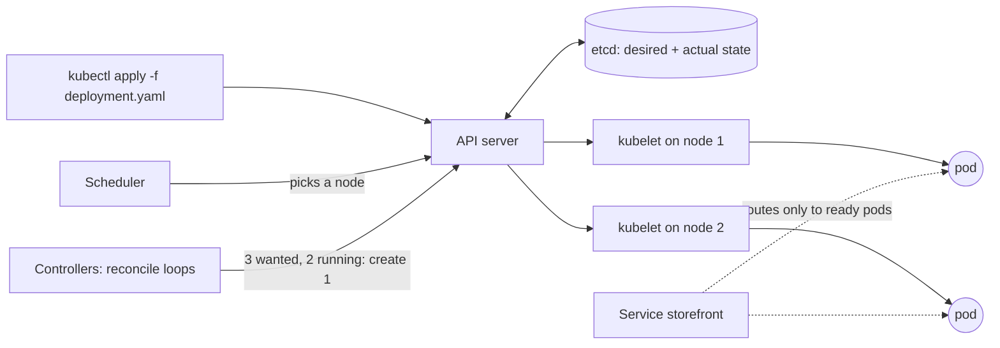
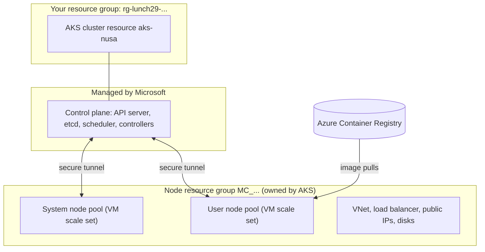

# Lunch 29 · Containers (Advanced): Azure Kubernetes Service

🇮🇩 [Baca dalam Bahasa Indonesia](README.id.md)

> **Track:** Deep-dive month · **Level:** Advanced · **Part 5:** Deep dives
> **Time:** 60 minutes · **Prerequisite lunches:** 13, 08
> **AZ-900 skill area:** Beyond AZ-900
> **Lab:** [Lab 29 · Kubernetes for the microservices team](../../labs/29-containers-advanced-aks/README.md) — about 60 minutes · cost 💲💲💲
> **Author:** Stefanus Pinarta · [About the author](../../README.md#about-the-author)

| ⏱ Minutes | Segment |
|---:|---|
| 5 | Scenario and objectives |
| 25 | Reading |
| 15 | Demo: interactive animation (+ optional walkthrough video) |
| 5 | Knowledge check |
| 5 | Key takeaways and lab preview |
| 5 | Buffer — finish your lunch 🍜 |

## 🍱 Today's menu

By the end of this lunch you will be able to:

- Explain how Kubernetes keeps a desired state with pods, deployments, services, probes and resource requests.
- Describe what Azure Kubernetes Service (AKS) runs for you and what you still own: control plane, node pools, the
  node resource group, pricing tiers and AKS Automatic.
- Choose a network model, an IP plan and an ingress option for an AKS cluster.
- Plan scaling, identity, upgrades and monitoring, and decide between AKS and Azure Container Apps.

## 🏪 Meanwhile at Nusantara Retail

Six months after the storefront moved into containers, Dewi's team has split it into services: catalogue, cart,
checkout, and a promotions engine that reprices hundreds of products every hour during a sale. A loyalty-points vendor
ships its product as a Helm chart with its own Kubernetes operator, and Rizky insists that only a real Kubernetes
cluster can run it.

Pak Budi has one condition: nothing in the cluster may clash with head office's 10.0.0.0/16 network, because a VPN to
Azure is coming. Ibu Sari has two: "I am not hiring a team just to babysit servers," and "show me what it costs at three
in the morning."

Today you find out what AKS runs for you, what stays your job, and how to set up a cluster that heals itself, scales
with the 12.12 crowd and updates without downtime. You will also find out when *not* to use it.

---

## 📖 Reading (≈25 minutes)

### 1. Kubernetes in one lunch: desired state

**Kubernetes** is a container orchestrator. You do not tell it "start three containers on server 2"; you describe the
**desired state** ("three copies of storefront v1 should always be running") in a YAML **manifest**, and Kubernetes
works continuously to make reality match. Each **controller** runs a reconciliation loop: compare desired with actual,
act on the difference, repeat. That loop is why Kubernetes heals itself.

A **cluster** has two halves. The **control plane** is the brain: the **API server** is the front door that every
command goes through, **etcd** is the database that stores desired and actual state, the **scheduler** chooses a node
for each new pod, and the **controller manager** runs the reconciliation loops. The **nodes** are the muscle: virtual
machines that run a **kubelet** (the node agent), a container runtime (containerd) and **kube-proxy**, which programs
service networking.



You will meet a handful of objects again and again:

| Object | What it does | Nusantara Retail example |
|---|---|---|
| **Pod** | Smallest unit: one or more containers sharing an IP address and volumes | One copy of the storefront web server |
| **Deployment** | Keeps N identical pods running and rolls out new versions gradually | `storefront`, three replicas, image `v1` |
| **Service** | A stable name and virtual IP in front of changing pods | `storefront`, reachable inside the cluster as `storefront.nusa` |
| **Namespace** | A folder for objects, with its own permissions and quotas | `nusa` for the shop, `loyalty` for the vendor's chart |
| **ConfigMap / Secret** | Settings and sensitive values injected into pods | Promotion settings; a database connection string |
| **Ingress / Gateway** | Layer-7 entry: one address, routing by host name or path, TLS | `shop.nusantara.example/cart` to the cart service |
| **HorizontalPodAutoscaler** | Changes a deployment's replica count based on metrics | 3 to 10 storefront pods during the sale |

Deployments are only one kind of workload. A **StatefulSet** gives each pod a stable name and its own persistent
disk, for software such as a message broker. A **DaemonSet** runs exactly one pod on every node, which suits log and
security agents. A **Job** runs pods to completion, and a **CronJob** starts Jobs on a schedule, like the nightly price
import from Lunch 13.

Two details in every good pod template decide how well the cluster can look after you. **Probes** tell Kubernetes
about health. A **readiness probe** answers "may this pod receive traffic yet?", so a service sends requests only to
ready pods. A **liveness probe** answers "is this process stuck?", and a failure restarts the container. A **startup
probe** gives slow starters time before the other two begin. **Resource requests and limits** describe the pod's
appetite. The scheduler places pods using their *requests*; a pod that exceeds its CPU *limit* is throttled, and one
that exceeds its memory *limit* is killed (`OOMKilled`) and restarted.

```yaml
spec:
  replicas: 3
  template:
    spec:
      containers:
        - name: storefront
          image: mcr.microsoft.com/azuredocs/aks-helloworld:v1
          resources:
            requests: { cpu: 50m, memory: 64Mi }    # what the scheduler reserves
            limits:   { cpu: 250m, memory: 256Mi }  # the hard ceiling
          readinessProbe: { httpGet: { path: /, port: 80 } }   # gate for traffic
          livenessProbe:  { httpGet: { path: /, port: 80 } }   # restart if stuck
```

Self-healing is real, but it is not instant. If a container crashes, the kubelet restarts it within seconds. If a whole
node stops responding, Kubernetes marks it `NotReady` and, by default, evicts its pods after about five minutes; the
Deployment controller then creates replacements on healthy nodes. That is why one replica is never enough for anything
that matters, and why replicas should be spread across nodes and zones.

New versions roll out the same declarative way. Change the image tag in the manifest and apply it: the Deployment
creates a new ReplicaSet and shifts pods across gradually, as fast as `maxSurge` (extra pods allowed) and
`maxUnavailable` (pods allowed to be missing) permit, and only as fast as new pods pass their readiness probes. If
something goes wrong, `kubectl rollout undo` returns to the previous ReplicaSet in seconds.

### 2. AKS: what Azure runs, and what you run

**Azure Kubernetes Service (AKS)** gives you a Kubernetes cluster whose control plane Microsoft runs, patches and
keeps highly available. You never see those control-plane machines. On the Free tier there is no charge for cluster
management; you pay for what runs in your subscription: the node VMs, their disks, load balancers, public IP addresses
and outbound data.

Every cluster spans **two resource groups**. The one you choose holds only the cluster resource. AKS creates a second,
the **node resource group** (named like `MC_rg-lunch29-ab12c_aks-nusa_southeastasia`), and fills it with the
infrastructure: a Virtual Machine Scale Set per node pool, the virtual network, the load balancer, public IP addresses
and managed disks. AKS owns that group. Changing things in it by hand is unsupported and can break the cluster, and
AKS deletes it automatically when you delete the cluster.

Nodes are grouped into **node pools**, each a set of identical VMs. A **system node pool** hosts critical add-ons such
as CoreDNS and metrics-server. It must run Linux, it cannot use B-series burstable sizes, and AKS blocks sizes smaller
than about 2 vCPUs and 4 GB of memory. Production guidance asks for at least three nodes, and larger ones, because
system pods need headroom. **User node pools** run your applications: Linux or Windows, any suitable size, and they can
scale to zero. Adding the taint `CriticalAddonsOnly=true:NoSchedule` to the system pool keeps application pods off it.
In regions with availability zones, a node pool can be spread across zones 1, 2 and 3, and the control plane is
spread across zones automatically.

You talk to the cluster with `kubectl`. The command `az aks get-credentials` downloads a kubeconfig file that tells
`kubectl` where the API server is and how to sign in; Cloud Shell already has `kubectl` installed. By default the API
server has a public endpoint protected by authentication. For production you can restrict it to authorized IP ranges,
or make the cluster private so that the API server is reachable only from your network. Scale and upgrade nodes through
AKS (`az aks scale`, `az aks nodepool`, `az aks upgrade`), never through the scale set or VM APIs, and stop a whole dev
cluster overnight with `az aks stop`.

| Pricing tier | Use it for | What you get |
|---|---|---|
| **Free** | Learning, development, tests; recommended for fewer than 10 nodes | Free cluster management, all AKS features, no financially backed uptime SLA |
| **Standard** | Production | Uptime SLA for the API server (99.95% with availability zones, 99.9% without), more control-plane capacity, up to 5,000 nodes |
| **Premium** | Production that must stay on one Kubernetes version longer | Everything in Standard plus Long-Term Support: about two years per version instead of one |

There are also two ways to *run* AKS. **AKS Standard** (the lab's choice, so that you see every part) lets you choose
everything: node pools, VM sizes, network plugin, add-ons and upgrade settings. **AKS Automatic**, which Microsoft now
recommends as the production default, makes those choices for you. It provisions nodes automatically to fit your pods,
uses Azure CNI Overlay powered by Cilium, managed ingress, workload identity and Azure RBAC, upgrades itself, and runs
on the Standard tier with an uptime SLA plus a pod-readiness SLA. Choose Automatic unless you need a setting it locks.



### 3. Networking: addresses, services and the way in

Pods need IP addresses, and the **network model** decides where those addresses come from.

| Model | How pods get IP addresses | Use it when |
|---|---|---|
| **Azure CNI Overlay** | From a private pod range (CIDR) that is separate from the virtual network; each node gets a /24 slice, and traffic leaving the cluster uses the node's IP address | The default for new clusters and the recommended choice: scales to 5,000 nodes and up to 250 pods per node without using up virtual-network addresses |
| **Azure CNI Pod Subnet** | Real virtual-network addresses from a dedicated pod subnet | Resources outside the cluster must reach pods directly |
| **Azure CNI Node Subnet** | Virtual-network addresses from the node subnet | Legacy clusters only |
| **kubenet** | A private range with route tables | Retiring on 31 March 2028: migrate to Azure CNI Overlay |

**Azure CNI powered by Cilium** is a data plane you can combine with Overlay: it uses eBPF instead of iptables and
enforces **network policies**, the rules that decide which pods may talk to which. AKS Automatic uses it by default.

Plan three address ranges before you create a cluster, because they are hard or impossible to change later: the
**node subnet**, the **pod CIDR** and the **service CIDR**, which gives every Kubernetes service its virtual IP
address. None of them may overlap a network you will ever connect to. Here is Pak Budi's trap: the default service
CIDR is **10.0.0.0/16**, exactly head office's range. The lab sets `--service-cidr 172.16.0.0/16` and
`--pod-cidr 192.168.0.0/16` to stay clear of it.

A **service** of type `ClusterIP` (the default) is reachable only inside the cluster, through a DNS name such as
`storefront.nusa.svc.cluster.local`. Type `LoadBalancer` asks AKS to program the Azure Standard Load Balancer and
attach a public IP address from the node resource group; an annotation makes it an internal load balancer instead.

Traffic leaving the cluster needs a plan too. By default nodes go out through the Standard Load Balancer's outbound
rules. You can switch the outbound type to a managed NAT gateway or your own, or send everything through Azure Firewall
with a user-defined route, which is how the hub-and-spoke design from Lunch 25 would inspect it. Inside the cluster,
every pod can reach every other pod until you add network policies, such as "only checkout may call payments".

A load balancer works at layer 4, so you would need one public IP address per service. For HTTP routing by host name or
path, with TLS, you add **ingress**. Kubernetes has two APIs for it: the older **Ingress** API, and the **Gateway API**,
its role-oriented successor (`GatewayClass`, `Gateway`, `HTTPRoute`). On AKS, the recommended managed option is the
**application routing add-on with its Gateway API implementation** (gateway class `approuting-istio`). The
alternatives are Application Gateway for Containers and the Istio service-mesh add-on.

> [!WARNING]
> Don't start new work on NGINX-based ingress. The upstream Ingress NGINX project is retired (its maintenance ended in
> March 2026), and Microsoft provides critical security patches for the application routing add-on's NGINX only until
> November 2026. Plan for the Gateway API.

### 4. Scaling and identity: both come in layers

Scaling in AKS happens at several layers, and each one solves a different problem:

| Layer | What it scales | Triggered by |
|---|---|---|
| **Horizontal Pod Autoscaler (HPA)** | The number of pods in a deployment | CPU or memory use as a percentage of *requests*, or custom metrics; by default it checks every 15 seconds and waits five minutes before scaling in |
| **KEDA** (add-on) | Pods, including down to zero | Events such as queue length, Kafka lag or a schedule |
| **Vertical Pod Autoscaler** (add-on) | Each pod's requests and limits | Observed usage, to right-size pods |
| **Cluster autoscaler** | Nodes in a node pool, within a minimum and maximum | Pods stuck in `Pending` because no node has room; empty, underused nodes are removed |
| **Node autoprovisioning (NAP)** | New nodes of whichever VM size fits | Pending pods; the default in AKS Automatic |

They work as a chain. When the 12.12 crowd arrives, the HPA asks for more storefront pods. If the nodes have room, new
pods start in seconds. If not, the extra pods wait in `Pending`, and the cluster autoscaler (or NAP) adds a node, which
takes a few minutes. Everything depends on honest **requests**: without CPU requests the HPA cannot compute a
percentage, and with inflated requests you pay for nodes that sit half empty.

The HPA's arithmetic is proportional. Three pods averaging 100% of their CPU request against a 50% target gives
ceil(3 × 100 ÷ 50) = 6 pods, capped at the HPA's maximum. When the load drops, the count comes down again, but only
after the five-minute stabilization window, so a short lull does not cause flapping.

Identity also comes in three layers, one for each direction of trust:

- **People and pipelines into the cluster.** Integrate the cluster with **Microsoft Entra ID** and authorize with
  Kubernetes RBAC or **Azure RBAC for Kubernetes**. AKS Standard starts with local accounts, which are fine for a lab;
  production clusters should disable them so that every `kubectl` command is tied to a real identity.
- **The cluster into Azure.** The cluster's managed identity creates load balancers and disks. A separate **kubelet
  identity** pulls images; `az aks update --attach-acr` gives it AcrPull on your registry, so no image pull secret is
  needed.
- **Pods into Azure.** **Microsoft Entra Workload ID** lets a pod exchange its Kubernetes service-account token for an
  Entra token through an OpenID Connect issuer and a federated credential. It replaces the older pod-managed identity
  preview, which is deprecated. Key Vault secrets reach pods through the Secrets Store CSI driver.

### 5. Day 2: upgrades, monitoring and cost

Kubernetes releases a minor version roughly every four months. AKS supports the newest generally available minor
version and the two before it (N, N-1 and N-2), each for about twelve months; new clusters start on N-1. A version
that falls to N-3 gets only platform support, and from June 2027 AKS upgrades clusters left on an unsupported version
itself, after a 60-day grace period. In practice: plan to upgrade at least once a year, or choose the Premium tier with
Long-Term Support if you truly cannot.

An upgrade goes control plane first, then node pools. For each node pool, AKS adds a **surge** node with the new
version, **cordons** an old node (no new pods), **drains** it (evicts its pods so they reschedule elsewhere), and
repeats. Your part is to make eviction safe: run at least two replicas, use readiness probes, and add a
**PodDisruptionBudget** that says how many replicas must stay up. Node operating-system images get weekly security
updates on a separate track. **Auto-upgrade channels** (for example `patch` or `stable`) and a **node OS upgrade
channel** automate both, and **planned maintenance windows** keep them out of business hours.

Before a manual upgrade, `az aks get-upgrades` lists the versions you can move to, and AKS stops an upgrade when it
detects workloads still calling Kubernetes APIs that the target version no longer serves. Keep `kubectl` within one
minor version of the cluster.

For visibility, **Container insights** sends container logs and inventory to a Log Analytics workspace, the **Azure
Monitor managed service for Prometheus** collects metrics, and **Azure Managed Grafana** (or Azure Monitor dashboards
with Grafana) draws them. Lunch 30 goes deeper. Day to day, `kubectl get events`, `kubectl describe` and
`kubectl top` answer most "why is this pod unhappy?" questions.

> [!TIP]
> The bill is mostly nodes, and nodes cost money whether they are busy or idle. Set realistic requests so pods pack
> tightly, enable the cluster autoscaler with sensible limits, run interruptible work on Spot user pools, use the Free
> tier for dev and test, stop dev clusters at night with `az aks stop`, and delete lab clusters as soon as you finish.

### 6. How it fits together for Nusantara Retail: AKS or Container Apps?

AKS is powerful because it gives you all of Kubernetes, and that is also its cost: someone must own upgrades, node
pools, add-ons and YAML. Compare it honestly with Container Apps from Lunch 13:

| Question | Azure Container Apps | Azure Kubernetes Service |
|---|---|---|
| Need the Kubernetes API (Helm charts with operators, CRDs, DaemonSets)? | Not available | Yes, the full API |
| Who handles nodes and upgrades? | The platform | You (much less with AKS Automatic) |
| Scale to zero | Built in for every app | Per workload with KEDA; nodes keep running unless a pool scales to zero |
| Pricing | Per second of use plus requests, with a free grant | Node VMs around the clock, plus the tier fee on Standard and Premium |
| Best fit | Web apps, APIs, workers and jobs from teams that just want to ship | Platform teams, complex microservices, vendor software built for Kubernetes |

Your recommendation to Ibu Sari: the storefront stays on Container Apps, where it costs almost nothing at three in the
morning. The microservices and the vendor's loyalty chart move to one AKS cluster, built as AKS Automatic in Indonesia
Central once you have confirmed that the features you need are offered there. That gives Standard-tier SLAs, nodes
across three zones, Azure CNI Overlay with Cilium, service and pod ranges that avoid 10.0.0.0/16, Gateway API ingress,
Entra ID sign-in with Azure RBAC, Workload ID for Key Vault, images pulled from ACR by the kubelet identity, and
Container insights with managed Prometheus from day one. One shared cluster, with a namespace and resource quota per
team, costs far less than a cluster per application. And if the stores one day run small Kubernetes clusters of their
own, Azure Arc-enabled Kubernetes can bring them under the same policies and monitoring (Lunch 31).

> [!NOTE]
> **Pause and think:** the three storefront replicas were all scheduled onto one node in zone 1. What happens to the
> shop if zone 1 fails, and which setting in the pod template would have prevented it? (Hint: look for
> `topologySpreadConstraints` in the lab's `deployment.yaml`.)

Next lunch, you will learn to ask the cluster's logs and metrics *why* checkout was slow on Friday.

---

## 🎬 Demo (≈15 minutes)

1. **Interactive animation (≈6–8 min):** [Open the demo](https://stefpin.github.io/azure-fundamentals-lunches/demos/29-containers-advanced-aks.html) —
   press ▶ Play or step through it at your own pace. Offline? Download
   [`docs/demos/29-containers-advanced-aks.html`](../../docs/demos/29-containers-advanced-aks.html) and open it in any browser.
2. **Walkthrough video (≤ 6 min):** _coming soon_ — [read the walkthrough script](demo-video-script.md).

What to watch for:

- The desired state (three replicas) never changes during a node failure; only the actual state does, until the
  controllers fix it.
- The scheduler spreads pods across zones, and the HPA changes the desired replica count from CPU used against requests.
- During a rolling update a new pod receives traffic only after its readiness probe passes, so the shop never closes.

## ✅ Knowledge check (≈5 minutes)

1. A new storefront pod shows `Running`, but the service never sends it any requests. Which probe is failing, and how
   does that differ from a failing liveness probe?
   <details><summary>Show answer</summary>

   The readiness probe. A failing readiness probe keeps the pod out of the service's endpoints but leaves it running;
   a failing liveness probe makes the kubelet restart the container.

   </details>
2. You create an HPA for the storefront, but `kubectl get hpa` shows the CPU target as `<unknown>/50%`, and nothing
   scales. What is the most likely cause?
   <details><summary>Show answer</summary>

   The pods have no CPU requests (or metrics are not yet available). The HPA computes utilization as a percentage of
   requests, so without requests it has nothing to compare against.

   </details>
3. Head office uses 10.0.0.0/16 and a VPN to Azure is planned. Which AKS address range is the hidden risk if you keep the
   defaults, and when must you fix it?
   <details><summary>Show answer</summary>

   The service CIDR, which defaults to 10.0.0.0/16. Set a non-overlapping range such as 172.16.0.0/16 (and a
   non-overlapping pod CIDR) when you create the cluster, because these ranges are hard or impossible to change later.

   </details>
4. Finance finds a resource group named `MC_rg-lunch29-…_aks-nusa_southeastasia`, full of VMs and a load balancer, and
   wants to delete it to save money. What do you tell them?
   <details><summary>Show answer</summary>

   It is the node resource group that AKS owns. Don't change or delete resources in it by hand. Delete or scale the
   cluster instead; deleting the cluster deletes the node resource group automatically.

   </details>
5. In October 2026, Rizky proposes the application routing add-on's managed NGINX for a brand-new ingress. What do you
   recommend instead?
   <details><summary>Show answer</summary>

   The application routing add-on's Gateway API implementation (or Application Gateway for Containers, or the Istio
   add-on). Upstream Ingress NGINX is retired and Microsoft's patches for the add-on's NGINX end in November 2026.

   </details>

## 🧠 Key takeaways

- Kubernetes runs on desired state: you declare deployments, services, probes and requests, and controllers keep
  reality matching by restarting, rescheduling and rolling out pods.
- AKS runs the control plane; you own the node pools, while the `MC_` node resource group belongs to AKS. Use Free for
  dev and test, Standard for an SLA and Premium for Long-Term Support; AKS Automatic is the recommended production
  default.
- Choose Azure CNI Overlay (kubenet retires in March 2028), plan node, pod and service ranges that never overlap your
  networks, and build ingress on the Gateway API, not on retiring NGINX.
- Scaling and identity both come in layers: HPA, KEDA and the cluster autoscaler or NAP for capacity; Entra ID, managed
  identities and Workload ID for people, the cluster and pods.
- Day 2 is the real work: upgrade within the N-2 window, protect upgrades with replicas, probes and
  PodDisruptionBudgets, monitor with Container insights and Prometheus, and pick Container Apps whenever you don't need
  the Kubernetes API.

## 🗒️ Field notes from Stefanus

> **Drain a node on purpose before the cluster goes live.** Before I sign off on any AKS cluster for production, I
> cordon and drain one node during working hours and watch the shop. It is the cheapest rehearsal of an upgrade I know.
> One drain exposes the single replica nobody noticed, the pod without a readiness probe that takes traffic too early,
> and the PodDisruptionBudget so strict that it blocks every drain, and with it every future upgrade. I also check where
> the replicas landed: three pods on one node are one pod as far as a failure is concerned. If the drain is boring, I
> trust the cluster. If it is exciting, I would much rather find out on a quiet Tuesday afternoon than in the middle of
> the 12.12 sale.

## 🔬 Your lab: Kubernetes for the microservices team

You will create a small AKS cluster (Free tier, Azure CNI Overlay, one node), look inside both of its resource groups,
and deploy the storefront from manifests with three replicas, probes and resource requests behind a public
LoadBalancer service. You will delete pods and watch them come back, scale by hand, roll out v2 without dropping a
request, add an HPA and load it until new pods appear, and diagnose a broken image tag with `kubectl describe`. The
cluster is the most expensive resource in the course, so you delete it as soon as you finish.

- ⏱ About 60 minutes · 💲💲💲 · works on its own (no earlier lab needed)
- 👉 [Start Lab 29](../../labs/29-containers-advanced-aks/README.md)

## 📚 Go further

- [Microsoft Learn: Overview of Azure CNI Overlay networking in AKS](https://learn.microsoft.com/azure/aks/concepts-network-azure-cni-overlay) — how pod addresses work, IP planning and how Overlay compares with kubenet.
- [Microsoft Learn: AKS Free, Standard and Premium pricing tiers](https://learn.microsoft.com/azure/aks/free-standard-pricing-tiers) — what each tier includes and how to switch between them.
- [Microsoft Learn: What is AKS Automatic?](https://learn.microsoft.com/azure/aks/intro-aks-automatic) — the preconfigured production defaults, compared feature by feature with AKS Standard.
- [Microsoft Learn: Supported Kubernetes versions in AKS](https://learn.microsoft.com/azure/aks/supported-kubernetes-versions) — the release calendar, the N-2 window, Long-Term Support and platform-initiated upgrades.

---

⬅️ [Lunch 28 · Relational Databases (Advanced)](../28-relational-databases-advanced/README.md) · 🏠 [Course home](../../README.md) · [Lunch 30 · Monitoring (Advanced): Log Analytics, KQL and Application Insights](../30-monitoring-advanced/README.md) ➡️

<sub>Last validated: October 2026 · Spotted something out of date? [Open an issue](../../CONTRIBUTING.md).</sub>
