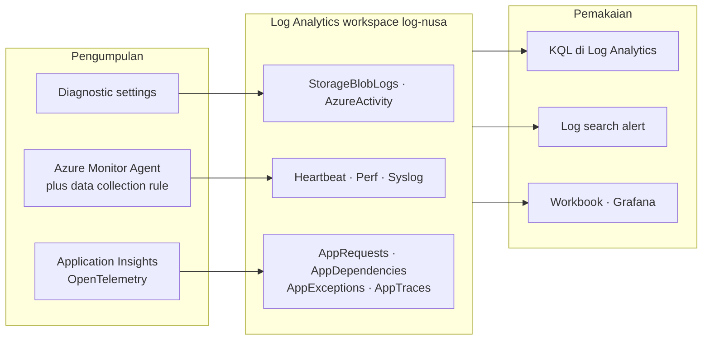
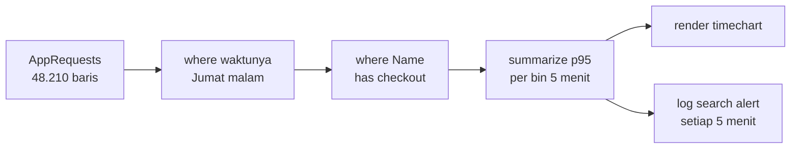
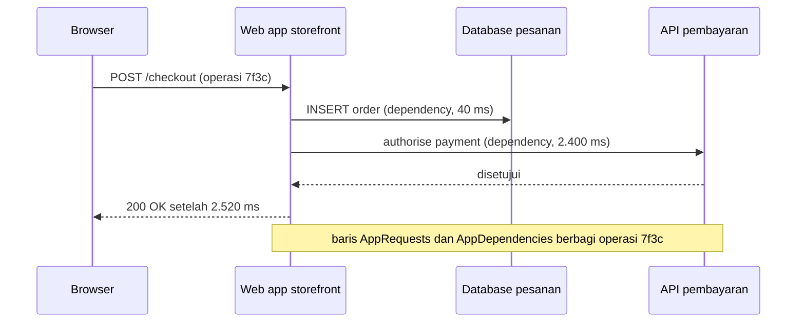

# Makan Siang 30 · Pemantauan (Lanjutan): Log Analytics, KQL, dan Application Insights

🇬🇧 [Read in English](README.md)

> **Jalur:** Bulan pendalaman · **Level:** Lanjutan · **Bagian 5:** Pendalaman
> **Waktu:** 60 menit · **Makan siang prasyarat:** 16 (Monitoring, Dasar), 06, 10
> **Area keterampilan AZ-900:** Di luar cakupan AZ-900
> **Lab:** [Lab 30 · Mengapa checkout lambat pada hari Jumat?](../../labs/30-monitoring-advanced/README.id.md) — sekitar 60 menit · biaya 💲💲
> **Penulis:** Stefanus Pinarta · [Tentang penulis](../../README.id.md#tentang-penulis)

| ⏱ Menit | Segmen |
|---:|---|
| 5 | Skenario dan tujuan |
| 25 | Bacaan |
| 15 | Demo: animasi interaktif (+ video panduan opsional) |
| 5 | Uji pemahaman |
| 5 | Poin penting dan pratinjau lab |
| 5 | Waktu cadangan — habiskan makan siang Anda 🍜 |

## 🍱 Menu hari ini

Setelah makan siang ini, Anda akan mampu:

- **Merancang** Log Analytics workspace: berapa banyak, di mana, siapa boleh membaca apa, berapa lama data disimpan, dan table plan apa yang dibutuhkan setiap tabel.
- **Memilih** pipa pengumpulan yang tepat — diagnostic setting, Azure Monitor Agent dengan data collection rule, atau Application Insights — untuk setiap jenis data.
- **Menulis** query KQL dengan `where`, `project`, `summarize`, `bin`, `render`, dan `join`, lalu **mengubah** sebuah query menjadi log search alert.
- **Memakai** Application Insights — OpenTelemetry, request, dependency, failure, availability test, dan application map — untuk menemukan ke mana waktu terbuang.

## 🏪 Sementara itu di Nusantara Retail

Alert (*pemberitahuan*) dari Makan Siang 16 berfungsi. Jumat lalu, alert CPU tetap diam — tidak ada server yang
melewati 50% CPU — tetapi checkout butuh empat detik, dan tim pembayaran mencatat 312 keranjang yang ditinggalkan antara
pukul 19.00 dan 20.00.

Hari Senin, semua orang punya teori. Dewi menyalahkan gambar produk di Blob storage. Pak Budi menyalahkan VM (virtual
machine, *komputer virtual*) yang menjalankan order job. Rizky, sang kontraktor, menyalahkan penyedia pembayaran.
Masing-masing membuka layar yang berbeda, dan tidak ada satu layar pun yang sepakat.

Ibu Sari mengajukan pertanyaan yang benar-benar penting: "Kenapa checkout lambat hari Jumat — dan apakah akan terulang
pada 12.12?" Harbolnas, Hari Belanja Online Nasional, tinggal kurang dari dua bulan lagi.

Hari ini Anda mengumpulkan semua bukti di satu tempat, mempelajari bahasa untuk menanyainya, lalu mengubah jawabannya
menjadi alert.

---

## 📖 Bacaan (≈25 menit)

### 1. Rancang workspace sebelum mengumpulkan apa pun

**Log Analytics workspace** adalah resource (*sumber daya*) Azure regional yang menyimpan data log di dalam tabel. Log
adalah catatan kejadian yang bertanda waktu, misalnya "pukul 19.05, sebuah request checkout butuh 2,8 detik". Data dari
agent, resource log, activity log yang diekspor, dan telemetri Application Insights (data pengamatan yang dikirim
aplikasi secara otomatis) semuanya mendarat di tabel-tabel di sana, dan setiap tabel punya skema, masa simpan
(retention), dan harga. Karena memindahkan data antar-workspace belakangan itu merepotkan, beberapa keputusan desain
sebaiknya diambil sejak awal.

**Berapa banyak workspace?** Sesedikit yang masih bisa Anda pertanggungjawabkan. Satu workspace membuat pertanyaan lintas
sumber menjadi mudah: satu query bisa menjajarkan request aplikasi dengan counter VM dan log storage. Pisahkan hanya
jika ada alasan yang nyata:

- **Residensi data** (aturan tentang di mana data boleh disimpan) — data pelanggan Nusantara Retail harus tetap berada
  di region (*wilayah*) Indonesia Central, sehingga log produksi yang mungkin berisi detail pelanggan masuk ke workspace
  di sana.
- **Pemilik yang berbeda** — tim keamanan yang menjalankan Microsoft Sentinel sering menginginkan workspace dan aturan
  aksesnya sendiri.
- **Penagihan atau skala** — cost center yang terpisah, atau volume yang sangat besar dengan komitmen harganya sendiri.

Jika Anda memang memisahkannya, fungsi `workspace()` memungkinkan satu query membaca beberapa workspace sekaligus.

**Siapa boleh membaca apa?** Dengan akses **resource-context**, siapa pun yang bisa membaca sebuah resource bisa
meng-query log resource itu tanpa diberi akses ke seluruh workspace. Akses **workspace-context** ditujukan bagi
operator yang membutuhkan semuanya, dan izin **table-level** (per tabel) melindungi tabel yang sensitif.

**Berapa lama data disimpan?** Tabel pada Analytics plan punya *analytics retention* — 30 hari secara default (90 hari
untuk tabel Application Insights dan workspace yang mengaktifkan Sentinel), bisa diperpanjang hingga dua tahun — dan
selama masa itu datanya bisa di-query sepenuhnya. Setiap tabel, apa pun plan-nya, juga punya *total retention* hingga
12 tahun. Data yang melewati analytics retention pindah ke **long-term retention** yang murah, yang bisa Anda jangkau
dengan **search job** atau dengan memulihkannya (restore). Retention default sudah termasuk dalam harga ingestion
(pemasukan data ke workspace); Anda hanya membayar tambahan untuk menyimpan data lebih lama.

**Table plan yang mana?** Setiap tabel punya plan yang menukar kemampuan query dengan harga. (Dokumentasi terbaru menamai
plan ketiga *Auxiliary / Lake*.)

| | Analytics | Basic | Auxiliary |
|---|---|---|---|
| Paling cocok untuk | data yang Anda jadikan alert dan Anda query setiap hari | data troubleshooting dan insiden | log yang sangat rinci dan jarang dibaca, disimpan untuk audit |
| Berlaku untuk tabel | semua | tabel Azure tertentu dan tabel kustom | tabel Azure tertentu dan tabel kustom |
| Harga ingestion | standar | lebih murah | minimal |
| Harga query | sudah termasuk | ditagih per GB yang dipindai | ditagih per GB yang dipindai |
| Kecepatan query | cepat | cepat | lebih lambat |
| Alert | ya | hanya simple log alert | tidak |
| Dashboard | semuanya, termasuk insights | workbook dan Grafana | workbook dan Grafana, lambat di-refresh |
| Contoh tabel di Nusantara | `AppRequests`, `Perf`, `Syslog` | log container (*kontainer*) yang sangat rinci | log audit yang disimpan bertahun-tahun |

Bagian 5 akan kembali membahas biaya. Untuk sekarang, ingat aturan di balik setiap plan: makin sering Anda butuh data
dengan cepat, makin mahal biaya menyimpannya. Ibaratnya menyimpan barang di rumah: dokumen yang dipakai setiap hari ada
di laci meja kerja (Analytics), kardus arsip ada di gudang belakang (Basic), dan barang yang jarang sekali dicari
dititipkan di gudang sewaan di luar kota (Auxiliary): murah, tetapi butuh waktu dan ongkos setiap kali Anda
mengambilnya.



### 2. Memasukkan data: tiga pipa

Bukti hari Jumat di Nusantara Retail tersebar di tiga tempat — platform, server, dan aplikasi — dan masing-masing punya
pipanya sendiri menuju workspace.

| Data | Pipa | Mendarat di | Ingat |
|---|---|---|---|
| Resource log: pembacaan blob, akses Key Vault, audit SQL | Diagnostic setting pada resource | tabel resource-specific seperti `StorageBlobLogs` (atau tabel bersama `AzureDiagnostics` yang lebih lama) | maksimal lima setting per resource; gunakan category group seperti *allLogs* |
| Activity log | Diagnostic setting pada subscription (*langganan*) | `AzureActivity` | gratis untuk di-ingest |
| Guest OS: Syslog, event Windows, performance counter, file teks | Azure Monitor Agent + data collection rule | `Syslog`, `Event`, `Perf`, tabel kustom `_CL` | butuh managed identity dan association |
| Request, dependency, exception, dan log aplikasi | Application Insights | `AppRequests`, `AppDependencies`, `AppExceptions`, `AppTraces` | autoinstrumentation atau OpenTelemetry |
| Catatan milik Anda sendiri | Logs ingestion API + data collection rule | tabel kustom `_CL` | Anda yang menentukan skemanya |

**Diagnostic setting** mengalirkan platform log sebuah resource — dan, jika mau, metriknya — ke workspace, storage
account (*akun penyimpanan*), Event Hubs, atau solusi partner. Utamakan tabel **resource-specific**, yang punya skema
rapi untuk setiap layanan, dibandingkan tabel bersama `AzureDiagnostics`. Ada satu keanehan yang sering mengejutkan:
diagnostic setting hidup lebih lama daripada resource-nya. Jika Anda menghapus sebuah resource lalu kemudian membuat
ulang resource dengan nama yang sama, setting lama bisa ikut kembali, jadi hapus setting saat Anda menghapus atau
mengganti nama resource. Dalam skala besar, Azure Policy membuat diagnostic setting untuk Anda (Makan Siang 31).

**Azure Monitor Agent** (AMA) adalah satu-satunya agent yang didukung untuk mengumpulkan data dari dalam mesin Windows dan
Linux, baik di Azure maupun — melalui Azure Arc — di tempat lain. Agent Log Analytics versi lama (disebut juga MMA atau
OMS) sudah pensiun pada 31 Agustus 2024, dan Microsoft memperingatkan bahwa setelah 2 Maret 2026 pengiriman datanya bisa
berhenti kapan saja tanpa pemberitahuan; jika Anda masih menemukannya di sebuah server, migrasi itu mendesak, bukan
pilihan. AMA melakukan autentikasi dengan **managed identity** milik mesin, yaitu identitas yang dikelola Azure tanpa
kata sandi yang perlu disimpan (system-assigned cukup untuk beberapa mesin; user-assigned lebih mudah di-scale).

Agent tidak melakukan apa-apa sampai ia menerima **data collection rule (DCR)**, yaitu aturan pengumpulan data. Sebuah
DCR menyatakan tiga hal:

1. **Apa yang dikumpulkan** — facility Syslog dengan tingkat keparahan (severity) minimum, performance counter dengan
   interval sampling, event Windows yang disaring dengan XPath, atau baris-baris dari file teks dan JSON.
2. **Bagaimana membentuknya** — **transformation** opsional, ditulis dalam KQL, yang membuang baris atau kolom sebelum
   disimpan.
3. **Ke mana mengirimnya** — satu atau beberapa workspace, atau Azure Monitor Metrics.

**DCR association** menghubungkan sebuah mesin dengan sebuah rule. Hubungannya banyak-ke-banyak (many-to-many): satu DCR
"Linux baseline" bisa melayani setiap server, sementara server pembayaran juga mendapat rule tambahan untuk log
aplikasinya. Memasang agent saja tidak mengumpulkan apa pun — kejutan klasik di hari pertama.

Bayangkan agent sebagai pengemudi ojek online yang sudah siap di atas motornya. Tanpa order (DCR) yang menyebutkan apa
yang dijemput dan ke mana diantar, ia hanya menunggu di pangkalan. Association adalah saat order itu benar-benar
ditugaskan kepada pengemudi tersebut.

**VM insights** mengemas semua ini untuk Anda. Saat Anda mengaktifkan pemantauan untuk sebuah VM di portal hari ini,
pengalaman *metrics-based* yang direkomendasikan mengumpulkan sekumpulan metrik guest OpenTelemetry default ke dalam
**Azure Monitor workspace** (jenis workspace yang berbeda dari Log Analytics workspace; di-query dengan PromQL, metrik
default gratis), sedangkan pengalaman klasik *logs-based* menyimpan data performa di Log Analytics untuk KQL, workbook,
dan tampilan multi-VM. Anda bisa memakai keduanya.

Data tidak datang seketika. Begitu sebuah pipa sudah mengalir, baris data biasanya tiba dalam hitungan detik hingga
beberapa menit. Agent, rule, diagnostic setting, atau tabel yang benar-benar baru sering butuh 5–15 menit sebelum baris
pertamanya muncul — perhitungkan hal ini saat merencanakan lab dan saat menakar harapan Anda ketika terjadi insiden.

> [!TIP]
> Saring sedini mungkin. DCR yang mengumpulkan Syslog mulai level *Warning* ke atas hanya mengirim sebagian kecil data
> dibandingkan DCR yang mengumpulkan level *Debug*, dan memilih hanya counter yang Anda butuhkan lebih baik daripada
> mengumpulkan semuanya "untuk jaga-jaga". Anda tidak bisa meng-query apa yang tidak Anda kumpulkan, tetapi Anda
> membayar semua yang Anda kumpulkan.

### 3. KQL: ajukan pertanyaan kepada data Anda

**Kusto Query Language (KQL)** adalah bahasa yang hanya membaca (read-only): query tidak pernah mengubah data. Sebuah
query dimulai dari sebuah tabel lalu mengalirkan baris-barisnya melalui operator, dari kiri ke kanan, seperti ban
berjalan di pabrik: setiap tahap menerima baris dan menyerahkan baris ke tahap berikutnya. Tiga kebiasaan membuat query
cepat dan benar: mulai dari tabel, saring berdasarkan waktu lebih dulu, baru kemudian saring, bentuk, dan agregasikan.
Nama tabel dan kolom peka huruf besar-kecil (case-sensitive).

| Operator | Fungsinya | Contoh |
|---|---|---|
| `where` | mempertahankan baris yang cocok | `where TimeGenerated > ago(1h)` |
| `project` | memilih, mengganti nama, atau mengurutkan ulang kolom | `project TimeGenerated, Computer, SyslogMessage` |
| `extend` | menambahkan kolom hasil perhitungan | `extend Seconds = DurationMs / 1000.0` |
| `summarize` | mengagregasi baris ke dalam kelompok | `summarize count() by Computer` |
| `bin()` | membulatkan nilai ke dalam "ember" (bucket), biasanya waktu | `summarize avg(CounterValue) by bin(TimeGenerated, 5m)` |
| `percentile()` | persentil latensi | `summarize p95 = percentile(DurationMs, 95)` |
| `countif()` | menghitung baris yang memenuhi suatu kondisi | `summarize Failed = countif(Success == false)` |
| `arg_max()` | baris terbaru per kelompok | `summarize arg_max(TimeGenerated, *) by Computer` |
| `top`, `sort by` | mengurutkan baris | `top 10 by DurationMs desc` |
| `render` | menggambar grafik | `render timechart` |
| `join` | menggabungkan dua tabel berdasarkan sebuah kunci | `join kind=leftouter (AppExceptions) on OperationId` |
| `union` | menumpuk tabel | `union AppTraces, AppExceptions` |
| `let` | memberi nama pada sebuah nilai atau subquery | `let slow = 1000;` |
| `has`, `contains`, `=~` | pencocokan teks | `where Name has "checkout"` |

Inilah query yang memulai penyelidikan Nusantara Retail: durasi persentil ke-95 dari request checkout dalam ember lima
menitan. Persentil ke-95 (p95) artinya 95% request selesai lebih cepat dari angka itu, dan 5% sisanya lebih lambat.

```kusto
AppRequests
| where TimeGenerated between (datetime(2026-10-16 18:00) .. datetime(2026-10-16 21:00))
| where Name has "checkout"
| summarize p95 = percentile(DurationMs, 95), requests = count() by bin(TimeGenerated, 5m)
| render timechart
```

Beberapa jebakan menjerat hampir semua orang:

- **`has` versus `contains`.** `has` mencocokkan kata utuh (term) dan memakai indeks, jadi cepat; `contains` mencocokkan
  potongan teks (substring) apa pun dan lebih lambat. `==` peka huruf besar-kecil; `=~` tidak.
- **Join default.** Tanpa `kind=`, sebuah join bertipe `innerunique`, yang diam-diam hanya menyimpan satu baris per kunci
  di sisi kiri. Tulis `kind=inner` atau `kind=leftouter` dengan sengaja, dan saring kedua sisi sebelum melakukan join.
- **Rata-rata menyembunyikan penderitaan.** Rata-rata checkout 600 ms bisa menyembunyikan satu dari dua puluh pelanggan
  yang menunggu empat detik. Gunakan persentil untuk latensi.
- **Cakupan (scope).** Membuka *Logs* dari menu sebuah resource membatasi query hanya pada resource itu; bukalah dari
  workspace (atau *Monitor › Logs*) untuk melihat semuanya. Log Analytics juga punya mode *Simple* yang cukup dioperasikan
  dengan klik, di samping mode *KQL*.

Query pada tabel Analytics tidak dikenai biaya tambahan; query yang menyentuh tabel Basic atau Auxiliary ditagih
berdasarkan data yang dipindainya — satu alasan lagi untuk menyaring berdasarkan waktu lebih dulu.



### 4. Application Insights: melihat ke dalam kode

**Application Insights** adalah fitur application performance monitoring (APM, pemantauan performa aplikasi) milik
Azure Monitor. Setiap resource Application Insights yang Anda buat hari ini bersifat **workspace-based**: telemetrinya
mendarat di tabel-tabel dalam Log Analytics workspace, dan resource itu menambahkan tampilan-tampilan di portal serta
**connection string** yang dipakai aplikasi Anda untuk mengirim data. Resource klasik, yang menyimpan datanya secara
terpisah, sudah pensiun pada Februari 2024.

Ada dua cara untuk menginstrumentasi aplikasi, yaitu memasang "sensor" yang mencatat apa yang terjadi di dalamnya:

- **Autoinstrumentation** — tanpa mengubah kode. Di App Service, Anda cukup menyalakan Application Insights (dua app
  setting jika memakai script) untuk .NET, Java, Node.js, dan, di Linux, Python; Azure Functions dan AKS punya opsinya
  sendiri. Dukungannya berbeda untuk setiap bahasa dan host, dan beberapa kombinasi masih berstatus preview, jadi
  periksa tabel dukungan untuk kombinasi Anda.
- **OpenTelemetry berbasis kode** — Anda menambahkan distro OpenTelemetry dari Microsoft ke aplikasi dan
  menginisialisasinya saat aplikasi mulai berjalan. Saat tulisan ini dibuat, aplikasi .NET, Node.js, dan Python yang
  baru memakai Microsoft OpenTelemetry Distro, sedangkan Java memakai Azure Monitor OpenTelemetry Distro (sebuah Java
  agent). OpenTelemetry adalah standar terbuka, sehingga instrumentasi yang sama juga bisa mengirim data ke backend
  lain. **Sampling** (hanya menyimpan sebagian sampel telemetri) menjaga volume dan biaya tetap terkendali.

| Telemetri | Tabel | Menjawab |
|---|---|---|
| Request | `AppRequests` | Halaman dan API mana yang dipanggil, berapa lama, dan apakah gagal |
| Dependency | `AppDependencies` | Panggilan keluar mana — SQL, HTTP API, storage — yang lambat atau gagal |
| Exception | `AppExceptions` | Apa yang rusak, lengkap dengan tipe, pesan, dan stack |
| Trace | `AppTraces` | Apa yang dicatat kode di sepanjang jalan |
| Hasil availability | `AppAvailabilityResults` | Apakah situs menjawab dari luar, dari setiap lokasi pengujian |
| Page view dan browser timing | `AppPageViews`, `AppBrowserTimings` | Apa yang dialami pengguna sungguhan di browser (butuh browser SDK) |

Setiap baris dari satu aksi pengguna berbagi **operation ID** yang sama, sehingga Anda bisa mengikuti satu checkout dari
browser, melewati web app (*aplikasi web*), menuju API pembayaran, lalu kembali lagi. Ibaratnya nomor resi paket:
dengan satu nomor, Anda bisa melacak perjalanan paket dari gudang, ke kurir, sampai ke depan pintu rumah. Portal
mengubahnya menjadi tampilan-tampilan yang akan terus Anda pakai:

- **Application map** menggambar komponen-komponen beserta dependency-nya, lengkap dengan laju panggilan, durasi, dan
  tingkat kegagalan.
- **Performance** dan **Failures** menampilkan daftar operasi berdasarkan durasi atau jumlah error, menunjukkan
  persentil, dan memungkinkan Anda menelusuri **end-to-end transaction** dari satu sampel.
- **Live metrics** menayangkan laju request, kegagalan, dan kesehatan server hampir secara real time saat Anda men-deploy
  atau menguji. Fitur ini tidak tersedia untuk setiap jenis instrumentasi (misalnya, autoinstrumentation App Service
  untuk Python).
- **Availability test** memanggil sebuah URL dari lokasi-lokasi pengujian Microsoft di seluruh dunia. **Standard test**
  memeriksa kode status, waktu respons, isi halaman, dan validitas sertifikat TLS; disarankan minimal lima lokasi, alert
  berbunyi ketika beberapa lokasi gagal, dan standard test ditagih per eksekusi. URL ping test yang lebih lama sudah
  pensiun pada 30 September 2026: buatlah standard test saja.



### 5. Dari query menjadi tindakan — tanpa menguras kantong

**Log search alert** menjalankan query KQL sesuai jadwal. Anda memilih **measurement** (jumlah baris, atau kolom hasil
agregasi seperti durasi rata-rata), **dimension** opsional untuk memecah hasil — satu alert per komputer atau per
operasi — sebuah **threshold** (ambang batas), sebuah **frequency** (seberapa sering dijalankan), sebuah **window**
(seberapa jauh ke belakang setiap eksekusi melihat), dan berapa kali pelanggaran harus terjadi sebelum alert berbunyi.
Secara default, rule bersifat stateful, sehingga ia selesai (resolve) dengan sendirinya ketika kondisinya sudah pulih,
dan ia memberi tahu orang melalui action group yang sama dengan metric alert dari Makan Siang 16. Setiap rule punya
biaya bulanan yang naik seiring frekuensi evaluasinya, jadi lima menit adalah default yang masuk akal. Dua kebiasaan ini
membantu:

- Tulis query untuk menggambarkan masalahnya, bukan alert-nya. Kembalikan request yang lambat dan biarkan rule yang
  menghitungnya, serta hindari `take` dan `limit`, yang membuat hasil tidak konsisten antar-eksekusi.
- Beri ruang untuk keterlambatan ingestion. Alert hanya bisa berbunyi setelah baris-barisnya tiba, jadi beri window
  waktu yang cukup longgar, melebihi keterlambatan yang biasa Anda lihat.

Untuk dashboard, **workbook** menggabungkan parameter, query, grafik, dan teks menjadi laporan interaktif yang bisa
dibagikan — rumah yang pas untuk halaman "kesehatan checkout". **Azure Monitor dashboards with Grafana** menambahkan
dashboard Grafana siap pakai yang gratis di dalam portal, dan **Azure Managed Grafana** adalah opsi berbayar bagi tim
yang juga membutuhkan sumber data di luar Azure serta fitur Grafana yang lengkap. Laporan bisnis bisa dikirim ke
**Power BI**. Untuk grafik jangka panjang, **summary rule** melakukan pra-agregasi data mentah ke dalam tabel kecil agar
dashboard tetap cepat.

Log biasanya menjadi baris terbesar di tagihan pemantauan, dan ia tumbuh diam-diam seiring tim menambah sumber data.
Ingestion Analytics ditagih per GB — saat tulisan ini dibuat, 5 GB pertama per billing account per bulan gratis pada
pay-as-you-go (*model berbasis penggunaan*) — dan beberapa tabel, termasuk `Heartbeat`, `AzureActivity`, dan `Usage`,
gratis untuk di-ingest. Tuas-tuas berikut menjaga sisanya tetap terkendali:

| Tuas | Fungsinya | Yang perlu diwaspadai |
|---|---|---|
| Kumpulkan lebih sedikit | level severity di DCR, counter yang lebih sedikit, interval sampling yang lebih panjang, sampling Application Insights | Anda tidak bisa meng-query apa yang tidak pernah Anda kumpulkan |
| Transformasi saat ingestion | transformation KQL di DCR membuang baris atau kolom yang bising sebelum disimpan | membuang lebih dari separuh data yang masuk menambah biaya pemrosesan untuk kelebihannya |
| Pilih table plan | Basic atau Auxiliary untuk data rinci yang jarang Anda query | query ditagih berdasarkan data yang dipindai; alert terbatas |
| Sesuaikan retention | jaga analytics retention tetap pendek dan simpan data lama di long-term retention | search job dan restore punya biayanya sendiri |
| Commitment tier | diskon untuk volume Analytics yang stabil mulai 100 GB per hari | Anda tetap membayar tier itu bahkan di hari yang sepi |
| Pantau tabel `Usage` | menunjukkan tabel dan resource mana yang mengirim data paling banyak | tinjau setiap kali ada sumber data baru |

> [!WARNING]
> **Daily cap** pada workspace menghentikan pengumpulan data yang ditagih untuk sisa hari itu begitu batasnya tercapai.
> Fitur ini melindungi anggaran (budget), tetapi justru membutakan Anda tepat saat sebuah insiden membanjiri log —
> mirip token listrik PLN yang habis persis ketika semua lampu sedang dibutuhkan. Gunakan hanya sebagai jaring pengaman
> yang dipasang jauh di atas volume normal, dan buat alert untuk ingestion yang terus naik.

### 6. Jawaban hari Jumat untuk Nusantara Retail

Dengan ketiga pipa mengalir ke `log-nusa`, rapat hari Senin berubah total. Alih-alih tiga layar dan tiga teori, tim
membuka satu workspace dan mengajukan pertanyaan secara berurutan, dari gejala menuju penyebab:

1. `AppRequests` menunjukkan p95 checkout melonjak dari sekitar 400 ms menjadi 2,8 detik pada pukul 19.05, sementara
   halaman utama dan daftar produk tetap cepat. Masalahnya khusus pada checkout.
2. `AppDependencies` menunjukkan sebabnya: panggilan ke API penyedia pembayaran butuh 2,4 detik pada p95, sementara
   panggilan ke database dan Blob storage tetap normal. Application map menggambarkan hal yang sama, dengan satu garis
   merah menuju API pembayaran.
3. `Perf` dan `StorageBlobLogs` membersihkan nama tersangka lainnya: VM order job tetap di bawah 50% CPU, dan latensi
   blob datar sepanjang malam. Gambar milik Dewi dan VM milik Pak Budi tidak bersalah.
4. Rizky benar. Penyedia pembayaran telah membatasi (throttle) para merchant selama jam sibuk malam itu.

Perbaikannya sebagian teknis, sebagian lagi soal komunikasi: standard availability test terhadap endpoint status milik
penyedia pembayaran, log search alert pada p95 panggilan dependency pembayaran, timeout yang masuk akal dengan pesan
coba-lagi yang ramah bagi pelanggan, workbook yang bisa dibuka seluruh tim, dan pembicaraan dengan penyedia tentang
batas yang lebih tinggi sebelum 12.12. Ibu Sari mendapat jawabannya dalam dua puluh menit, bukan seminggu penuh
perdebatan — dan query yang sama akan mengawal Harbolnas.

> [!NOTE]
> **Renungkan sejenak:** log search alert Anda berjalan setiap 5 menit dan melihat 5 menit terakhir, tetapi pada jam
> sibuk baris `Syslog` tiba hingga 4 menit terlambat. Apa yang bisa salah, dan dua pengaturan mana yang akan Anda ubah?

Berikutnya, Makan Siang 31 memperluas governance (*tata kelola*) ke seluruh perusahaan, termasuk definisi Azure Policy
yang memasang agent dan diagnostic setting secara otomatis.

---

## 🎬 Demo (≈15 menit)

1. **Animasi interaktif (≈6–8 menit):** [Buka demo](https://stefpin.github.io/azure-fundamentals-lunches/demos/30-monitoring-advanced.html?lang=id) —
   tekan ▶ Putar atau telusuri langkah demi langkah sesuai kecepatan Anda. Sedang offline? Unduh
   [`docs/demos/30-monitoring-advanced.html`](../../docs/demos/30-monitoring-advanced.html) lalu buka di browser apa pun.
2. **Video panduan (≤ 6 menit):** _segera hadir_ — [baca naskah video](demo-video-script.id.md).

Yang perlu diperhatikan:

- Tiga pipa — agent dengan DCR, Application Insights, diagnostic setting — mengalir ke satu workspace, masing-masing ke
  tabelnya sendiri.
- Apa yang terjadi ketika DCR menyaring habis severity yang Anda butuhkan, dan mengapa perbaikannya butuh beberapa menit
  untuk terlihat.
- Bagaimana setiap operator KQL mengubah jumlah baris sampai tersisa sebuah grafik, dan bagaimana query yang sama
  menjadi alert.

## ✅ Uji pemahaman (≈5 menit)

1. Pak Budi memasang Azure Monitor Agent di sebuah VM Linux baru satu jam yang lalu. Extension-nya menampilkan
   *Provisioning succeeded*, tetapi tabel `Heartbeat` tidak punya satu baris pun untuk VM itu. Apa penyebab yang paling
   mungkin?
   <details><summary>Lihat jawaban</summary>

   VM itu **tidak punya data collection rule yang ter-associate** (atau tidak punya managed identity yang bisa dipakai
   agent untuk autentikasi). *Alasannya:* agent tidak mengumpulkan apa pun sampai sebuah DCR association memberitahunya
   apa yang dikumpulkan dan ke mana mengirimnya.

   </details>
2. Tim keamanan membutuhkan log firewall selama tiga tahun untuk audit dan hanya meng-query-nya beberapa kali setahun.
   Table plan mana yang cocok, dan apa kompromi (trade-off)-nya?
   <details><summary>Lihat jawaban</summary>

   **Auxiliary** (atau Basic), dengan total retention diatur ke tiga tahun. *Alasannya:* ingestion jauh lebih murah;
   sebagai gantinya query lebih lambat, ditagih per GB yang dipindai, dan tidak bisa menggerakkan alert standar — tidak
   masalah untuk pertanyaan audit yang jarang.

   </details>
3. Dewi menulis `AppRequests | summarize avg(DurationMs)` dan melihat 620 ms, padahal pelanggan mengeluhkan checkout
   yang butuh empat detik. Apa yang harus ia ubah?
   <details><summary>Lihat jawaban</summary>

   Saring ke operasi checkout dan rentang waktu yang tepat, lalu gunakan **persentil** per ember waktu — misalnya
   `percentile(DurationMs, 95)` per `bin(TimeGenerated, 5m)`. *Alasannya:* rata-rata dari semua data menyembunyikan ekor
   lambat yang benar-benar dirasakan pelanggan.

   </details>
4. Join antara request yang gagal dan exception berdasarkan `OperationId` mengembalikan lebih sedikit baris daripada yang
   diharapkan. Detail KQL mana yang menjelaskannya?
   <details><summary>Lihat jawaban</summary>

   Tanpa `kind=`, join di KQL bertipe **`innerunique`**, yang hanya menyimpan satu baris sisi kiri per kunci, dan inner
   join membuang request yang sama sekali tidak punya exception. Gunakan `kind=leftouter` (atau `kind=inner`) dengan
   sengaja. *Alasannya:* jenis join default menghapus duplikat di sisi kiri.

   </details>
5. Nusantara Retail ingin tahu, dari luar jaringan perusahaan, apakah pelanggan di Jakarta, Singapura, dan Tokyo bisa
   menjangkau toko online. Fitur mana yang cocok, dan jenis apa yang sebaiknya Anda buat?
   <details><summary>Lihat jawaban</summary>

   **Availability test** Application Insights berjenis **standard**, yang berjalan dari beberapa lokasi (disarankan lima
   atau lebih), dengan alert ketika beberapa lokasi gagal. *Alasannya:* URL ping test sudah pensiun sejak September 2026,
   dan standard test juga memeriksa sertifikat TLS, verb, dan header.

   </details>

## 🧠 Poin penting

- Rancang workspace lebih dulu — workspace sesedikit mungkin yang tetap memenuhi kebutuhan residensi dan kepemilikan,
  akses resource-context, retention yang tepat, dan table plan yang tepat untuk setiap tabel.
- Gunakan pipa yang tepat: diagnostic setting untuk platform log, Azure Monitor Agent plus data collection rule
  (ter-associate, dengan managed identity) untuk data dari dalam guest OS, dan Application Insights untuk telemetri
  aplikasi.
- KQL adalah sebuah pipeline: mulai dari tabel, saring berdasarkan waktu, lalu saring, ringkas, kelompokkan per bin,
  dan render; pilih jenis join dengan sengaja dan utamakan persentil untuk latensi.
- Application Insights berbasis workspace dan berbasis OpenTelemetry: request, dependency, exception, dan trace berbagi
  operation ID, dan standard availability test mengawasi dari luar.
- Ubah query yang bagus menjadi log search alert dan workbook — dan kendalikan biaya dengan mengumpulkan lebih sedikit,
  memilih table plan dengan bijak, dan memantau tabel `Usage`.

## 🗒️ Catatan lapangan dari Stefanus

> **Sunyi belum tentu sehat.** Query yang tidak mengembalikan apa pun tampak persis sama dengan sistem yang tidak
> bermasalah. Karena itu, setiap kali saya mengubah agent, data collection rule, atau diagnostic setting, saya
> mengirim satu pesan uji dengan penanda unik — sebaris `logger` atau satu request uji — dan saya tidak beranjak sebelum
> sebuah query berhasil menemukannya. Untuk setiap sumber data yang penting, saya juga memasang satu alert khusus untuk
> mendeteksi kesunyian: komputer yang `Heartbeat` terakhirnya sudah lebih dari sepuluh menit, atau tabel yang tidak
> menerima satu baris pun dalam satu jam terakhir. Alert berbasis ambang batas tidak akan pernah berbunyi untuk data
> yang berhenti datang, dan layar Anda tidak akan memberi tahu soal itu. Jebakan yang paling sering saya lihat: rule
> yang dipercaya semua orang, dengan setia mengevaluasi tabel yang sudah lama berhenti terisi.

## 🔬 Lab Anda: Mengapa checkout lambat pada hari Jumat?

Anda akan membangun ruang bukti Nusantara Retail di satu Log Analytics workspace: memasang Azure Monitor Agent di sebuah
VM dan menghubungkannya dengan data collection rule dari file JSON, mengirim resource log sebuah storage account melalui
diagnostic setting, serta menghubungkan toko online kecil berbasis Python di App Service ke Application Insights
berbasis workspace, lengkap dengan availability test. Setelah itu Anda akan menjawab sepuluh pertanyaan KQL bernilai,
mengubah query checkout lambat menjadi log search alert, dan memperbaiki DCR yang diam-diam membuang warning yang Anda
butuhkan.

- ⏱ Sekitar 60 menit · 💲💲 · bisa dikerjakan terpisah (tidak perlu lab sebelumnya)
- 👉 [Mulai Lab 30](../../labs/30-monitoring-advanced/README.id.md)

## 📚 Pelajari lebih lanjut

- [Microsoft Learn: Ikhtisar Azure Monitor Logs](https://learn.microsoft.com/azure/azure-monitor/logs/data-platform-logs) — workspace, table plan, dan fitur-fiturnya, berdampingan.
- [Microsoft Learn: Memasang dan mengelola Azure Monitor Agent](https://learn.microsoft.com/azure/azure-monitor/agents/azure-monitor-agent-manage) — opsi instalasi, identitas, dan cara memverifikasi agent dengan query Heartbeat.
- [Microsoft Learn: Tutorial: Mempelajari operator KQL yang umum](https://learn.microsoft.com/kusto/query/tutorials/learn-common-operators) — tur praktik ke operator-operator di makan siang ini, dengan data contoh.
- [Microsoft Learn: Mengaktifkan OpenTelemetry di Application Insights](https://learn.microsoft.com/azure/azure-monitor/app/opentelemetry-enable) — distro terbaru dan cara menghubungkan aplikasi dengan connection string.

---

⬅️ [Makan Siang 29 · Containers (Lanjutan): Azure Kubernetes Service](../29-containers-advanced-aks/README.id.md) · 🏠 [Beranda kursus](../../README.id.md) · [Makan Siang 31 · Hierarki Resource dan Tata Kelola (Lanjutan): Tata Kelola Skala Besar](../31-governance-at-scale/README.id.md) ➡️

<sub>Terakhir divalidasi: Oktober 2026 · Menemukan informasi yang sudah usang? [Buka issue](../../CONTRIBUTING.md).</sub>
