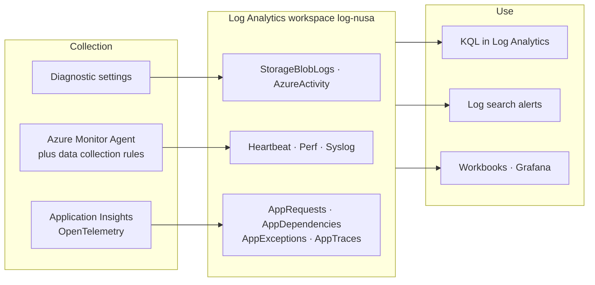
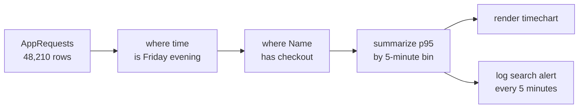
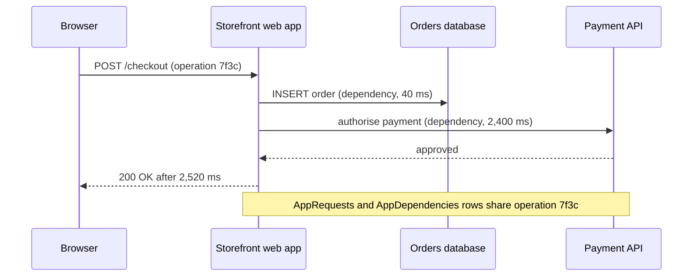

# Lunch 30 · Monitoring (Advanced): Log Analytics, KQL and Application Insights

> **Track:** Deep-dive month · **Level:** Advanced · **Part 5:** Deep dives
> **Time:** 60 minutes · **Prerequisite lunches:** 16 (Monitoring, Basic), 06, 10
> **AZ-900 skill area:** Beyond AZ-900
> **Lab:** [Lab 30 · Why was checkout slow on Friday?](../../labs/30-monitoring-advanced/README.md) — about 60 minutes · cost 💲💲

| ⏱ Minutes | Segment |
|---:|---|
| 5 | Scenario and objectives |
| 25 | Reading |
| 15 | Demo: interactive animation (+ optional walkthrough video) |
| 5 | Knowledge check |
| 5 | Key takeaways and lab preview |
| 5 | Buffer — finish your lunch 🍜 |

## 🍱 Today's menu

By the end of this lunch you will be able to:

- **Design** a Log Analytics workspace: how many, where, who can read what, how long data stays, and which table plan each table needs.
- **Choose** the right collection pipe — diagnostic settings, the Azure Monitor Agent with data collection rules, or Application Insights — for each kind of data.
- **Write** KQL queries with `where`, `project`, `summarize`, `bin`, `render` and `join`, and **turn** a query into a log search alert.
- **Use** Application Insights — OpenTelemetry, requests, dependencies, failures, availability tests and the application map — to find where the time goes.

## 🏪 Meanwhile at Nusantara Retail

The alerts from Lunch 16 work. Last Friday the CPU alert stayed quiet — no server passed 50% CPU — yet checkout took
four seconds, and the payments team counted 312 abandoned carts between 19:00 and 20:00.

On Monday everyone has a theory. Dewi blames the product images in Blob storage. Pak Budi blames the VM that runs the
order jobs. Rizky, the contractor, blames the payment provider. Each of them opens a different screen, and none of the
screens agree.

Ibu Sari asks the question that matters: "Why was checkout slow on Friday — and will it happen again on 12.12?"
Harbolnas, the national online-shopping day, is less than two months away.

Today you put all the evidence in one place, learn the language to question it, and turn the answer into an alert.

---

## 📖 Reading (≈25 minutes)

### 1. Design the workspace before you collect anything

A **Log Analytics workspace** is a regional Azure resource that stores log data in tables. Agent data, resource logs,
the exported activity log and Application Insights telemetry all land in tables there, and every table has a schema,
a retention period and a price. Because moving data between workspaces later is painful, a few design decisions belong
at the start.

**How many workspaces?** As few as you can justify. One workspace makes cross-source questions easy: a single query
can line up application requests with VM counters and storage logs. Split only for a real reason:

- **Data residency** — Nusantara Retail's customer data must stay in Indonesia Central, so production logs that may
  contain customer details go to a workspace there.
- **Different owners** — a security team running Microsoft Sentinel often wants its own workspace and access rules.
- **Billing or scale** — separate cost centres, or very large volumes with their own pricing commitments.

When you do split, the `workspace()` function lets one query read several workspaces.

**Who can read what?** With **resource-context** access, anyone who can read a resource can query that resource's logs
without being given the whole workspace. **Workspace-context** access is for operators who need everything, and
**table-level** permissions protect sensitive tables.

**How long is data kept?** A table on the Analytics plan has an *analytics retention* — 30 days by default (90 days for
Application Insights tables and Sentinel-enabled workspaces), extendable to two years — during which it's fully
queryable. Every table, whatever its plan, also has a *total retention* of up to 12 years. Data past the analytics
retention moves to cheap **long-term retention**, which you reach with **search jobs** or by restoring it. The default
retention is included in the ingestion price; you pay extra only for keeping data longer.

**Which table plan?** Every table has a plan that trades query power for price. (The current docs label the third plan
*Auxiliary / Lake*.)

| | Analytics | Basic | Auxiliary |
|---|---|---|---|
| Best for | data you alert on and query every day | troubleshooting and incident data | verbose, rarely read logs kept for audit |
| Which tables | all | selected Azure tables and custom tables | selected Azure tables and custom tables |
| Ingestion price | standard | reduced | minimal |
| Query price | included | charged per GB scanned | charged per GB scanned |
| Query speed | fast | fast | slower |
| Alerts | yes | simple log alerts only | no |
| Dashboards | everything, including insights | workbooks and Grafana | workbooks and Grafana, slow to refresh |
| Typical Nusantara table | `AppRequests`, `Perf`, `Syslog` | verbose container logs | audit logs kept for years |

Section 5 returns to cost. For now, remember the rule behind every plan: the more often you need data quickly, the more
you pay to store it.



### 2. Getting data in: three pipes

Nusantara Retail's Friday evidence lives in three places — the platform, the servers and the application — and each
has its own pipe into the workspace.

| Data | Pipe | Lands in | Remember |
|---|---|---|---|
| Resource logs: blob reads, Key Vault access, SQL audit | Diagnostic setting on the resource | resource-specific tables such as `StorageBlobLogs` (or the older shared `AzureDiagnostics`) | up to five settings per resource; use category groups such as *allLogs* |
| Activity log | Diagnostic setting on the subscription | `AzureActivity` | free to ingest |
| Guest OS: Syslog, Windows events, performance counters, text files | Azure Monitor Agent + data collection rule | `Syslog`, `Event`, `Perf`, custom `_CL` tables | needs a managed identity and an association |
| Application requests, dependencies, exceptions, logs | Application Insights | `AppRequests`, `AppDependencies`, `AppExceptions`, `AppTraces` | autoinstrumentation or OpenTelemetry |
| Your own records | Logs ingestion API + data collection rule | custom `_CL` tables | you define the schema |

**Diagnostic settings** route a resource's platform logs — and optionally its metrics — to a workspace, a storage
account, Event Hubs or a partner solution. Prefer **resource-specific** tables, which have a proper schema per
service, over the shared `AzureDiagnostics` table. One quirk surprises people: a diagnostic setting outlives its
resource. If you delete a resource and later recreate one with the same name, the old setting can come back with it,
so delete settings when you delete or rename resources. At scale, Azure Policy creates diagnostic settings for you
(Lunch 31).

The **Azure Monitor Agent** (AMA) is the only supported agent for collecting data from inside Windows and Linux
machines, in Azure and — through Azure Arc — elsewhere. The legacy Log Analytics agent (also called MMA or OMS) was
retired on August 31, 2024, and Microsoft warns that after March 2, 2026 its data uploads can stop at any time without
notice; if you still find it on a server, migrating is urgent, not optional. AMA authenticates with the machine's
**managed identity** (system-assigned is fine for a few machines; user-assigned scales better).

The agent does nothing until it receives a **data collection rule (DCR)**. A DCR says three things:

1. **What to collect** — Syslog facilities with a minimum severity, performance counters with a sampling interval,
   Windows events filtered with XPath, or lines from text and JSON files.
2. **How to shape it** — an optional **transformation**, written in KQL, that drops rows or columns before they are
   stored.
3. **Where to send it** — one or more workspaces, or Azure Monitor Metrics.

A **DCR association** links a machine to a rule. The relationship is many-to-many: one "Linux baseline" DCR can serve
every server, while the payment server also gets an extra rule for its application log. Installing the agent alone
collects nothing — a classic first-day surprise.

**VM insights** packages this for you. When you enable monitoring for a VM in the portal today, the recommended
*metrics-based* experience collects a default set of OpenTelemetry guest metrics into an **Azure Monitor workspace**
(queried with PromQL, default metrics free), and the classic *logs-based* experience stores performance data in Log
Analytics for KQL, workbooks and multi-VM views. You can use both.

Data isn't instant. Once a pipe is flowing, rows usually arrive within seconds to a few minutes. A brand-new agent,
rule, diagnostic setting or table often needs 5–15 minutes before the first rows appear — plan your labs and your
incident expectations accordingly.

> [!TIP]
> Filter as early as possible. A DCR that collects Syslog at *Warning* and above sends a fraction of the data of one
> that collects *Debug*, and choosing only the counters you need beats collecting everything "just in case". You can't
> query what you didn't collect, but you pay for everything you do.

### 3. KQL: ask questions of your data

**Kusto Query Language (KQL)** is a read-only language. A query starts with a table and pipes the rows through
operators, left to right, like a production line: each step receives rows and hands rows to the next. Three habits make
queries fast and correct: start with the table, filter on time first, and only then filter, shape and aggregate.
Table and column names are case-sensitive.

| Operator | What it does | Example |
|---|---|---|
| `where` | keep matching rows | `where TimeGenerated > ago(1h)` |
| `project` | choose, rename or reorder columns | `project TimeGenerated, Computer, SyslogMessage` |
| `extend` | add a calculated column | `extend Seconds = DurationMs / 1000.0` |
| `summarize` | aggregate rows into groups | `summarize count() by Computer` |
| `bin()` | round values into buckets, usually time | `summarize avg(CounterValue) by bin(TimeGenerated, 5m)` |
| `percentile()` | latency percentiles | `summarize p95 = percentile(DurationMs, 95)` |
| `countif()` | count rows that match a condition | `summarize Failed = countif(Success == false)` |
| `arg_max()` | the latest row per group | `summarize arg_max(TimeGenerated, *) by Computer` |
| `top`, `sort by` | order rows | `top 10 by DurationMs desc` |
| `render` | draw a chart | `render timechart` |
| `join` | combine two tables on a key | `join kind=leftouter (AppExceptions) on OperationId` |
| `union` | stack tables | `union AppTraces, AppExceptions` |
| `let` | name a value or a subquery | `let slow = 1000;` |
| `has`, `contains`, `=~` | text matching | `where Name has "checkout"` |

Here is the query that started Nusantara Retail's investigation: the 95th-percentile duration of checkout requests in
five-minute buckets.

```kusto
AppRequests
| where TimeGenerated between (datetime(2026-10-16 18:00) .. datetime(2026-10-16 21:00))
| where Name has "checkout"
| summarize p95 = percentile(DurationMs, 95), requests = count() by bin(TimeGenerated, 5m)
| render timechart
```

A few traps catch almost everyone:

- **`has` versus `contains`.** `has` matches whole terms and uses the index, so it's fast; `contains` matches any
  substring and is slower. `==` is case-sensitive; `=~` isn't.
- **The default join.** Without `kind=`, a join is `innerunique`, which silently keeps only one row per key on the left
  side. Write `kind=inner` or `kind=leftouter` on purpose, and filter both sides before joining.
- **Averages hide pain.** An average checkout of 600 ms can hide one customer in twenty waiting four seconds. Use
  percentiles for latency.
- **Scope.** Opening *Logs* from a resource's menu scopes queries to that resource; open it from the workspace (or
  *Monitor › Logs*) to see everything. Log Analytics also has a point-and-click *Simple* mode beside *KQL* mode.

Queries on Analytics tables cost nothing extra; queries that touch Basic or Auxiliary tables are billed by the data
they scan — one more reason to filter on time first.



### 4. Application Insights: see inside the code

**Application Insights** is Azure Monitor's application performance monitoring feature. Every Application Insights
resource you create today is **workspace-based**: the telemetry lands in tables in a Log Analytics workspace, and the
resource adds the portal experiences and the **connection string** your app uses to send data. Classic resources, which
kept data separately, were retired in February 2024.

There are two ways to instrument an app:

- **Autoinstrumentation** — no code changes. On App Service you turn on Application Insights (two app settings when
  scripted) for .NET, Java, Node.js and, on Linux, Python; Azure Functions and AKS have their own options. Support
  differs per language and host, and some combinations are still in preview, so check the support table for yours.
- **Code-based OpenTelemetry** — you add Microsoft's OpenTelemetry distro to the app and initialise it at start-up. At
  the time of writing, new .NET, Node.js and Python apps use the Microsoft OpenTelemetry Distro, and Java uses the
  Azure Monitor OpenTelemetry Distro (a Java agent). OpenTelemetry is an open standard, so the same instrumentation can
  also send to other backends. **Sampling** keeps volume and cost under control.

| Telemetry | Table | Answers |
|---|---|---|
| Requests | `AppRequests` | Which pages and APIs were called, how long they took, and whether they failed |
| Dependencies | `AppDependencies` | Which outgoing calls — SQL, HTTP APIs, storage — were slow or failing |
| Exceptions | `AppExceptions` | What broke, with type, message and stack |
| Traces | `AppTraces` | What the code logged along the way |
| Availability results | `AppAvailabilityResults` | Whether the site answered from outside, from each test location |
| Page views and browser timings | `AppPageViews`, `AppBrowserTimings` | What real users experienced in the browser (needs the browser SDK) |

Every row of one user action shares an **operation ID**, so you can follow a single checkout from the browser through
the web app to the payment API and back. The portal turns this into views you'll use constantly:

- The **application map** draws components and their dependencies, with call rates, durations and failure rates.
- **Performance** and **Failures** list operations by duration or error count, show percentiles, and let you drill into
  one sample's **end-to-end transaction**.
- **Live metrics** stream request rates, failures and server health in near real time while you deploy or test. It
  isn't available with every instrumentation (for example, App Service autoinstrumentation for Python).
- **Availability tests** call a URL from Microsoft's test locations around the world. A **standard test** checks the
  status code, response time, content and TLS certificate validity; at least five locations are recommended, alerts
  fire when several locations fail, and standard tests are billed per run. The older URL ping tests are deprecated and
  scheduled for retirement on September 30, 2028.



### 5. From query to action — without breaking the bank

A **log search alert** runs a KQL query on a schedule. You choose a **measurement** (the number of rows, or an
aggregated column such as average duration), optional **dimensions** to split the result — one alert per computer or
per operation — a **threshold**, a **frequency**, a **window** (how far back each run looks) and how many violations
must occur before it fires. Rules are stateful by default, so they resolve themselves when the condition clears, and
they notify people through the same action groups as the metric alerts from Lunch 16. Each rule has a monthly cost that
rises with the evaluation frequency, so five minutes is a sensible default. Two habits help:

- Write the query to describe the problem, not the alert. Return the slow requests and let the rule count them, and
  avoid `take` and `limit`, which make results inconsistent between runs.
- Allow for ingestion delay. An alert can only fire after its rows have arrived, so give the window comfortably more
  time than the delay you normally see.

For dashboards, **workbooks** combine parameters, queries, charts and text into interactive, shareable reports — the
natural home for a "checkout health" page. **Azure Monitor dashboards with Grafana** add free, prebuilt Grafana
dashboards inside the portal, and **Azure Managed Grafana** is the paid option for teams that also need non-Azure data
sources and the full Grafana feature set. Business reports can go to **Power BI**. For charts over long periods,
**summary rules** pre-aggregate raw data into a small table so dashboards stay fast.

Logs are usually the largest line on a monitoring bill, and they grow quietly as teams add sources. Analytics ingestion
is billed per GB — at the time of writing the first 5 GB per billing account per month are free on pay-as-you-go — and
some tables, including `Heartbeat`, `AzureActivity` and `Usage`, are free to ingest. These levers keep the rest under
control:

| Lever | What it does | Watch out for |
|---|---|---|
| Collect less | DCR severity levels, fewer counters, longer sampling intervals, Application Insights sampling | you can't query what you never collected |
| Transform at ingestion | a KQL transformation in the DCR drops noisy rows or columns before they're stored | dropping more than half of the incoming data adds a processing charge for the excess |
| Choose table plans | Basic or Auxiliary for verbose data you rarely query | queries are billed by data scanned; alerts are limited |
| Right-size retention | keep analytics retention short and older data in long-term retention | search jobs and restores have their own charges |
| Commitment tiers | a discount for steady Analytics volume from 100 GB per day | you pay for the tier even on quiet days |
| Watch the `Usage` table | shows which tables and resources send the most data | review it after every new data source |

> [!WARNING]
> A workspace **daily cap** stops collecting billable data for the rest of the day once the cap is reached. It protects
> the budget, but it blinds you exactly when an incident floods the logs. Use it only as a safety net set well above
> normal volume, and alert on rising ingestion instead.

### 6. Friday's answer for Nusantara Retail

With all three pipes feeding `log-nusa`, the Monday meeting changed. Instead of three screens and three theories, the
team opened one workspace and asked questions in order, from symptom to cause:

1. `AppRequests` showed the p95 of checkout jumping from about 400 ms to 2.8 seconds at 19:05, while the home page and
   product list stayed fast. The problem was specific to checkout.
2. `AppDependencies` showed why: calls to the payment provider's API took 2.4 seconds at p95, while the database and
   Blob storage calls stayed normal. The application map drew the same picture, with one red line to the payment API.
3. `Perf` and `StorageBlobLogs` cleared the other suspects: the order-jobs VM stayed below 50% CPU, and blob latency was
   flat all evening. Dewi's images and Pak Budi's VM were innocent.
4. Rizky was right. The payment provider had throttled merchants during the evening peak.

The fix is part technical, part conversation: a standard availability test against the payment provider's status
endpoint, a log search alert on the p95 of payment dependency calls, sensible timeouts with a friendly retry message for
customers, a workbook the whole team can open, and a call with the provider about higher limits before 12.12. Ibu Sari
got her answer in twenty minutes instead of a week of arguments — and the same queries will watch Harbolnas.

> [!NOTE]
> **Pause and think:** Your log search alert runs every 5 minutes over the last 5 minutes, but during busy periods
> `Syslog` rows arrive up to 4 minutes late. What could go wrong, and which two settings would you change?

Next, Lunch 31 scales governance across the whole company, including the Azure Policy definitions that deploy agents
and diagnostic settings automatically.

---

## 🎬 Demo (≈15 minutes)

1. **Interactive animation (≈6–8 min):** [Open the demo](https://stefpin.github.io/azure-fundamentals-lunches/demos/30-monitoring-advanced.html) —
   press ▶ Play or step through it at your own pace. Offline? Download
   [`docs/demos/30-monitoring-advanced.html`](../../docs/demos/30-monitoring-advanced.html) and open it in any browser.
2. **Walkthrough video (≤ 6 min):** _coming soon_ — [read the walkthrough script](demo-video-script.md).

What to watch for:

- Three pipes — agent with a DCR, Application Insights, diagnostic settings — feeding one workspace, each into its own
  tables.
- What happens when a DCR filters out the severity you needed, and why the fix takes a few minutes to show up.
- How each KQL operator changes the row count until a chart remains, and how the same query becomes an alert.

## ✅ Knowledge check (≈5 minutes)

1. Pak Budi installed the Azure Monitor Agent on a new Linux VM an hour ago. The extension shows *Provisioning
   succeeded*, but the `Heartbeat` table has no rows for that VM. What is the most likely cause?
   <details><summary>Show answer</summary>

   The VM has **no data collection rule associated** (or no managed identity for the agent to authenticate with).
   *Why:* the agent collects nothing until a DCR association tells it what to collect and where to send it.

   </details>
2. The security team needs three years of firewall logs for audits and queries them a few times a year. Which table plan
   fits, and what's the trade-off?
   <details><summary>Show answer</summary>

   **Auxiliary** (or Basic), with total retention set to three years. *Why:* ingestion is far cheaper; in return queries
   are slower, are charged per GB scanned, and can't drive standard alerts — fine for rare audit questions.

   </details>
3. Dewi writes `AppRequests | summarize avg(DurationMs)` and sees 620 ms, yet customers complain about four-second
   checkouts. What should she change?
   <details><summary>Show answer</summary>

   Filter to the checkout operation and the right time range, then use **percentiles** per time bucket — for example
   `percentile(DurationMs, 95)` by `bin(TimeGenerated, 5m)`. *Why:* an average over everything hides the slow tail
   that customers actually feel.

   </details>
4. A join of failed requests with exceptions on `OperationId` returns fewer rows than expected. Which detail of KQL
   explains it?
   <details><summary>Show answer</summary>

   Without `kind=`, a KQL join is **`innerunique`**, which keeps only one left-side row per key, and inner joins drop
   requests that have no exception at all. Use `kind=leftouter` (or `kind=inner`) on purpose. *Why:* the default join
   kind deduplicates the left side.

   </details>
5. Nusantara Retail wants to know from outside the company network whether customers in Jakarta, Singapore and Tokyo
   can reach the storefront. Which feature fits, and which kind should you create?
   <details><summary>Show answer</summary>

   An Application Insights **availability test** of the **standard** kind, running from several locations (five or more
   is recommended), with an alert when multiple locations fail. *Why:* URL ping tests are deprecated, and standard
   tests also check TLS certificates, verbs and headers.

   </details>

## 🧠 Key takeaways

- Design the workspace first — fewest workspaces that satisfy residency and ownership, resource-context access, the
  right retention, and the right table plan per table.
- Use the right pipe: diagnostic settings for platform logs, the Azure Monitor Agent plus a data collection rule
  (associated, with a managed identity) for guest data, and Application Insights for application telemetry.
- KQL is a pipeline: start with the table, filter on time, then filter, summarise, bin and render; choose join kinds
  deliberately and prefer percentiles for latency.
- Application Insights is workspace-based and OpenTelemetry-based: requests, dependencies, exceptions and traces share
  an operation ID, and standard availability tests watch from outside.
- Turn good queries into log search alerts and workbooks — and control cost by collecting less, choosing table plans
  wisely and watching the `Usage` table.

## 🔬 Your lab: Why was checkout slow on Friday?

You'll build Nusantara Retail's evidence room in one Log Analytics workspace: install the Azure Monitor Agent on a VM
and connect it with a data collection rule from a JSON file, send a storage account's resource logs through a
diagnostic setting, and connect a small Python storefront on App Service to workspace-based Application Insights with
an availability test. Then you'll answer ten graded KQL questions, turn the slow-checkout query into a log search alert,
and repair a DCR that silently drops the warnings you need.

- ⏱ About 60 minutes · 💲💲 · works on its own (no earlier lab needed)
- 👉 [Start Lab 30](../../labs/30-monitoring-advanced/README.md)

## 📚 Go further

- [Microsoft Learn: Azure Monitor Logs overview](https://learn.microsoft.com/azure/azure-monitor/logs/data-platform-logs) — workspaces, table plans and their features side by side.
- [Microsoft Learn: Install and manage the Azure Monitor Agent](https://learn.microsoft.com/azure/azure-monitor/agents/azure-monitor-agent-manage) — installation options, identities and how to verify the agent with a Heartbeat query.
- [Microsoft Learn: Tutorial: Learn common KQL operators](https://learn.microsoft.com/kusto/query/tutorials/learn-common-operators) — a hands-on tour of the operators in this lunch, with sample data.
- [Microsoft Learn: Enable OpenTelemetry in Application Insights](https://learn.microsoft.com/azure/azure-monitor/app/opentelemetry-enable) — the current distros and how to connect an app with a connection string.

---

⬅️ [Lunch 29 · Containers (Advanced): Azure Kubernetes Service](../29-containers-advanced-aks/README.md) · 🏠 [Course home](../../README.md) · [Lunch 31 · Resource Hierarchy and Governance (Advanced): Governance at Scale](../31-governance-at-scale/README.md) ➡️

<sub>Last validated: October 2026 · Spotted something out of date? [Open an issue](../../CONTRIBUTING.md).</sub>
