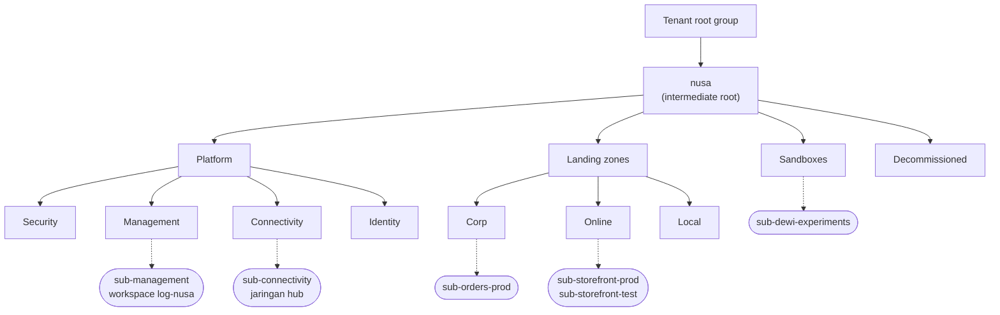
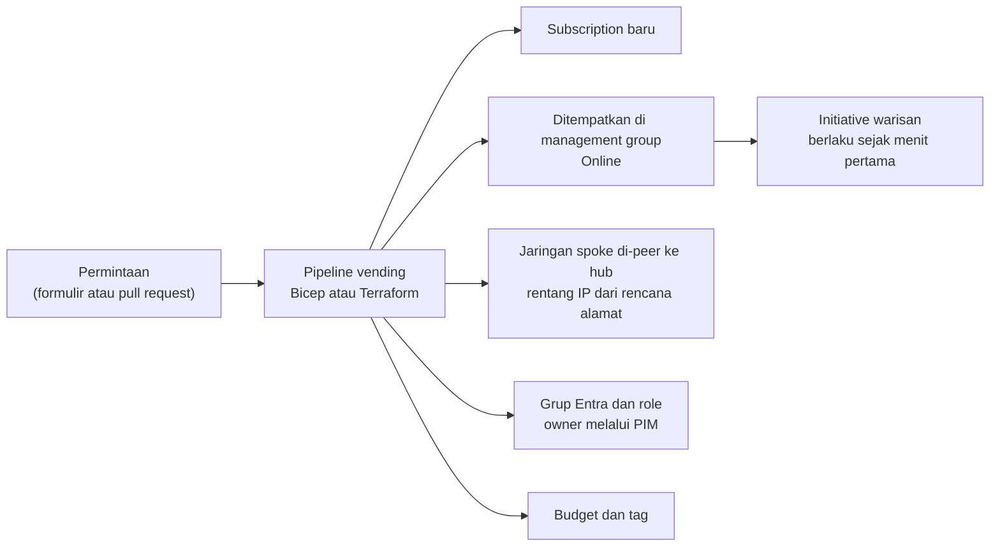
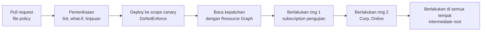

# Makan Siang 31 · Hierarki Resource dan Tata Kelola (Lanjutan): Tata Kelola Skala Besar

🇬🇧 [Read in English](README.md)

> **Jalur:** Bulan pendalaman · **Level:** Lanjutan · **Bagian 5:** Pendalaman
> **Waktu:** 60 menit · **Makan siang prasyarat:** 04, 18 (akan membantu: 20, 22)
> **Area keterampilan AZ-900:** Di luar cakupan AZ-900
> **Lab:** [Lab 31 · Tata kelola untuk seluruh perusahaan](../../labs/31-governance-at-scale/README.id.md) — sekitar 60 menit · biaya 💲
> **Penulis:** Stefanus Pinarta · [Tentang penulis](../../README.id.md#tentang-penulis)

| ⏱ Menit | Segmen |
|---:|---|
| 5 | Skenario dan tujuan |
| 25 | Bacaan |
| 15 | Demo: animasi interaktif (+ video panduan opsional) |
| 5 | Uji pemahaman |
| 5 | Poin penting dan pratinjau lab |
| 5 | Waktu cadangan — habiskan makan siang Anda 🍜 |

## 🍱 Menu hari ini

Setelah makan siang ini, Anda akan mampu:

- Merancang hierarki management group (*grup manajemen*) berdasarkan arsitektur Azure landing zone, dan menjelaskan mengapa hierarki itu mengikuti jenis workload (beban kerja), bukan bagan organisasi.
- Menjelaskan mengapa subscription (*langganan*) adalah satuan skala, apa yang diotomatiskan oleh subscription vending, dan di scope mana RBAC (*kontrol akses berbasis peran*), anggaran (budget), dan policy sebaiknya dipasang.
- Menjalankan tata kelola berbasis policy di scope management group: tempat definisi disimpan, rollout yang aman, identitas untuk remediasi, serta exemption (Waiver vs Mitigated).
- Mengelola tata kelola sebagai kode dan merencanakan perpindahan dari Azure Blueprints ke deployment stacks dan template specs.
- Memakai Azure Resource Graph dan Azure Arc untuk melihat dan mengatur setiap subscription — termasuk server yang tidak akan pernah pindah ke Azure.

## 🏪 Sementara itu di Nusantara Retail

Setahun setelah toko online pindah ke Azure, Nusantara Retail kini punya tujuh subscription: produksi dan pengujian toko
online, aplikasi loyalitas, data warehouse milik tim keuangan, sebuah hub jaringan bersama, dan dua subscription yang tak
seorang pun ingat pernah membuatnya — salah satunya ternyata subscription Visual Studio yang dipakai Dewi untuk
bereksperimen. Bulan depan, perusahaan menuntaskan pembelian jaringan dua belas toko di Sulawesi, yang membawa dua
subscription tambahan berisi resource di West Europe. Selain itu, masing-masing dari empat puluh toko masih menjalankan
server kasir (point-of-sale) kecil di ruang belakang, yang tidak akan pernah pindah ke cloud.

Pagar pengaman (guardrails) yang Anda bangun di Makan Siang 18 hanya melindungi tepat satu subscription. Sisanya
dikonfigurasi secara manual, dan setiap kali hasilnya sedikit berbeda. Blueprint lama buatan Rizky, yang dulu "mencap" tag
dan role ke setiap subscription baru, berhenti menerima assignment baru pada akhir bulan ini.

Ibu Sari menyampaikannya tanpa basa-basi: *"Tahun depan kita akan punya dua puluh subscription. Bagaimana caranya supaya
semuanya langsung mengikuti aturan yang sama sejak menit pertama dibuat — tanpa Anda harus mengonfigurasinya satu per
satu?"*

---

## 📖 Bacaan (≈25 menit)

### 1. Hierarki yang dirancang untuk policy, bukan untuk bagan organisasi

Di Makan Siang 04 Anda sudah berkenalan dengan hierarki resource: sebuah tenant Microsoft Entra (direktori identitas
milik organisasi), **tenant root group** di puncaknya, lalu management group, subscription, resource group (*grup sumber
daya*), dan resource (*sumber daya*). Apa pun yang Anda tetapkan di sebuah scope (tingkat dalam hierarki tempat sebuah
aturan dipasang) — entah role atau policy — akan mengalir turun ke semua yang ada di bawahnya, sementara biaya terkumpul
naik ke atas. Dalam skala kecil, bagian puncak pohon ini nyaris tak terasa. Dalam skala perusahaan, justru di
sinilah keputusan desain terpenting Anda, karena pewarisan (inheritance) adalah cara satu aturan menjangkau dua puluh
subscription.

Beberapa fakta platform menentukan bentuk desainnya. Pohon management group bisa sedalam enam tingkat, tidak termasuk
tenant root dan tingkat subscription. Di bawah root, setiap management group dan subscription punya tepat satu induk
(parent). ID tenant root group sama dengan ID tenant, dan grup ini tidak bisa dipindahkan maupun dihapus. ID sebuah
management group bersifat permanen begitu dibuat; hanya nama tampilannya (display name) yang bisa diubah. Secara default,
setiap pengguna di tenant boleh membuat management group, dan setiap **subscription baru langsung mendarat di bawah tenant
root group** — di luar semua aturan yang sudah Anda rancang dengan cermat.

Arsitektur **Azure landing zone** dari Cloud Adoption Framework (CAF, kumpulan panduan Microsoft untuk mengadopsi cloud)
memberi Anda bentuk awal yang sudah teruji. *Landing zone* berarti "zona pendaratan": lingkungan yang sudah disiapkan
lengkap dengan aturan, jaringan, dan akses, sehingga sebuah workload tinggal mendarat. Saat tulisan ini dibuat (Oktober
2026), arsitektur ini merekomendasikan management group berikut:

| Management group | Isinya | Pagar pengaman yang umum |
|---|---|---|
| **Intermediate root** (prefiks Anda, misalnya `nusa`) | Semua yang diatur perusahaan; berada tepat di bawah tenant root group | Baseline seluruh perusahaan: region (*wilayah*) yang diizinkan, tag wajib, tolok ukur (benchmark) keamanan |
| **Platform** → Security, Management, Connectivity, Identity | Masing-masing satu subscription khusus untuk perangkat SIEM (pengumpul dan penganalisis peristiwa keamanan), logging terpusat, jaringan hub, dan layanan identitas | Aturan untuk infrastruktur bersama, dikelola oleh tim platform |
| **Landing zones** → Corp, Online, Local | Subscription workload: Corp untuk aplikasi yang membutuhkan jaringan korporat, Online untuk aplikasi yang menghadap internet, Local untuk workload di klaster Azure Local | Aturan keamanan yang berlaku untuk semua workload dipasang di induk, aturan khusus arketipe di bawahnya |
| **Sandboxes** | Subscription untuk belajar dan bereksperimen, terisolasi dari jaringan korporat | Set policy yang lebih ringan dan budget yang ketat |
| **Decommissioned** | Landing zone yang sudah dibatalkan dan menunggu dihapus | Menolak hampir semua hal baru |



Perhatikan apa yang *tidak* ada. Tidak ada management group "Finance" atau "Marketing", karena perubahan struktur
departemen tidak boleh memaksa Anda merombak policy. Tidak ada pula grup "Production" dan "Development": lingkungan
(environment) dipisahkan sebagai subscription tersendiri di dalam management group yang sama, sehingga lingkungan
pengujian diatur persis seperti produksi. Region juga tidak mendapat grup sendiri, kecuali jika aturan residensi data
(kewajiban menyimpan data di negara tertentu) atau kedaulatan data memang berbeda di antara region tersebut. Panduannya:
jaga pohon tetap **datar — tiga atau empat tingkat** — dan kelompokkan subscription berdasarkan aturan yang mereka
butuhkan, yang dalam arsitektur landing zone disebut **arketipe** (archetype) workload.

Bayangkan pengelola sebuah mal. Ia tidak menyusun peraturan menurut siapa pemilik tiap gerai, melainkan menurut jenis area:
food court punya aturan kebersihan dan tabung gas, area parkir punya aturan keselamatan, bioskop punya jam operasionalnya
sendiri. Saat sebuah gerai berganti pemilik, aturannya tetap sama, karena yang menentukan adalah *jenis area* tempat gerai
itu berada. Management group bekerja dengan cara yang sama: yang menentukan adalah jenis workload, bukan nama departemen.

Dua pengaturan melengkapi gambarannya. Di pengaturan hierarki (hierarchy settings), pilih sebuah **default management
group** untuk subscription baru (Sandboxes adalah kandidat yang baik), agar subscription Visual Studio seperti milik Dewi
langsung tunduk pada aturan sandbox, bukan lolos dari semuanya. Lalu aktifkan pengaturan yang mewajibkan otorisasi untuk
membuat management group, sehingga hanya tim platform yang bisa mengubah bentuk pohon.

> [!TIP]
> Jangan pernah menggantungkan baseline Anda langsung di tenant root group. Sebuah **intermediate root** memberi Anda
> scope yang bisa diganti namanya, diuji lebih dulu (hierarki "canary" kedua yang kecil adalah praktik umum — namanya
> diambil dari burung kenari yang dulu dibawa penambang untuk mendeteksi gas berbahaya lebih awal), bahkan diganti
> sepenuhnya, sementara tenant root tetap hampir kosong. Intermediate root juga menjaga subscription dari perusahaan yang
> diakuisisi tetap berada di luar aturan Anda sampai Anda sengaja memindahkannya ke dalam.

### 2. Subscription sebagai satuan skala — dan cara menyediakannya lewat vending

Kalau management group adalah foldernya, maka **subscription** adalah unit yang Anda bagikan. Setiap subscription adalah
batas untuk tagihan, untuk kuota dan batas layanan, untuk akses, dan untuk *blast radius* (radius ledakan — seberapa jauh
dampak sebuah kesalahan bisa menjalar): kekeliruan atau skrip yang lepas kendali di subscription loyalitas tidak bisa
menghabiskan kuota toko online atau menyusup ke resource group-nya. Itulah sebabnya organisasi yang matang membuat banyak
subscription kecil — biasanya satu per workload per lingkungan — alih-alih satu subscription raksasa.

Membuat subscription secara manual tidak bisa mengimbangi pertumbuhan, dan setiap langkah manual adalah peluang untuk lupa
sesuatu. **Subscription vending** (dari *vending machine*, mesin penjual otomatis) mengubah sebuah permintaan menjadi
subscription yang langsung tertata lengkap melalui otomatisasi. Tim workload cukup mengisi formulir atau membuka pull
request (usulan perubahan di Git); sebuah pipeline (alur kerja otomatis) yang dibangun dengan Bicep atau Terraform —
keduanya punya modul vending siap pakai — mengerjakan sisanya.

Ibaratnya membuka cabang baru sebuah minimarket waralaba. Pemilik cabang tidak merakit sendiri rak, mesin kasir, seragam,
dan SOP (prosedur operasi standar); semuanya datang sebagai satu paket standar dari kantor pusat, dan pintu toko baru
dibuka setelah semuanya terpasang. Subscription vending adalah "paket waralaba" untuk subscription.



Membuat subscription secara terprogram membutuhkan izin billing pada akun Enterprise Agreement, Microsoft Customer
Agreement, atau Microsoft Partner Agreement, jadi lab melewati langkah ini — lagi pula, subscription tambahan di akun
pribadi mudah terlupakan. Gagasan terpentingnya adalah urutan: subscription ditempatkan di management group yang tepat
*sebelum* siapa pun men-deploy workload, sehingga policy warisan sudah menunggu di sana.

Pola pikir "tentukan scope sekali saja" yang sama berlaku untuk semua hal lain yang Anda tetapkan:

| Kontrol | Scope terbaik | Alasannya |
|---|---|---|
| Baseline policy seluruh perusahaan | Intermediate root | Menjangkau setiap subscription, termasuk yang baru dibuat kelak |
| Aturan arketipe (misalnya "tanpa IP publik" untuk Corp) | Management group Corp atau Online | Hanya workload yang membutuhkan aturan itu yang mendapatkannya |
| Akses tim platform | Platform atau intermediate root, diaktifkan melalui Privileged Identity Management | Hak yang luas, tetapi hanya saat dibutuhkan dan dengan jejak audit |
| Akses tim workload | Subscription atau resource group mereka sendiri, diberikan ke grup Entra | Prinsip hak akses minimum (least privilege); tidak ada kejutan dari pewarisan |
| Budget | Subscription untuk tim pemiliknya; management group untuk gambaran menyeluruh | Alert (*pemberitahuan*) sampai ke orang yang bisa bertindak |

Untuk **RBAC dalam skala besar**, tetapkan role ke grup Entra, jangan pernah ke individu, dan utamakan role bawaan
(built-in). Jika Anda membutuhkan **custom role** (role buatan sendiri), perhatikan bahwa assignable scopes-nya (daftar
scope tempat role itu boleh dipakai) bisa memuat paling banyak satu management group, dan role yang berisi data actions
(izin atas *isi* data, misalnya membaca blob) tidak bisa ditetapkan di scope management group. Jadikan role berhak
istimewa berstatus *eligible* (berhak diaktifkan saat perlu) alih-alih permanen dengan **Privileged Identity Management**
(PIM), yang membutuhkan lisensi Microsoft Entra ID (*ID Microsoft Entra*) P2 atau Entra ID Governance — Makan Siang 22
membahasnya secara mendalam. Untuk **budget di scope yang lebih tinggi**, ingat dari Makan Siang 19 bahwa budget hanya
mengirim alert dan tidak pernah menghentikan resource, dan bahwa tampilan biaya di level management group tidak tersedia
untuk setiap jenis perjanjian billing (periksa dokumentasi scope Cost Management (*manajemen biaya*) untuk jenis perjanjian
Anda).

### 3. Tata kelola berbasis policy di scope management group

Di Makan Siang 18 Anda menetapkan tiga policy tunggal ke satu resource group. Dalam skala besar, Anda membundelnya menjadi
sebuah **initiative** (paket beberapa policy yang dikelola sebagai satu kesatuan) dan menetapkannya sekali saja, tinggi di
pohon, dengan **parameter** yang membuat initiative yang sama bisa melayani arketipe berbeda — Corp mungkin hanya
mengizinkan `indonesiacentral`, sementara Sandboxes juga mengizinkan `southeastasia`. Ingat dari Makan Siang 18 bahwa
assignment (penetapan policy pada sebuah scope) bertumpuk: sebuah resource harus memenuhi setiap assignment di atasnya,
sehingga scope yang lebih rendah bisa memperketat aturan, tetapi tidak pernah bisa melonggarkannya. Jaga baseline di
tingkat teratas tetap ringkas, dan letakkan aturan yang lebih ketat di tingkat bawah.

Tiga aturan menentukan apakah semua ini benar-benar berjalan dalam praktik.

**Tempat definisi disimpan menentukan di mana definisi itu bisa ditetapkan.** Definisi kustom yang disimpan di sebuah
subscription hanya bisa ditetapkan di dalam subscription itu. Definisi yang disimpan di sebuah management group bisa
ditetapkan ke grup itu dan semua yang ada di bawahnya. Jadi, simpan definisi kustom dan initiative yang dipakai bersama di
intermediate root, meskipun awalnya Anda menetapkannya di tingkat yang lebih rendah. Saat tulisan ini dibuat, satu scope
dapat menampung hingga 500 definisi policy kustom dan 200 initiative, dan satu initiative dapat mereferensikan hingga
1.000 policy.

**Lakukan rollout seperti merilis perangkat lunak.** Assignment baru dengan effect Deny (permintaan yang melanggar
langsung ditolak) di intermediate root bisa memblokir deployment di seluruh perusahaan dalam hitungan menit. Mulailah
setiap assignment dengan enforcement mode **DoNotEnforce**: kepatuhan tetap dievaluasi dan dilaporkan, tetapi tidak ada
yang ditolak atau diubah. Tinjau hasilnya, perbaiki atau kecualikan temuan Anda, lalu berlakukan secara bertahap dalam
*ring* (gelombang) — satu subscription pengujian dulu, lalu satu arketipe, lalu semuanya. Resource selectors dan
overrides pada sebuah assignment memungkinkan Anda memberlakukan aturan secara bertahap, misalnya region demi region,
tanpa membuat salinan.

Ibaratnya aturan ganjil-genap di jalan raya. Sebelum tilang benar-benar berlaku, biasanya ada masa uji coba: petugas
hanya mencatat dan menegur pelanggar. Setelah datanya jelas, aturan diberlakukan di beberapa ruas jalan dulu, baru
kemudian diperluas. DoNotEnforce adalah masa uji coba itu, dan ring adalah perluasan ruas jalannya.

**Remediasi membutuhkan identitas dengan role yang tepat di tempat yang tepat.** Assignment dengan effect Modify
(mengubah resource, misalnya menambahkan tag) dan DeployIfNotExists (DINE — men-deploy sesuatu jika belum ada) bertindak
atas nama Anda melalui sebuah **managed identity** (identitas yang dikelola Azure, tanpa kata sandi yang perlu disimpan),
baik system-assigned (satu per assignment) maupun user-assigned (dibuat sekali, diberi role sekali, lalu dipakai ulang
oleh banyak assignment). Role yang dibutuhkan berasal dari `roleDefinitionIds` di dalam definisi. Portal memberikan role
tersebut secara otomatis; deployment lewat CLI (command-line interface) dan infrastructure as code (*infrastruktur sebagai
kode*) harus memberikannya secara eksplisit. Begitu sebuah assignment diberlakukan, resource baru dan yang diperbarui akan
diperbaiki otomatis — Modify saat permintaan diproses, DINE sesaat setelah resource dibuat (secara default sekitar sepuluh
menit kemudian). Resource yang sudah ada, dan apa pun yang dievaluasi selama assignment masih DoNotEnforce, membutuhkan
sebuah **remediation task** (tugas perbaikan), yang memperbaiki satu policy Modify atau DINE dalam satu waktu; jadi untuk
initiative, Anda menyebutkan reference ID policy tersebut.

> [!WARNING]
> Kegagalan remediasi skala besar yang klasik: sebuah policy DINE yang ditetapkan di grup Landing zones harus mengirim log
> diagnostik ke `log-nusa` di subscription *Management*. Identitasnya punya role di dalam Landing zones, tetapi tidak
> punya satu pun role di workspace tersebut, sehingga setiap deployment remediasi gagal dengan error otorisasi. Berikan
> identitas itu role yang dibutuhkannya di setiap scope yang ia tulisi — termasuk scope di luar assignment.

Tidak ada baseline yang cocok untuk semua kasus, jadi Anda membutuhkan cara terdokumentasi untuk berkata "kecuali di
sini". Sebuah **policy exemption** menandai sebuah scope (dari management group hingga satu resource) sebagai dikecualikan
dari sebuah assignment, atau dari policy tertentu di dalam sebuah initiative. Exemption muncul di laporan kepatuhan dengan
status **Exempt** (dikecualikan), bisa membawa tanggal kedaluwarsa serta metadata seperti nomor tiket, dan terbagi dalam
dua kategori:

| | Exemption: **Waiver** | Exemption: **Mitigated** | Exclusion (`notScopes`) |
|---|---|---|---|
| Artinya | Risikonya diketahui dan diterima untuk sementara | Tujuan policy sudah terpenuhi dengan cara lain | Scope itu sama sekali tidak dievaluasi |
| Contoh di Nusantara | Beta aplikasi loyalitas boleh memakai West Europe selama 30 hari, sementara integrasi dengan mitra diuji | Sebuah VM (*komputer virtual*) yang menurut policy harus dilindungi Azure Backup ternyata sudah dilindungi produk backup milik jaringan toko Sulawesi | Resource group lab yang tidak masuk laporan siapa pun |
| Terlihat di laporan kepatuhan | Ya, sebagai Exempt | Ya, sebagai Exempt | Tidak |
| Kedaluwarsa bawaan | `expiresOn` opsional | `expiresOn` opsional | Tidak ada |

Exemption yang kedaluwarsa tidak dihapus; ia sekadar berhenti berlaku, dan resource-nya kembali tampil sebagai tidak
patuh (non-compliant). Membuat exemption membutuhkan izin untuk menulis exemption dan aksi `exempt` pada assignment-nya
(role bawaan Resource Policy Contributor punya keduanya), jadi putuskan dengan sengaja siapa yang boleh memberi
pengecualian.

Ibaratnya buku absen di sekolah. Waiver seperti surat izin bertanggal yang ditandatangani kepala sekolah: di buku absen
tetap tercatat "izin", tidak hilang begitu saja. Mitigated seperti siswa yang dibebaskan dari ujian praktik renang karena
sudah punya sertifikat renang dari klubnya — tujuannya tercapai dengan cara lain. Exclusion seperti mencoret nama siswa
dari daftar absen: tidak ada lagi yang tahu ia hadir atau tidak.

Terakhir, fitur **regulatory compliance** (kepatuhan regulasi) di Microsoft Defender for Cloud (*Microsoft Defender untuk
Cloud*) dibangun di atas mesin yang sama. Microsoft cloud security benchmark aktif secara default, dan Anda bisa
menambahkan standar seperti ISO/IEC 27001:2022 (manajemen keamanan informasi), PCI DSS v4.0.1 (keamanan data kartu
pembayaran), atau NIST SP 800-53 (katalog kontrol keamanan dari lembaga standar Amerika Serikat). Di Azure, standar-standar
ini sebenarnya adalah initiative policy di balik layar, sehingga aturan pewarisan yang sama berlaku. Dasbornya memetakan
kontrol teknis ke rekomendasi; dasbor ini membantu audit, tetapi tidak memberi Anda sertifikasi. Beberapa standar atau
fitur mungkin memerlukan paket Defender berbayar — periksa dokumentasinya sebelum menjanjikan laporan kepada auditor.

### 4. Tata kelola sebagai kode — dan kehidupan setelah Blueprints

Mengeklik policy satu per satu di portal masih masuk akal untuk sepuluh assignment, tetapi tidak untuk dua ratus.
**Policy as code** memperlakukan definisi, initiative, assignment, dan exemption sebagai file di Git: setiap perubahan
adalah pull request yang ditinjau oleh orang kedua, lalu di-deploy oleh pipeline yang identitasnya menjadi satu-satunya
yang boleh menulis resource policy. Panduan Microsoft menyarankan satu folder per initiative dengan file seperti
`policyset.json`, `policyset.definitions.json`, dan `policyset.parameters.json`, ditambah file `assign.<name>.json` dan
folder `exemptions.<name>/`. Definisi dan assignment yang sudah ada bisa diekspor dengan CLI, PowerShell, atau Resource
Graph, jadi Anda bisa memulai dari apa yang sudah ada. Tim yang lebih besar sering memakai proyek open source Enterprise
Policy as Code (EPAC), atau pustaka policy yang disertakan dalam Azure landing zone accelerators.



**Azure landing zone accelerators** mengemas semua ini: hierarkinya, subscription platform, dan satu set policy pilihan,
yang di-deploy melalui accelerator infrastructure as code (Bicep atau Terraform, dibangun di atas Azure Verified Modules
dan terhubung ke GitHub atau Azure DevOps) atau melalui pengalaman portal untuk percobaan pertama. Kebanyakan perusahaan
memulai dari sebuah accelerator lalu menyesuaikannya, alih-alih merancang dari kertas kosong.

Sekarang giliran blueprint buatan Rizky. Azure Blueprints (preview) dipensiunkan secara bertahap: tidak ada definisi
blueprint baru mulai 31 Juli 2026, tidak ada assignment baru mulai 31 Oktober 2026, tidak ada perubahan pada assignment
yang sudah ada mulai 31 Desember 2026, dan pensiun penuh pada 31 Januari 2027. Penggantinya adalah sepasang alat yang
sudah Anda kenal di Makan Siang 20: **deployment stacks**, yang men-deploy dan melacak sekumpulan resource di scope
resource group, subscription, atau management group serta bisa melindunginya dengan deny settings (pengaturan yang
melarang perubahan atau penghapusan); dan **template specs** (atau Git) untuk menyimpan template beserta versinya.

| Konsep Blueprint | Penggantinya |
|---|---|
| Definisi blueprint dan versinya | Template Bicep atau ARM (*templat ARM*) di Git, opsional dipublikasikan sebagai template specs dengan versi |
| Artifact policy assignment | Resource policy assignment di dalam template — atau repositori policy-as-code Anda |
| Artifact role assignment | Resource role assignment di dalam template, ditetapkan ke grup |
| Artifact resource group dan template | Resource group dan modul di dalam template, di-deploy di scope subscription |
| Blueprint assignment | Sebuah deployment stack, misalnya `az stack mg create` yang menargetkan sebuah subscription |
| Resource lock (*kunci sumber daya*) blueprint | Deny settings milik stack (`denyDelete` atau `denyWriteAndDelete`), dengan beberapa principal (identitas) yang dikecualikan |

> [!IMPORTANT]
> Pada 31 Januari 2027, layanan Blueprints berhenti. Resource yang sudah di-deploy tetap ada, tetapi definisi dan
> assignment yang tidak Anda ekspor akan dihapus, dan **lock blueprint berhenti melindungi resource Anda**. Ekspor,
> konversikan ke Bicep, lalu deploy ulang sebagai deployment stack dengan deny settings sebelum tanggal itu.

### 5. Melihat semuanya: Resource Graph dalam skala besar dan Azure Arc

Tata kelola yang tidak bisa Anda lihat hanyalah angan-angan. **Azure Resource Graph** menjawab pertanyaan lintas semua
subscription yang bisa Anda baca dalam satu query, memakai sebagian dari bahasa KQL (Kusto Query Language, Makan Siang
30). Selain tabel `resources`, ada `resourcecontainers` yang berisi management group, subscription, dan resource group,
serta `policyresources` yang berisi status kepatuhan, assignment, dan exemption — sehingga pertanyaan "resource mana saja
yang tidak patuh, per initiative, di seluruh perusahaan?" cukup dijawab dengan satu query, bukan dengan menyisir
subscription satu per satu. Anda bisa membatasi query ke sebuah management group, dan CLI hanya mengembalikan 100 baris
pertama kecuali Anda meminta lebih.

```kusto
policyresources
| where type == 'microsoft.policyinsights/policystates'
| where tostring(properties.complianceState) == 'NonCompliant'
| summarize resources = count() by assignment = tostring(properties.policyAssignmentName)
```

Empat puluh server toko tidak akan pernah pindah ke Azure, tetapi tetap bisa diatur olehnya. **Azure Arc**
"memproyeksikan" mesin dan klaster yang berjalan di tempat lain ke dalam Azure Resource Manager, sehingga mereka mendapat
resource ID, tinggal di sebuah resource group, membawa tag, serta mewarisi RBAC dan policy seperti resource lainnya.
Ibaratnya kendaraan yang terdaftar di Samsat: mobilnya tetap di garasi Anda, tetapi punya nomor polisi, tercatat resmi,
dan wajib mengikuti aturan yang sama.

| Azure Arc untuk | Cara terhubung | Tata kelola yang Anda peroleh | Catatan biaya |
|---|---|---|---|
| Server (Windows dan Linux, on-premises atau di cloud lain) | Connected Machine agent; heartbeat (sinyal "masih hidup") setiap lima menit, tampil sebagai Disconnected setelah 15–30 menit tanpa kabar | Inventaris, tag, RBAC, Resource Graph; machine configuration mengaudit pengaturan di dalam sistem operasi; Update Manager, Defender for Servers, Azure Monitor Agent | Fitur inventaris dan pengorganisasian gratis; layanan tambahan ditagih (lihat halaman harga masing-masing) |
| Klaster Kubernetes (klaster apa pun yang sesuai standar CNCF, Cloud Native Computing Foundation) | Agen klaster yang di-deploy dengan CLI | Azure Policy for Kubernetes (dibangun di atas Gatekeeper), konfigurasi GitOps dengan Flux, Defender for Containers | Inventaris dan pengorganisasian gratis; beberapa ekstensi ditagih (periksa halaman harga Azure Arc) |

Mesin yang terputus selama 45 hari dapat berstatus **Expired** dan harus dihubungkan ulang oleh administrator, jadi pantau
status agen sebagai bagian dari operasional rutin. Arc bukan untuk VM Azure — VM tersebut sudah berada di Azure Resource
Manager.

### 6. Bagaimana semuanya menyatu untuk Nusantara Retail

Inilah rencana yang Anda bawa ke Ibu Sari. Buat intermediate root `nusa` beserta Platform, Landing zones (Corp, Online),
Sandboxes, dan Decommissioned. Pindahkan ketujuh subscription ke dalamnya, jadikan Sandboxes sebagai default management
group, dan wajibkan otorisasi untuk setiap perubahan hierarki. Simpan definisi policy dan initiative di repositori Git
yang dilengkapi pipeline, lalu tetapkan seperti ini:

| Scope | Assignment | Effect | Identitas |
|---|---|---|---|
| `nusa` (intermediate root) | Baseline Nusantara: lokasi yang diizinkan (`indonesiacentral`, `southeastasia`), tag `costCenter` wajib, tag diwarisi dari resource group | Deny, Modify | System-assigned, dengan role yang disebut definisi (Contributor) di `nusa` |
| `nusa` | Microsoft cloud security benchmark (Defender for Cloud) | Audit, AuditIfNotExists | Tidak diperlukan |
| Landing zones | Diagnostic settings ke `log-nusa` | DeployIfNotExists | User-assigned: Monitoring Contributor di Landing zones, Log Analytics Contributor di workspace |
| Corp | Data pelanggan tetap di Jakarta (lokasi yang diizinkan: hanya `indonesiacentral`); tanpa alamat IP publik pada network interface | Deny | Tidak diperlukan |

Sandboxes hanya mewarisi baseline, ditambah budget kecil di setiap subscription sandbox. Semuanya dimulai dalam mode
DoNotEnforce. Setelah seminggu membaca laporan kepatuhan di Resource Graph, Anda meremediasi tag yang hilang, lalu
memberlakukan aturan ring demi ring. Beta aplikasi loyalitas mendapat Waiver yang kedaluwarsa dalam 30 hari, dengan nama
Ibu Sari di metadatanya. Sebelum 31 Januari 2027, blueprint buatan Rizky berubah menjadi file Bicep yang di-deploy sebagai
deployment stack dengan `denyDelete`. Keempat puluh server toko bergabung melalui Azure Arc ke sebuah subscription khusus
di bawah Corp, sehingga baseline, tag, dan Update Manager yang sama juga menjangkau mereka. Subscription dari Sulawesi
menunggu di luar intermediate root sampai resource mereka di West Europe punya rencana migrasi — barulah setelah itu
dipindahkan masuk.

> [!NOTE]
> **Renungkan sejenak:** subscription dari Sulawesi datang dengan storage account (*akun penyimpanan*) di West Europe.
> Jika Anda memindahkannya ke bawah `nusa` hari ini, saat baseline sudah diberlakukan, apa yang akan terjadi pada
> akun-akun yang sudah ada itu — dan pada deployment berikutnya yang dicoba tim mereka di West Europe?

Lab hari ini membangun versi kecil dari desain ini di tenant Anda sendiri, lalu tantangan capstone lanjutan meminta Anda
membungkus sebuah solusi lengkap dengan initiative policy.

---

## 🎬 Demo (≈15 menit)

1. **Animasi interaktif (≈6–8 menit):** [Buka demo](https://stefpin.github.io/azure-fundamentals-lunches/demos/31-governance-at-scale.html?lang=id) —
   tekan ▶ Putar atau telusuri langkah demi langkah sesuai kecepatan Anda. Sedang offline? Unduh
   [`docs/demos/31-governance-at-scale.html`](../../docs/demos/31-governance-at-scale.html) lalu buka di browser apa pun.
2. **Video panduan (≤ 6 menit):** _segera hadir_ — [baca naskah video](demo-video-script.id.md).

Yang perlu diperhatikan:

- Bagaimana hierarki tumbuh dari satu intermediate root, dan di mana setiap subscription mendarat.
- Bagaimana satu initiative, yang disimpan di intermediate root dan ditetapkan di Landing zones, menjangkau setiap subscription di bawahnya.
- Mengapa remediasi DeployIfNotExists yang pertama gagal, dan satu role assignment yang memperbaikinya.
- Bagaimana sebuah exemption Waiver muncul sebagai "Exempt", alih-alih menghilang dari laporan.

## ✅ Uji pemahaman (≈5 menit)

1. Dewi membuat subscription baru dengan benefit Visual Studio miliknya. Subscription itu muncul di bawah tenant root
   group, dan tidak satu pun policy baseline berlaku untuknya. Pengaturan apa yang seharusnya mencegah hal ini?
   <details><summary>Lihat jawaban</summary>

   Sebuah **default management group** di pengaturan hierarki (misalnya Sandboxes) — *alasannya:* subscription baru
   mendarat di bawah tenant root group kecuali ada default yang dikonfigurasi, jadi tanpa pengaturan itu subscription baru
   memulai hidupnya di luar semua aturan warisan.

   </details>
2. Anda menyimpan sebuah initiative kustom di subscription produksi toko online. Menetapkannya di management group
   Landing zones ternyata gagal. Mengapa, dan apa perbaikannya?
   <details><summary>Lihat jawaban</summary>

   Sebuah definisi hanya bisa ditetapkan di scope tempat ia disimpan atau di bawahnya. Simpan initiative di intermediate
   root (atau di Landing zones), lalu tetapkan salinan itu — *alasannya:* lokasi definisi menentukan di mana definisi itu
   bisa dipakai.

   </details>
3. Sebuah assignment DeployIfNotExists di Landing zones seharusnya mengirim log diagnostik ke `log-nusa` di subscription
   Management. Remediation task-nya gagal dengan error otorisasi. Apa yang kurang?
   <details><summary>Lihat jawaban</summary>

   Sebuah role untuk managed identity milik assignment di workspace tersebut (misalnya Log Analytics Contributor) —
   *alasannya:* identitas itu hanya punya role di dalam scope assignment, padahal deployment-nya menulis ke luar scope
   itu; setiap scope tujuan membutuhkan pemberian role.

   </details>
4. Ibu Sari menyetujui bahwa beta aplikasi loyalitas boleh mempertahankan sebuah storage account di West Europe selama
   30 hari, sementara mitra menguji sebuah integrasi. Bagaimana Anda mencatatnya agar tetap terlihat dan tidak menjadi
   permanen?
   <details><summary>Lihat jawaban</summary>

   Buat policy exemption dengan kategori **Waiver**, dengan scope resource group milik beta (atau satu resource itu
   saja), dengan `expiresOn` diatur 30 hari ke depan dan metadata yang menyebut pemberi persetujuan serta nomor tiket —
   *alasannya:* Waiver berarti risiko yang diterima; ia tetap terlihat sebagai Exempt, dan setelah kedaluwarsa, resource
   itu kembali tampil sebagai tidak patuh.

   </details>
5. Sekarang bulan Februari 2027. Blueprint buatan Rizky tidak pernah dimigrasikan. Apa yang terjadi pada resource yang
   di-deploy-nya, dan pada lock blueprint yang melindunginya?
   <details><summary>Lihat jawaban</summary>

   Resource-nya masih ada, tetapi blueprint assignment dan lock-nya sudah hilang, sehingga tidak ada lagi yang mencegah
   orang menghapusnya. Deploy ulang template yang sama sebagai deployment stack dengan deny settings (dan simpan
   template-nya di Git atau template specs) — *alasannya:* itulah pengganti yang direkomendasikan Microsoft, dan deny
   settings mengambil alih peran lock.

   </details>

## 🧠 Poin penting

- Rancang hierarki management group untuk pewarisan policy dan akses: sebuah intermediate root dengan Platform, Landing zones (Corp, Online, Local), Sandboxes, dan Decommissioned, sedalam tiga atau empat tingkat, dikelompokkan menurut jenis workload.
- Subscription adalah satuan skala; subscription vending menempatkan setiap subscription baru di management group yang tepat, lengkap dengan jaringan, RBAC berbasis grup, budget, dan tag, sebelum workload apa pun tiba.
- Simpan definisi di tingkat tinggi, tetapkan initiative di scope management group dengan parameter, mulai dengan DoNotEnforce, dan berikan identitas Modify dan DeployIfNotExists role di setiap scope yang mereka tulisi.
- Exemption (Waiver atau Mitigated) dengan tanggal kedaluwarsa dan metadata membuat pengecualian tetap terlihat dan bisa diaudit; exclusion diam-diam menghapus scope dari laporan.
- Tata kelola adalah kode: Git, pipeline, deployment stacks, dan template specs menggantikan Blueprints sebelum 31 Januari 2027, sementara Resource Graph dan Azure Arc memperluas visibilitas dan kendali ke setiap subscription dan ke server di luar Azure.

## 🗒️ Catatan lapangan dari Stefanus

> **Tanyakan dulu: subscription berikutnya akan mendarat di mana?** Dalam setiap review desain tata kelola, saya membuka dengan satu pertanyaan: *kalau sore ini ada yang membuat subscription baru, di mana ia akan berada, dan aturan apa yang sudah berlaku sejak menit pertama?* Kalau jawaban jujurnya "di bawah tenant root, belum ada aturan apa-apa", hierarki itu baru sebatas gambar. Setelah itu saya mencari pintu samping, karena jebakan yang paling sering saya temui bukan policy yang kurang, melainkan pintu yang tidak dijaga: siapa yang boleh memindahkan subscription, siapa yang boleh memberi exemption, dan apakah setiap exemption punya pemilik serta tanggal berakhir? Terakhir, sebelum policy Deny mana pun diberlakukan di intermediate root, saya menulis pesan penolakannya (non-compliance message) dengan bahasa manusia: apa yang diblokir, mengapa, dan harus bertanya kepada siapa. Orang yang pukul enam sore ditolak oleh pesan error yang kaku akan mencari jalan pintas, bukan mencari pemilik policy-nya.

## 🔬 Lab Anda: Tata kelola untuk seluruh perusahaan

Di tenant Anda sendiri, Anda akan membangun hierarki landing zone mini (sebuah intermediate root dengan grup platform,
landing zones, dan corp), menulis initiative kustom dari file JSON (lokasi yang diizinkan, tag wajib, tag warisan),
menetapkannya dengan managed identity, meremediasi resource yang sudah ada, memberi Waiver berbatas waktu untuk resource
group sandbox, mengkueri kepatuhan lintas scope dengan Resource Graph, dan mengekspor semuanya sebagai file
policy-as-code. Memindahkan subscription lab Anda ke dalam hierarki bersifat opsional dan sepenuhnya bisa dibatalkan.

- ⏱ Sekitar 60 menit · 💲 gratis atau hampir gratis · bisa dikerjakan terpisah (tidak memerlukan lab sebelumnya)
- 👉 [Mulai Lab 31](../../labs/31-governance-at-scale/README.id.md)

## 📚 Pelajari lebih lanjut

- [Cloud Adoption Framework: management group](https://learn.microsoft.com/azure/cloud-adoption-framework/ready/landing-zone/design-area/resource-org-management-groups) — hierarki landing zone dan rekomendasi desain di baliknya
- [Merancang alur kerja Azure Policy as Code](https://learn.microsoft.com/azure/governance/policy/concepts/policy-as-code) — tata letak file, pengujian dengan DoNotEnforce, dan remediasi di dalam pipeline
- [Memigrasikan blueprint ke deployment stacks](https://learn.microsoft.com/azure/azure-resource-manager/bicep/migrate-blueprint) — bagaimana setiap artifact blueprint menjadi Bicep di bawah deployment stack
- [Apa itu server yang didukung Azure Arc?](https://learn.microsoft.com/azure/azure-arc/servers/overview) — Connected Machine agent dan apa saja yang bisa Anda atur di luar Azure

---

⬅️ [Makan Siang 30 · Pemantauan (Lanjutan): Log Analytics, KQL, dan Application Insights](../30-monitoring-advanced/README.id.md) · 🏠 [Beranda kursus](../../README.id.md) · [Tantangan capstone lanjutan](../../labs/32-advanced-capstone-challenge/README.id.md) ➡️

<sub>Terakhir divalidasi: Oktober 2026 · Menemukan informasi yang sudah usang? [Buka issue](../../CONTRIBUTING.md).</sub>
