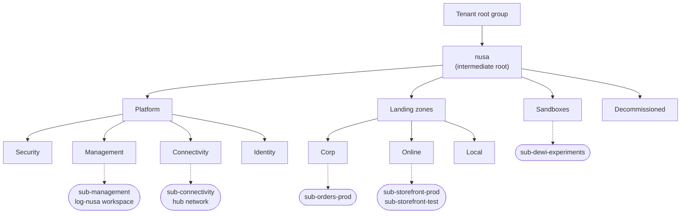
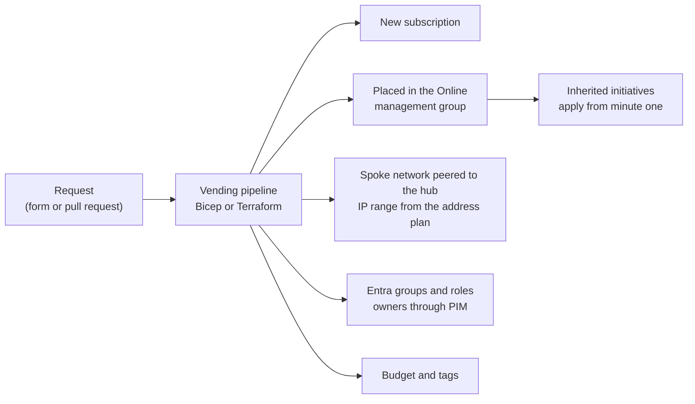
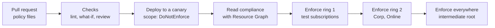

# Lunch 31 · Resource Hierarchy and Governance (Advanced): Governance at Scale

🇮🇩 [Baca dalam Bahasa Indonesia](README.id.md)

> **Track:** Deep-dive month · **Level:** Advanced · **Part 5:** Deep dives
> **Time:** 60 minutes · **Prerequisite lunches:** 04, 18 (helpful: 20, 22)
> **AZ-900 skill area:** Beyond AZ-900
> **Lab:** [Lab 31 · Governance for the whole company](../../labs/31-governance-at-scale/README.md) — about 60 minutes · cost 💲
> **Author:** Stefanus Pinarta · [About the author](../../README.md#about-the-author)

| ⏱ Minutes | Segment |
|---:|---|
| 5 | Scenario and objectives |
| 25 | Reading |
| 15 | Demo: interactive animation (+ optional walkthrough video) |
| 5 | Knowledge check |
| 5 | Key takeaways and lab preview |
| 5 | Buffer — finish your lunch 🍜 |

## 🍱 Today's menu

By the end of this lunch you will be able to:

- Design a management group hierarchy based on the Azure landing zone architecture, and explain why it follows workload types instead of the org chart.
- Explain why subscriptions are the unit of scale, what subscription vending automates, and at which scope RBAC, budgets and policies belong.
- Run policy-driven governance at management-group scope: where definitions live, safe rollout, remediation identities and exemptions (Waiver vs Mitigated).
- Manage governance as code and plan the move from Azure Blueprints to deployment stacks and template specs.
- Use Azure Resource Graph and Azure Arc to see and govern every subscription — and the servers that will never move to Azure.

## 🏪 Meanwhile at Nusantara Retail

A year after the storefront moved to Azure, Nusantara Retail has seven subscriptions: storefront production and test,
the loyalty app, finance's data warehouse, a shared network hub, and two that nobody quite remembers creating — one of
them is the Visual Studio subscription Dewi uses for experiments. Next month the company completes the purchase of a
twelve-store chain in Sulawesi, which brings two more subscriptions with resources in West Europe. And each of the
forty stores still runs a small point-of-sale server in its back office that will never move to the cloud.

The guardrails you built in Lunch 18 protect exactly one subscription. Everything else was configured by hand, a little
differently each time. Rizky's old blueprint, which stamped tags and roles onto new subscriptions, stops accepting new
assignments at the end of this month.

Ibu Sari puts it plainly: *"Next year we will have twenty subscriptions. How do we make every one of them follow the same
rules from the minute it exists — without you configuring each one by hand?"*

---

## 📖 Reading (≈25 minutes)

### 1. A hierarchy designed for policy, not for the org chart

In Lunch 04 you met the resource hierarchy: a Microsoft Entra tenant, the **tenant root group** at the top, management
groups, subscriptions, resource groups and resources. Anything you assign at a scope — a role or a policy — flows down
to everything beneath it, and costs roll up. At small scale you barely notice the top of that tree. At company scale it
becomes your most important design decision, because inheritance is how one rule reaches twenty subscriptions.

A few platform facts shape the design. A management group tree can be six levels deep, not counting the tenant root or
the subscription level. Below the root, every management group and subscription has exactly one parent. The tenant root group's ID is
the tenant ID, and you can neither move nor delete it. A management group's ID is permanent once created; only its
display name can change. By default, any user in the tenant can create management groups, and every **new subscription
lands directly under the tenant root group** — outside all of your carefully designed rules.

The **Azure landing zone** architecture from the Cloud Adoption Framework gives you a proven starting shape. At the time
of writing (October 2026) it recommends these management groups:

| Management group | What lives there | Typical guardrails |
|---|---|---|
| **Intermediate root** (your prefix, for example `nusa`) | Everything the company governs; sits just below the tenant root group | The company-wide baseline: allowed regions, required tags, security benchmark |
| **Platform** → Security, Management, Connectivity, Identity | One dedicated subscription each for SIEM tooling, central logging, the hub network and identity services | Rules for shared infrastructure, managed by the platform team |
| **Landing zones** → Corp, Online, Local | Workload subscriptions: Corp for apps that need the corporate network, Online for internet-facing apps, Local for workloads on Azure Local clusters | Workload-agnostic security rules at the parent, archetype-specific rules below |
| **Sandboxes** | Subscriptions for learning and experiments, isolated from the corporate network | A lighter policy set and strict budgets |
| **Decommissioned** | Cancelled landing zones waiting to be deleted | Deny almost everything new |



Notice what is missing. There is no "Finance" or "Marketing" management group, because a department change should not
force you to rewire policies. There are no "Production" and "Development" groups either: environments are separate
subscriptions inside the same management group, so test is governed exactly like production. Regions do not get their
own groups unless a data residency or sovereignty rule genuinely differs between them. The guidance is to keep the tree
**flat — three or four levels** — and to group subscriptions by the rules they need, which the landing zone architecture
calls workload **archetypes**.

Two settings complete the picture. In the hierarchy settings, choose a **default management group** for new
subscriptions (Sandboxes is a good candidate), so a Visual Studio subscription like Dewi's starts under the sandbox
rules instead of escaping them. And turn on the setting that requires authorization to create management groups, so only
the platform team can reshape the tree.

> [!TIP]
> Never hang your baseline directly on the tenant root group. An **intermediate root** gives you a scope you can
> rename, test against (a second, small "canary" hierarchy is common) and even replace, while the tenant root stays
> almost empty. It also keeps an acquired company's subscriptions out of your rules until you deliberately move them in.

### 2. Subscriptions as units of scale — and vending them

If management groups are the folders, **subscriptions** are the units you hand out. Each one is a boundary for billing,
for service quotas and limits, for access, and for blast radius: a mistake or a runaway script in the loyalty
subscription cannot exhaust the storefront's quota or wander into its resource groups. That is why mature
organisations create many smaller subscriptions — usually one per workload and environment — instead of one giant one.

Creating subscriptions by hand does not scale, and every manual step is a chance to forget something. **Subscription
vending** turns a request into a fully governed subscription through automation. A workload team fills in a form or opens
a pull request; a pipeline built with Bicep or Terraform (both have ready-made vending modules) does the rest.



Creating subscriptions programmatically requires billing permissions on an Enterprise Agreement, a Microsoft Customer
Agreement or a Microsoft Partner Agreement account, so the lab skips this step — extra subscriptions on a personal
account are also easy to forget. The important idea is the order: the subscription is placed in the right management
group before anyone deploys a workload, so inherited policies are already waiting.

The same "decide the scope once" thinking applies to everything else you assign:

| Control | Best scope | Why |
|---|---|---|
| Company-wide policy baseline | Intermediate root | Reaches every subscription, including future ones |
| Archetype rules (for example "no public IPs" for Corp) | Corp or Online management group | Only the workloads that need the rule get it |
| Platform team access | Platform or intermediate root, activated through Privileged Identity Management | Broad rights, but only when needed and with an audit trail |
| Workload team access | Their subscription or resource group, granted to Entra groups | Least privilege; no inherited surprises |
| Budgets | Subscription for the owning team; management group for an overall view | Alerts reach the people who can act |

For **RBAC at scale**, assign roles to Entra groups, never to individuals, and prefer built-in roles. When you need a
**custom role**, note that its assignable scopes can include at most one management group, and roles with data actions
cannot be assigned at management-group scope. Make privileged roles *eligible* rather than permanent with **Privileged
Identity Management** (PIM), which needs Microsoft Entra ID P2 or Entra ID Governance licences — Lunch 22 covers it in
depth. For **budgets at higher scopes**, remember from Lunch 19 that budgets alert but never stop resources, and that
management-group cost views are not available for every billing agreement type (check the Cost Management scope
documentation for yours).

### 3. Policy-driven governance at management-group scope

In Lunch 18 you assigned three single policies to one resource group. At scale you bundle them into an **initiative**
and assign it once, high in the tree, with **parameters** that let the same initiative serve different archetypes — Corp
might allow only `indonesiacentral`, while Sandboxes also allow `southeastasia`. Remember from Lunch 18 that
assignments stack: a resource must satisfy every assignment above it, so a lower scope can tighten a rule but never
loosen one. Keep the top-level baseline short, and put stricter rules lower down.

Three rules decide whether this works in practice.

**Where a definition is saved decides where it can be assigned.** A custom definition saved in a subscription can only
be assigned inside that subscription. One saved in a management group can be assigned to that group and anything below
it. So save shared custom definitions and initiatives at the intermediate root, even if you first assign them lower
down. At the time of writing, a single scope holds up to 500 custom policy definitions and 200 initiatives, and an
initiative can reference up to 1,000 policies.

**Roll out like software.** A new assignment with a Deny effect at the intermediate root can block deployments across
the whole company within minutes. Start every assignment with enforcement mode **DoNotEnforce**: compliance is still
evaluated and reported, but nothing is denied or changed. Review the results, fix or exempt what you find, then enforce
in rings — a test subscription first, then one archetype, then everything. Resource selectors and overrides on an
assignment let you stage enforcement, for example region by region, without creating copies.

**Remediation needs an identity with the right roles in the right places.** Modify and DeployIfNotExists (DINE)
assignments act on your behalf through a **managed identity**, either system-assigned (one per assignment) or
user-assigned (created once, granted roles once, reused by many assignments). The roles come from the
`roleDefinitionIds` in the definition. The portal grants them for you; the CLI and infrastructure-as-code deployments
must grant them explicitly. Once an assignment is enforced, new and updated resources are fixed automatically — Modify
during the request, DINE shortly after the resource is created (about ten minutes later by default). Existing resources,
and anything evaluated while the assignment was in DoNotEnforce, need a **remediation task**, which fixes one Modify or
DINE policy at a time, so for an initiative you name the policy's reference ID.

> [!WARNING]
> The classic at-scale remediation failure: a DINE policy assigned at the Landing zones group must send diagnostic logs
> to `log-nusa` in the *Management* subscription. Its identity has roles inside Landing zones, but none on the
> workspace, so every remediation deployment fails with an authorization error. Grant the identity the roles it needs on
> every scope it writes to — including scopes outside the assignment.

No baseline fits every case, so you need a documented way to say "not here". A **policy exemption** marks a scope (from a
management group down to a single resource) as exempt from an assignment, or from chosen policies inside an initiative.
It shows up in compliance as **Exempt**, can carry an expiry date and metadata such as a ticket number, and comes in two
categories:

| | Exemption: **Waiver** | Exemption: **Mitigated** | Exclusion (`notScopes`) |
|---|---|---|---|
| Meaning | The risk is known and accepted for now | The policy's intent is met another way | The scope is simply not evaluated |
| Nusantara example | The loyalty beta may use West Europe for 30 days while a partner integration is tested | A VM that policy expects in Azure Backup is already protected by the Sulawesi chain's backup product | A lab resource group nobody reports on |
| Visible in compliance | Yes, as Exempt | Yes, as Exempt | No |
| Built-in expiry | Optional `expiresOn` | Optional `expiresOn` | None |

An expired exemption is not deleted; it simply stops applying, and the resource reappears as non-compliant. Creating an
exemption needs permission to write exemptions and the `exempt` action on the assignment (the built-in Resource Policy
Contributor role has both), so decide deliberately who may grant exceptions.

Finally, **regulatory compliance** in Microsoft Defender for Cloud builds on the same machinery. The Microsoft cloud
security benchmark is enabled by default, and you can add standards such as ISO/IEC 27001:2022, PCI DSS v4.0.1 or NIST
SP 800-53. On Azure these standards are policy initiatives behind the scenes, so the same inheritance rules apply. The
dashboard maps technical controls to recommendations; it supports an audit, but it does not certify you. Some standards
or features may require a paid Defender plan — check the documentation before promising a report to the auditors.

### 4. Governance as code — and life after Blueprints

Clicking policies into the portal works for ten assignments, not for two hundred. **Policy as code** treats
definitions, initiatives, assignments and exemptions as files in Git: every change is a pull request, reviewed by a
second person, deployed by a pipeline whose identity is the only one allowed to write policy resources. Microsoft's
guidance suggests a folder per initiative with files such as `policyset.json`, `policyset.definitions.json` and
`policyset.parameters.json`, plus `assign.<name>.json` files and an `exemptions.<name>/` folder. Existing definitions and
assignments can be exported with the CLI, PowerShell or Resource Graph, so you can start from what already exists.
Larger teams often adopt the open-source Enterprise Policy as Code (EPAC) project, or the policy library that ships with
the Azure landing zone accelerators.



The **Azure landing zone accelerators** package all of this: the hierarchy, the platform subscriptions and a curated
policy set, deployed through an infrastructure-as-code accelerator (Bicep or Terraform, built on Azure Verified Modules
and wired to GitHub or Azure DevOps) or a portal experience for a first try. Most companies start from an accelerator
and adjust, rather than designing from a blank page.

That brings us to Rizky's blueprint. Azure Blueprints (preview) is being retired in phases: no new blueprint
definitions from July 31, 2026, no new assignments from October 31, 2026, no changes to existing assignments from
December 31, 2026, and full retirement on January 31, 2027. The replacement is a pair of tools you met in Lunch 20:
**deployment stacks**, which deploy and track a set of resources at resource group, subscription or management group
scope and can protect them with deny settings; and **template specs** (or Git) to store and version the templates.

| Blueprint concept | Replacement |
|---|---|
| Blueprint definition and its versions | Bicep or ARM templates in Git, optionally published as template specs with versions |
| Policy assignment artifact | Policy assignment resources in the template — or your policy-as-code repository |
| Role assignment artifact | Role assignment resources in the template, assigned to groups |
| Resource group and template artifacts | Resource groups and modules in the template, deployed at subscription scope |
| Blueprint assignment | A deployment stack, for example `az stack mg create` targeting a subscription |
| Blueprint resource locks | The stack's deny settings (`denyDelete` or `denyWriteAndDelete`), with a few excluded principals |

> [!IMPORTANT]
> On January 31, 2027 the Blueprints service stops. Deployed resources stay, but definitions and assignments you did not
> export are removed, and **blueprint locks stop protecting your resources**. Export, convert to Bicep, and redeploy as
> deployment stacks with deny settings before that date.

### 5. Seeing everything: Resource Graph at scale and Azure Arc

Governance you cannot see is wishful thinking. **Azure Resource Graph** answers questions across every subscription you
can read in one query, using a subset of KQL (Lunch 30). Besides the `resources` table, `resourcecontainers` holds
management groups, subscriptions and resource groups, and `policyresources` holds compliance states, assignments and
exemptions — so "which resources are non-compliant, by initiative, across the company?" is a single query instead of a
loop over subscriptions. You can scope a query to a management group, and the CLI returns the first 100 rows unless you
ask for more.

```kusto
policyresources
| where type == 'microsoft.policyinsights/policystates'
| where tostring(properties.complianceState) == 'NonCompliant'
| summarize resources = count() by assignment = tostring(properties.policyAssignmentName)
```

The forty store servers will never move to Azure, but they can still be governed by it. **Azure Arc** projects machines
and clusters that run elsewhere into Azure Resource Manager, so they get a resource ID, live in a resource group, carry
tags and inherit RBAC and policy like any other resource.

| Azure Arc for | How it connects | Governance you gain | Cost note |
|---|---|---|---|
| Servers (Windows and Linux, on premises or other clouds) | The Connected Machine agent; a heartbeat every five minutes, shown as Disconnected after 15–30 minutes of silence | Inventory, tags, RBAC, Resource Graph; machine configuration audits settings inside the OS; Update Manager, Defender for Servers, Azure Monitor Agent | The inventory and organisation features are free; add-on services are billed (see each pricing page) |
| Kubernetes clusters (any CNCF-conformant cluster) | Cluster agents deployed with the CLI | Azure Policy for Kubernetes (built on Gatekeeper), GitOps configuration with Flux, Defender for Containers | Inventory and organisation are free; several extensions are billed (check the Azure Arc pricing page) |

A machine that stays disconnected for 45 days can become **Expired** and must be reconnected by an administrator, so
monitor agent status as part of operations. Arc is not for Azure VMs — they are already in Azure Resource Manager.

### 6. How it fits together for Nusantara Retail

Here is the plan you take to Ibu Sari. Create the intermediate root `nusa` with Platform, Landing zones (Corp, Online),
Sandboxes and Decommissioned. Move the seven subscriptions in, set Sandboxes as the default management group, and require
authorization for hierarchy changes. Put the policy definitions and the initiative in a Git repository with a pipeline,
and assign them like this:

| Scope | Assignment | Effects | Identity |
|---|---|---|---|
| `nusa` (intermediate root) | Nusantara baseline: allowed locations (`indonesiacentral`, `southeastasia`), required `costCenter` tag, tag inherited from the resource group | Deny, Modify | System-assigned, with the role the definition names (Contributor) at `nusa` |
| `nusa` | Microsoft cloud security benchmark (Defender for Cloud) | Audit, AuditIfNotExists | None needed |
| Landing zones | Diagnostic settings to `log-nusa` | DeployIfNotExists | User-assigned: Monitoring Contributor at Landing zones, Log Analytics Contributor on the workspace |
| Corp | Customer data stays in Jakarta (allowed locations: `indonesiacentral` only); no public IP addresses on network interfaces | Deny | None needed |

Sandboxes inherit only the baseline, plus a small budget on every sandbox subscription.
Everything starts in DoNotEnforce mode. After a week of reading compliance in Resource Graph, you remediate the missing
tags, then enforce ring by ring. The loyalty beta gets a Waiver with a 30-day expiry and Ibu Sari's name in the
metadata. Before January 31, 2027, Rizky's blueprint becomes a Bicep file deployed as a deployment stack with
`denyDelete`. The forty store servers join through Azure Arc into a dedicated subscription under Corp, so the same
baseline, tags and Update Manager reach them. The Sulawesi subscriptions wait outside the intermediate root until their
West Europe resources have a migration plan — then they move in.

> [!NOTE]
> **Pause and think:** the Sulawesi subscriptions arrive with storage accounts in West Europe. If you moved them under
> `nusa` today, with the baseline enforced, what would happen to those existing accounts — and to the next deployment
> their team tries in West Europe?

Today's lab builds a small version of this design in your own tenant, and the advanced capstone challenge then asks you
to put a policy initiative around a complete solution.

---

## 🎬 Demo (≈15 minutes)

1. **Interactive animation (≈6–8 min):** [Open the demo](https://stefpin.github.io/azure-fundamentals-lunches/demos/31-governance-at-scale.html) —
   press ▶ Play or step through it at your own pace. Offline? Download
   [`docs/demos/31-governance-at-scale.html`](../../docs/demos/31-governance-at-scale.html) and open it in any browser.
2. **Walkthrough video (≤ 6 min):** _coming soon_ — [read the walkthrough script](demo-video-script.md).

What to watch for:

- How the hierarchy grows from a single intermediate root, and where each subscription lands.
- How one initiative, saved at the intermediate root and assigned at Landing zones, reaches every subscription below it.
- Why the first DeployIfNotExists remediation fails, and the single role assignment that fixes it.
- How a Waiver exemption shows up as "Exempt" instead of disappearing from the report.

## ✅ Knowledge check (≈5 minutes)

1. Dewi creates a new subscription with her Visual Studio benefit. It appears under the tenant root group and none of the
   baseline policies apply to it. Which setting would have prevented this?
   <details><summary>Show answer</summary>

   A **default management group** in the hierarchy settings (for example Sandboxes). New subscriptions land under the
   tenant root group unless a default is configured, so without it they start outside every inherited rule.

   </details>
2. You saved a custom initiative in the storefront production subscription. Assigning it at the Landing zones management
   group fails. Why, and what is the fix?
   <details><summary>Show answer</summary>

   A definition can only be assigned at or below the scope where it is saved. Save the initiative at the intermediate
   root (or at Landing zones) and assign that copy — the definition's location decides where it can be used.

   </details>
3. A DeployIfNotExists assignment at Landing zones should send diagnostic logs to `log-nusa` in the Management
   subscription. Its remediation tasks fail with authorization errors. What is missing?
   <details><summary>Show answer</summary>

   A role for the assignment's managed identity on the workspace (for example Log Analytics Contributor). The identity
   only has roles inside the assignment scope, but the deployment writes outside it — every target scope needs a grant.

   </details>
4. Ibu Sari accepts that the loyalty beta may keep a storage account in West Europe for 30 days while a partner tests an
   integration. How do you record this so it stays visible and does not become permanent?
   <details><summary>Show answer</summary>

   Create a policy exemption with category **Waiver**, scoped to the beta's resource group (or the single resource), with
   `expiresOn` set 30 days ahead and metadata naming the approver and ticket. A Waiver means an accepted risk; it remains
   visible as Exempt, and after expiry the resource shows as non-compliant again.

   </details>
5. It is February 2027. Rizky's blueprint was never migrated. What happened to the resources it deployed and to the
   blueprint locks protecting them?
   <details><summary>Show answer</summary>

   The resources still exist, but the blueprint assignment and its locks are gone, so nothing prevents someone from
   deleting them. Redeploy the same templates as a deployment stack with deny settings (and keep the templates in Git or
   template specs) — the replacement Microsoft recommends.

   </details>

## 🧠 Key takeaways

- Design the management group hierarchy for inheritance of policy and access: an intermediate root with Platform, Landing zones (Corp, Online, Local), Sandboxes and Decommissioned, three or four levels deep, grouped by workload type.
- Subscriptions are the unit of scale; subscription vending places each new one in the right management group with networking, group-based RBAC, budgets and tags before any workload arrives.
- Save definitions high, assign initiatives at management-group scope with parameters, start in DoNotEnforce, and give Modify and DeployIfNotExists identities roles on every scope they write to.
- Exemptions (Waiver or Mitigated) with expiry dates and metadata keep exceptions visible and auditable; exclusions silently remove scopes from the report.
- Governance is code: Git, pipelines, deployment stacks and template specs replace Blueprints before January 31, 2027, while Resource Graph and Azure Arc extend visibility and control to every subscription and to servers outside Azure.

## 🗒️ Field notes from Stefanus

> **Ask where the next subscription lands.** In every governance review I start with one question: *if someone creates a subscription this afternoon, where does it land, and which rules apply to it in its first minute?* If the honest answer is "under the tenant root, nothing yet", the hierarchy is only a diagram. Then I look for side doors, because the trap I see most often is not a missing policy but an unguarded exit: who may move subscriptions, who may grant exemptions, and does every exemption have an owner and an end date? Finally, before any Deny goes live at the intermediate root, I write its non-compliance message in plain words: what was blocked, why, and whom to ask. Someone who hits a bare error at six in the evening looks for a workaround, not for the policy owner.

## 🔬 Your lab: Governance for the whole company

In your own tenant you build a miniature landing-zone hierarchy (an intermediate root with platform, landing zones and
corp groups), write a custom initiative from JSON files (allowed locations, required tag, inherited tag), assign it with
a managed identity, remediate existing resources, grant a time-boxed Waiver to a sandbox resource group, query compliance
across scopes with Resource Graph, and export everything as policy-as-code files. Moving your lab subscription into the
hierarchy is optional and fully reversible.

- ⏱ About 60 minutes · 💲 free or close to free · works on its own (no earlier lab needed)
- 👉 [Start Lab 31](../../labs/31-governance-at-scale/README.md)

## 📚 Go further

- [Cloud Adoption Framework: Management groups](https://learn.microsoft.com/azure/cloud-adoption-framework/ready/landing-zone/design-area/resource-org-management-groups) — the landing zone hierarchy and the design recommendations behind it
- [Design Azure Policy as Code workflows](https://learn.microsoft.com/azure/governance/policy/concepts/policy-as-code) — file layout, testing with DoNotEnforce and remediation in a pipeline
- [Migrate blueprints to deployment stacks](https://learn.microsoft.com/azure/azure-resource-manager/bicep/migrate-blueprint) — how each blueprint artifact becomes Bicep under a deployment stack
- [What is Azure Arc-enabled servers?](https://learn.microsoft.com/azure/azure-arc/servers/overview) — the Connected Machine agent and what you can govern outside Azure

---

⬅️ [Lunch 30 · Monitoring (Advanced): Log Analytics, KQL and Application Insights](../30-monitoring-advanced/README.md) · 🏠 [Course home](../../README.md) · [Advanced capstone challenge](../../labs/32-advanced-capstone-challenge/README.md) ➡️

<sub>Last validated: October 2026 · Spotted something out of date? [Open an issue](../../CONTRIBUTING.md).</sub>
