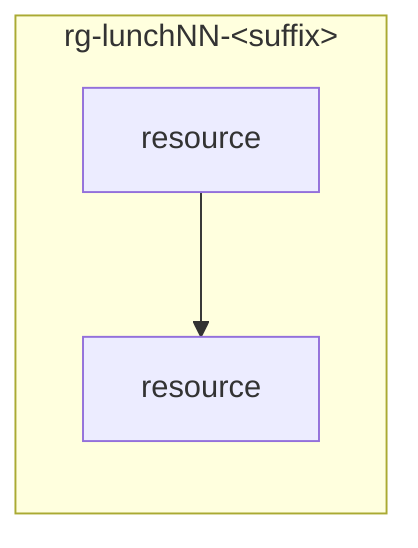

# Lab NN · Lab title

> **Pairs with:** [Lunch NN · Title](../../lunches/NN-slug/README.md)
> **Time:** about NN minutes · **Cost:** 💲 | 💲💲 | 💲💲💲 (see [cost bands](../README.md#cost-bands)) · **Difficulty:** ★☆☆ | ★★☆ | ★★★
> **Works on its own:** ✅ You do not need any earlier lab. Everything this lab needs is created by its steps or by `setup.sh`.

## 🎯 What you'll build

One paragraph describing the end state in Nusantara Retail terms.



## ✅ Before you start

- An Azure subscription where you can create resources (see [Lab 01](../01-before-you-begin/README.md)).
- **Azure Cloud Shell (Bash)** — open [shell.azure.com](https://shell.azure.com). Nothing to install.
- Get the lab files and load the shared settings:

```bash
git clone https://github.com/stefpin/azure-fundamentals-lunches.git   # first time only
cd azure-fundamentals-lunches/labs/NN-slug
source ../common/config.sh
RG=$(rg_name NN)
```

- (Only if this lab has one) create the starting point — takes about N minutes:

```bash
bash setup.sh
```

> [!IMPORTANT]
> Lab resources cost money while they exist. Finish with the **Clean up** section, even if you stop halfway.

## 🧭 Choose your mode

| Mode | For you if… | How |
|---|---|---|
| **Guided** | you want every step explained | follow Tasks 1–N below |
| **Challenge** | you already know the basics | read only the [Challenge brief](#-challenge-brief), build it your way, then run `bash verify.sh` |

## Task 1 · Short task title

Why this task matters, in one or two sentences.

```bash
az ... \
  --resource-group "$RG" \
  --location "$LOCATION"
```

> [!TIP]
> **Prefer the portal?** Portal path: *Home › … › …* — then come back and continue with the next task.

> ✅ **Checkpoint:** what the learner should see, and a command that proves it.

## Task 2 · …

…

## 🔧 Break it and fix it

A deliberate fault the learner introduces, the symptom they should observe, and a hint (in a `<details>` block) for the fix.

## 🧪 Verify your work

```bash
bash verify.sh
```

Every check should say **PASS**. If one fails, the message tells you which task to revisit.

## 🧹 Clean up (do not skip!)

```bash
bash cleanup.sh
```

This deletes everything the lab created (resource group `rg-lunchNN-<suffix>` plus anything outside it, such as role or policy assignments).
Deletion continues in the background for a few minutes.

## 🩺 Troubleshooting

| Symptom | Likely cause | Fix |
|---|---|---|
| … | … | … |

## 🚀 Stretch goals

- Optional extra 1
- Optional extra 2

## 🏁 Challenge brief

Build the following, any way you like (portal, CLI, Bicep):

1. Requirement 1
2. Requirement 2

Then run `bash verify.sh`. Stuck? Peek at `solution.sh` (if present) or switch to Guided mode.

---

⬅️ [Lunch NN reading](../../lunches/NN-slug/README.md) · 🏠 [All labs](../README.md) · 🏠 [Course home](../../README.md)

<sub>Last validated: October 2026 · Something broken? [Report a lab problem](../../CONTRIBUTING.md).</sub>
