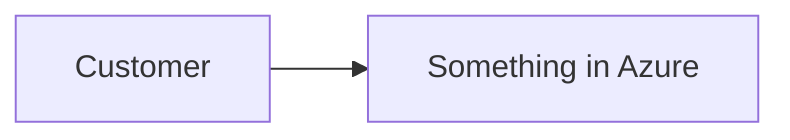

# Lunch NN · Title (Basic | Advanced)

> **Track:** Core month | Deep-dive month · **Level:** Basic | Advanced · **Part N:** Part name
> **Time:** 60 minutes · **Prerequisite lunches:** NN, NN (or "none")
> **AZ-900 skill area:** Describe cloud concepts | Describe Azure architecture and services | Describe Azure management and governance | Beyond AZ-900
> **Lab:** [Lab NN · Lab title](../../labs/NN-slug/README.md) — about NN minutes · cost 💲 | 💲💲 | 💲💲💲

| ⏱ Minutes | Segment |
|---:|---|
| 5 | Scenario and objectives |
| 25 | Reading |
| 15 | Demo: interactive animation (+ optional walkthrough video) |
| 5 | Knowledge check |
| 5 | Key takeaways and lab preview |
| 5 | Buffer — finish your lunch 🍜 |

## 🍱 Today's menu

By the end of this lunch you will be able to:

- Objective 1 (measurable verb: explain, choose, compare, configure, decide…)
- Objective 2
- Objective 3
- Objective 4 (optional)

## 🏪 Meanwhile at Nusantara Retail

A 120–180-word story beat that sets up today's problem for Nusantara Retail and you, their new cloud engineer.
End with the question this lunch answers.

---

## 📖 Reading (≈25 minutes)

### 1. First big idea

Explain one concept at a time. Use short paragraphs, concrete Nusantara Retail examples and plain language.
Define each new term the first time you use it, in **bold**.

> [!TIP]
> Practical advice that saves time or money.

### 2. Second big idea

| Option | Use it when | Watch out for |
|---|---|---|
| … | … | … |

> [!WARNING]
> A common mistake and how to avoid it.

### 3. Third big idea

…

### 4. How it fits together for Nusantara Retail

Tie the concepts back to the scenario and to the next lunch.

> [!NOTE]
> **Pause and think:** a question the learner answers in their head before moving on.

---

## 🎬 Demo (≈15 minutes)

1. **Interactive animation (≈6–8 min):** [Open the demo](https://stefpin.github.io/azure-fundamentals-lunches/demos/NN-slug.html) —
   press ▶ Play or step through it at your own pace. Offline? Download
   [`docs/demos/NN-slug.html`](../../docs/demos/NN-slug.html) and open it in any browser.
2. **Walkthrough video (≤ 6 min):** _coming soon_ — [read the walkthrough script](demo-video-script.md).

What to watch for:

- Point 1
- Point 2

## ✅ Knowledge check (≈5 minutes)

1. Scenario-style question?
   

Show answer

   Answer, with one sentence of *why*.

   

2. …
3. …
4. …
5. …

## 🧠 Key takeaways

- Takeaway 1
- Takeaway 2
- Takeaway 3
- Takeaway 4
- Takeaway 5

## 🔬 Your lab: Lab title

One paragraph: what the learner will build, on their own time, and why it matters.

- ⏱ About NN minutes · 💲 cost band · works on its own (no earlier lab needed)
- 👉 [Start Lab NN](../../labs/NN-slug/README.md)

## 📚 Go further

- [Microsoft Learn: exact page title](https://learn.microsoft.com/...) — one line on why it is worth reading
- 2–4 links in total, all verified

---

⬅️ [Lunch NN-1 · Title](../NN-1-slug/README.md) · 🏠 [Course home](../../README.md) · [Lunch NN+1 · Title](../NN+1-slug/README.md) ➡️

Last validated: October 2026 · Spotted something out of date? [Open an issue](../../CONTRIBUTING.md).
